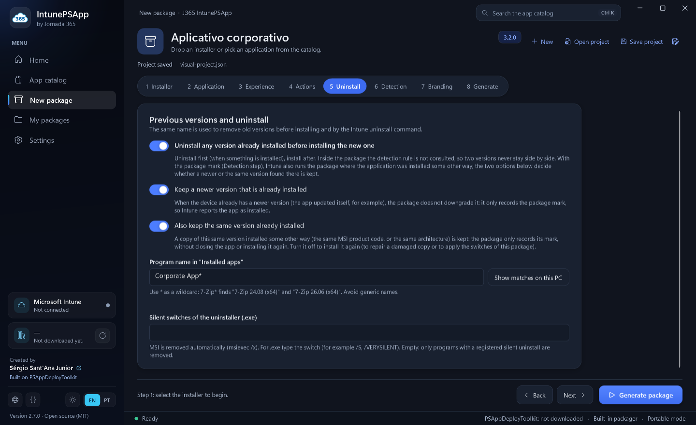
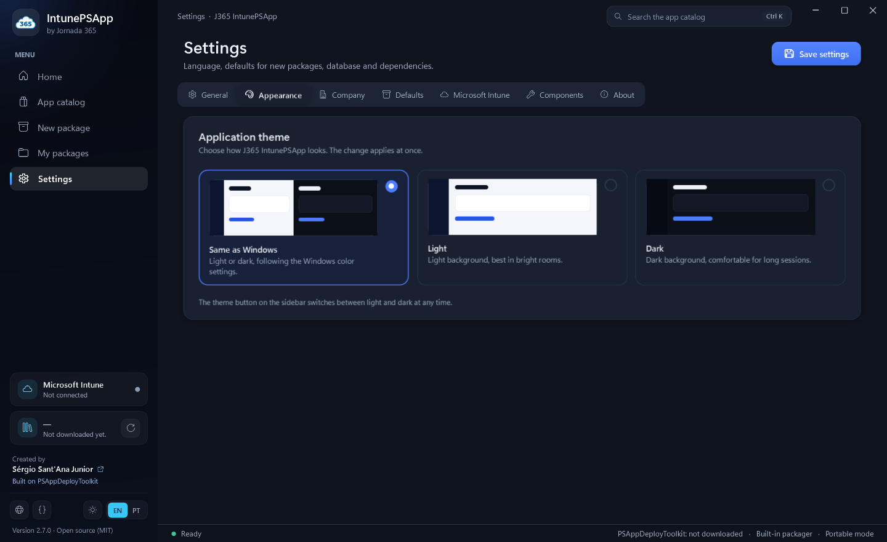

<strong>English</strong> · <a href="README.pt-BR.md">Português (Brasil)</a>

<b>Fewer repetitive tasks. More consistent deployment packages.</b> A visual workspace to prepare, customize, test and publish Windows applications.

<a href="#features">Explore the features</a> · <a href="#get-started">Get started</a> · <a href="https://github.com/sesantanajr/J365-IntunePSApp/releases/tag/v2.7.0">Release notes</a>

  

## Your next deployment package starts here

Turn an MSI or EXE installer into an organized Microsoft Intune package. **J365 IntunePSApp** brings installation settings, user experience, actions, detection and publishing together in a guided workflow built on **PSAppDeployToolkit**.

| Prepare faster | Standardize the experience | Stay in control |
| --- | --- | --- |
| A catalog of winget and the Microsoft Store, installer analysis, silent-switch suggestions and batch deploy. | Company logo, colors, messages, deferrals and reusable defaults. | Review before building, tests, logs and protection against stale package publishing. |

**One complete workflow:** installer → application → experience → actions → uninstall → detection → branding → build → test → publish.

## Explore the features

Actual **2.7** captures with a demonstration project. Click images to enlarge. Connection and test states demonstrate the UI, not a live tenant deployment.

### 01 · Present applications clearly in Intune

Organize description, publisher, developer, owner and information/privacy links. Application name and version use separate fields.

### 02 · Shape the installation experience

Choose display mode, app closing, deferrals and messages — or a **silent** installation with no dialogs and no Intune notifications. Add pre/post-install actions for files, registry, services, dependencies and custom commands.

<table><tr><td width="50%"><b>User experience and deferrals</b> </td><td width="50%"><b>Ready-made actions and extra files</b> </td></tr></table>

### 03 · Plan updates and detection

Configure removal of previous versions and protection for a newer installed version. Detect by name/version, product code or file, and review the generated script.

<table><tr><td width="50%"><b>Previous version handling</b> </td><td width="50%"><b>Detection rules and local checks</b> </td></tr></table>

### 04 · Make deployments reflect your company

Use your company name, logo and accent color in PSAppDeployToolkit dialogs. Reuse company defaults and choose a light, dark or Windows-matched editor theme.

<table><tr><td width="50%"><b>Company branding and colors</b> </td><td width="50%"><b>Editor appearance and preferences</b> </td></tr></table>

### 05 · Connect and follow publishing

Connect with an app certificate, user account, existing registration or Azure Cloud Shell. After building and testing, create or update an Intune application with upload progress — one at a time, or many at once with the same assignment, including apps of the Microsoft Store. [Publishing guide](docs/INTUNE-PUBLISH.md).

<table><tr><td width="50%"><b>Microsoft Intune connection options</b> </td><td width="50%"><b>Connection settings and status</b> </td></tr></table>

### 06 · Find packages and resume your work

Reopen projects, search by name or publisher and sort by date, name or available updates. Background loading keeps the library responsive; empty results offer a clear-filters action.

<table><tr><td width="50%"><b>Package library and sorting</b> </td><td width="50%"><b>Actionable empty search results</b> </td></tr></table>

### 07 · Know when a rebuild is required

The editor distinguishes saved projects from generated packages. Changed settings mark the previous result as stale and disable publishing/testing until rebuilding. Saving cannot hide outdated build output.

### 08 · Work your way

English/Portuguese, light/dark themes, compact layouts and portable operation. **Ctrl+S** saves the current project; **Ctrl+Shift+S** creates a copy; **Ctrl+K** opens catalog search.

## What each build delivers

| Output | Purpose |
| --- | --- |
| **`.intunewin`** | Content prepared for upload to Microsoft Intune. |
| **PSAppDeployToolkit package** | Installation, uninstallation, actions and user experience. |
| **Detection script** | Check installation against your configured rule. |
| **Commands and instructions** | Installation/uninstallation reference and Intune field guidance. |
| **Metadata and project** | Application information and reusable project settings. |

Test locally or in **Windows Sandbox**, where available, with results and logs. Command-line options support automation. [Documentation](docs/BUILDING.md).

## Get started in three steps

1. Use the download button at the top and extract the ZIP.
2. Open **`J365.IntunePSApp.exe`** and complete tool preparation. The runtime is included; no .NET SDK is required.
3. Select an installer or a catalog application, configure the project and review before building — or tick several applications (winget or Microsoft Store) and deploy them together. Validate in a pilot group before distribution.

## New in 2.7

- **Updates that work on company networks:** the latest version is read from the files of the latest release on github.com instead of the GitHub API, whose 60 requests an hour per address a company network shares. A failed check says why (and when the limit frees up), every check is in the log, and a window left open checks again every few hours. Copies up to 2.6.0 depend on the API: if one keeps saying "up to date", download this release once.
- **The same version already installed is kept:** a device that already has this exact version of the same product is no longer uninstalled and installed again (9 minutes and a prompt to close Adobe Acrobat Reader in a real deployment): the package applies its post-install actions and records its mark. One switch on the Uninstall step.
- **Faster, sturdier packages:** short folder names and a path check before IntuneWinAppUtil (long OneDrive paths made it fail), and a built-in packager that no longer recompresses installers (seconds instead of minutes). Settings point out a packages folder inside OneDrive.
- **Publishing fixes:** apps of the Microsoft Store are published through Microsoft Graph beta (where `winGetApp` exists), a lost answer no longer creates duplicates, and the list of earlier versions never preselects an app with another name.
- **One window at a time** and safely written settings: starting the application again brings the open window to the front instead of a second window that overwrote the settings of the first.
- **Interface and texts:** a batch cannot start twice while signing in, the catalog refreshes after a database update and ignores double-clicks on its scroll bar, Settings keep what was typed, Esc closes dialogs, and the Portuguese texts were reviewed.

2.6 brought apps of the Microsoft Store, batch deploy to Intune, truly silent installations, correct icons and switches. All changes: [CHANGELOG](CHANGELOG.md).

## Quality as the product evolves

Every release passes **409 automated tests** on Windows (generated scripts parsed by Windows PowerShell 5.1, packaging, detection, publishing texts, the Microsoft Store parsing, batch planning, localization) plus interface checks that render the editor, settings, connection and batch windows in both languages and themes. The Microsoft Store search and the update check were also exercised against the live services. See the [quality review](docs/QUALITY.md).

Existing projects remain readable. Updating the editor does not change existing tenant applications. New packages carry a revision record; regenerate legacy packages to create one.

**Compatibility:** WPF/.NET 10 editor for Windows x64. ARM64 package settings do not imply a native ARM64 editor. Silent switches, detection and restart behavior depend on the installer and require testing. Publishing to a live tenant (packages and Microsoft Store apps) should be validated with a pilot group.

**Signing:** this release is not Authenticode-signed yet. See [signing guidance](docs/SIGNING.md) if Windows policy blocks execution.

## Documentation & community

[Changelog](CHANGELOG.md) · [Quality review](docs/QUALITY.md) · [Intune publishing](docs/INTUNE-PUBLISH.md) · [Building](docs/BUILDING.md) · [Architecture](docs/ARCHITECTURE.md)

[Contribute](CONTRIBUTING.md) · [Report an issue](https://github.com/sesantanajr/J365-IntunePSApp/issues) · [Security](SECURITY.md) · [SHA256SUMS.txt](https://github.com/sesantanajr/J365-IntunePSApp/releases/download/v2.7.0/SHA256SUMS.txt)

---

<b>Created by <a href="https://www.linkedin.com/in/sergiosantanacloud/">Sérgio Sant'Ana Junior</a></b> <a href="https://jornada365.cloud">Jornada 365</a> · Your journey starts here.

<a href="https://jornada365.cloud"><picture><source media="(prefers-color-scheme: dark)" srcset="docs/assets/j365-blog-logo-dark.png"></picture></a>

Built on [PSAppDeployToolkit](https://psappdeploytoolkit.com), with catalog data from [microsoft/winget-pkgs](https://github.com/microsoft/winget-pkgs). An independent project, not affiliated with Microsoft.

[MIT License](LICENSE) · [Third-party notices](THIRD-PARTY-NOTICES.md) · [Code signing policy](CODE_SIGNING_POLICY.md)
