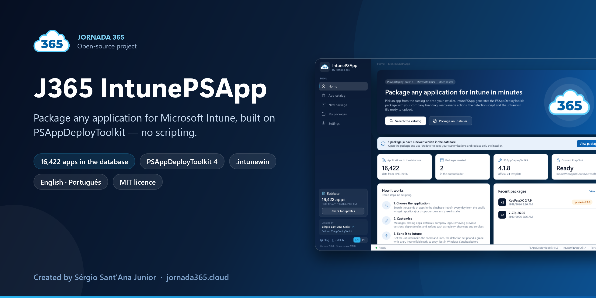
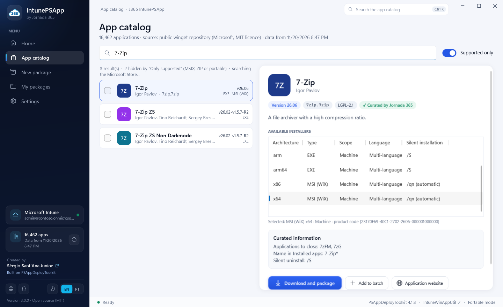
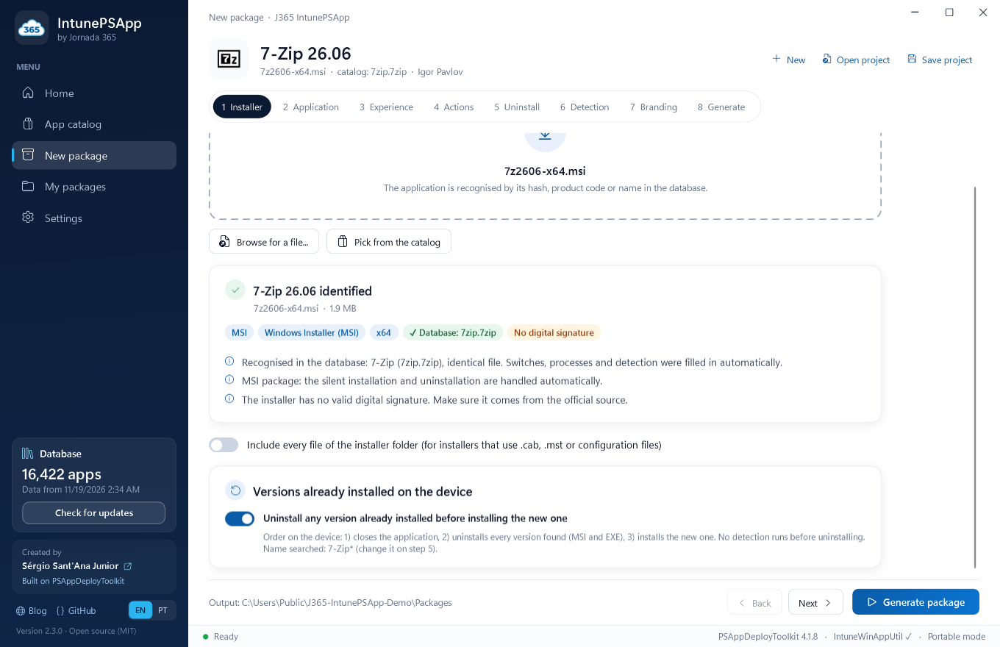
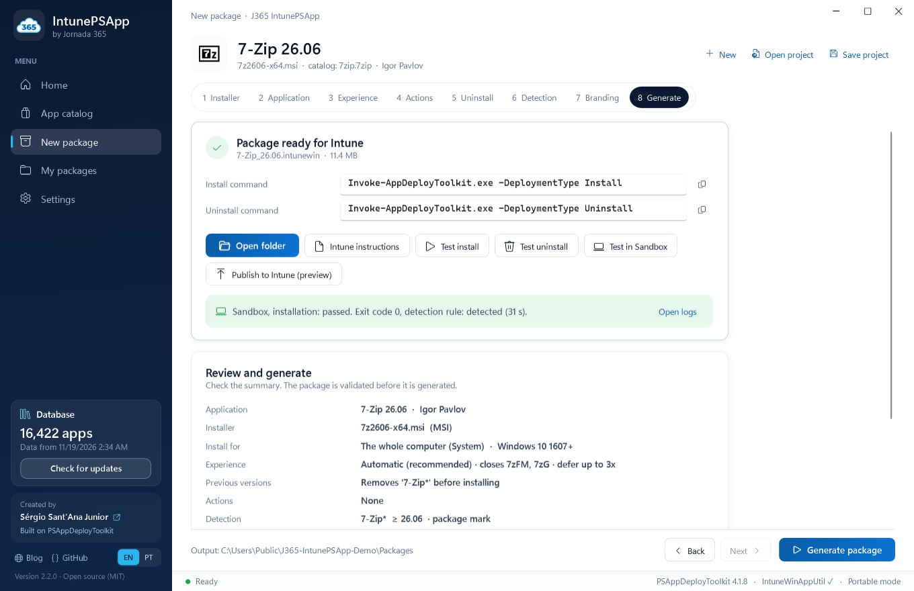
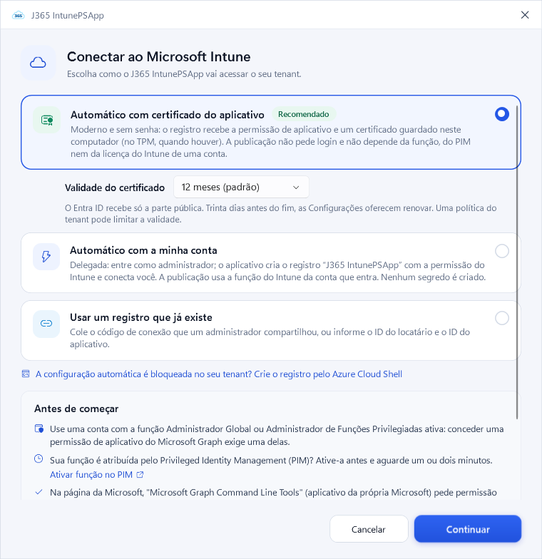
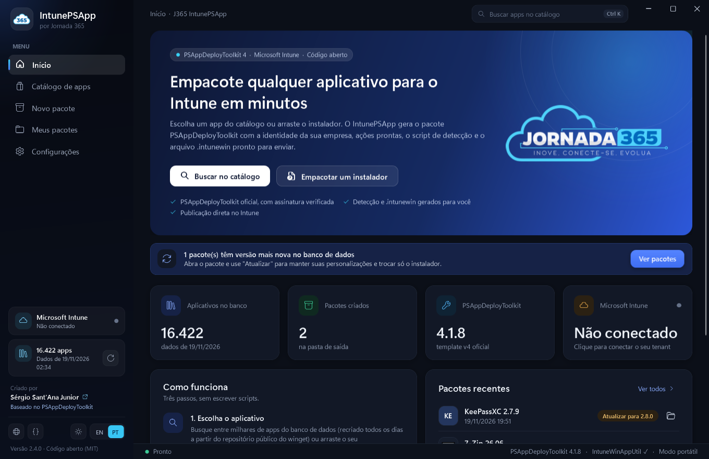
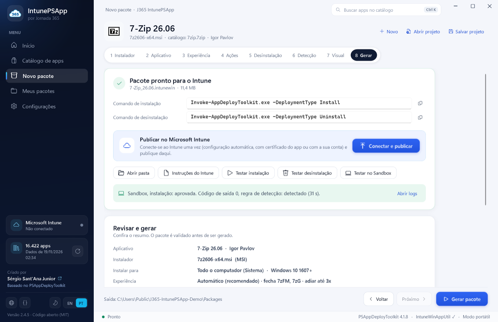
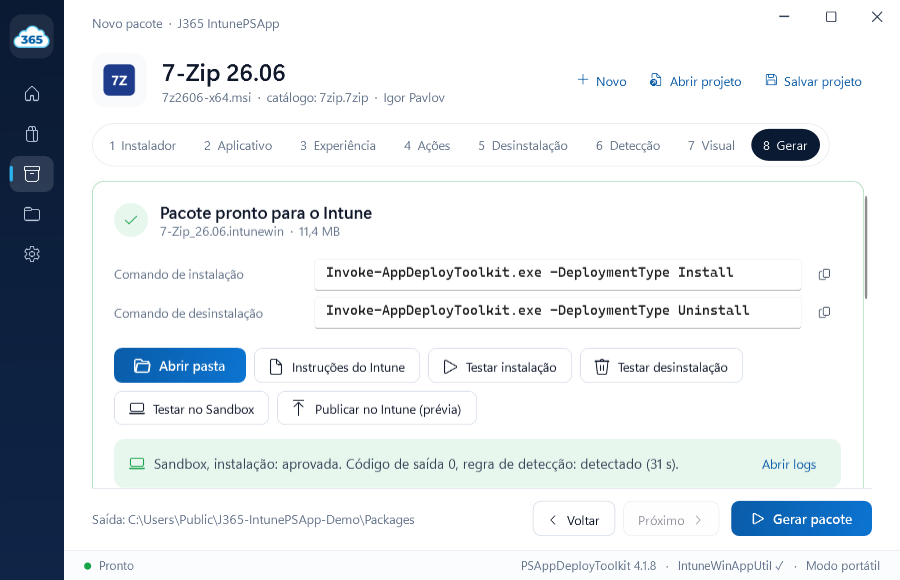

<p align="center">
  
</p>

<h1 align="center">J365 IntunePSApp</h1>

<p align="center">
  <b>Package any Windows application for Microsoft Intune in minutes. No scripting.</b><br>
  Built on <a href="https://psappdeploytoolkit.com">PSAppDeployToolkit</a> · Portable · Open source (MIT)
</p>

<p align="center">
  <a href="https://github.com/sesantanajr/J365-IntunePSApp/releases/latest"></a>
  <a href="https://github.com/sesantanajr/J365-IntunePSApp/actions/workflows/build.yml"></a>
  <a href="https://github.com/sesantanajr/J365-IntunePSApp/actions/workflows/catalog.yml"></a>
  <a href="LICENSE"></a>
</p>

<p align="center">
  <b>English</b> · <a href="#-português">Português</a>
</p>

> **Created by [Sérgio Sant'Ana Junior](https://www.linkedin.com/in/sergiosantanacloud/)** · [Jornada 365](https://jornada365.cloud)
>
> This project is **based on [PSAppDeployToolkit](https://psappdeploytoolkit.com)**, the open-source deployment framework: every package it generates is a standard PSAppDeployToolkit v4 package. J365 IntunePSApp is the friendly front end that writes the package for you.

<p align="center"><a href="https://jornada365.cloud"><picture><source media="(prefers-color-scheme: dark)" srcset="docs/assets/j365-blog-logo-dark.png"></picture></a></p>

---

## What it does

You pick an application (from a database of 16,000+ apps, or your own `.msi` / `.exe`), answer a few questions, and get everything Intune needs:

- the **`.intunewin`** file, ready to upload;
- the **install and uninstall command lines**;
- a **detection script**;
- an **instructions page** with every field of the Intune wizard ready to copy;
- the complete **PSAppDeployToolkit package**, so you can keep editing it by hand if you want.

Anyone can use it: there is nothing to install, no script to write and no PowerShell knowledge required.

## What is new in 2.5.0

Separate Intune app name and version; editable developer, owner and privacy metadata; clearer editor header and dark-theme contrast; Ctrl+S/O/N in the editor; URL validation and safer concurrent saves. Existing tenant apps require an explicit update to change their names. See [release notes](.github/RELEASE_NOTES.md).

### Previous release: 2.4.5

- **The preview is the dialog of the toolkit.** The *Visual* step shows the welcome dialog with the texts and the layout of PSAppDeployToolkit 4.1.8, in the language of the dialogs: one row per application, *Remaining Deferrals*, the accent button on the left. Three moments of a required installation can be shown (an application open, none open, the last notice after the deferrals), and the preview says when the dialog does not appear at all.
- **Progress while generating.** One bar with the step, the percentage and the time left, also on the status bar and the taskbar.
- **Test like Intune.** In Windows Sandbox the package runs as SYSTEM, as Intune runs it, so its dialogs appear as in a required installation.
- **The plans of the tenant.** *Check the subscription* lists the plans of Intune it found and their status, with how to reactivate them. Publishing retries more and never creates an app twice.
- **Validity of the certificate.** 6, 12 or 24 months, chosen when connecting or renewing.

## What came in 2.4.4

- **Does the tenant have Intune?** Publishing with the app certificate failed with *HTTP 401 (UnknownError)*: Intune answers that to every request of a tenant without an active Intune subscription, whatever the connection. The setup now reads the subscriptions of the tenant (read only) and says at once when Intune is missing, expired or limited to *Basic Mobility and Security*; for a connection set up before, **Check the subscription** asks an administrator to sign in and reads it. The sidebar, the home page, Settings and the card of a package show it, with *Activate Intune in Microsoft 365*.
- **Clear refusals.** The publishing dialog no longer says *"Could not connect"* when the connection works: it says *Intune refused this connection*, with the cause and the Activity ID for Microsoft support. The error of Intune is opened to its sentence even when it comes nested twice or cut short, instead of raw JSON.
- **An .exe that installs an MSI is removed by its product code.** For installers such as Adobe Acrobat Reader, the catalog gives the product code of the MSI they install: the package removes it with msiexec /x, in the uninstallation and before installing over an existing version, so no uninstall switches are needed and the warning before generating is gone. The database no longer gives Adobe Acrobat Reader (64-bit) a name that also matches Acrobat Pro and Acrobat 2020, so its package cannot remove them.

## What came in 2.4.3

- **One connection, one way in and one way out.** *Settings > Microsoft Intune* is one card with the state of the connection and only the actions that fit it. **Disconnect** is there whenever something is saved and clears the session, the certificate and the registration saved on this computer, so you can connect again from the beginning. A sign-in waiting for the browser can be cancelled.
- **A registration deleted in Entra ID is found at once**, at start-up and before a browser opens (Entra ID shows its error there and never comes back to the application): Settings says the connection needs attention, with *Connect again* and *Disconnect*.
- **Nothing changes until it works:** a new connection takes over only after its sign-in, or the first token of the certificate, succeeded; a cancel or a failure leaves the connection in use as it was.
- **Less to choose from:** the card to type the registration, the extra certificate buttons and the ID fields of the publishing dialog are gone; the connection window keeps three ways (certificate, my account, an existing registration) and Azure Cloud Shell as a link.

## What came in 2.4.2

- **Connect with an app certificate: modern and without passwords.** *Connect to Intune > Automatic with an app certificate*: the registration *J365 IntunePSApp* gets the application permission `DeviceManagementApps.ReadWrite.All` and a certificate created on this computer, with its key in the TPM and never exportable. Publishing then needs no sign-in, and it no longer depends on the role, the PIM activation or the Intune license of an account. The connection with your own account (delegated) is still there. [How it works](docs/INTUNE-PUBLISH.md#connect-with-an-app-certificate-242-recommended).
- **Publishing comes first.** The card of a generated package shows *Publish to Microsoft Intune* with the connection it will use and a *Publish now* (or *Connect and publish*) button; *Publish to Intune when done* opens the publication as soon as the package is generated. It is no longer labelled preview.
- **Fixed: "Could not find a property named 'displayVersion'".** The search for earlier versions of the app in Intune asked for a property that only Windows (Win32) apps have, so publishing stopped with "Could not connect to Microsoft Intune". It works again, and a failed search no longer blocks the publication.
- **Refusals of Intune explained.** When Intune refuses a request that Microsoft Graph accepted (HTTP 401 or 403 "Forbidden"), the application lists what to check, read from the sign-in: an active Intune role (PIM), the license or *Allow access to unlicensed admins*, the subscription of the tenant, the consent, or the certificate as the way around. The internal address of Intune no longer fills the messages.
- **Fixed:** a network failure while renewing the session no longer signs you out.

<p align="center"></p>

## What came in 2.4

- **A connection to Intune that explains itself.** *Connect to Intune* opens a guided window with three ways in: the **automatic setup** (an administrator signs in; the registration *J365 IntunePSApp* is created and approved), a **registration that already exists** (paste the *connection code* an administrator shares, or the two IDs), or **Azure Cloud Shell** (one command creates the same registration with the Azure CLI, which is already authorised in every tenant: no consent screen). Every step is shown, and a failure comes with its likely causes and the action that fixes each one. Microsoft's "sign-in cancelled" answer is now told apart: a consent screen that was closed, an account without an active administrator role (with a shortcut to activate it in PIM), or a tenant that blocks *Microsoft Graph Command Line Tools*. The administrator account can be chosen beforehand.
- **Light and dark themes, a new look.** A redesign of every page: new palette, a sidebar with the Intune connection and the database, catalog search from anywhere (**Ctrl+K**), Settings in sections, dialogs with a title bar in the theme. *Settings > Appearance*: same as Windows, light or dark; the sidebar button switches at any time.
- **No more silent downgrades.** An application that updated itself (Firefox 134 on a device where the package installs 133) was reported as not installed, and the package replaced it with the older version. The mark of an older package now counts, and a package that finds a newer version already installed keeps it (*Keep a newer version that is already installed*, on by default).
- **Uninstall tells the truth.** When the program is still there after the uninstallation (an `.exe` without a silent uninstaller), the deployment fails and keeps the mark, instead of reporting "uninstalled" to Intune.
- **Safer publishing.** Updating an app in Intune uploads and confirms the new content first, then switches settings, detection and content in one change: a failure or a cancel leaves the app as it was. *Cancel* asks the script to stop and clean up, and an app created by that run is removed.
- **Found by a review and fixed:** *Path*-like environment variables are appended instead of replaced (the old way could drop System32 from the PATH of the devices); the PSAppDeployToolkit template must carry the signature of its publisher (checked when it is installed and before every build); typographic quotes no longer cut the company name short; a failed removal of the previous version no longer fails the installation; the *Uninstall application* action waits for uninstallers that run from a copy of themselves; publishing works behind proxies that ask for the Windows sign-in; the catalog only opens web links; the editor asks before discarding changes that were not saved.

<p align="center"></p>

Earlier in 2.3: publishing inside the application, the branded PSAppDeployToolkit dialogs in *Automatic* mode, the live preview of the dialog in Settings. The [changelog](CHANGELOG.md) lists everything.

## Download

1. Download **`J365-IntunePSApp-<version>-win-x64.zip`** from the [latest release](https://github.com/sesantanajr/J365-IntunePSApp/releases/latest).
2. Extract it anywhere (a USB stick works) and run **`J365.IntunePSApp.exe`**.
3. On the first run the application **prepares itself**: it downloads and verifies the application database, the PSAppDeployToolkit template and Microsoft's IntuneWinAppUtil. Nothing is installed on Windows.

<p align="center"></p>

**Requirements:** Windows 10 or 11 (x64). No .NET to install (it is inside the executable). Internet access on the first run.

> **Windows protection prompts.** Until the releases are code-signed, Windows SmartScreen may show *"Windows protected your PC"*: check the file first (see [Verify the download](#verify-the-download)), then choose *More info > Run anyway*. **Smart App Control** (Windows 11) goes further: it blocks a program it does not know and that has no signature, with no exception for one application, and every new version starts unknown again. Use a computer where it is off (company-managed devices usually are), or see the options in [docs/SIGNING.md](docs/SIGNING.md). The release workflow signs the executable as soon as a signing identity is configured (SignPath Foundation, Azure Artifact Signing, or a certificate of the author with `tools/Sign-Release.ps1`).

## Features

| | |
|---|---|
| **Application database** | 16,000+ applications with silent switches, official download URLs, SHA256 hashes and uninstall data. Rebuilt **every day** from the public [winget-pkgs](https://github.com/microsoft/winget-pkgs) repository, plus curated knowledge (processes to close, detection tips). Only a tiny metadata file is downloaded when nothing changed. |
| **Any installer** | Drop an `.msi` or `.exe`. The technology is identified (MSI, Inno Setup, NSIS, WiX Burn, InstallShield, Advanced Installer, Squirrel) and the silent switches are suggested. The file is matched against the database by hash, product code or name. |
| **User experience** | Close running applications (with countdown), let the user defer, block the app during the installation, custom welcome / progress / completion messages, restart prompt. Display mode **Automatic** (branded dialogs whenever a user is signed in, silent during Autopilot), Discreet, Interactive or Silent. Live preview of the dialog, Fluent or Classic. |
| **Company branding** | Your logo, company name and accent colour in every dialog. Save once, reuse in every package. |
| **Ready-made actions** | 20 actions, no scripting: install a **dependency**, uninstall another app, shortcuts, files and folders, copy to every user profile, registry values, import `.reg`, services, scheduled tasks, environment variables, run a program, show a message... and a PowerShell box for everything else. |
| **Dependencies** | When the winget manifest declares dependencies (Visual C++ Redistributable, .NET Desktop Runtime...), one click downloads the right installer, ships it inside the package and installs it first. |
| **Versions already installed** | Uninstalls any version already on the device (MSI and EXE) and only then installs the new one, so two versions never stay side by side. A **newer** version already installed is kept: the package never downgrades an application that updated itself. Uninstallers that hand the work to a copy of themselves are waited for; what was found and removed goes to the log. |
| **Detection** | Generated detection script: by program name and minimum version, by product code, or by file, plus the **mark of the package**, so a copy installed some other way does not stop Intune from running the package. Test it on your computer with one click. |
| **Keeping packages current** | *My packages* shows which packages have a **newer version in the database**. *Update* downloads the new installer and keeps every customisation. |
| **Test before publishing** | **Windows Sandbox**: one click installs the package in a disposable Windows and runs the detection rule, with live progress; the result and the logs come back to the application. If the Windows feature is not installed, the application says so and installs it for you. Or test on the local computer. |
| **Application icon** | Every package gets `Intune\AppIcon.png` for Intune and the Company Portal: the icon of the installer, of the program an `.msi` installs (read from its cabinet), of the copy installed on your computer, a file you choose, or a generated tile with the initials. Nothing to download separately. |
| **Publish to Intune** | Connect once in a guided window (an app certificate with no sign-in, your own account, a connection code or Azure Cloud Shell; every step and every failure explained), then publish with one click inside the application, with progress: create or update the app (a new version updates the previous one, which stays untouched until the new content is confirmed), optional assignment, link to the admin center. The same `Publish-ToIntune.ps1` also runs by hand. See [docs/INTUNE-PUBLISH.md](docs/INTUNE-PUBLISH.md). |
| **Light and dark** | Light, dark or same as Windows, switched live. Catalog search from any page with **Ctrl+K**. |
| **English and Portuguese** | Switch the language at any time (sidebar or Settings). The generated instructions follow the same language. |
| **Portable or installed** | Runs from any folder. Optionally installs for your user (Start menu, *Installed apps*) without administrator rights, and uninstalls cleanly. **Updates itself** with the window open. |
| **Any screen size** | The window fits small notebooks, 125-150 % scaling and remote sessions: icon-only sidebar and pages that reflow. |
| **Command line** | `--build`, `--sandbox`, `--setup`, `--update-catalog`, `--install`, `--update`... for automation. |

## How it works

**1. Choose the application** - search the catalog or drop your installer.

<p align="center"></p>

The installer is identified (technology, silent switches, database match) and you decide right there what happens to **versions already installed on the device**: uninstall whatever is found, then install the new one.

<p align="center"></p>

**2. Customise** - experience, actions, dependencies, uninstall, detection and branding. Everything is filled in with sensible defaults.

<p align="center"></p>
<p align="center"></p>
<p align="center"></p>

**3. Generate** - the package is validated (script syntax, `.intunewin` integrity) and you get the commands, the detection script and the instructions.

**4. Test in Windows Sandbox, then send to Intune** - one click installs the package in a disposable Windows and runs the detection rule. The result comes back to the same card.

<p align="center"></p>

**Later** - the application tells you when a packaged app has a new version.

<p align="center"></p>

## Testing in Windows Sandbox

*Test in Sandbox* opens a disposable Windows, installs the package with the same command line Intune uses and runs the detection rule. Nothing changes on your computer.

| | |
|---|---|
| **Requirements** | Windows 10/11 Pro, Enterprise or Education with the *Windows Sandbox* feature and hardware virtualisation enabled. When the feature is turned off, the application offers to install it (administrator permission, then a restart). Windows Home and Windows Server do not have it. |
| **What you see in the sandbox** | A PowerShell window with the elapsed time and the last entry of the PSAppDeployToolkit log while the package runs, then `RESULT`. It stays open with four commands: `Test-Install`, `Test-Uninstall`, `Test-Detection` and `Show-Log`. |
| **What comes back** | Exit code, detection and time on the result card; `result.json` and the logs in `Sandbox\Results` of the package. Reopening the package shows its last result again (2.1.1). |
| **What the test changes inside the sandbox** | It turns off the Smart App Control evaluation (it makes installers take minutes there) and QuickEdit in the test window (a click would pause it). Both only exist in that disposable Windows. |
| **Time limit** | 60 minutes per run, the same default as Intune. A package that asks a question nobody answers is stopped and reported as failed. |
| **Differences from Intune** | Intune installs as SYSTEM; the sandbox installs as its local administrator. Always finish with a pilot group. |
| **Command line** | `J365.IntunePSApp.exe --sandbox "<package folder>"` |

## Any screen size

The window never opens larger than the screen and remembers its size. On small notebooks, 125-150 % scaling and remote sessions the sidebar keeps only its icons and every page reflows.

<p align="center"></p>

## What is generated

```
<Output>\<App>_<Version>\
├── Package\                     PSAppDeployToolkit package (Invoke-AppDeployToolkit.exe/.ps1, Files, SupportFiles, Config, Assets...)
├── Intune\
│   ├── <App>_<Version>.intunewin    upload this file to Intune
│   ├── Detection_<App>_<Version>.ps1
│   ├── Intune-Instructions.html     every field of the Intune wizard, ready to copy (+ .txt)
│   ├── intune-app.json              the same information, machine-readable
│   ├── Publish-ToIntune.ps1         publishing script (also runs by hand)
│   └── AppIcon.png
├── Sandbox\
│   ├── Sandbox-Test.ps1             test script used by "Test in Sandbox"
│   └── Results\                     result.json and logs written by the last sandbox test
├── project.json                 reopen, change and generate again
└── build.log
```

In Intune (*Apps > Windows > Add > Windows app (Win32)*):

| Field | Value |
|---|---|
| Install command | `Invoke-AppDeployToolkit.exe -DeploymentType Install` |
| Uninstall command | `Invoke-AppDeployToolkit.exe -DeploymentType Uninstall` |
| Install behavior | System (or User, when you choose so) |
| Detection rules | Use a custom detection script: `Detection_<App>_<Version>.ps1` |

## Command line

```text
J365.IntunePSApp.exe [file]                                   open a project (project.json) or analyse an installer
J365.IntunePSApp.exe --build <project.json|installer> [--out <folder>] [--native]
J365.IntunePSApp.exe --sandbox <package folder>               test a generated package in Windows Sandbox
J365.IntunePSApp.exe --setup                                  download and verify the dependencies
J365.IntunePSApp.exe --update-catalog [--force]               update the application database
J365.IntunePSApp.exe --install [--desktop-shortcut] [--quiet] install for the current user
J365.IntunePSApp.exe --uninstall [--purge] [--quiet]          remove the installation
J365.IntunePSApp.exe --update [--check]                       update this executable to the latest release
    --lang <en|pt-BR>    --version    --help
```

## Verify the download

Every release is built by GitHub Actions from the tagged commit and carries checksums and a signed build provenance attestation.

```powershell
# 1. Checksum: compare with SHA256SUMS.txt of the release
Get-FileHash .\J365-IntunePSApp-2.5.0-win-x64.zip -Algorithm SHA256

# 2. Provenance: proves the file was built by this repository's workflow (GitHub CLI)
gh attestation verify .\J365-IntunePSApp-2.5.0-win-x64.zip --repo sesantanajr/J365-IntunePSApp
```

What the application itself verifies: the database installers (SHA256 from the winget manifest), the PSAppDeployToolkit module (Authenticode signature), IntuneWinAppUtil (Microsoft signature, otherwise discarded), every `.intunewin` it creates (HMAC and SHA256) and its own updates (SHA256 of the release zip and the version of the new executable). See [SECURITY.md](SECURITY.md).

## Code signing policy

What is signed, by whom, and what the application sends over the network: [CODE_SIGNING_POLICY.md](CODE_SIGNING_POLICY.md). How releases get signed: [docs/SIGNING.md](docs/SIGNING.md).

## Source package, building and forking

The project is open source so you can **audit it, build it yourself, fork it or base another project on it**.

- **Source package:** every release includes `J365-IntunePSApp-<version>-source.zip`, the exact source of that release.
- **Build:** `dotnet publish src/IntunePSApp -c Release -r win-x64` with the .NET 10 SDK. Details in [docs/BUILDING.md](docs/BUILDING.md).
- **Fork / rebrand / translate:** [docs/FORKING.md](docs/FORKING.md) lists the few places to change (name, links, logo, database URL) and how to add a language.
- **How it is organised:** [docs/ARCHITECTURE.md](docs/ARCHITECTURE.md).
- **Contributing:** [CONTRIBUTING.md](CONTRIBUTING.md). The quickest way to help is improving [`catalog/curated.json`](catalog/curated.json).

## Troubleshooting

| Symptom | What to do |
|---|---|
| The sandbox test stays on *Installing* for minutes (version 2.0) | Update to 2.1 and click *Test in Sandbox* again: packages generated by 2.0 get the new test script automatically. If you had clicked on the test window, press Enter in it. |
| *Windows Sandbox is not enabled on this computer* | Choose *Install the feature now*, accept the Windows permission prompt and restart. By hand: *Turn Windows features on or off > Windows Sandbox*, or as administrator `dism /Online /Enable-Feature /FeatureName:Containers-DisposableClientVM /All`. Virtualisation (Intel VT-x / AMD-V) must be enabled in the firmware. |
| *Windows Sandbox is already open* | Windows allows one sandbox at a time: close its window and test again. |
| The sandbox test failed | *Open logs* on the result card, or `Show-Log` in the test window. Exit codes: `0`, `1707`, `3010`, `1641` are success; `1618` means another installation was running; `1602` means the user deferred or cancelled. |
| Intune says *Installed* but the copy that was already on the device is still there | The detection rule matched that copy, so Intune never ran the package. Generate the package again with 2.2: *Require the mark of this package* (Detection step) makes a copy installed some other way count as not installed. Also keep *Require a version equal to or higher than* on (the review step warns about both). On the device, `HKLM\SOFTWARE\J365\IntunePSApp\Apps` lists what the packages installed. |
| *Test on this computer* says the application is installed, but not by this package | Expected where the package has not run: Intune will run it there (remove the copy found, install this version, write the mark). |
| The update inside the application does not start | It needs to reach `api.github.com` and `github.com` (proxy and firewall). A copy in a read-only folder cannot replace itself: the application offers the download page instead. The installed copy is in `%LOCALAPPDATA%\Programs\J365 IntunePSApp`. |
| *Windows protected your PC* when starting the application | See [Download](#download): the executable is not code-signed yet ([docs/SIGNING.md](docs/SIGNING.md)). |
| *Smart App Control blocked an app that may be unsafe* | Smart App Control accepts an unknown program only with a valid signature, and gives no exception for one application; a new version is unknown again. Use a computer where it is off, or turn it off in *Windows Security > App & browser control* (Windows 11 25H2 can turn it back on later). The permanent fix is a signed release: [docs/SIGNING.md](docs/SIGNING.md). |
| *PowerShell is restricted on this computer* (local tests, publishing) | Windows App Control (or Smart App Control) runs unsigned scripts in Constrained Language Mode, which refuses the .NET calls of the detection, test and publishing scripts. Use a computer without that policy for those features; generating packages still works. |
| The package ran from Intune but the user only saw Intune's notification, not the branded dialogs | Packages of 2.2 or earlier in *Automatic* mode turned silent when none of the applications to close was open. Generate the package again with 2.3 (*Automatic* now shows the dialogs whenever a user is signed in). |
| *Connect to Intune* created the registration but says the consent is missing | The administrator could create apps but not grant consent for Microsoft Graph. A Global Administrator opens the consent link the window shows (*Copy link* to send it), or grants it in Entra ID > App registrations > J365 IntunePSApp > API permissions. |
| *Connect to Intune* says the sign-in was cancelled or needs an administrator's approval | The window lists the three causes and their fix: accept the consent screen of *Microsoft Graph Command Line Tools* (Microsoft's own app, used only to create the registration); sign in with an account whose administrator role is **active** (Global, Application or Cloud Application Administrator; with PIM, activate it and wait a minute); or, when the tenant blocks that app, use *Create it with Azure Cloud Shell*. Entra ID > Sign-in logs, application *Microsoft Graph Command Line Tools*, shows the exact reason. |
| An uninstallation fails with *Still installed after the uninstallation* | The program registers no silent uninstaller, so nothing was removed (2.3 reported it as uninstalled anyway). Fill *Silent switches of the uninstaller (.exe)* in step 5 (for example `/S`) and generate the package again. |

Application logs: `IntunePSApp-Data\logs` next to the executable (portable) or `%LOCALAPPDATA%\J365\IntunePSApp\logs` (installed). On the devices, PSAppDeployToolkit writes by default to `C:\ProgramData\Microsoft\IntuneManagementExtension\Logs`.

## What was tested (and what was not)

- **Automated:** 282 unit tests run on every push (generated scripts are parsed by Windows PowerShell 5.1, `.intunewin` round trip, both languages, project migration, validations, the detection script run against a real registry mark, the replacement of a running executable, the automatic tenant setup and the sign-in against a local Entra ID stand-in).
- **End to end, by the author:** packages built from the interface and from the command line in both languages; a generated package executed for real with a test installer (install, repair, uninstall, 22 actions including dependency and `.reg` import); first-run setup on an empty folder; per-user install and uninstall; database generation.
- **In Windows Sandbox (2.1):** the 7-Zip MSI package was installed by the test script in a real sandbox (exit code 0, detected, 31 s; the same installation took about 150 s before the Smart App Control fix), and run as SYSTEM three times in a row: install on a clean Windows, install again over the existing version (the log shows it being listed and uninstalled first) and uninstall (no longer detected). Not exercised: enabling the Windows feature from the application (it needs a computer without it) and the test of an `.exe` installer.
- **For 2.1.2:** a package built with the new code was run as SYSTEM in Windows Sandbox (install, install over the existing version, uninstall; an action failing on purpose was logged and the deployment still returned 0; user code with a here-string ran). Icon extraction was checked with two real MSI files (one carrying an `.ico`, one an `.exe`). The publishing script was run end to end, in Windows PowerShell 5.1 and PowerShell 7, against a local stand-in for Entra ID, Microsoft Graph and Azure Storage that verified the uploaded content (MAC, IV, digest), the retries, the update of an existing app, the assignment and the removal of an incomplete app.
- **For 2.2:** the reported case was reproduced as SYSTEM in Windows Sandbox: "7-Zip 26.06 (x64)" registered as installed by its `.exe` installer, with an uninstaller that hands the work to a copy of itself in `%TEMP%`. The detection of the old package reported it as installed (so Intune would never run the package); the new one did not. The package waited for that copy to finish, installed the MSI, wrote the mark and was detected; the uninstallation removed the MSI and the mark. The update inside the application was run end to end against a local release server, from the command line and through the window (notice, confirmation, download with progress, replacement of the running executable, restart in the new version, cleanup). Icon extraction was checked with three real MSI files.
- **For 2.3:** a harmless per-user package was run on Windows in both display modes: the PSAppDeployToolkit log shows *"running in [Interactive] mode"* and the progress dialog created in *Automatic*, against *"changing deployment mode to [Silent]"* in *Discreet* (the old behaviour). The automatic setup was run against a local stand-in for Entra ID and Microsoft Graph that checks the registration (single tenant, public client, no secret, the one permission), the enterprise application created after a replication delay, the admin consent, the PKCE sign-in and the encrypted session; publishing inside the application was run against the Graph and Azure Storage stand-in with the session of the application (no browser), and the uploaded content was verified (MAC, IV, digest).
- **For 2.4:** inside the real PSAppDeployToolkit 4.1.8 (per-user package, nothing elevated): with a newer version registered, the installation kept it, did not run the installer, wrote the mark and returned 0; with an entry that has no silent uninstaller, the uninstallation logged *"No applications found for removal"*, then failed with *"Still installed after the uninstallation"* (exit code 60001) and kept the mark. Publishing was run against the Graph and Azure Storage stand-in: an update of an existing app sent its only change after the content was committed (MAC, IV and digest verified); a failed commit left the app untouched; a cancel during the upload removed the app the run had created and recorded *cancelled*. The PowerShell expansion of typographic quotes was checked in Windows PowerShell 5.1. Every page was rendered in the light and the dark theme, in both languages.
- **For 2.4.2:** the certificate connection was run against a stand-in for Entra ID and Microsoft Graph that checks every assertion as Entra ID does (key registered on the application, PS256 signature, audience, client, time), from the application and from `Publish-ToIntune.ps1` in Windows PowerShell 5.1; the key was created non-exportable and removed with the certificate. The stand-in also answers like Intune to the old search of earlier versions (HTTP 400) and to a refused account (HTTP 401 "Forbidden").
- **For 2.4.3:** the case of a registration deleted in Entra ID was reproduced against the stand-in, which answers the device code and token requests with AADSTS700016 as Entra ID does: the check at start-up reports it, the sign-in stops before any browser opens, *Disconnect* clears the connection and the automatic setup connects again.
- **For 2.4.4:** the refusal Intune gives a tenant without a subscription (HTTP 401 *UnknownError*, its error nested twice) is reproduced by the stand-in: the application and `Publish-ToIntune.ps1` in Windows PowerShell 5.1 open it to its sentence and Activity ID, the subscriptions of the tenant are read at the setup and with *Check the subscription* (Intune active, basic mobility only, expired, none), and an answer of Intune ends a refusal. The package of an .exe that installs an MSI was generated and parsed with the removal by product code.
- **For 2.4.5:** the four paths of publishing changed by the review were run in Windows PowerShell 5.1 against the Graph and Azure Storage stand-in:
  - a creation with an assignment: a throttled request and a failed block were sent again, the content was verified (MAC, IV, digest), and the assignment waited for *published*;
  - an update without an icon kept the icon of the app;
  - a creation answered with a time-out was not sent twice, and the app it had created was removed;
  - a failed commit removed the app.
  The string tables of PSAppDeployToolkit 4.1.8 were read by the application exactly as PowerShell reads them (27 languages, 2,457 texts). The new test script ran a freshly built 7-Zip package as SYSTEM in Windows Sandbox: installed, exit code 0, detected.
- **Not verified yet:** the certificate connection and the Cloud Shell command against a real tenant (publishing with a user sign-in was used against a real tenant in 2.4.1, which found the problems fixed in 2.4.2). The database generator changes were compiled but the database was not regenerated locally. Feedback is welcome in the [issues](https://github.com/sesantanajr/J365-IntunePSApp/issues).

As with any packaging tool: **always test a package with a pilot group before a broad deployment.**

## Roadmap

Code signing (the workflow is ready) · more languages (the texts are two JSON files) · ARM64 build · Intune assignments and supersedence in the publishing script.

## Credits

- **[PSAppDeployToolkit](https://psappdeploytoolkit.com)** (LGPL-3.0) - the deployment framework this project is based on. Thank you to the PSAppDeployToolkit team and community.
- **[winget-pkgs](https://github.com/microsoft/winget-pkgs)** (MIT) - source of the application database.
- **[Microsoft Win32 Content Prep Tool](https://github.com/microsoft/Microsoft-Win32-Content-Prep-Tool)** - downloaded from Microsoft at run time, never redistributed.

Not affiliated with Microsoft or with the PSAppDeployToolkit team. See [NOTICE.md](NOTICE.md) and [THIRD-PARTY-NOTICES.md](THIRD-PARTY-NOTICES.md).

## Licence

[MIT](LICENSE) © 2026 Sérgio Sant'Ana Junior - Jornada 365.

<br>

---

<p align="center">
  
</p>

# 🇧🇷 Português

<p align="center">
  <b>Empacote qualquer aplicativo Windows para o Microsoft Intune em minutos. Sem escrever scripts.</b><br>
  Baseado no <a href="https://psappdeploytoolkit.com">PSAppDeployToolkit</a> · Portátil · Código aberto (MIT)
</p>

<p align="center">
  <a href="#j365-intunepsapp">English</a> · <b>Português</b>
</p>

> **Criado por [Sérgio Sant'Ana Junior](https://www.linkedin.com/in/sergiosantanacloud/)** · [Jornada 365](https://jornada365.cloud)
>
> Este projeto foi **criado com base no [PSAppDeployToolkit](https://psappdeploytoolkit.com)**, o framework de implantação de código aberto: todo pacote gerado é um pacote padrão do PSAppDeployToolkit v4. O J365 IntunePSApp é a interface amigável que escreve o pacote para você.

<p align="center"><a href="https://jornada365.cloud"><picture><source media="(prefers-color-scheme: dark)" srcset="docs/assets/j365-blog-logo-dark.png"></picture></a></p>

## O que ele faz

Você escolhe um aplicativo (em um banco de dados com mais de 16.000 apps, ou o seu próprio `.msi` / `.exe`), responde a algumas perguntas e recebe tudo o que o Intune precisa:

- o arquivo **`.intunewin`**, pronto para enviar;
- os **comandos de instalação e desinstalação**;
- um **script de detecção**;
- uma **página de instruções** com todos os campos do assistente do Intune prontos para copiar;
- o **pacote PSAppDeployToolkit** completo, para continuar editando manualmente se quiser.

Qualquer pessoa consegue usar: não há nada para instalar, nenhum script para escrever e não é preciso conhecer PowerShell.

## Novidades da 2.5.0

Nome e versão separados no Intune; desenvolvedor, proprietário e privacidade editáveis; cabeçalho mais claro e contraste melhor no tema escuro; Ctrl+S/O/N no editor; validação de URLs e salvamento simultâneo mais seguro. Aplicativos já existentes no tenant precisam de atualização explícita para mudar o nome. Veja as [notas da versão](.github/RELEASE_NOTES.md).

### Versão anterior: 2.4.5

- **A prévia é a janela do toolkit.** A etapa *Visual* mostra a janela de boas-vindas com os textos e o layout do PSAppDeployToolkit 4.1.8, no idioma das janelas: uma linha por aplicativo, *Adiamentos restantes*, o botão de destaque à esquerda. Dá para ver três momentos de uma instalação obrigatória (um aplicativo aberto, nada aberto, o último aviso depois dos adiamentos), e a prévia avisa quando a janela nem aparece.
- **Progresso ao gerar.** Uma barra com a etapa, a porcentagem e o tempo restante, também na barra de status e na barra de tarefas.
- **Teste como o Intune.** No Windows Sandbox o pacote roda como SYSTEM, como o Intune o executa, e as janelas aparecem como numa instalação obrigatória.
- **Os planos do tenant.** *Verificar a assinatura* lista os planos do Intune que encontrou e o status deles, com o caminho para reativar. A publicação tenta de novo mais vezes e nunca cria um app duas vezes.
- **Validade do certificado.** 6, 12 ou 24 meses, escolhida ao conectar ou renovar.

## O que veio na 2.4.4

- **O tenant tem Intune?** A publicação com o certificado do aplicativo falhava com *HTTP 401 (UnknownError)*: o Intune responde isso a qualquer pedido de um tenant sem assinatura ativa do Intune, seja qual for a conexão. A configuração agora lê as assinaturas do tenant (só leitura) e avisa na hora quando o Intune não existe, expirou ou se limita à *Mobilidade e Segurança Básicas*; para uma conexão configurada antes, **Verificar a assinatura** pede o login de um administrador e faz a leitura. A barra lateral, o início, as Configurações e o cartão do pacote mostram isso, com *Ativar o Intune no Microsoft 365*.
- **Recusas claras.** A janela de publicação não diz mais *"Não foi possível conectar"* quando a conexão funciona: diz *O Intune recusou esta conexão*, com a causa e o Activity ID para o suporte da Microsoft. O erro do Intune é aberto até a frase mesmo quando vem aninhado duas vezes ou cortado, em vez de JSON cru.
- **Um .exe que instala um MSI é removido pelo código do produto.** Para instaladores como o do Adobe Acrobat Reader, o catálogo informa o código do produto do MSI que eles instalam: o pacote o remove com msiexec /x, na desinstalação e antes de instalar sobre uma versão existente, então não precisa de parâmetros de desinstalação e o aviso antes de gerar sumiu. O banco de dados não dá mais ao Adobe Acrobat Reader (64 bits) um nome que também corresponde ao Acrobat Pro e ao Acrobat 2020, então o pacote dele não pode removê-los.

## O que veio na 2.4.3

- **Uma conexão, uma entrada e uma saída.** *Configurações > Microsoft Intune* é um cartão só, com o estado da conexão e apenas as ações que cabem nele. **Desconectar** aparece sempre que há algo guardado e limpa a sessão, o certificado e o registro guardados neste computador, para você conectar de novo do zero. Um login esperando o navegador pode ser cancelado.
- **Um registro excluído no Entra ID é percebido na hora**, ao abrir e antes de abrir o navegador (o Entra ID mostra o erro lá e nunca volta ao aplicativo): as Configurações dizem que a conexão precisa de atenção, com *Conectar de novo* e *Desconectar*.
- **Nada muda até funcionar:** uma conexão nova só assume depois que o login, ou o primeiro token do certificado, deu certo; um cancelamento ou uma falha deixam a conexão em uso como estava.
- **Menos para escolher:** saíram o cartão para digitar o registro, os botões extras do certificado e os campos de IDs da janela de publicação; a janela de conexão mantém três caminhos (certificado, minha conta, um registro que já existe) e o Azure Cloud Shell como link.

## O que veio na 2.4.2

- **Conectar com certificado do aplicativo: moderno e sem senha.** *Conectar ao Intune > Automático com certificado do aplicativo*: o registro *J365 IntunePSApp* recebe a permissão de aplicativo `DeviceManagementApps.ReadWrite.All` e um certificado criado neste computador, com a chave no TPM e nunca exportável. A partir daí a publicação não pede login e deixa de depender da função, da ativação no PIM e da licença do Intune de uma conta. A conexão com a sua própria conta (delegada) continua disponível. [Como funciona](docs/INTUNE-PUBLISH.md#conectar-com-certificado-do-aplicativo-242-recomendado).
- **A publicação vem primeiro.** O cartão de um pacote gerado mostra *Publicar no Microsoft Intune* com a conexão que será usada e o botão *Publicar agora* (ou *Conectar e publicar*); *Publicar no Intune ao terminar* abre a publicação assim que o pacote é gerado. Deixou de ser prévia.
- **Corrigido: "Could not find a property named 'displayVersion'".** A busca de versões anteriores do app no Intune pedia uma propriedade que só os apps do Windows (Win32) têm, e a publicação parava com "Não foi possível conectar ao Microsoft Intune". Voltou a funcionar, e uma busca que falha não bloqueia mais a publicação.
- **Recusas do Intune explicadas.** Quando o Intune recusa um pedido que o Microsoft Graph aceitou (HTTP 401 ou 403 "Forbidden"), o aplicativo lista o que conferir, lido do login: uma função do Intune ativa (PIM), a licença ou *Permitir acesso a administradores sem licença*, a assinatura do tenant, o consentimento, ou o certificado como alternativa. O endereço interno do Intune deixou de encher as mensagens.
- **Corrigido:** uma falha de rede ao renovar a sessão não desconecta mais.

<p align="center"></p>

## O que veio na 2.4

- **Uma conexão com o Intune que explica o que acontece.** *Conectar ao Intune* abre uma janela guiada com três caminhos: a **configuração automática** (um administrador entra; o registro *J365 IntunePSApp* é criado e aprovado), um **registro que já existe** (cole o *código de conexão* que um administrador compartilhou, ou os dois IDs) ou o **Azure Cloud Shell** (um comando cria o mesmo registro com o Azure CLI, que já é autorizado em todo tenant: sem tela de permissão). Cada etapa aparece na tela, e uma falha vem com as causas prováveis e a ação que resolve cada uma. A resposta "login cancelado" da Microsoft agora é diferenciada: tela de permissão fechada, conta sem uma função de administrador ativa (com atalho para ativá-la no PIM) ou tenant que bloqueia o *Microsoft Graph Command Line Tools*. A conta de administrador pode ser escolhida antes.
- **Temas claro e escuro, visual novo.** Todas as telas foram redesenhadas: paleta nova, barra lateral com a conexão do Intune e o banco de dados, busca no catálogo de qualquer lugar (**Ctrl+K**), Configurações em seções e janelas com barra de título no tema. *Configurações > Aparência*: igual ao Windows, claro ou escuro; o botão da barra lateral alterna a qualquer momento.
- **Sem rebaixar versões em silêncio.** Um aplicativo que se atualizou sozinho (Firefox 134 num dispositivo onde o pacote instala o 133) era dado como não instalado, e o pacote o trocava pela versão mais antiga. A marca de um pacote mais antigo agora vale, e um pacote que encontra uma versão mais nova já instalada a mantém (*Manter uma versão mais nova que já esteja instalada*, ligado por padrão).
- **Desinstalação que diz a verdade.** Quando o programa continua lá depois da desinstalação (um `.exe` sem desinstalador silencioso), a implantação falha e mantém a marca, em vez de informar "desinstalado" ao Intune.
- **Publicação mais segura.** Atualizar um app no Intune envia e confirma o conteúdo novo primeiro e só no fim troca configurações, detecção e conteúdo de uma vez: uma falha ou um cancelamento deixa o app como estava. *Cancelar* pede ao script que pare e limpe, e um app criado naquela execução é removido.
- **Encontrado numa revisão e corrigido:** variáveis de ambiente do tipo *Path* são acrescentadas em vez de substituídas (o jeito antigo podia tirar o System32 do PATH dos dispositivos); o template do PSAppDeployToolkit precisa ter a assinatura do publicador (conferida ao instalar e antes de cada geração); aspas tipográficas não cortam mais o nome da empresa; uma falha ao remover a versão anterior não faz mais a instalação falhar; a ação *Desinstalar aplicativo* espera desinstaladores que rodam de uma cópia de si mesmos; a publicação funciona atrás de proxies que pedem o login do Windows; o catálogo só abre links da web; o editor pergunta antes de descartar alterações não salvas.

<p align="center"></p>

Antes, na 2.3: publicação dentro do aplicativo, as janelas personalizadas do PSAppDeployToolkit no modo *Automático*, a prévia ao vivo da janela nas Configurações. O [changelog](CHANGELOG.md) lista tudo.

## Download

1. Baixe **`J365-IntunePSApp-<versão>-win-x64.zip`** na [última versão](https://github.com/sesantanajr/J365-IntunePSApp/releases/latest).
2. Extraia em qualquer pasta (funciona em pendrive) e execute **`J365.IntunePSApp.exe`**.
3. Na primeira execução o aplicativo **se prepara sozinho**: baixa e verifica o banco de dados de aplicativos, o template do PSAppDeployToolkit e o IntuneWinAppUtil da Microsoft. Nada é instalado no Windows.

<p align="center"></p>

**Requisitos:** Windows 10 ou 11 (x64). Não precisa instalar o .NET (ele está dentro do executável). Acesso à internet na primeira execução.

> **Avisos de proteção do Windows.** Enquanto as versões não tiverem assinatura de código, o Windows SmartScreen pode mostrar *"O Windows protegeu o computador"*: confira o arquivo antes (veja [Verifique o download](#verifique-o-download)) e escolha *Mais informações > Executar assim mesmo*. O **Controle Inteligente de Aplicativos** (Smart App Control, Windows 11) vai além: bloqueia um programa que não conhece e que não tem assinatura, sem exceção para um aplicativo, e cada versão nova começa desconhecida de novo. Use um computador em que ele esteja desligado (dispositivos gerenciados por empresas costumam estar), ou veja as opções em [docs/SIGNING.md](docs/SIGNING.md). O workflow de release assina o executável assim que uma identidade de assinatura for configurada (SignPath Foundation, Azure Artifact Signing, ou um certificado do autor com o `tools/Sign-Release.ps1`).

## Recursos

| | |
|---|---|
| **Banco de dados de aplicativos** | Mais de 16.000 aplicativos com parâmetros silenciosos, links oficiais de download, hashes SHA256 e dados de desinstalação. Recriado **todos os dias** a partir do repositório público [winget-pkgs](https://github.com/microsoft/winget-pkgs), com curadoria (processos a fechar, dicas de detecção). Quando nada mudou, só um pequeno arquivo de metadados é baixado. |
| **Qualquer instalador** | Arraste um `.msi` ou `.exe`. A tecnologia é identificada (MSI, Inno Setup, NSIS, WiX Burn, InstallShield, Advanced Installer, Squirrel) e os parâmetros silenciosos são sugeridos. O arquivo é comparado com o banco de dados por hash, código do produto ou nome. |
| **Experiência do usuário** | Fechar aplicativos abertos (com contagem), permitir adiar, impedir abrir o app durante a instalação, mensagens personalizadas de boas-vindas / progresso / conclusão, pedido de reinicialização. Modo de exibição **Automático** (janelas personalizadas sempre que houver um usuário conectado, silencioso no Autopilot), Discreto, Interativo ou Silencioso. Prévia da janela em tempo real, Fluent ou Clássico. |
| **Identidade da empresa** | Seu logo, nome da empresa e cor de destaque em todas as janelas. Salve uma vez e reutilize em todos os pacotes. |
| **Ações prontas** | 20 ações, sem script: instalar uma **dependência**, desinstalar outro app, atalhos, arquivos e pastas, copiar para o perfil de cada usuário, valores de registro, importar `.reg`, serviços, tarefas agendadas, variáveis de ambiente, executar um programa, mostrar mensagem... e uma caixa de PowerShell para todo o resto. |
| **Dependências** | Quando o manifesto do winget declara dependências (Visual C++ Redistributable, .NET Desktop Runtime...), um clique baixa o instalador certo, envia dentro do pacote e instala antes. |
| **Versões já instaladas** | Desinstala qualquer versão que já esteja no dispositivo (MSI e EXE) e só então instala a nova, para nunca ficarem duas versões lado a lado. Uma versão **mais nova** já instalada é mantida: o pacote nunca rebaixa um aplicativo que se atualizou sozinho. Desinstaladores que passam o trabalho para uma cópia de si mesmos são aguardados; o que foi encontrado e removido vai para o log. |
| **Detecção** | Script de detecção gerado: pelo nome do programa e versão mínima, pelo código do produto ou por arquivo, mais a **marca do pacote**, para que uma cópia instalada de outra forma não impeça o Intune de executar o pacote. Teste no seu computador com um clique. |
| **Pacotes sempre atuais** | *Meus pacotes* mostra quais pacotes têm **versão mais nova no banco de dados**. *Atualizar* baixa o novo instalador e mantém todas as personalizações. |
| **Teste antes de publicar** | **Windows Sandbox**: um clique instala o pacote em um Windows descartável e executa a regra de detecção, com progresso ao vivo; o resultado e os logs voltam para o aplicativo. Se o recurso do Windows não estiver instalado, o aplicativo avisa e instala para você. Ou teste no computador local. |
| **Ícone do aplicativo** | Todo pacote recebe `Intune\AppIcon.png` para o Intune e o Portal da Empresa: o ícone do instalador, do programa que um `.msi` instala (lido do gabinete dele), da cópia instalada no seu computador, um arquivo que você escolher, ou um ícone gerado com as iniciais. Nada para baixar separado. |
| **Publicar no Intune** | Conecte uma vez numa janela guiada (certificado do aplicativo sem login, a sua própria conta, um código de conexão ou o Azure Cloud Shell; cada etapa e cada falha explicadas) e publique com um clique dentro do aplicativo, com progresso: cria ou atualiza o app (uma versão nova atualiza a anterior, que fica intacta até o conteúdo novo ser confirmado), atribuição opcional, link para o centro de administração. O mesmo `Publish-ToIntune.ps1` também roda manualmente. Veja [docs/INTUNE-PUBLISH.md](docs/INTUNE-PUBLISH.md#publicar-no-intune). |
| **Claro e escuro** | Claro, escuro ou igual ao Windows, trocado na hora. Busca no catálogo de qualquer tela com **Ctrl+K**. |
| **Inglês e português** | Troque o idioma a qualquer momento (barra lateral ou Configurações). As instruções geradas seguem o mesmo idioma. |
| **Portátil ou instalado** | Roda de qualquer pasta. Se quiser, instala para o seu usuário (Menu Iniciar, *Aplicativos instalados*) sem precisar de administrador, e desinstala sem deixar resíduos. **Atualiza a si mesmo** com a janela aberta. |
| **Qualquer tamanho de tela** | A janela cabe em notebooks pequenos, escala de 125-150 % e sessões remotas: barra lateral só com ícones e páginas que se reorganizam. |
| **Linha de comando** | `--build`, `--sandbox`, `--setup`, `--update-catalog`, `--install`, `--update`... para automação. |

## Como funciona

**1. Escolha o aplicativo** - busque no catálogo ou arraste o seu instalador.

<p align="center"></p>

O instalador é identificado (tecnologia, parâmetros silenciosos, correspondência no banco de dados) e ali mesmo você decide o que acontece com as **versões já instaladas no dispositivo**: desinstalar o que for encontrado e depois instalar a nova.

<p align="center"></p>

**2. Personalize** - experiência, ações, dependências, desinstalação, detecção e visual. Tudo já vem preenchido com padrões sensatos.

<p align="center"></p>
<p align="center"></p>
<p align="center"></p>

**3. Gere** - o pacote é validado (sintaxe dos scripts, integridade do `.intunewin`) e você recebe os comandos, o script de detecção e as instruções.

**4. Teste no Windows Sandbox e envie ao Intune** - um clique instala o pacote em um Windows descartável e executa a regra de detecção. O resultado volta para o mesmo cartão.

<p align="center"></p>

**Depois** - o aplicativo avisa quando um app empacotado tem versão nova.

<p align="center"></p>

## Teste no Windows Sandbox

*Testar no Sandbox* abre um Windows descartável, instala o pacote com a mesma linha de comando usada pelo Intune e executa a regra de detecção. Nada muda no seu computador.

| | |
|---|---|
| **Requisitos** | Windows 10/11 Pro, Enterprise ou Education com o recurso *Área Restrita do Windows* (Windows Sandbox) e virtualização de hardware habilitada. Quando o recurso está desligado, o aplicativo oferece instalar (permissão de administrador e, depois, reiniciar). O Windows Home e o Windows Server não têm o recurso. |
| **O que aparece no sandbox** | Uma janela do PowerShell com o tempo decorrido e a última linha do log do PSAppDeployToolkit enquanto o pacote roda, e depois `RESULT`. Ela fica aberta com quatro comandos: `Test-Install`, `Test-Uninstall`, `Test-Detection` e `Show-Log`. |
| **O que volta** | Código de saída, detecção e tempo no cartão de resultado; `result.json` e os logs em `Sandbox\Results` do pacote. Ao reabrir o pacote, o último resultado aparece de novo (2.1.1). |
| **O que o teste altera dentro do sandbox** | Desliga a avaliação do Smart App Control (ela faz os instaladores levarem minutos ali) e o QuickEdit da janela do teste (um clique a pausaria). As duas alterações só existem naquele Windows descartável. |
| **Limite de tempo** | 60 minutos por execução, o mesmo padrão do Intune. Um pacote que faz uma pergunta sem resposta é interrompido e reportado como falha. |
| **Diferenças em relação ao Intune** | O Intune instala como SYSTEM; o sandbox instala como o administrador local dele. Sempre finalize com um grupo piloto. |
| **Linha de comando** | `J365.IntunePSApp.exe --sandbox "<pasta do pacote>"` |

## Qualquer tamanho de tela

A janela nunca abre maior que a tela e lembra o tamanho. Em notebooks pequenos, escala de 125-150 % e sessões remotas a barra lateral fica só com os ícones e todas as páginas se reorganizam.

<p align="center"></p>

## O que é gerado

```
<Saída>\<App>_<Versão>\
├── Package\                     pacote PSAppDeployToolkit (Invoke-AppDeployToolkit.exe/.ps1, Files, SupportFiles, Config, Assets...)
├── Intune\
│   ├── <App>_<Versão>.intunewin     envie este arquivo ao Intune
│   ├── Detection_<App>_<Versão>.ps1
│   ├── Intune-Instructions.html     todos os campos do assistente do Intune, prontos para copiar (+ .txt)
│   ├── intune-app.json              as mesmas informações, para automação
│   ├── Publish-ToIntune.ps1         script de publicação (também roda manualmente)
│   └── AppIcon.png
├── Sandbox\
│   ├── Sandbox-Test.ps1             script de teste usado por "Testar no Sandbox"
│   └── Results\                     result.json e logs gravados pelo último teste no sandbox
├── project.json                 reabra, altere e gere novamente
└── build.log
```

No Intune (*Aplicativos > Windows > Adicionar > Aplicativo do Windows (Win32)*):

| Campo | Valor |
|---|---|
| Comando de instalação | `Invoke-AppDeployToolkit.exe -DeploymentType Install` |
| Comando de desinstalação | `Invoke-AppDeployToolkit.exe -DeploymentType Uninstall` |
| Comportamento de instalação | Sistema (ou Usuário, se você escolher) |
| Regras de detecção | Usar um script de detecção personalizado: `Detection_<App>_<Versão>.ps1` |

## Linha de comando

```text
J365.IntunePSApp.exe [arquivo]                                abre um projeto (project.json) ou analisa um instalador
J365.IntunePSApp.exe --build <project.json|instalador> [--out <pasta>] [--native]
J365.IntunePSApp.exe --sandbox <pasta do pacote>              testa um pacote gerado no Windows Sandbox
J365.IntunePSApp.exe --setup                                  baixa e verifica as dependências
J365.IntunePSApp.exe --update-catalog [--force]               atualiza o banco de dados de aplicativos
J365.IntunePSApp.exe --install [--desktop-shortcut] [--quiet] instala para o usuário atual
J365.IntunePSApp.exe --uninstall [--purge] [--quiet]          remove a instalação
J365.IntunePSApp.exe --update [--check]                       atualiza este executável para a última versão
    --lang <en|pt-BR>    --version    --help
```

## Verifique o download

Cada versão é compilada pelo GitHub Actions a partir do commit marcado e traz os checksums e um atestado assinado de procedência da compilação.

```powershell
# 1. Checksum: compare com o SHA256SUMS.txt da versão
Get-FileHash .\J365-IntunePSApp-2.5.0-win-x64.zip -Algorithm SHA256

# 2. Procedência: prova que o arquivo foi compilado pelo workflow deste repositório (GitHub CLI)
gh attestation verify .\J365-IntunePSApp-2.5.0-win-x64.zip --repo sesantanajr/J365-IntunePSApp
```

O que o próprio aplicativo verifica: os instaladores do banco de dados (SHA256 do manifesto do winget), o módulo do PSAppDeployToolkit (assinatura Authenticode), o IntuneWinAppUtil (assinatura da Microsoft, senão é descartado), cada `.intunewin` criado (HMAC e SHA256) e as próprias atualizações (SHA256 do zip da release e a versão do novo executável). Veja [SECURITY.md](SECURITY.md).

## Política de assinatura de código

O que é assinado, por quem, e o que o aplicativo envia pela rede: [CODE_SIGNING_POLICY.md](CODE_SIGNING_POLICY.md) (Code signing policy). Como as versões são assinadas: [docs/SIGNING.md](docs/SIGNING.md).

## Pacote de código-fonte, compilação e fork

O projeto é de código aberto para que você possa **auditar, compilar, fazer um fork ou criar outro projeto com base nele**.

- **Pacote de código-fonte:** cada versão inclui `J365-IntunePSApp-<versão>-source.zip`, o código exato daquela versão.
- **Compilar:** `dotnet publish src/IntunePSApp -c Release -r win-x64` com o SDK do .NET 10. Detalhes em [docs/BUILDING.md](docs/BUILDING.md).
- **Fork / mudar a marca / traduzir:** [docs/FORKING.md](docs/FORKING.md) lista os poucos lugares a alterar (nome, links, logo, endereço do banco de dados) e como adicionar um idioma.
- **Como está organizado:** [docs/ARCHITECTURE.md](docs/ARCHITECTURE.md).
- **Contribuir:** [CONTRIBUTING.md](CONTRIBUTING.md). A forma mais rápida de ajudar é melhorar o [`catalog/curated.json`](catalog/curated.json).

## Solução de problemas

| Sintoma | O que fazer |
|---|---|
| O teste no sandbox fica em *Installing* por minutos (versão 2.0) | Atualize para a 2.1 e clique em *Testar no Sandbox* novamente: os pacotes gerados pela 2.0 recebem o novo script de teste automaticamente. Se você tinha clicado na janela do teste, pressione Enter nela. |
| *O Windows Sandbox não está ativo neste computador* | Escolha *Instalar o recurso agora*, aceite o pedido de permissão do Windows e reinicie. Manualmente: *Ativar ou desativar recursos do Windows > Área Restrita do Windows*, ou, como administrador, `dism /Online /Enable-Feature /FeatureName:Containers-DisposableClientVM /All`. A virtualização (Intel VT-x / AMD-V) precisa estar habilitada no firmware. |
| *O Windows Sandbox já está aberto* | O Windows permite um sandbox por vez: feche a janela dele e teste de novo. |
| O teste no sandbox falhou | *Abrir logs* no cartão de resultado, ou `Show-Log` na janela do teste. Códigos de saída: `0`, `1707`, `3010` e `1641` são sucesso; `1618` indica outra instalação em andamento; `1602` indica que o usuário adiou ou cancelou. |
| O Intune mostra *Instalado*, mas a cópia que já estava no dispositivo continua lá | A regra de detecção encontrou essa cópia, então o Intune nunca executou o pacote. Gere o pacote de novo com a 2.2: *Exigir a marca deste pacote* (passo Detecção) faz uma cópia instalada de outra forma contar como não instalada. Mantenha também *Exigir versão igual ou superior a* (o passo de revisão avisa sobre os dois). No dispositivo, `HKLM\SOFTWARE\J365\IntunePSApp\Apps` lista o que os pacotes instalaram. |
| *Testar neste computador* diz que o aplicativo está instalado, mas não por este pacote | Esperado onde o pacote ainda não rodou: o Intune vai executá-lo ali (remover a cópia encontrada, instalar esta versão e gravar a marca). |
| A atualização dentro do aplicativo não começa | Ela precisa acessar `api.github.com` e `github.com` (proxy e firewall). Uma cópia numa pasta somente leitura não consegue se substituir: o aplicativo oferece a página de download. A cópia instalada fica em `%LOCALAPPDATA%\Programs\J365 IntunePSApp`. |
| *O Windows protegeu o computador* ao abrir o aplicativo | Veja [Download](#download-1): o executável ainda não tem assinatura de código ([docs/SIGNING.md](docs/SIGNING.md)). |
| *O controle inteligente de aplicativos bloqueou um aplicativo que pode não ser seguro* | O Controle Inteligente de Aplicativos só aceita um programa desconhecido com assinatura válida e não dá exceção para um aplicativo; uma versão nova volta a ser desconhecida. Use um computador em que ele esteja desligado, ou desligue-o em *Segurança do Windows > Controle de aplicativos e do navegador* (o Windows 11 25H2 permite religá-lo depois). A solução definitiva é uma versão assinada: [docs/SIGNING.md](docs/SIGNING.md). |
| *O PowerShell deste computador está restrito* (testes locais, publicação) | O Controle de Aplicativos do Windows (ou o Controle Inteligente de Aplicativos) roda scripts sem assinatura em modo de linguagem restrita, que recusa as chamadas .NET dos scripts de detecção, de teste e de publicação. Use um computador sem essa política para esses recursos; gerar pacotes continua funcionando. |
| O pacote rodou pelo Intune, mas o usuário viu só a notificação do Intune, sem as janelas personalizadas | Pacotes da 2.2 ou anteriores no modo *Automático* ficavam silenciosos quando nenhum dos aplicativos a fechar estava aberto. Gere o pacote de novo com a 2.3 (o *Automático* agora mostra as janelas sempre que houver um usuário conectado). |
| *Conectar ao Intune* criou o registro, mas diz que falta o consentimento | O administrador podia criar aplicativos, mas não conceder consentimento para o Microsoft Graph. Um Administrador Global abre o link de consentimento que a janela mostra (*Copiar link* para enviá-lo), ou concede em Entra ID > Registros de aplicativo > J365 IntunePSApp > Permissões de API. |
| *Conectar ao Intune* diz que o login foi cancelado ou precisa da aprovação de um administrador | A janela lista as três causas e a solução de cada uma: aceite a tela de permissão do *Microsoft Graph Command Line Tools* (aplicativo da própria Microsoft, usado só para criar o registro); entre com uma conta cuja função de administrador esteja **ativa** (Administrador Global, de Aplicativos ou de Aplicativos de Nuvem; com PIM, ative-a e aguarde um minuto); ou, se o tenant bloquear esse aplicativo, use *Criar pelo Azure Cloud Shell*. Em Entra ID > Logs de entrada, aplicativo *Microsoft Graph Command Line Tools*, aparece o motivo exato. |
| Uma desinstalação falha com *Still installed after the uninstallation* | O programa não registra um desinstalador silencioso, então nada foi removido (a 2.3 informava "desinstalado" mesmo assim). Preencha *Parâmetros silenciosos do desinstalador (.exe)* no passo 5 (por exemplo `/S`) e gere o pacote de novo. |

Logs do aplicativo: `IntunePSApp-Data\logs` ao lado do executável (portátil) ou `%LOCALAPPDATA%\J365\IntunePSApp\logs` (instalado). Nos dispositivos, o PSAppDeployToolkit grava por padrão em `C:\ProgramData\Microsoft\IntuneManagementExtension\Logs`.

## O que foi testado (e o que não foi)

- **Automatizado:** 282 testes unitários rodam a cada push (os scripts gerados são analisados pelo Windows PowerShell 5.1, ida e volta do `.intunewin`, os dois idiomas, migração de projetos, validações, o script de detecção executado contra uma marca real no registro, a substituição de um executável em execução, a configuração automática do tenant e o login contra um substituto local do Entra ID).
- **De ponta a ponta, pelo autor:** pacotes gerados pela interface e pela linha de comando nos dois idiomas; um pacote gerado executado de verdade com um instalador de teste (instalação, reparo, desinstalação, 22 ações incluindo dependência e importação de `.reg`); preparação da primeira execução em uma pasta vazia; instalação e desinstalação por usuário; geração do banco de dados.
- **No Windows Sandbox (2.1):** o pacote MSI do 7-Zip foi instalado pelo script de teste em um sandbox real (código de saída 0, detectado, 31 s; a mesma instalação levava cerca de 150 s antes da correção do Smart App Control) e executado como SYSTEM três vezes seguidas: instalação em um Windows limpo, instalação por cima da versão existente (o log mostra ela sendo listada e desinstalada antes) e desinstalação (não é mais detectado). Não exercitado: a ativação do recurso do Windows pelo aplicativo (exige um computador sem ele) e o teste de um instalador `.exe`.
- **Para a 2.1.2:** um pacote gerado com o código novo foi executado como SYSTEM no Windows Sandbox (instalação, instalação por cima da versão existente, desinstalação; uma ação que falha de propósito foi registrada e a implantação ainda retornou 0; código do usuário com here-string rodou). A extração de ícone foi conferida com dois arquivos MSI reais (um com `.ico`, outro com `.exe`). O script de publicação foi executado de ponta a ponta, no Windows PowerShell 5.1 e no PowerShell 7, contra um substituto local do Entra ID, do Microsoft Graph e do Azure Storage que conferiu o conteúdo enviado (MAC, IV, hash), as repetições, a atualização de um app existente, a atribuição e a remoção de um app incompleto.
- **Para a 2.2:** o caso relatado foi reproduzido como SYSTEM no Windows Sandbox: "7-Zip 26.06 (x64)" registrado como instalado pelo instalador `.exe`, com um desinstalador que passa o trabalho para uma cópia de si mesmo no `%TEMP%`. A detecção do pacote antigo o dava como instalado (o Intune nunca executaria o pacote); a nova, não. O pacote esperou essa cópia terminar, instalou o MSI, gravou a marca e foi detectado; a desinstalação removeu o MSI e a marca. A atualização dentro do aplicativo foi executada de ponta a ponta contra um servidor de releases local, pela linha de comando e pela janela (aviso, confirmação, download com progresso, troca do executável em uso, reinício na versão nova, limpeza). A extração de ícone foi conferida com três arquivos MSI reais.
- **Para a 2.3:** um pacote inofensivo por usuário foi executado no Windows nos dois modos de exibição: o log do PSAppDeployToolkit mostra *"running in [Interactive] mode"* e a janela de progresso criada no *Automático*, contra *"changing deployment mode to [Silent]"* no *Discreto* (o comportamento antigo). A configuração automática foi executada contra um substituto local do Entra ID e do Microsoft Graph que confere o registro (um único tenant, cliente público, sem segredo, a única permissão), o aplicativo empresarial criado após um atraso de replicação, o consentimento do administrador, o login PKCE e a sessão criptografada; a publicação dentro do aplicativo foi executada contra o substituto do Graph e do Azure Storage com a sessão do aplicativo (sem navegador), e o conteúdo enviado foi conferido (MAC, IV, hash).
- **Para a 2.4:** dentro do PSAppDeployToolkit 4.1.8 real (pacote por usuário, nada elevado): com uma versão mais nova registrada, a instalação a manteve, não executou o instalador, gravou a marca e retornou 0; com uma entrada sem desinstalador silencioso, a desinstalação registrou *"No applications found for removal"*, depois falhou com *"Still installed after the uninstallation"* (código 60001) e manteve a marca. A publicação foi executada contra o substituto do Graph e do Azure Storage: a atualização de um app existente enviou a única alteração depois do conteúdo confirmado (MAC, IV e hash conferidos); uma confirmação com falha deixou o app intacto; um cancelamento durante o envio removeu o app criado pela execução e registrou *cancelled*. A expansão de aspas tipográficas foi conferida no Windows PowerShell 5.1. Todas as telas foram desenhadas nos temas claro e escuro, nos dois idiomas.
- **Para a 2.4.2:** a conexão com certificado foi executada contra um substituto do Entra ID e do Microsoft Graph que confere cada declaração como o Entra ID faz (chave registrada no aplicativo, assinatura PS256, público, cliente, tempo), a partir do aplicativo e do `Publish-ToIntune.ps1` no Windows PowerShell 5.1; a chave foi criada não exportável e removida junto com o certificado. O substituto também responde como o Intune à busca antiga de versões anteriores (HTTP 400) e a uma conta recusada (HTTP 401 "Forbidden").
- **Para a 2.4.3:** o caso de um registro excluído no Entra ID foi reproduzido contra o substituto, que responde às solicitações de código de dispositivo e de token com AADSTS700016 como o Entra ID: a verificação ao abrir o aponta, o login para antes de abrir qualquer navegador, *Desconectar* limpa a conexão e a configuração automática conecta de novo.
- **Para a 2.4.4:** a recusa que o Intune dá a um tenant sem assinatura (HTTP 401 *UnknownError*, com o erro aninhado duas vezes) é reproduzida pelo substituto: o aplicativo e o `Publish-ToIntune.ps1` no Windows PowerShell 5.1 a abrem até a frase e o Activity ID, as assinaturas do tenant são lidas na configuração e com *Verificar a assinatura* (Intune ativo, só mobilidade básica, expirado, nenhum), e uma resposta do Intune encerra uma recusa. O pacote de um .exe que instala um MSI foi gerado e analisado com a remoção pelo código do produto.
- **Para a 2.4.5:** os quatro caminhos da publicação alterados pela revisão foram executados no Windows PowerShell 5.1 contra o substituto do Graph e do Azure Storage:
  - uma criação com atribuição: um pedido limitado e um bloco com falha foram enviados de novo, o conteúdo foi conferido (MAC, IV, hash) e a atribuição esperou o *published*;
  - uma atualização sem ícone manteve o ícone do app;
  - uma criação respondida com timeout não foi enviada duas vezes, e o app que ela tinha criado foi removido;
  - uma confirmação com falha removeu o app.
  As tabelas de texto do PSAppDeployToolkit 4.1.8 foram lidas pelo aplicativo exatamente como o PowerShell as lê (27 idiomas, 2.457 textos). O novo script de teste executou um pacote do 7-Zip recém-gerado como SYSTEM no Windows Sandbox: instalado, código de saída 0, detectado.
- **Ainda não verificado:** a conexão com certificado e o comando do Cloud Shell contra um locatário real (a publicação com login de usuário foi usada contra um locatário real na 2.4.1, o que revelou os problemas corrigidos na 2.4.2). As alterações do gerador do banco de dados foram compiladas, mas o banco não foi regenerado localmente. Relatos são bem-vindos nas [issues](https://github.com/sesantanajr/J365-IntunePSApp/issues).

Como em qualquer ferramenta de empacotamento: **sempre teste o pacote em um grupo piloto antes de uma implantação ampla.**

## Próximos passos

Assinatura de código (o workflow está pronto) · mais idiomas (os textos são dois arquivos JSON) · versão ARM64 · atribuições e substituição (supersedence) no script de publicação.

## Créditos

- **[PSAppDeployToolkit](https://psappdeploytoolkit.com)** (LGPL-3.0) - o framework de implantação em que este projeto é baseado. Obrigado à equipe e à comunidade do PSAppDeployToolkit.
- **[winget-pkgs](https://github.com/microsoft/winget-pkgs)** (MIT) - origem do banco de dados de aplicativos.
- **[Microsoft Win32 Content Prep Tool](https://github.com/microsoft/Microsoft-Win32-Content-Prep-Tool)** - baixado da Microsoft em tempo de execução, nunca redistribuído.

Sem vínculo com a Microsoft ou com a equipe do PSAppDeployToolkit. Veja [NOTICE.md](NOTICE.md) e [THIRD-PARTY-NOTICES.md](THIRD-PARTY-NOTICES.md).

## Licença

[MIT](LICENSE) © 2026 Sérgio Sant'Ana Junior - Jornada 365.
