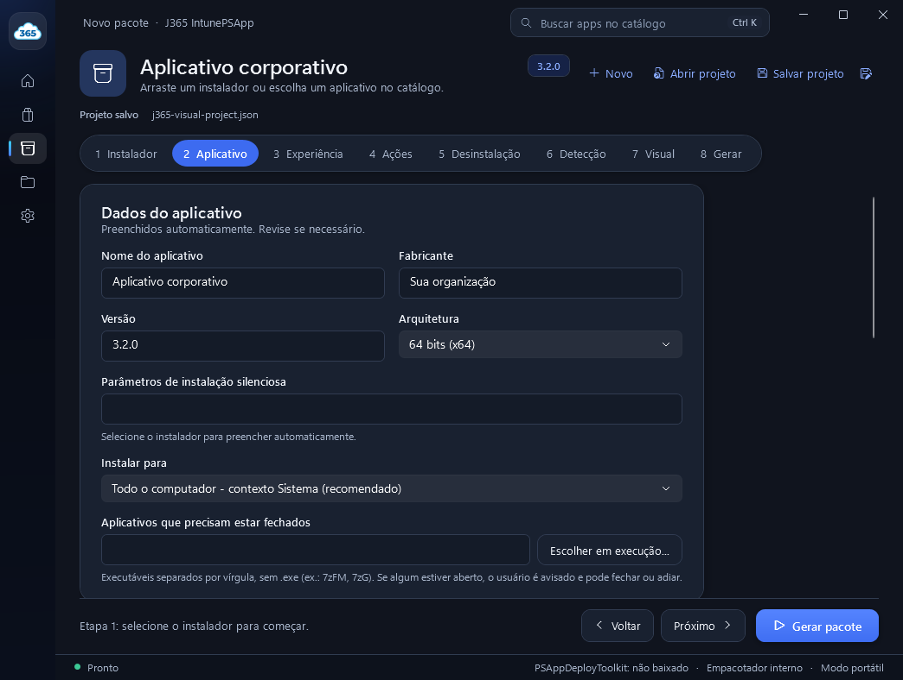
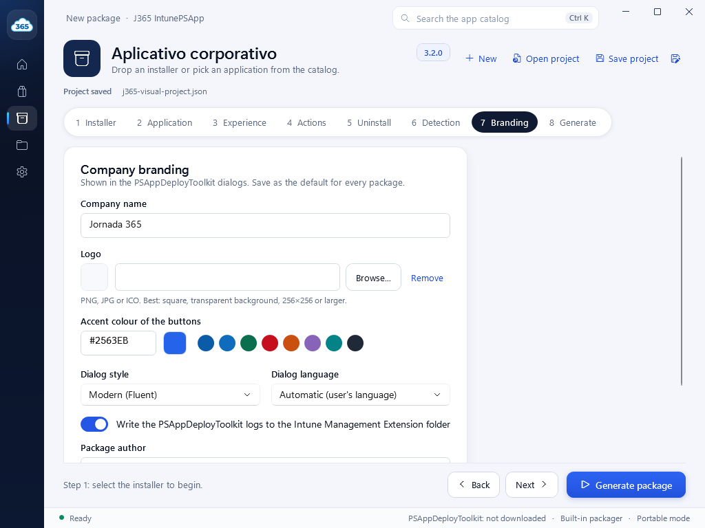
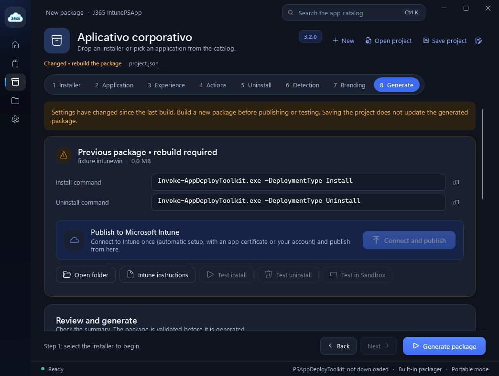

  

<h1 align="center">J365 IntunePSApp · 2.5.1</h1>

<b>Prepare, review, test and publish Windows application packages for Microsoft Intune.</b> Built on PSAppDeployToolkit · Windows x64 · Portable · Open source

  

<a href="https://github.com/sesantanajr/J365-IntunePSApp/releases/tag/v2.5.1">Release notes &amp; checksums</a> · <a href="#português">Português</a> · <a href="#english">English</a> · <a href="CHANGELOG.md">Changelog</a>

  
  
  

Created by <a href="https://www.linkedin.com/in/sergiosantanacloud/">Sérgio Sant'Ana Junior</a> · <a href="https://jornada365.cloud">Jornada 365</a>

## Português

O **J365 IntunePSApp** reúne em uma interface visual as etapas de preparação de aplicativos Windows para o Microsoft Intune. Escolha um instalador MSI/EXE ou procure no catálogo, configure a instalação e a experiência do usuário, revise a detecção e gere o pacote.

O resultado inclui o arquivo **`.intunewin`**, o pacote **PSAppDeployToolkit**, os comandos de instalação/desinstalação, o script de detecção, as instruções e os metadados para publicação.

### Baixar a versão 2.5.1

1. Baixe o ZIP e extraia todos os arquivos para uma pasta.
2. Execute **`J365.IntunePSApp.exe`**. A distribuição portátil inclui o runtime; não exige instalar o SDK .NET.
3. Conclua a preparação das ferramentas e escolha um aplicativo para empacotar.

[Notas da versão](https://github.com/sesantanajr/J365-IntunePSApp/releases/tag/v2.5.1) · [Código-fonte da 2.5.1](https://github.com/sesantanajr/J365-IntunePSApp/releases/download/v2.5.1/J365-IntunePSApp-2.5.1-source.zip) · [SHA256SUMS.txt](https://github.com/sesantanajr/J365-IntunePSApp/releases/download/v2.5.1/SHA256SUMS.txt)

O executável desta release ainda não tem assinatura Authenticode. Consulte a [política de assinatura](docs/SIGNING.md) se o Windows ou uma política corporativa bloquear a execução.

### O que mudou na 2.5.1

| Área | Melhoria |
| --- | --- |
| Projeto e pacote | Alterações nas configurações exigem nova geração antes de publicar ou testar; salvar o projeto não atualiza um pacote antigo. |
| Salvamento | Ctrl+S salva no arquivo atual. Salvar como / Ctrl+Shift+S criam outra cópia. O estado e o arquivo aberto permanecem visíveis. |
| Estabilidade | Reserva exclusiva das pastas de saída, gerações serializadas no processo e edição pausada durante a geração. |
| Biblioteca | Leitura em segundo plano, ordenação por data/nome/atualizações e busca sem resultados com ação para limpar filtros. |
| Interface | Nome e versão separados, avisos de pacote desatualizado e ações de publicação/teste desabilitadas até gerar novamente. |
| Validação | Entradas numéricas inválidas são apontadas antes de salvar ou gerar; buscas antigas não substituem os resultados da consulta atual. |

Também inclui os campos de **desenvolvedor, proprietário e URL de privacidade**, a separação entre **nome e versão no Intune** e o salvamento atômico introduzidos na linha 2.5.

### Veja a interface

Capturas reais da **2.5.1**, renderizadas com um projeto demonstrativo. As imagens de revisão e conexão ilustram estados da interface; não representam uma instalação ou publicação em tenant real.

<b>Tema claro, identidade visual e biblioteca de pacotes</b>

<b>Proteção contra publicação de um pacote desatualizado</b>

### Recursos da solução

| Etapa | Recursos |
| --- | --- |
| Encontrar | Catálogo baseado no winget, reconhecimento de instaladores MSI/EXE e sugestões de parâmetros silenciosos. |
| Preparar | Dependências, ações prontas, arquivos extras, registro, serviços e comandos personalizados. |
| Personalizar | Logo, empresa, cores, idiomas, temas claro/escuro, mensagens, adiamentos e fechamento de aplicativos. |
| Detectar | Regras por nome/versão, product code ou arquivo, com marca de execução do pacote. |
| Gerar | PSAppDeployToolkit, `.intunewin`, instruções, comandos e metadados do Intune. |
| Testar | Teste local ou Windows Sandbox, quando disponível, com resultados e logs. |
| Publicar | Criar ou atualizar aplicativos no Intune, acompanhar o envio e abrir o resultado no portal. |
| Manter | Reabrir projetos, localizar versões novas no catálogo e aproveitar as configurações existentes. |

**Fluxo:** instalador → aplicativo → experiência → ações → desinstalação → detecção → visual → revisar e gerar → testar → publicar.

### Qualidade e compatibilidade

- **292 testes automatizados aprovados** na release, além de verificações do fluxo editar/salvar/reabrir e renderização nos temas claro e escuro.
- Aplicativo **WPF/.NET 10 para Windows x64**. A arquitetura ARM64 de um pacote não significa que o editor seja distribuído como executável nativo ARM64.
- Projetos anteriores continuam legíveis. A identificação da revisão acompanha novos pacotes; pacotes antigos precisam ser regenerados para recebê-la.
- A atualização do editor não modifica automaticamente os aplicativos já publicados no tenant.
- Parâmetros silenciosos, detecção, reinício e comportamento do instalador devem ser validados em grupo piloto. A validação desta revisão em tenant real continua pendente.

[Análise técnica e limites](docs/QUALITY-25.md) · [Publicação no Intune](docs/INTUNE-PUBLISH.md) · [Compilar a partir do código-fonte](docs/BUILDING.md)

## English

**J365 IntunePSApp** provides a visual workflow for preparing Windows applications for Microsoft Intune. Select an MSI/EXE installer or find an application in the catalog, configure installation and user experience, review detection, then generate the package.

The output includes the **`.intunewin`** file, the **PSAppDeployToolkit** package, installation/uninstallation commands, a detection script, instructions and publishing metadata.

### Download 2.5.1

1. Download and extract the ZIP.
2. Run **`J365.IntunePSApp.exe`**. The portable distribution includes its runtime; the .NET SDK is not required.
3. Complete tool preparation and select an application to package.

[Release notes](https://github.com/sesantanajr/J365-IntunePSApp/releases/tag/v2.5.1) · [Source code](https://github.com/sesantanajr/J365-IntunePSApp/releases/download/v2.5.1/J365-IntunePSApp-2.5.1-source.zip) · [SHA256 checksums](https://github.com/sesantanajr/J365-IntunePSApp/releases/download/v2.5.1/SHA256SUMS.txt)

This release is not Authenticode-signed yet. See [signing guidance](docs/SIGNING.md) if Windows or an organizational policy blocks execution.

### What's new in 2.5.1

| Area | Improvement |
| --- | --- |
| Project consistency | Changed settings require rebuilding before publishing or testing. Saving does not refresh a previous build. |
| Saving | Ctrl+S saves to the current file. Save As / Ctrl+Shift+S create a copy. Project state and filename stay visible. |
| Reliability | Independently reserved output directories, serialized builds within the process and editing paused during generation. |
| Package library | Background loading, sorting by date/name/available updates and actionable empty search results. |
| Interface | Separate name/version, clear stale-build warnings and publishing/testing disabled until rebuilding. |
| Validation | Invalid numeric input is rejected before saving or generating. Superseded catalog results are discarded. |

Includes developer, owner and privacy-policy metadata, separate Intune app names and versions, and atomic saving from the 2.5 series.

### Screenshots

Actual **2.5.1** interface captures using a demonstration project. Review and connection states are UI demonstrations, not evidence of a live deployment.

<b>Light theme, branding and package library</b>

<b>Stale package protection</b>

### Capabilities

- Catalog based on winget; MSI/EXE analysis and silent installation suggestions.
- Dependencies, ready-made actions, extra files, registry changes, services and custom commands.
- Company logo, colors, messages, deferrals, app closing and live dialog previews.
- Detection by name/version, product code or file, with a package execution mark.
- PSAppDeployToolkit and `.intunewin` generation, instructions and metadata.
- Local or Windows Sandbox testing where available, with results and logs.
- Intune publishing, project reopening and catalog update discovery.
- English/Portuguese, light/dark themes, portable distribution and command-line automation.

### Quality and compatibility

The release passed **292 automated tests**, plus edit/save/reopen and light/dark rendering checks. The editor uses **WPF/.NET 10 on Windows x64**. ARM64 package settings do not imply a native ARM64 editor distribution.

Existing projects remain readable. New packages carry a settings revision record; regenerate legacy packages to create it. Updating the editor does not automatically change existing tenant applications. Installer behavior, silent switches, restart and detection still require pilot testing. Live-tenant validation of this revision remains pending.

[Quality review](docs/QUALITY-25.md) · [Intune publishing guide](docs/INTUNE-PUBLISH.md) · [Build from source](docs/BUILDING.md) · [Architecture](docs/ARCHITECTURE.md)

## Contributing & security

See [CONTRIBUTING.md](CONTRIBUTING.md), [SECURITY.md](SECURITY.md) and the [Code of Conduct](CODE_OF_CONDUCT.md). For changes between releases, see [CHANGELOG.md](CHANGELOG.md).

## Credits & license

Created by **Sérgio Sant'Ana Junior — Jornada 365**. Built on [PSAppDeployToolkit](https://psappdeploytoolkit.com), with catalog data from [microsoft/winget-pkgs](https://github.com/microsoft/winget-pkgs). This project is not affiliated with Microsoft.

[MIT License](LICENSE) · [Third-party notices](THIRD-PARTY-NOTICES.md) · [Code signing policy](CODE_SIGNING_POLICY.md)
