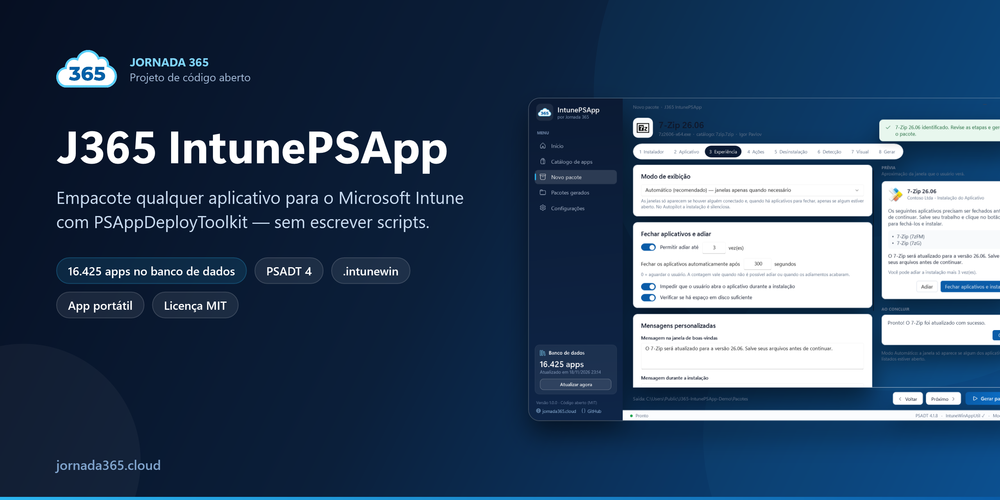
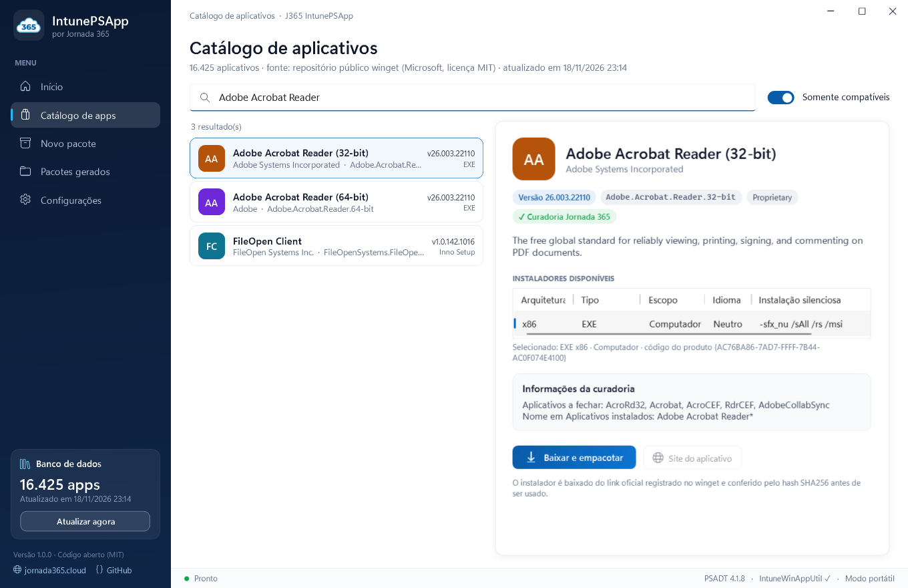
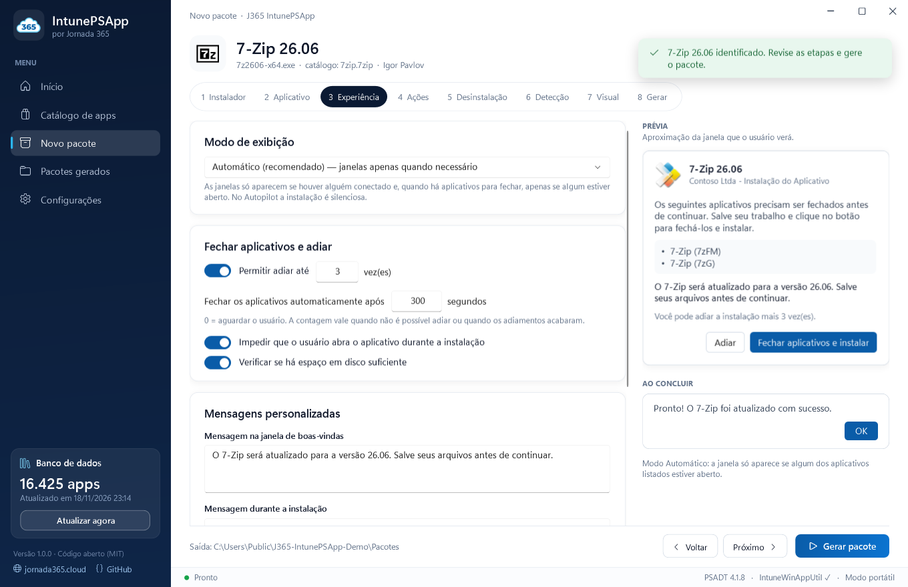
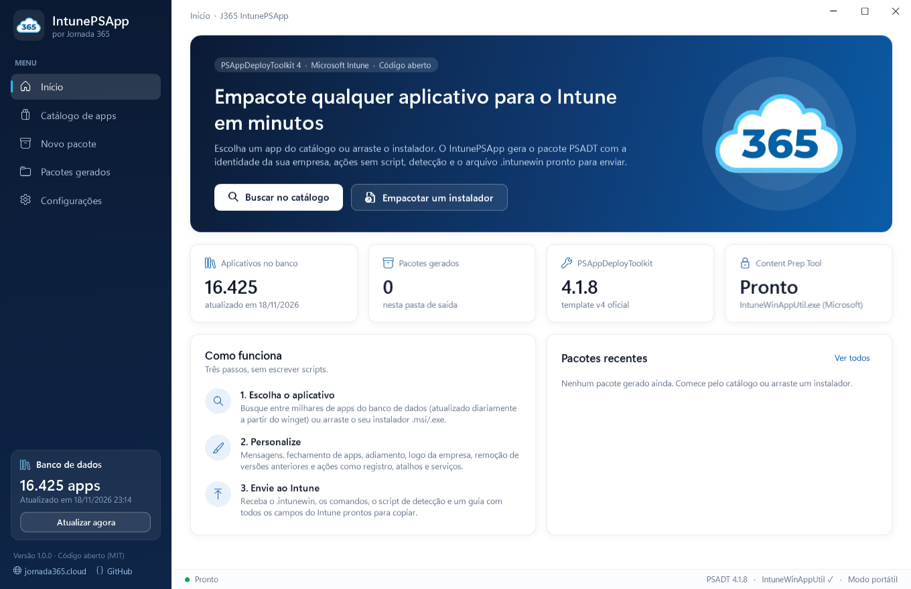
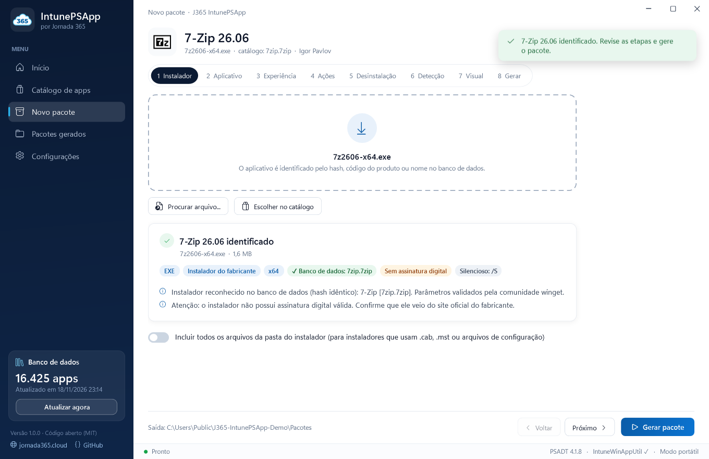
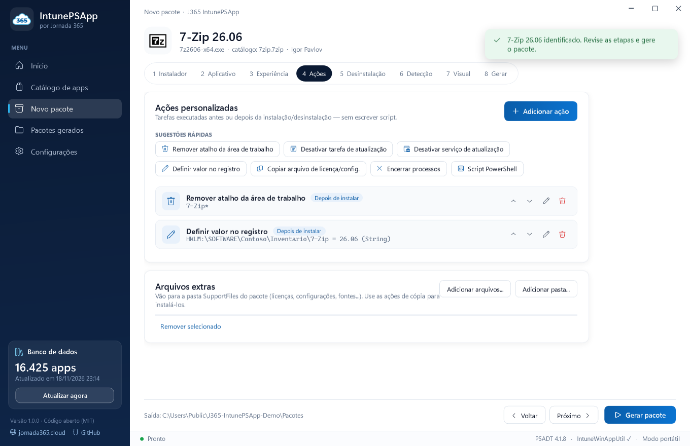
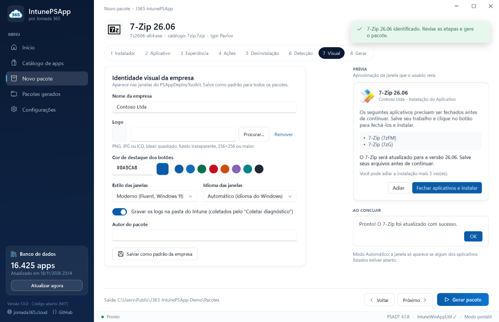
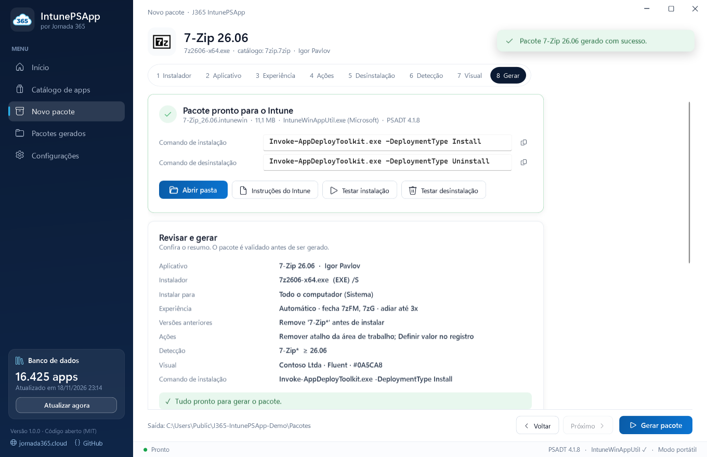
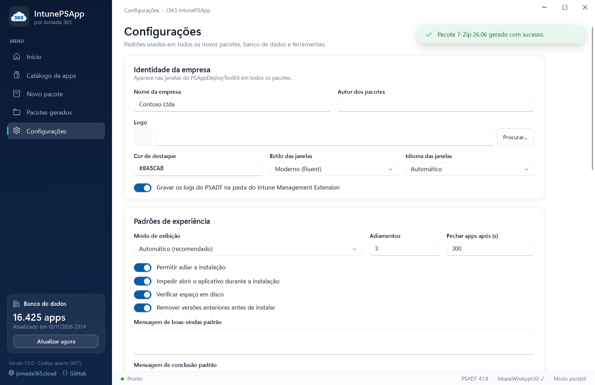

<p align="center">
  
</p>

<h1 align="center">J365 IntunePSApp</h1>

<p align="center">
  <b>Empacote qualquer aplicativo para o Microsoft Intune com PSAppDeployToolkit, sem escrever scripts.</b><br>
  Aplicativo portátil para Windows, de código aberto, criado pelo <a href="https://jornada365.cloud">Jornada 365</a>.
</p>

<p align="center">
  <a href="https://github.com/sesantanajr/J365-IntunePSApp/releases/latest"></a>
  <a href="LICENSE"></a>
  
  
  
</p>

---

## O que é

O **J365 IntunePSApp** pega o instalador de um aplicativo (`.msi` ou `.exe`) e gera um pacote **Win32 para o Microsoft Intune** baseado no [PSAppDeployToolkit 4](https://psappdeploytoolkit.com). O pacote vem com:

- instalação silenciosa, com parâmetros validados;
- a identidade visual da sua empresa;
- mensagens para o usuário, fechamento de aplicativos e adiamento;
- remoção de versões anteriores;
- ações personalizadas (registro, atalhos, serviços, arquivos e outras);
- um **script de detecção**;
- o arquivo **`.intunewin`** pronto para envio;
- um guia com **todos os campos do Intune** já preenchidos.

O banco de dados integrado tem **mais de 16 mil aplicativos**. Ele é gerado diariamente a partir do repositório público do [winget](https://github.com/microsoft/winget-pkgs) e enriquecido pela curadoria do Jornada 365. Com ele, você busca um app, clica em **Baixar e empacotar** e recebe o pacote pronto. O download vem do link oficial do fabricante e é conferido pelo hash SHA256.

<p align="center">
  
  
</p>

## Destaques

| | |
|---|---|
| 🗂️ **Banco de dados com mais de 16 mil apps** | Parâmetros silenciosos, links oficiais, SHA256, códigos de produto e nomes em "Aplicativos instalados". Atualizado todos os dias pelo GitHub Actions. |
| 🔎 **Reconhecimento automático** | O app identifica o instalador pelo hash, pelo código do produto MSI ou pelo nome. A tecnologia do `.exe` também é detectada: NSIS, Inno Setup, WiX Burn, InstallShield, Advanced Installer ou Squirrel. |
| 🎨 **Identidade da empresa** | Logo, nome, cor de destaque, estilo Fluent ou Clássico e idioma das janelas do PSADT, com prévia ao vivo. |
| 💬 **Experiência do usuário** | Modo Automático, Silencioso ou Interativo; fechamento de apps com contagem regressiva; adiamento; bloqueio do app durante a instalação; mensagens personalizadas; pedido de reinicialização. |
| ⚙️ **Ações sem script** | Remover ou criar atalhos, copiar arquivos (inclusive para todos os perfis), definir ou remover registro, parar ou desativar serviços, desativar tarefas agendadas, variáveis de ambiente, executar programas ou PowerShell, mensagens e espera. |
| ♻️ **Versões anteriores** | Remove qualquer versão instalada (MSI e EXE) antes de instalar. O botão *Ver correspondências neste PC* mostra o que seria removido. |
| ✅ **Detecção** | Gera o script de detecção por nome do programa, código do produto ou arquivo, com versão mínima e teste neste computador. |
| 📦 **`.intunewin`** | Gerado pelo `IntuneWinAppUtil.exe` oficial da Microsoft, com assinatura verificada. Sem internet, um empacotador interno compatível gera o arquivo. Depois de pronto, o arquivo é validado (HMAC e SHA256). |
| 💼 **Portátil** | Um único `.exe`, sem instalação e sem precisar do .NET. Configurações, banco de dados e ferramentas ficam numa pasta ao lado do executável. |
| 🧾 **Guia do Intune** | `INSTRUCOES_INTUNE.html` com cada campo do portal (comandos, códigos de retorno, requisitos e detecção) e botões de copiar. |

## Download e uso

1. Baixe `J365-IntunePSApp-<versão>-win-x64.zip` em **[Releases](https://github.com/sesantanajr/J365-IntunePSApp/releases/latest)** e extraia em qualquer pasta (ou pendrive).
2. Abra `J365.IntunePSApp.exe`.
3. Escolha um app no **Catálogo** e clique em **Baixar e empacotar**, ou arraste o seu instalador na tela **Novo pacote**.
4. Revise as etapas: Aplicativo, Experiência, Ações, Desinstalação, Detecção e Visual.
5. Clique em **Gerar pacote** e envie o `.intunewin` ao Intune seguindo o guia gerado.

> Na primeira geração, o app baixa o PSAppDeployToolkit (GitHub oficial) e o IntuneWinAppUtil (GitHub da Microsoft) e verifica a assinatura digital de ambos.

<details>
<summary><b>Ver mais telas</b></summary>

| Início | Instalador analisado |
|---|---|
|  |  |
| **Ações sem script** | **Identidade visual** |
|  |  |
| **Pacote gerado** | **Configurações** |
|  |  |

</details>

## O que é gerado

```
Pacotes\7-Zip_26.06\
├── Pacote_PSADT\                     pasta-fonte do PSAppDeployToolkit (dá para testar localmente)
│   ├── Invoke-AppDeployToolkit.exe
│   ├── Invoke-AppDeployToolkit.ps1    gerado: instalar · desinstalar · reparar · ações
│   ├── Files\                         instalador
│   ├── SupportFiles\                  arquivos extras (licenças, configurações...)
│   ├── Assets\  Config\  Strings\     logo, cor, idioma e mensagens da empresa
├── Intune\
│   ├── 7-Zip_26.06.intunewin          envie ao Intune
│   ├── Deteccao_7-Zip_26.06.ps1       regra de detecção (script personalizado)
│   ├── Icone_App.png                  ícone para o Portal da Empresa
│   └── INSTRUCOES_INTUNE.html / .txt  todos os campos do Intune
├── projeto.json                       reabra para gerar a próxima versão em segundos
└── geracao.log
```

**Configuração no Intune (resumo):**

| Campo | Valor |
|---|---|
| Comando de instalação | `Invoke-AppDeployToolkit.exe -DeploymentType Install` |
| Comando de desinstalação | `Invoke-AppDeployToolkit.exe -DeploymentType Uninstall` |
| Comportamento de instalação | Sistema |
| Reinicialização | Determinar o comportamento com base nos códigos de retorno |
| Detecção | Script personalizado `Deteccao_*.ps1` (32 bits: Não · assinatura: Não) |

A partir do PSADT 4.1, as janelas aparecem para o usuário mesmo com a instalação rodando como Sistema, sem precisar do ServiceUI. No modo **Automático**:

- as janelas só aparecem quando há alguém conectado;
- se houver aplicativos configurados para fechar, elas só aparecem quando algum deles estiver aberto;
- durante o Autopilot, a instalação é silenciosa.

## Banco de dados de aplicativos

- **Fonte:** [`microsoft/winget-pkgs`](https://github.com/microsoft/winget-pkgs) (licença MIT). Entra apenas a versão mais recente de cada pacote.
- **Gerador:** [`tools/CatalogBuilder`](tools/CatalogBuilder). Ele lê o tarball do repositório em streaming e gera `catalog.json.gz` (cerca de 3,5 MB, mais de 16 mil apps) em menos de um minuto.
- **Atualização:** o workflow [`catalog.yml`](.github/workflows/catalog.yml) roda **todos os dias** e publica o arquivo na release [`catalog`](https://github.com/sesantanajr/J365-IntunePSApp/releases/tag/catalog). O app baixa a nova versão automaticamente.
- **Curadoria:** [`catalog/curated.json`](catalog/curated.json) acrescenta o que o winget não tem: processos a fechar, nome em "Aplicativos instalados", parâmetros de desinstalação, detecção recomendada e observações. **Contribuições são bem-vindas.**

## Linha de comando

O mesmo executável gera pacotes sem interface, o que é útil para automação e pipelines:

```powershell
.\J365.IntunePSApp.exe --build "C:\Instaladores\7z2606-x64.exe" --out "D:\Pacotes"
.\J365.IntunePSApp.exe --build "D:\Pacotes\7-Zip_26.06\projeto.json"
```

## Compilar a partir do código

Requisito: [.NET SDK 10](https://dotnet.microsoft.com/download).

```powershell
git clone https://github.com/sesantanajr/J365-IntunePSApp.git
cd J365-IntunePSApp
dotnet run --project src/IntunePSApp
# Versão portátil (um único .exe):
dotnet publish src/IntunePSApp -c Release -r win-x64 -o publish
# Banco de dados local:
dotnet run --project tools/CatalogBuilder -c Release -- --out out --curated catalog/curated.json
```

| Pasta | Conteúdo |
|---|---|
| `src/IntunePSApp/Core` | motor: análise de instaladores (MSI e PE), banco de dados, geração do PSADT, ações, detecção, `.intunewin` |
| `src/IntunePSApp/Views` | interface WPF (tema Fluent do .NET 10 com a identidade do Jornada 365) |
| `tools/CatalogBuilder` | gerador do banco de dados a partir do winget-pkgs |
| `catalog/curated.json` | curadoria (processos, desinstalação, detecção, observações) |
| `.github/workflows` | build e release do `.exe` portátil e atualização diária do banco |

## Contribuindo

Pull requests são bem-vindos, principalmente com **curadoria de aplicativos** e testes com instaladores reais. Veja o [CONTRIBUTING.md](CONTRIBUTING.md).

## Licença e créditos

- Código: **[MIT](LICENSE)** © 2026 Jornada 365.
- [PSAppDeployToolkit](https://github.com/PSAppDeployToolkit/PSAppDeployToolkit) (LGPL-3.0): baixado do GitHub oficial em tempo de execução e incluído nos pacotes gerados.
- [Microsoft Win32 Content Prep Tool](https://github.com/microsoft/Microsoft-Win32-Content-Prep-Tool) (licença Microsoft): baixado do GitHub oficial em tempo de execução, não é redistribuído.
- Dados de aplicativos: [winget-pkgs](https://github.com/microsoft/winget-pkgs) (MIT).

Detalhes em [THIRD-PARTY-NOTICES.md](THIRD-PARTY-NOTICES.md). Este projeto não é afiliado à Microsoft nem ao PSAppDeployToolkit. Microsoft, Intune e Windows são marcas da Microsoft Corporation.

<p align="center">
  <a href="https://jornada365.cloud"></a><br>
  Feito com 💙 pelo <a href="https://jornada365.cloud">Jornada 365</a>: sua jornada começa aqui.
</p>
