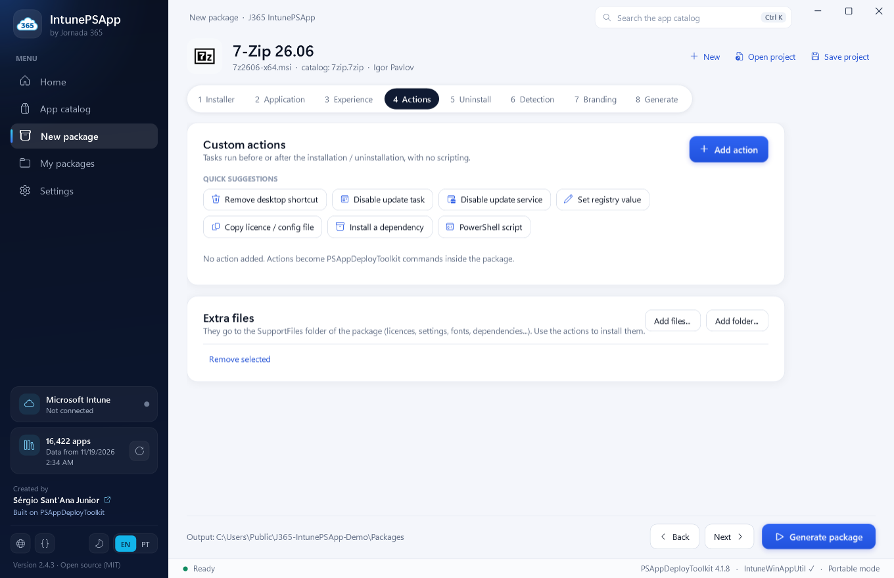

<strong>English</strong> · <a href="README.pt-BR.md">Português (Brasil)</a>

<b>Fewer repetitive tasks. More consistent deployment packages.</b> A visual workspace to prepare, customize, test and publish Windows applications.

<a href="#features">Explore the features</a> · <a href="#get-started">Get started</a> · <a href="https://github.com/sesantanajr/J365-IntunePSApp/releases/tag/v2.6.0">Release notes</a>

  

## Your next deployment package starts here

Turn an MSI or EXE installer into an organized Microsoft Intune package. **J365 IntunePSApp** brings installation settings, user experience, actions, detection and publishing together in a guided workflow built on **PSAppDeployToolkit**.

| Prepare faster | Standardize the experience | Stay in control |
| --- | --- | --- |
| A winget-based catalog, installer analysis and silent-switch suggestions. | Company logo, colors, messages, deferrals and reusable defaults. | Review before building, tests, logs and protection against stale package publishing. |

**One complete workflow:** installer → application → experience → actions → uninstall → detection → branding → build → test → publish.

## Explore the features

Actual **2.5.1** captures with a demonstration project. Click images to enlarge. Connection and test states demonstrate the UI, not a live tenant deployment.

### 01 · Present applications clearly in Intune

Organize description, publisher, developer, owner and information/privacy links. Application name and version use separate fields.

### 02 · Shape the installation experience

Choose display mode, app closing, deferrals and messages. Add pre/post-install actions for files, registry, services, dependencies and custom commands.

<table><tr><td width="50%"><b>User experience and deferrals</b> </td><td width="50%"><b>Ready-made actions and extra files</b> </td></tr></table>

### 03 · Plan updates and detection

Configure removal of previous versions and protection for a newer installed version. Detect by name/version, product code or file, and review the generated script.

<table><tr><td width="50%"><b>Previous version handling</b> </td><td width="50%"><b>Detection rules and local checks</b> </td></tr></table>

### 04 · Make deployments reflect your company

Use your company name, logo and accent color in PSAppDeployToolkit dialogs. Reuse company defaults and choose a light, dark or Windows-matched editor theme.

<table><tr><td width="50%"><b>Company branding and colors</b> </td><td width="50%"><b>Editor appearance and preferences</b> </td></tr></table>

### 05 · Connect and follow publishing

Connect with an app certificate, user account, existing registration or Azure Cloud Shell. After building and testing, create or update an Intune application with upload progress. [Publishing guide](docs/INTUNE-PUBLISH.md).

<table><tr><td width="50%"><b>Microsoft Intune connection options</b> </td><td width="50%"><b>Connection settings and status</b> </td></tr></table>

### 06 · Find packages and resume your work

Reopen projects, search by name or publisher and sort by date, name or available updates. Background loading keeps the library responsive; empty results offer a clear-filters action.

<table><tr><td width="50%"><b>Package library and sorting</b> </td><td width="50%"><b>Actionable empty search results</b> </td></tr></table>

### 07 · Know when a rebuild is required

Version **2.5.1** distinguishes saved projects from generated packages. Changed settings mark the previous result as stale and disable publishing/testing until rebuilding. Saving cannot hide outdated build output.

### 08 · Work your way

English/Portuguese, light/dark themes, compact layouts and portable operation. **Ctrl+S** saves the current project; **Ctrl+Shift+S** creates a copy; **Ctrl+K** opens catalog search.

## What each build delivers

| Output | Purpose |
| --- | --- |
| **`.intunewin`** | Content prepared for upload to Microsoft Intune. |
| **PSAppDeployToolkit package** | Installation, uninstallation, actions and user experience. |
| **Detection script** | Check installation against your configured rule. |
| **Commands and instructions** | Installation/uninstallation reference and Intune field guidance. |
| **Metadata and project** | Application information and reusable project settings. |

Test locally or in **Windows Sandbox**, where available, with results and logs. Command-line options support automation. [Documentation](docs/BUILDING.md).

## Get started in three steps

1. Use the download button at the top and extract the ZIP.
2. Open **`J365.IntunePSApp.exe`** and complete tool preparation. The runtime is included; no .NET SDK is required.
3. Select an installer or catalog application, configure the project and review before building. Validate in a pilot group before distribution.

## New in 2.6

- **Apps of the Microsoft Store:** the catalog also searches the Microsoft Store live, by name or product id (`9PM860492SZD` finds Microsoft PC Manager), and publishes them to Intune as **Microsoft Store app (new)**: Intune installs them from the Store and keeps them current, with no package and the official logo in the Company Portal. Alone or in a batch.
- **Batch deploy:** tick several applications in the catalog and generate them all at once with the same settings (company name, owner, display mode, notifications and deferral). Each installer is downloaded from its official link, checked against its SHA256 and packaged as in the editor; optionally each package is published to Intune with the same assignment. An `.exe` without known silent switches, or a name that also matches other applications, is skipped with the reason, never guessed, and can be opened in the editor. Also from the command line: `--batch id1,id2 --mode Silent --publish`.
- **Truly silent installations:** in **Silent** mode the package shows no dialog and blocks no application and, by default, the assignment created by the publication hides Intune's toast notifications (`hideAll`) and does not restart the device. Notifications can also be chosen per package and as a company default.
- **Fewer repeated fields:** the switch that uninstalls earlier versions lives on the Uninstall step only; the detection name and version follow the Uninstall and Application steps until changed.
- **Right icons:** generic installer icons (Inno Setup, WiX Burn and the NSIS stock icons) no longer reach the Company Portal; the icon of the installed program or the initials tile is used instead.
- **Reliable updates:** "Check now" only says up to date when it reached GitHub, names the version found and, when the GitHub API is blocked, uses the releases page.
- **Right switches:** switches the analysis finds in the installer itself (NSIS, InstallShield, Advanced Installer, Squirrel) are no longer discarded when the database has none; per-user Inno Setup installers get `/CURRENTUSER`, as winget does (432 applications); and the .NET Desktop Runtime 10 detection matches the name it registers again.

## Quality as the product evolves

Version **2.5.1** adds package revision tracking, current-file saving, independent output-directory reservation, numeric input validation and a more responsive package library. The release passed **292 automated tests**, plus edit/save/reopen and interface rendering checks.

Existing projects remain readable. Updating the editor does not change existing tenant applications. New packages carry a revision record; regenerate legacy packages to create one.

**Compatibility:** WPF/.NET 10 editor for Windows x64. ARM64 package settings do not imply a native ARM64 editor. Silent switches, detection and restart behavior depend on the installer and require testing. Live-tenant validation of this revision remains pending.

**Signing:** this release is not Authenticode-signed yet. See [signing guidance](docs/SIGNING.md) if Windows policy blocks execution.

## Documentation & community

[Changelog](CHANGELOG.md) · [Quality review](docs/QUALITY-25.md) · [Intune publishing](docs/INTUNE-PUBLISH.md) · [Building](docs/BUILDING.md) · [Architecture](docs/ARCHITECTURE.md)

[Contribute](CONTRIBUTING.md) · [Report an issue](https://github.com/sesantanajr/J365-IntunePSApp/issues) · [Security](SECURITY.md) · [SHA256SUMS.txt](https://github.com/sesantanajr/J365-IntunePSApp/releases/download/v2.6.0/SHA256SUMS.txt)

---

<b>Created by <a href="https://www.linkedin.com/in/sergiosantanacloud/">Sérgio Sant'Ana Junior</a></b> <a href="https://jornada365.cloud">Jornada 365</a> · Your journey starts here.

<a href="https://jornada365.cloud"><picture><source media="(prefers-color-scheme: dark)" srcset="docs/assets/j365-blog-logo-dark.png"></picture></a>

Built on [PSAppDeployToolkit](https://psappdeploytoolkit.com), with catalog data from [microsoft/winget-pkgs](https://github.com/microsoft/winget-pkgs). An independent project, not affiliated with Microsoft.

[MIT License](LICENSE) · [Third-party notices](THIRD-PARTY-NOTICES.md) · [Code signing policy](CODE_SIGNING_POLICY.md)
