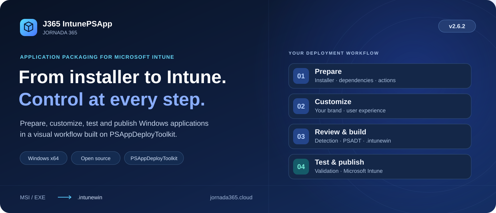
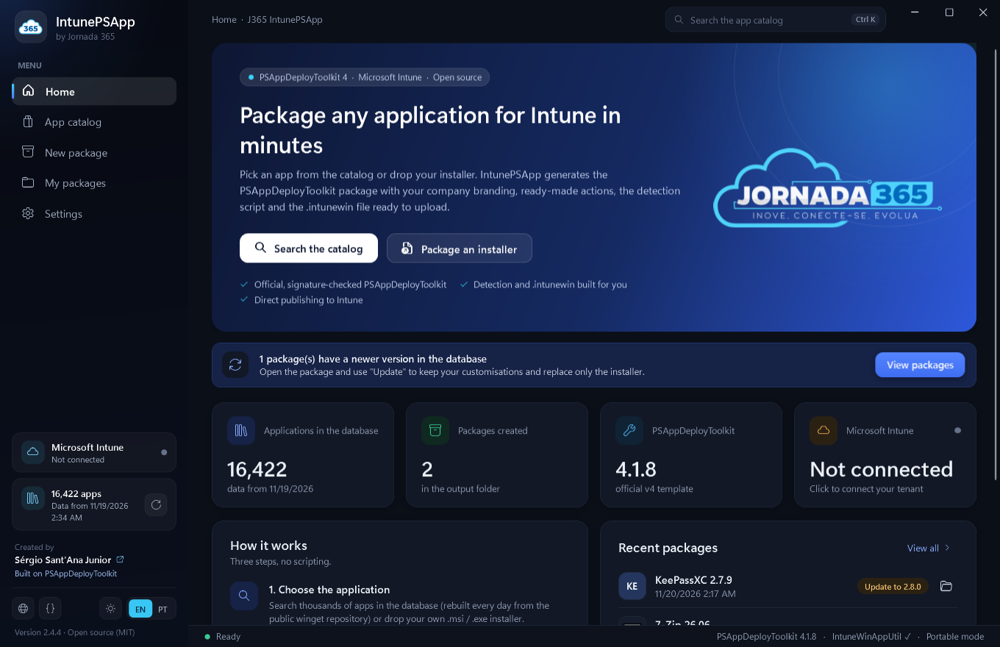
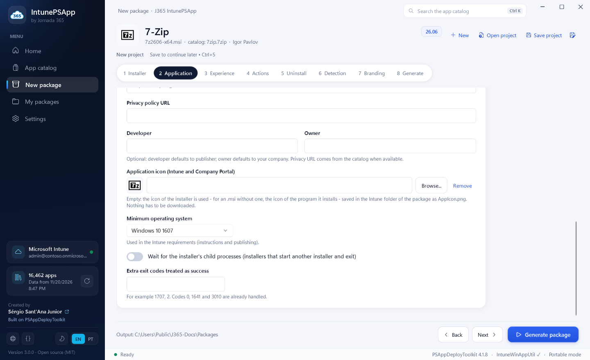
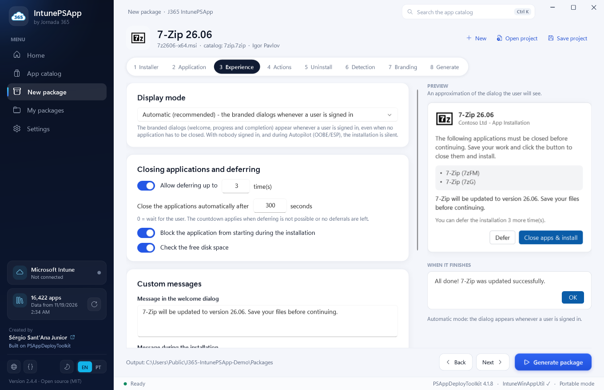
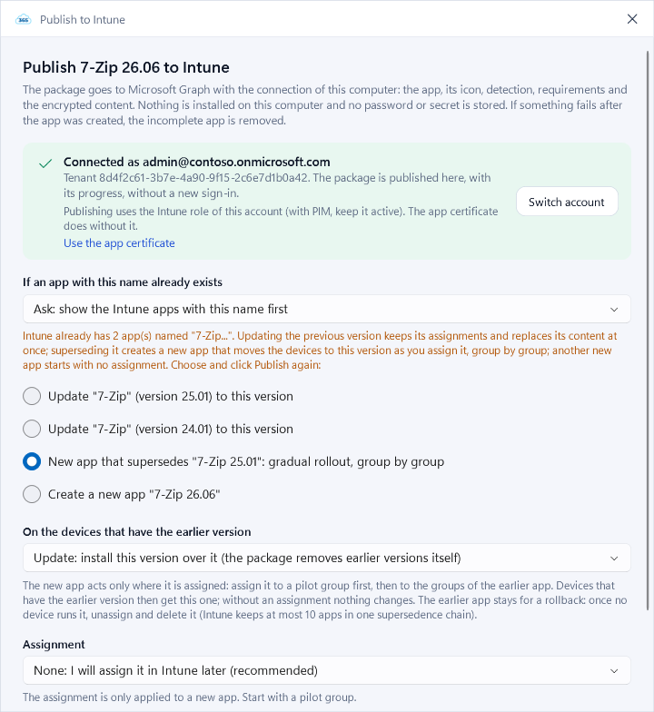
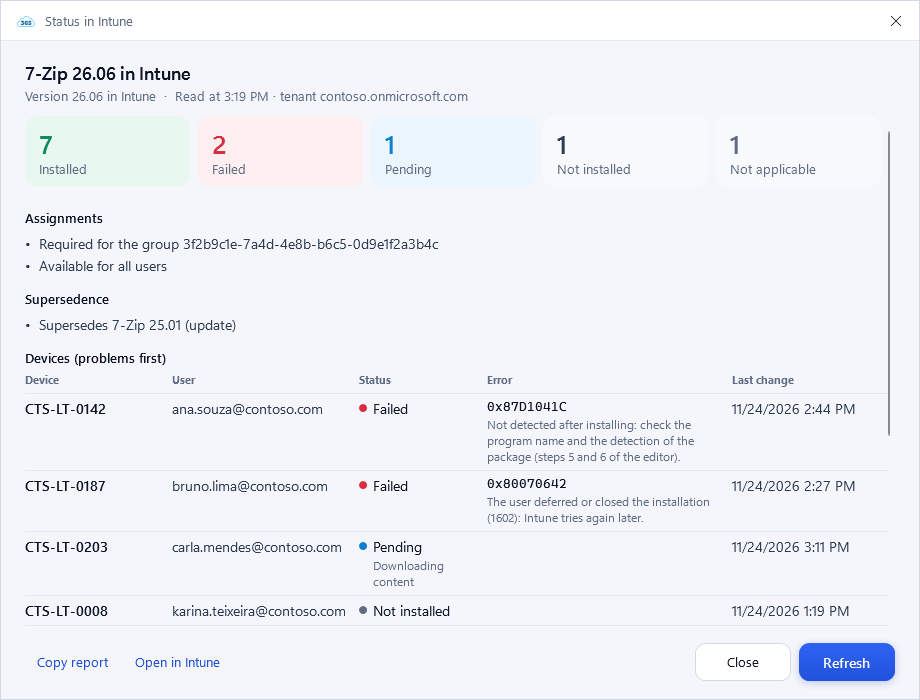
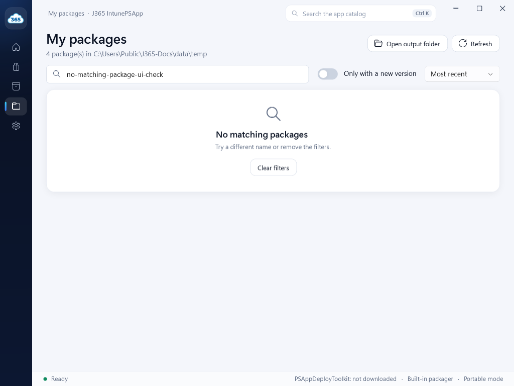
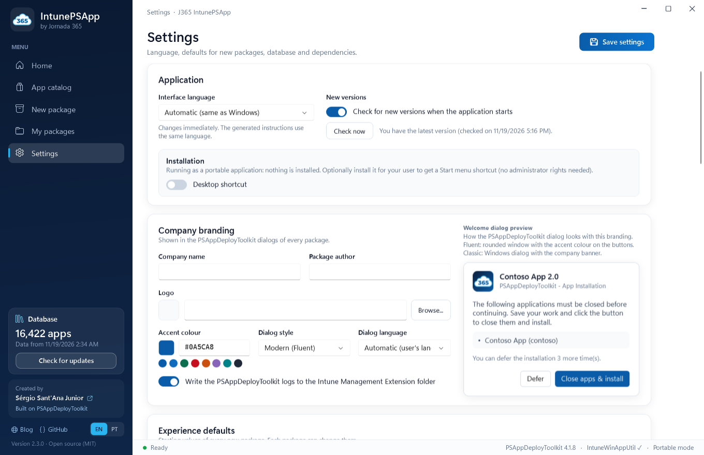

<strong>English</strong> · <a href="README.pt-BR.md">Português (Brasil)</a>

<b>Fewer repetitive tasks. More consistent deployment packages.</b> A visual workspace to prepare, customize, test and publish Windows applications.

<a href="#features">Explore the features</a> · <a href="#get-started">Get started</a> · <a href="docs/USER-GUIDE.md">User guide</a> · <a href="https://github.com/sesantanajr/J365-IntunePSApp/releases/tag/v3.0.0">Release notes</a>

  

## Your next deployment package starts here

Turn an MSI or EXE installer — or any application of the winget catalog and the Microsoft Store — into an organized Microsoft Intune package. **J365 IntunePSApp** brings installation settings, user experience, actions, detection and publishing together in a guided workflow built on **PSAppDeployToolkit**.

| Prepare faster | Standardize the experience | Stay in control |
| --- | --- | --- |
| A catalog of winget and the Microsoft Store, installer analysis, silent-switch suggestions and batch deploy. | Silent installation or with notification, company logo, colors, messages and reusable defaults. | Review before building, tests, logs and protection against stale package publishing. |

**One complete workflow:** catalog or installer → application → experience → actions → uninstall → detection → branding → build → test → publish. Every screen is explained in the **[user guide](docs/USER-GUIDE.md)**.

## Explore the features

Actual **3.0** captures with a demonstration company (Contoso) and the 7-Zip MSI, packaged for real. Click images to enlarge. The Intune connection is a sample: nothing was published to a tenant.

### 01 · Find any application

Search more than 16,000 applications of winget by name, publisher or ID — with every installer, the silent switches that will be used and the curated knowledge of Jornada 365 — and the Microsoft Store live, by name or product ID. **Download and package** checks the installer against its SHA256 and opens it in the editor already filled in.

### 02 · Present applications clearly in Intune

The installer is analysed and recognised; name, version, architecture, context and icon are filled in. Description, publisher, developer, owner and information/privacy links go to Intune in their own fields.

<table><tr><td width="50%"><b>Application, architecture and context</b> </td><td width="50%"><b>Information shown in Intune and the Company Portal</b> </td></tr></table>

### 03 · Shape the installation experience

Choose between an installation **with notification** (the windows of the package and the notifications of Intune) and a **silent** one (nothing shows), set app closing and messages, with a live preview of the real PSAppDeployToolkit dialog. The installation cannot be deferred. Add pre/post-install actions for files, registry, services, dependencies and custom commands.

<table><tr><td width="50%"><b>Silent installation or with notification</b> </td><td width="50%"><b>Ready-made actions and extra files</b> </td></tr></table>

### 04 · Plan updates and detection

Whatever is installed is removed before installing (only a newer version is kept), and if a copy cannot be removed the installation stops instead of leaving two versions side by side. Detect by name/version, product code or file, with the package mark, and test the rule on your computer.

<table><tr><td width="50%"><b>Previous and kept versions</b> </td><td width="50%"><b>Detection rules and local checks</b> </td></tr></table>

### 05 · Make deployments reflect your company

Use your company name, logo and accent color in the PSAppDeployToolkit dialogs, save them as company defaults, and work in a light, dark or Windows-matched theme.

<table><tr><td width="50%"><b>Company branding and colors</b> </td><td width="50%"><b>Editor appearance</b> </td></tr></table>

### 06 · Generate, test and know when to rebuild

One click builds the PSAppDeployToolkit package, the detection script and the `.intunewin`, with the commands and the instructions for Intune. Test it here or in Windows Sandbox. Changed settings mark the result as outdated and disable publishing and testing until you generate it again.

<table><tr><td width="50%"><b>Package ready for Intune</b> </td><td width="50%"><b>Outdated package: generate again</b> </td></tr></table>

### 07 · Connect, publish and follow the installation

Connect with your account, an app certificate kept in the TPM, an existing registration or Azure Cloud Shell. Create or update the app in Intune with upload progress, the icon, detection, requirements and an optional assignment — or, new in 2.8, publish the new version as a new app that **supersedes** the earlier one and roll it out group by group. **Status in Intune** then shows the devices installed, failed and pending, with every error code explained. [Publishing guide](docs/INTUNE-PUBLISH.md).

<table><tr><td width="50%"><b>Ways to connect</b> </td><td width="50%"><b>Publish to Intune</b> </td></tr><tr><td width="50%"><b>A new version that supersedes the earlier one</b> </td><td width="50%"><b>Status in Intune</b> </td></tr></table>

### 08 · Deploy many applications at once

Tick applications of the catalog (winget or Microsoft Store), set what they share, and generate — and optionally publish — them all. Anything that would need a guess is skipped with the reason and can be finished in the editor.

### 09 · Find packages and resume your work

Reopen projects, search by name or publisher, sort by date, name or available updates, and recover from an empty search with one click.

<table><tr><td width="50%"><b>Package library and sorting</b> </td><td width="50%"><b>Actionable empty search results</b> </td></tr></table>

### 10 · Work your way

English or Portuguese, light or dark, portable or installed for your user, updates from inside the application, and defaults that every new package starts from.

<table><tr><td width="50%"><b>General settings, updates and folders</b> </td><td width="50%"><b>Connection settings and status</b> </td></tr></table>

## What each build delivers

| Output | Purpose |
| --- | --- |
| **`.intunewin`** | Content prepared for upload to Microsoft Intune. |
| **PSAppDeployToolkit package** | Installation, uninstallation, actions and user experience. |
| **Detection script** | Check installation against your configured rule. |
| **Commands and instructions** | Installation/uninstallation reference and Intune field guidance. |
| **Metadata and project** | Application information and reusable project settings. |

Test locally or in **Windows Sandbox**, where available, with results and logs. Command-line options support automation. [Documentation](docs/BUILDING.md).

## Get started in three steps

1. Use the download button at the top and extract the ZIP.
2. Open **`J365.IntunePSApp.exe`** and complete tool preparation. The runtime is included; no .NET SDK is required.
3. Select an installer or a catalog application, configure the project and review before building — or tick several applications (winget or Microsoft Store) and deploy them together. Validate in a pilot group before distribution. The [user guide](docs/USER-GUIDE.md) walks through every screen.

## New in 3.0

- **Silent installation or with notification:** the four display modes, the choice of Intune notifications and the deferrals became one choice. *With notification* shows the windows of the package and the notifications of Intune; *Silent* shows nothing. Older projects still open.
- **No deferral:** the option to let the user defer the installation (3 times by default) was removed.
- **Removal guaranteed before installing:** whatever is installed goes first, the same version included. An MSI by its product code; an .exe by the switches of the package, by the silent command it registered or by the switches of Inno Setup and NSIS, recognised on the device. If a copy is still installed, the installation stops with an error (or installs over it, if you allow it).
- **Less for an antivirus to doubt:** the executable is no longer compressed and the application no longer removes the "mark of the web" of the files it downloads. Smart App Control still requires a signed release ([how to sign](docs/SIGNING.md)).

2.8 brought supersedence (a new version, group by group) and the install status in Intune; 2.7, update checks that work on company networks and the [user guide](docs/USER-GUIDE.md). All changes: [CHANGELOG](CHANGELOG.md).
## Quality as the product evolves

Every release passes **456 automated tests** on Windows (generated scripts parsed by Windows PowerShell 5.1, packaging, detection, the publication end to end against a local stand-in of Microsoft Graph, the install status, the Microsoft Store parsing, batch planning, localization) plus interface checks that render the editor, settings, connection, publishing, status and batch windows in both languages and themes. The Microsoft Store search and the update check were also exercised against the live services. See the [quality review](docs/QUALITY.md).

Existing projects remain readable. Updating the editor does not change existing tenant applications. New packages carry a revision record; regenerate legacy packages to create one.

**Compatibility:** WPF/.NET 10 editor for Windows x64. ARM64 package settings do not imply a native ARM64 editor. Silent switches, detection and restart behavior depend on the installer and require testing. Publishing to a live tenant (packages and Microsoft Store apps) should be validated with a pilot group.

**Signing:** releases up to 3.0.0 are not Authenticode-signed. See the [code signing policy](#code-signing-policy) below and the [signing guidance](docs/SIGNING.md) if Windows policy blocks execution.

## Code signing policy

Free code signing provided by [SignPath.io](https://about.signpath.io), certificate by [SignPath Foundation](https://signpath.org).

- **What is signed:** only the release executable built by GitHub Actions from this public repository, after the tests pass. Every signing request is approved by hand.
- **Committers and reviewers:** [Sérgio Sant'Ana Junior](https://github.com/sesantanajr). **Approvers:** [Sérgio Sant'Ana Junior](https://github.com/sesantanajr).
- **Privacy policy:** this program will not transfer any information to other networked systems unless specifically requested by the user or the person installing or operating it.

Signed releases start with the first version published after the project is accepted by the foundation; until then the releases are unsigned. The full policy: [CODE_SIGNING_POLICY.md](CODE_SIGNING_POLICY.md).

## Documentation & community

[User guide](docs/USER-GUIDE.md) · [Changelog](CHANGELOG.md) · [Quality review](docs/QUALITY.md) · [Intune publishing](docs/INTUNE-PUBLISH.md) · [Building](docs/BUILDING.md) · [Architecture](docs/ARCHITECTURE.md)

[Contribute](CONTRIBUTING.md) · [Report an issue](https://github.com/sesantanajr/J365-IntunePSApp/issues) · [Security](SECURITY.md) · [SHA256SUMS.txt](https://github.com/sesantanajr/J365-IntunePSApp/releases/download/v3.0.0/SHA256SUMS.txt)

---

<b>Created by <a href="https://www.linkedin.com/in/sergiosantanacloud/">Sérgio Sant'Ana Junior</a></b> <a href="https://jornada365.cloud">Jornada 365</a> · Your journey starts here.

<a href="https://jornada365.cloud"><picture><source media="(prefers-color-scheme: dark)" srcset="docs/assets/j365-blog-logo-dark.png"></picture></a>

Built on [PSAppDeployToolkit](https://psappdeploytoolkit.com), with catalog data from [microsoft/winget-pkgs](https://github.com/microsoft/winget-pkgs). An independent project, not affiliated with Microsoft.

[MIT License](LICENSE) · [Third-party notices](THIRD-PARTY-NOTICES.md) · [Code signing policy](CODE_SIGNING_POLICY.md)
