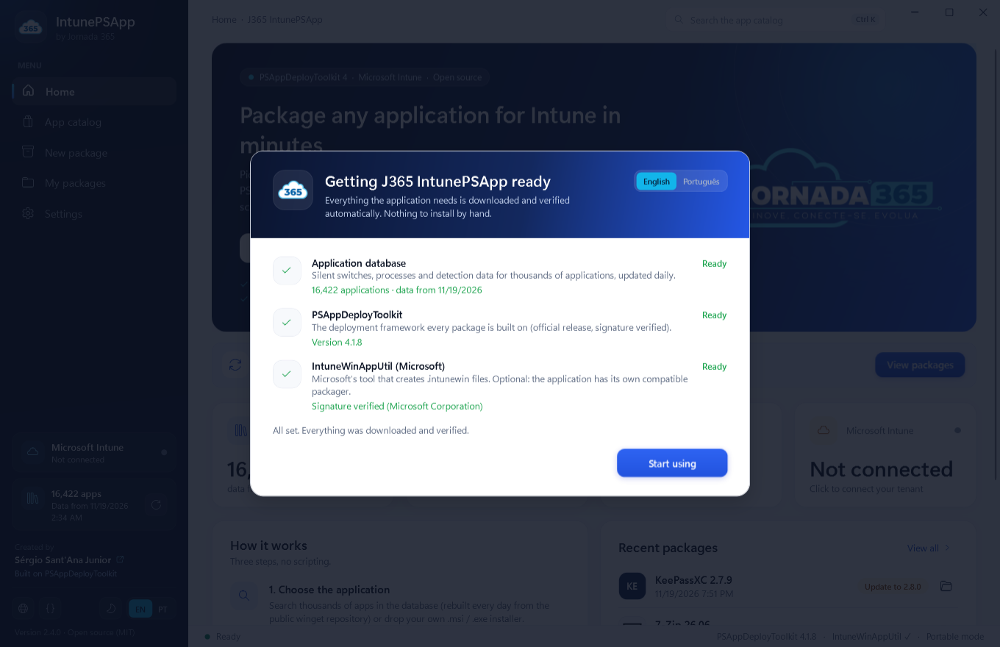
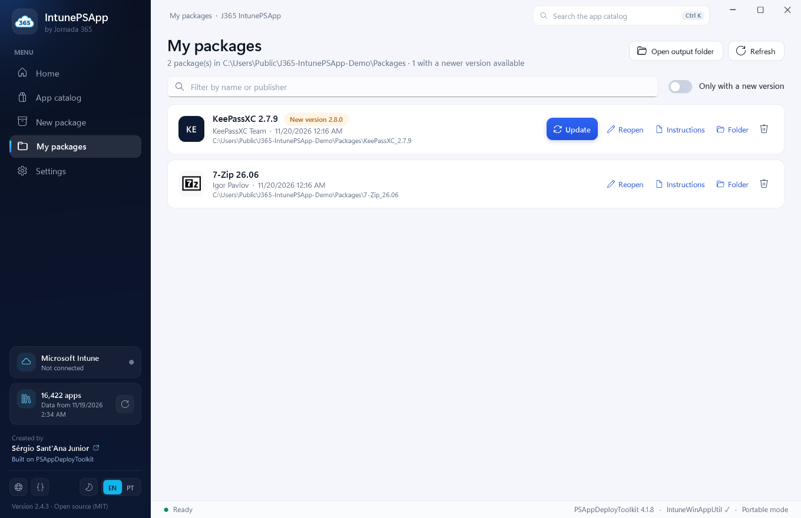
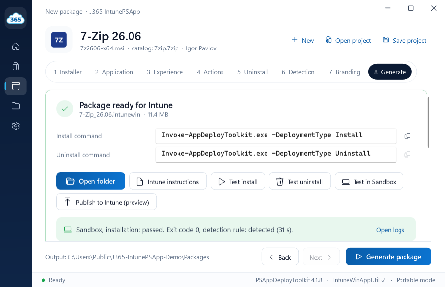
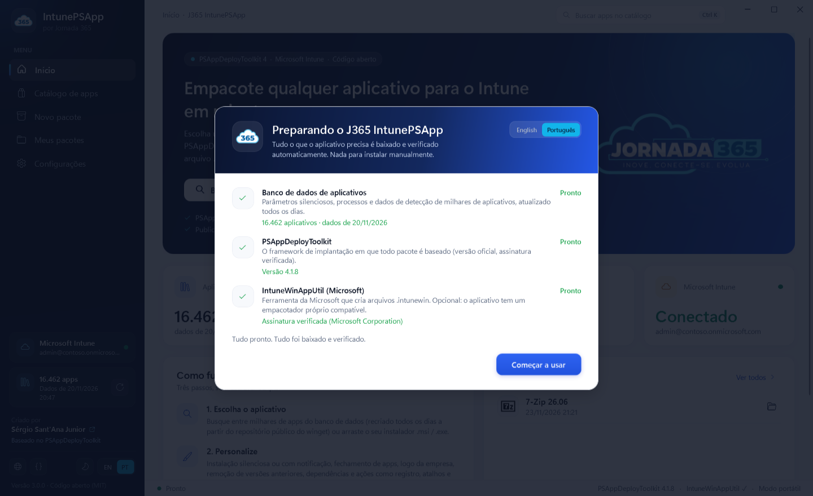

<p align="center">
  
</p>

<h1 align="center">J365 IntunePSApp</h1>

<p align="center">
  <b>Package any Windows application for Microsoft Intune in minutes. No scripting.</b><br>
  Built on <a href="https://psappdeploytoolkit.com">PSAppDeployToolkit</a> · Portable · Open source (MIT)
</p>

<p align="center">
  <a href="https://github.com/sesantanajr/J365-IntunePSApp/releases/latest"></a>
  <a href="https://github.com/sesantanajr/J365-IntunePSApp/actions/workflows/build.yml"></a>
  <a href="https://github.com/sesantanajr/J365-IntunePSApp/actions/workflows/catalog.yml"></a>
  <a href="LICENSE"></a>
</p>

<p align="center">
  <b>English</b> · <a href="#-português">Português</a>
</p>

> **Created by [Sérgio Sant'Ana Junior](https://www.linkedin.com/in/sergiosantanacloud/)** · [Jornada 365](https://jornada365.cloud)
>
> This project is **based on [PSAppDeployToolkit](https://psappdeploytoolkit.com)**, the open-source deployment framework: every package it generates is a standard PSAppDeployToolkit v4 package. J365 IntunePSApp is the friendly front end that writes the package for you.

<p align="center"><a href="https://jornada365.cloud"></a></p>

---

## What it does

You pick an application (from a database of 16,000+ apps, or your own `.msi` / `.exe`), answer a few questions, and get everything Intune needs:

- the **`.intunewin`** file, ready to upload;
- the **install and uninstall command lines**;
- a **detection script**;
- an **instructions page** with every field of the Intune wizard ready to copy;
- the complete **PSAppDeployToolkit package**, so you can keep editing it by hand if you want.

Anyone can use it: there is nothing to install, no script to write and no PowerShell knowledge required.

## What is new in 2.1

- **The Windows Sandbox test no longer looks frozen.** Inside Windows Sandbox a 2 MB MSI took about two minutes to install and a single click on the test window paused it. Both causes are handled: the same test now takes about half a minute, shows live progress and has a time limit.
- **Windows Sandbox not installed?** The application says so and installs the Windows feature for you.
- **The result of the test comes back to the application**: exit code, detection, time and logs.
- **Versions already installed**: the option to uninstall whatever is on the device before installing is on the first step, and the generated script logs what it found and removed.
- **The window adapts to the screen**, down to 900 x 580.

Details in [Testing in Windows Sandbox](#testing-in-windows-sandbox), [Troubleshooting](#troubleshooting) and the [changelog](CHANGELOG.md). Upgrading: replace the executable; settings, packages and projects keep working.

## Download

1. Download **`J365-IntunePSApp-<version>-win-x64.zip`** from the [latest release](https://github.com/sesantanajr/J365-IntunePSApp/releases/latest).
2. Extract it anywhere (a USB stick works) and run **`J365.IntunePSApp.exe`**.
3. On the first run the application **prepares itself**: it downloads and verifies the application database, the PSAppDeployToolkit template and Microsoft's IntuneWinAppUtil. Nothing is installed on Windows.

<p align="center"></p>

**Requirements:** Windows 10 or 11 (x64). No .NET to install (it is inside the executable). Internet access on the first run.

> **Windows protection prompts.** The executable is not code-signed (this is a free community project). Windows SmartScreen may show *"Windows protected your PC"*: check the file first (see [Verify the download](#verify-the-download)), then choose *More info > Run anyway*. On computers with **Smart App Control** turned on, Windows can block unsigned applications it does not know yet and offers no exception; in that case use another computer or a virtual machine.

## Features

| | |
|---|---|
| **Application database** | 16,000+ applications with silent switches, official download URLs, SHA256 hashes and uninstall data. Rebuilt **every day** from the public [winget-pkgs](https://github.com/microsoft/winget-pkgs) repository, plus curated knowledge (processes to close, detection tips). Only a tiny metadata file is downloaded when nothing changed. |
| **Any installer** | Drop an `.msi` or `.exe`. The technology is identified (MSI, Inno Setup, NSIS, WiX Burn, InstallShield, Advanced Installer, Squirrel) and the silent switches are suggested. The file is matched against the database by hash, product code or name. |
| **User experience** | Close running applications (with countdown), let the user defer, block the app during the installation, custom welcome / progress / completion messages, restart prompt, silent or interactive mode. Live preview of the dialog. |
| **Company branding** | Your logo, company name and accent colour in every dialog. Save once, reuse in every package. |
| **Ready-made actions** | 20 actions, no scripting: install a **dependency**, uninstall another app, shortcuts, files and folders, copy to every user profile, registry values, import `.reg`, services, scheduled tasks, environment variables, run a program, show a message... and a PowerShell box for everything else. |
| **Dependencies** | When the winget manifest declares dependencies (Visual C++ Redistributable, .NET Desktop Runtime...), one click downloads the right installer, ships it inside the package and installs it first. |
| **Versions already installed** | Uninstalls any version already on the device (MSI and EXE) and only then installs the new one, so two versions never stay side by side. No detection is consulted before uninstalling; what was found and removed goes to the log. |
| **Detection** | Generated detection script: by program name and minimum version, by product code, or by file. Test it on your computer with one click. |
| **Keeping packages current** | *My packages* shows which packages have a **newer version in the database**. *Update* downloads the new installer and keeps every customisation. |
| **Test before publishing** | **Windows Sandbox**: one click installs the package in a disposable Windows and runs the detection rule, with live progress; the result and the logs come back to the application. If the Windows feature is not installed, the application says so and installs it for you. Or test on the local computer. |
| **Publish to Intune (preview)** | A generated `Publish-ToIntune.ps1` creates the app in your tenant with your own sign-in, without assignments. See [docs/INTUNE-PUBLISH.md](docs/INTUNE-PUBLISH.md). |
| **English and Portuguese** | Switch the language at any time (sidebar or Settings). The generated instructions follow the same language. |
| **Portable or installed** | Runs from any folder. Optionally installs for your user (Start menu, *Installed apps*) without administrator rights, and uninstalls cleanly. |
| **Any screen size** | The window fits small notebooks, 125-150 % scaling and remote sessions: icon-only sidebar and pages that reflow. |
| **Command line** | `--build`, `--sandbox`, `--setup`, `--update-catalog`, `--install`... for automation. |

## How it works

**1. Choose the application** - search the catalog or drop your installer.

<p align="center"></p>

The installer is identified (technology, silent switches, database match) and you decide right there what happens to **versions already installed on the device**: uninstall whatever is found, then install the new one.

<p align="center"></p>

**2. Customise** - experience, actions, dependencies, uninstall, detection and branding. Everything is filled in with sensible defaults.

<p align="center"></p>
<p align="center"></p>

**3. Generate** - the package is validated (script syntax, `.intunewin` integrity) and you get the commands, the detection script and the instructions.

**4. Test in Windows Sandbox, then send to Intune** - one click installs the package in a disposable Windows and runs the detection rule. The result comes back to the same card.

<p align="center"></p>

**Later** - the application tells you when a packaged app has a new version.

<p align="center"></p>

## Testing in Windows Sandbox

*Test in Sandbox* opens a disposable Windows, installs the package with the same command line Intune uses and runs the detection rule. Nothing changes on your computer.

| | |
|---|---|
| **Requirements** | Windows 10/11 Pro, Enterprise or Education with the *Windows Sandbox* feature and hardware virtualisation enabled. When the feature is turned off, the application offers to install it (administrator permission, then a restart). Windows Home and Windows Server do not have it. |
| **What you see in the sandbox** | A PowerShell window with the elapsed time and the last entry of the PSAppDeployToolkit log while the package runs, then `RESULT`. It stays open with four commands: `Test-Install`, `Test-Uninstall`, `Test-Detection` and `Show-Log`. |
| **What comes back** | Exit code, detection and time on the result card; `result.json` and the logs in `Sandbox\Results` of the package. Reopening the package shows its last result again (2.1.1). |
| **What the test changes inside the sandbox** | It turns off the Smart App Control evaluation (it makes installers take minutes there) and QuickEdit in the test window (a click would pause it). Both only exist in that disposable Windows. |
| **Time limit** | 60 minutes per run, the same default as Intune. A package that asks a question nobody answers is stopped and reported as failed. |
| **Differences from Intune** | Intune installs as SYSTEM; the sandbox installs as its local administrator. Always finish with a pilot group. |
| **Command line** | `J365.IntunePSApp.exe --sandbox "<package folder>"` |

## Any screen size

The window never opens larger than the screen and remembers its size. On small notebooks, 125-150 % scaling and remote sessions the sidebar keeps only its icons and every page reflows.

<p align="center"></p>

## What is generated

```
<Output>\<App>_<Version>\
├── Package\                     PSAppDeployToolkit package (Invoke-AppDeployToolkit.exe/.ps1, Files, SupportFiles, Config, Assets...)
├── Intune\
│   ├── <App>_<Version>.intunewin    upload this file to Intune
│   ├── Detection_<App>_<Version>.ps1
│   ├── Intune-Instructions.html     every field of the Intune wizard, ready to copy (+ .txt)
│   ├── intune-app.json              the same information, machine-readable
│   ├── Publish-ToIntune.ps1         optional publishing script (preview)
│   └── AppIcon.png
├── Sandbox\
│   ├── Sandbox-Test.ps1             test script used by "Test in Sandbox"
│   └── Results\                     result.json and logs written by the last sandbox test
├── project.json                 reopen, change and generate again
└── build.log
```

In Intune (*Apps > Windows > Add > Windows app (Win32)*):

| Field | Value |
|---|---|
| Install command | `Invoke-AppDeployToolkit.exe -DeploymentType Install` |
| Uninstall command | `Invoke-AppDeployToolkit.exe -DeploymentType Uninstall` |
| Install behavior | System (or User, when you choose so) |
| Detection rules | Use a custom detection script: `Detection_<App>_<Version>.ps1` |

## Command line

```text
J365.IntunePSApp.exe [file]                                   open a project (project.json) or analyse an installer
J365.IntunePSApp.exe --build <project.json|installer> [--out <folder>] [--native]
J365.IntunePSApp.exe --sandbox <package folder>               test a generated package in Windows Sandbox
J365.IntunePSApp.exe --setup                                  download and verify the dependencies
J365.IntunePSApp.exe --update-catalog [--force]               update the application database
J365.IntunePSApp.exe --install [--desktop-shortcut] [--quiet] install for the current user
J365.IntunePSApp.exe --uninstall [--purge] [--quiet]          remove the installation
    --lang <en|pt-BR>    --version    --help
```

## Verify the download

Every release is built by GitHub Actions from the tagged commit and carries checksums and a signed build provenance attestation.

```powershell
# 1. Checksum: compare with SHA256SUMS.txt of the release
Get-FileHash .\J365-IntunePSApp-2.1.1-win-x64.zip -Algorithm SHA256

# 2. Provenance: proves the file was built by this repository's workflow (GitHub CLI)
gh attestation verify .\J365-IntunePSApp-2.1.1-win-x64.zip --repo sesantanajr/J365-IntunePSApp
```

What the application itself verifies: the database installers (SHA256 from the winget manifest), the PSAppDeployToolkit module (Authenticode signature), IntuneWinAppUtil (Microsoft signature, otherwise discarded) and every `.intunewin` it creates (HMAC and SHA256). See [SECURITY.md](SECURITY.md).

## Source package, building and forking

The project is open source so you can **audit it, build it yourself, fork it or base another project on it**.

- **Source package:** every release includes `J365-IntunePSApp-<version>-source.zip`, the exact source of that release.
- **Build:** `dotnet publish src/IntunePSApp -c Release -r win-x64` with the .NET 10 SDK. Details in [docs/BUILDING.md](docs/BUILDING.md).
- **Fork / rebrand / translate:** [docs/FORKING.md](docs/FORKING.md) lists the few places to change (name, links, logo, database URL) and how to add a language.
- **How it is organised:** [docs/ARCHITECTURE.md](docs/ARCHITECTURE.md).
- **Contributing:** [CONTRIBUTING.md](CONTRIBUTING.md). The quickest way to help is improving [`catalog/curated.json`](catalog/curated.json).

## Troubleshooting

| Symptom | What to do |
|---|---|
| The sandbox test stays on *Installing* for minutes (version 2.0) | Update to 2.1 and click *Test in Sandbox* again: packages generated by 2.0 get the new test script automatically. If you had clicked on the test window, press Enter in it. |
| *Windows Sandbox is not enabled on this computer* | Choose *Install the feature now*, accept the Windows permission prompt and restart. By hand: *Turn Windows features on or off > Windows Sandbox*, or as administrator `dism /Online /Enable-Feature /FeatureName:Containers-DisposableClientVM /All`. Virtualisation (Intel VT-x / AMD-V) must be enabled in the firmware. |
| *Windows Sandbox is already open* | Windows allows one sandbox at a time: close its window and test again. |
| The sandbox test failed | *Open logs* on the result card, or `Show-Log` in the test window. Exit codes: `0`, `1707`, `3010`, `1641` are success; `1618` means another installation was running; `1602` means the user deferred or cancelled. |
| Intune says *Installed* but the old version is still there | The detection rule has no version check, so the old version already counts as installed and Intune never runs the package. Turn on *Require a version equal to or higher than* in the Detection step (the review step warns about it). |
| *Windows protected your PC* when starting the application | See [Download](#download): the executable is not code-signed. |

Application logs: `IntunePSApp-Data\logs` next to the executable (portable) or `%LOCALAPPDATA%\J365\IntunePSApp\logs` (installed). On the devices, PSAppDeployToolkit writes by default to `C:\ProgramData\Microsoft\IntuneManagementExtension\Logs`.

## What was tested (and what was not)

- **Automated:** 136 unit tests run on every push (generated scripts are parsed by Windows PowerShell 5.1, `.intunewin` round trip, both languages, project migration, validations).
- **End to end, by the author:** packages built from the interface and from the command line in both languages; a generated package executed for real with a test installer (install, repair, uninstall, 22 actions including dependency and `.reg` import); first-run setup on an empty folder; per-user install and uninstall; database generation.
- **In Windows Sandbox (2.1):** the 7-Zip MSI package was installed by the test script in a real sandbox (exit code 0, detected, 31 s; the same installation took about 150 s before the Smart App Control fix), and run as SYSTEM three times in a row: install on a clean Windows, install again over the existing version (the log shows it being listed and uninstalled first) and uninstall (no longer detected). Not exercised: enabling the Windows feature from the application (it needs a computer without it) and the test of an `.exe` installer.
- **Not verified by the author yet:** *Publish to Intune* against a real tenant (the script was reviewed against the IntuneWin32App module and its validation mode was run; that is why it is labelled **preview**). Feedback is welcome in the [issues](https://github.com/sesantanajr/J365-IntunePSApp/issues).

As with any packaging tool: **always test a package with a pilot group before a broad deployment.**

## Roadmap

Dark theme · self-update · more languages (the texts are two JSON files) · ARM64 build · code signing · Intune assignments and supersedence in the publishing script.

## Credits

- **[PSAppDeployToolkit](https://psappdeploytoolkit.com)** (LGPL-3.0) - the deployment framework this project is based on. Thank you to the PSAppDeployToolkit team and community.
- **[winget-pkgs](https://github.com/microsoft/winget-pkgs)** (MIT) - source of the application database.
- **[Microsoft Win32 Content Prep Tool](https://github.com/microsoft/Microsoft-Win32-Content-Prep-Tool)** - downloaded from Microsoft at run time, never redistributed.
- **[IntuneWin32App](https://github.com/MSEndpointMgr/IntuneWin32App)** (MIT) - community module used by the optional publishing script.

Not affiliated with Microsoft or with the PSAppDeployToolkit team. See [NOTICE.md](NOTICE.md) and [THIRD-PARTY-NOTICES.md](THIRD-PARTY-NOTICES.md).

## Licence

[MIT](LICENSE) © 2026 Sérgio Sant'Ana Junior - Jornada 365.

<br>

---

<p align="center">
  
</p>

# 🇧🇷 Português

<p align="center">
  <b>Empacote qualquer aplicativo Windows para o Microsoft Intune em minutos. Sem escrever scripts.</b><br>
  Baseado no <a href="https://psappdeploytoolkit.com">PSAppDeployToolkit</a> · Portátil · Código aberto (MIT)
</p>

<p align="center">
  <a href="#j365-intunepsapp">English</a> · <b>Português</b>
</p>

> **Criado por [Sérgio Sant'Ana Junior](https://www.linkedin.com/in/sergiosantanacloud/)** · [Jornada 365](https://jornada365.cloud)
>
> Este projeto foi **criado com base no [PSAppDeployToolkit](https://psappdeploytoolkit.com)**, o framework de implantação de código aberto: todo pacote gerado é um pacote padrão do PSAppDeployToolkit v4. O J365 IntunePSApp é a interface amigável que escreve o pacote para você.

<p align="center"><a href="https://jornada365.cloud"></a></p>

## O que ele faz

Você escolhe um aplicativo (em um banco de dados com mais de 16.000 apps, ou o seu próprio `.msi` / `.exe`), responde a algumas perguntas e recebe tudo o que o Intune precisa:

- o arquivo **`.intunewin`**, pronto para enviar;
- os **comandos de instalação e desinstalação**;
- um **script de detecção**;
- uma **página de instruções** com todos os campos do assistente do Intune prontos para copiar;
- o **pacote PSAppDeployToolkit** completo, para continuar editando manualmente se quiser.

Qualquer pessoa consegue usar: não há nada para instalar, nenhum script para escrever e não é preciso conhecer PowerShell.

## Novidades da 2.1

- **O teste no Windows Sandbox não parece mais travado.** Dentro do Windows Sandbox um MSI de 2 MB levava cerca de dois minutos para instalar, e um único clique na janela do teste o pausava. As duas causas foram tratadas: o mesmo teste agora leva cerca de meio minuto, mostra o progresso ao vivo e tem limite de tempo.
- **Windows Sandbox não instalado?** O aplicativo avisa e instala o recurso do Windows para você.
- **O resultado do teste volta para o aplicativo**: código de saída, detecção, tempo e logs.
- **Versões já instaladas**: a opção de desinstalar o que houver no dispositivo antes de instalar está no primeiro passo, e o script gerado registra o que encontrou e removeu.
- **A janela se ajusta à tela**, até 900 x 580.

Detalhes em [Teste no Windows Sandbox](#teste-no-windows-sandbox), [Solução de problemas](#solução-de-problemas) e no [changelog](CHANGELOG.md). Para atualizar: substitua o executável; configurações, pacotes e projetos continuam funcionando.

## Download

1. Baixe **`J365-IntunePSApp-<versão>-win-x64.zip`** na [última versão](https://github.com/sesantanajr/J365-IntunePSApp/releases/latest).
2. Extraia em qualquer pasta (funciona em pendrive) e execute **`J365.IntunePSApp.exe`**.
3. Na primeira execução o aplicativo **se prepara sozinho**: baixa e verifica o banco de dados de aplicativos, o template do PSAppDeployToolkit e o IntuneWinAppUtil da Microsoft. Nada é instalado no Windows.

<p align="center"></p>

**Requisitos:** Windows 10 ou 11 (x64). Não precisa instalar o .NET (ele está dentro do executável). Acesso à internet na primeira execução.

> **Avisos de proteção do Windows.** O executável não tem assinatura digital (é um projeto gratuito da comunidade). O Windows SmartScreen pode mostrar *"O Windows protegeu o computador"*: confira o arquivo antes (veja [Verifique o download](#verifique-o-download)) e escolha *Mais informações > Executar assim mesmo*. Em computadores com o **Controle Inteligente de Aplicativos** (Smart App Control) ativado, o Windows pode bloquear aplicativos sem assinatura que ainda não conhece e não oferece exceção; nesse caso use outro computador ou uma máquina virtual.

## Recursos

| | |
|---|---|
| **Banco de dados de aplicativos** | Mais de 16.000 aplicativos com parâmetros silenciosos, links oficiais de download, hashes SHA256 e dados de desinstalação. Recriado **todos os dias** a partir do repositório público [winget-pkgs](https://github.com/microsoft/winget-pkgs), com curadoria (processos a fechar, dicas de detecção). Quando nada mudou, só um pequeno arquivo de metadados é baixado. |
| **Qualquer instalador** | Arraste um `.msi` ou `.exe`. A tecnologia é identificada (MSI, Inno Setup, NSIS, WiX Burn, InstallShield, Advanced Installer, Squirrel) e os parâmetros silenciosos são sugeridos. O arquivo é comparado com o banco de dados por hash, código do produto ou nome. |
| **Experiência do usuário** | Fechar aplicativos abertos (com contagem), permitir adiar, impedir abrir o app durante a instalação, mensagens personalizadas de boas-vindas / progresso / conclusão, pedido de reinicialização, modo silencioso ou interativo. Prévia da janela em tempo real. |
| **Identidade da empresa** | Seu logo, nome da empresa e cor de destaque em todas as janelas. Salve uma vez e reutilize em todos os pacotes. |
| **Ações prontas** | 20 ações, sem script: instalar uma **dependência**, desinstalar outro app, atalhos, arquivos e pastas, copiar para o perfil de cada usuário, valores de registro, importar `.reg`, serviços, tarefas agendadas, variáveis de ambiente, executar um programa, mostrar mensagem... e uma caixa de PowerShell para todo o resto. |
| **Dependências** | Quando o manifesto do winget declara dependências (Visual C++ Redistributable, .NET Desktop Runtime...), um clique baixa o instalador certo, envia dentro do pacote e instala antes. |
| **Versões já instaladas** | Desinstala qualquer versão que já esteja no dispositivo (MSI e EXE) e só então instala a nova, para nunca ficarem duas versões lado a lado. Nenhuma detecção é consultada antes de desinstalar; o que foi encontrado e removido vai para o log. |
| **Detecção** | Script de detecção gerado: pelo nome do programa e versão mínima, pelo código do produto ou por arquivo. Teste no seu computador com um clique. |
| **Pacotes sempre atuais** | *Meus pacotes* mostra quais pacotes têm **versão mais nova no banco de dados**. *Atualizar* baixa o novo instalador e mantém todas as personalizações. |
| **Teste antes de publicar** | **Windows Sandbox**: um clique instala o pacote em um Windows descartável e executa a regra de detecção, com progresso ao vivo; o resultado e os logs voltam para o aplicativo. Se o recurso do Windows não estiver instalado, o aplicativo avisa e instala para você. Ou teste no computador local. |
| **Publicar no Intune (prévia)** | Um `Publish-ToIntune.ps1` gerado cria o aplicativo no seu locatário com o seu próprio login, sem atribuições. Veja [docs/INTUNE-PUBLISH.md](docs/INTUNE-PUBLISH.md). |
| **Inglês e português** | Troque o idioma a qualquer momento (barra lateral ou Configurações). As instruções geradas seguem o mesmo idioma. |
| **Portátil ou instalado** | Roda de qualquer pasta. Se quiser, instala para o seu usuário (Menu Iniciar, *Aplicativos instalados*) sem precisar de administrador, e desinstala sem deixar resíduos. |
| **Qualquer tamanho de tela** | A janela cabe em notebooks pequenos, escala de 125-150 % e sessões remotas: barra lateral só com ícones e páginas que se reorganizam. |
| **Linha de comando** | `--build`, `--sandbox`, `--setup`, `--update-catalog`, `--install`... para automação. |

## Como funciona

**1. Escolha o aplicativo** - busque no catálogo ou arraste o seu instalador.

<p align="center"></p>

O instalador é identificado (tecnologia, parâmetros silenciosos, correspondência no banco de dados) e ali mesmo você decide o que acontece com as **versões já instaladas no dispositivo**: desinstalar o que for encontrado e depois instalar a nova.

<p align="center"></p>

**2. Personalize** - experiência, ações, dependências, desinstalação, detecção e visual. Tudo já vem preenchido com padrões sensatos.

<p align="center"></p>
<p align="center"></p>

**3. Gere** - o pacote é validado (sintaxe dos scripts, integridade do `.intunewin`) e você recebe os comandos, o script de detecção e as instruções.

**4. Teste no Windows Sandbox e envie ao Intune** - um clique instala o pacote em um Windows descartável e executa a regra de detecção. O resultado volta para o mesmo cartão.

<p align="center"></p>

**Depois** - o aplicativo avisa quando um app empacotado tem versão nova.

<p align="center"></p>

## Teste no Windows Sandbox

*Testar no Sandbox* abre um Windows descartável, instala o pacote com a mesma linha de comando usada pelo Intune e executa a regra de detecção. Nada muda no seu computador.

| | |
|---|---|
| **Requisitos** | Windows 10/11 Pro, Enterprise ou Education com o recurso *Área Restrita do Windows* (Windows Sandbox) e virtualização de hardware habilitada. Quando o recurso está desligado, o aplicativo oferece instalar (permissão de administrador e, depois, reiniciar). O Windows Home e o Windows Server não têm o recurso. |
| **O que aparece no sandbox** | Uma janela do PowerShell com o tempo decorrido e a última linha do log do PSAppDeployToolkit enquanto o pacote roda, e depois `RESULT`. Ela fica aberta com quatro comandos: `Test-Install`, `Test-Uninstall`, `Test-Detection` e `Show-Log`. |
| **O que volta** | Código de saída, detecção e tempo no cartão de resultado; `result.json` e os logs em `Sandbox\Results` do pacote. Ao reabrir o pacote, o último resultado aparece de novo (2.1.1). |
| **O que o teste altera dentro do sandbox** | Desliga a avaliação do Smart App Control (ela faz os instaladores levarem minutos ali) e o QuickEdit da janela do teste (um clique a pausaria). As duas alterações só existem naquele Windows descartável. |
| **Limite de tempo** | 60 minutos por execução, o mesmo padrão do Intune. Um pacote que faz uma pergunta sem resposta é interrompido e reportado como falha. |
| **Diferenças em relação ao Intune** | O Intune instala como SYSTEM; o sandbox instala como o administrador local dele. Sempre finalize com um grupo piloto. |
| **Linha de comando** | `J365.IntunePSApp.exe --sandbox "<pasta do pacote>"` |

## Qualquer tamanho de tela

A janela nunca abre maior que a tela e lembra o tamanho. Em notebooks pequenos, escala de 125-150 % e sessões remotas a barra lateral fica só com os ícones e todas as páginas se reorganizam.

<p align="center"></p>

## O que é gerado

```
<Saída>\<App>_<Versão>\
├── Package\                     pacote PSAppDeployToolkit (Invoke-AppDeployToolkit.exe/.ps1, Files, SupportFiles, Config, Assets...)
├── Intune\
│   ├── <App>_<Versão>.intunewin     envie este arquivo ao Intune
│   ├── Detection_<App>_<Versão>.ps1
│   ├── Intune-Instructions.html     todos os campos do assistente do Intune, prontos para copiar (+ .txt)
│   ├── intune-app.json              as mesmas informações, para automação
│   ├── Publish-ToIntune.ps1         script opcional de publicação (prévia)
│   └── AppIcon.png
├── Sandbox\
│   ├── Sandbox-Test.ps1             script de teste usado por "Testar no Sandbox"
│   └── Results\                     result.json e logs gravados pelo último teste no sandbox
├── project.json                 reabra, altere e gere novamente
└── build.log
```

No Intune (*Aplicativos > Windows > Adicionar > Aplicativo do Windows (Win32)*):

| Campo | Valor |
|---|---|
| Comando de instalação | `Invoke-AppDeployToolkit.exe -DeploymentType Install` |
| Comando de desinstalação | `Invoke-AppDeployToolkit.exe -DeploymentType Uninstall` |
| Comportamento de instalação | Sistema (ou Usuário, se você escolher) |
| Regras de detecção | Usar um script de detecção personalizado: `Detection_<App>_<Versão>.ps1` |

## Linha de comando

```text
J365.IntunePSApp.exe [arquivo]                                abre um projeto (project.json) ou analisa um instalador
J365.IntunePSApp.exe --build <project.json|instalador> [--out <pasta>] [--native]
J365.IntunePSApp.exe --sandbox <pasta do pacote>              testa um pacote gerado no Windows Sandbox
J365.IntunePSApp.exe --setup                                  baixa e verifica as dependências
J365.IntunePSApp.exe --update-catalog [--force]               atualiza o banco de dados de aplicativos
J365.IntunePSApp.exe --install [--desktop-shortcut] [--quiet] instala para o usuário atual
J365.IntunePSApp.exe --uninstall [--purge] [--quiet]          remove a instalação
    --lang <en|pt-BR>    --version    --help
```

## Verifique o download

Cada versão é compilada pelo GitHub Actions a partir do commit marcado e traz os checksums e um atestado assinado de procedência da compilação.

```powershell
# 1. Checksum: compare com o SHA256SUMS.txt da versão
Get-FileHash .\J365-IntunePSApp-2.1.1-win-x64.zip -Algorithm SHA256

# 2. Procedência: prova que o arquivo foi compilado pelo workflow deste repositório (GitHub CLI)
gh attestation verify .\J365-IntunePSApp-2.1.1-win-x64.zip --repo sesantanajr/J365-IntunePSApp
```

O que o próprio aplicativo verifica: os instaladores do banco de dados (SHA256 do manifesto do winget), o módulo do PSAppDeployToolkit (assinatura Authenticode), o IntuneWinAppUtil (assinatura da Microsoft, senão é descartado) e cada `.intunewin` criado (HMAC e SHA256). Veja [SECURITY.md](SECURITY.md).

## Pacote de código-fonte, compilação e fork

O projeto é de código aberto para que você possa **auditar, compilar, fazer um fork ou criar outro projeto com base nele**.

- **Pacote de código-fonte:** cada versão inclui `J365-IntunePSApp-<versão>-source.zip`, o código exato daquela versão.
- **Compilar:** `dotnet publish src/IntunePSApp -c Release -r win-x64` com o SDK do .NET 10. Detalhes em [docs/BUILDING.md](docs/BUILDING.md).
- **Fork / mudar a marca / traduzir:** [docs/FORKING.md](docs/FORKING.md) lista os poucos lugares a alterar (nome, links, logo, endereço do banco de dados) e como adicionar um idioma.
- **Como está organizado:** [docs/ARCHITECTURE.md](docs/ARCHITECTURE.md).
- **Contribuir:** [CONTRIBUTING.md](CONTRIBUTING.md). A forma mais rápida de ajudar é melhorar o [`catalog/curated.json`](catalog/curated.json).

## Solução de problemas

| Sintoma | O que fazer |
|---|---|
| O teste no sandbox fica em *Installing* por minutos (versão 2.0) | Atualize para a 2.1 e clique em *Testar no Sandbox* novamente: os pacotes gerados pela 2.0 recebem o novo script de teste automaticamente. Se você tinha clicado na janela do teste, pressione Enter nela. |
| *O Windows Sandbox não está ativo neste computador* | Escolha *Instalar o recurso agora*, aceite o pedido de permissão do Windows e reinicie. Manualmente: *Ativar ou desativar recursos do Windows > Área Restrita do Windows*, ou, como administrador, `dism /Online /Enable-Feature /FeatureName:Containers-DisposableClientVM /All`. A virtualização (Intel VT-x / AMD-V) precisa estar habilitada no firmware. |
| *O Windows Sandbox já está aberto* | O Windows permite um sandbox por vez: feche a janela dele e teste de novo. |
| O teste no sandbox falhou | *Abrir logs* no cartão de resultado, ou `Show-Log` na janela do teste. Códigos de saída: `0`, `1707`, `3010` e `1641` são sucesso; `1618` indica outra instalação em andamento; `1602` indica que o usuário adiou ou cancelou. |
| O Intune mostra *Instalado*, mas a versão antiga continua lá | A regra de detecção não confere a versão, então a versão antiga já conta como instalada e o Intune nunca executa o pacote. Ative *Exigir versão igual ou superior a* no passo Detecção (o passo de revisão avisa sobre isso). |
| *O Windows protegeu o computador* ao abrir o aplicativo | Veja [Download](#download-1): o executável não tem assinatura de código. |

Logs do aplicativo: `IntunePSApp-Data\logs` ao lado do executável (portátil) ou `%LOCALAPPDATA%\J365\IntunePSApp\logs` (instalado). Nos dispositivos, o PSAppDeployToolkit grava por padrão em `C:\ProgramData\Microsoft\IntuneManagementExtension\Logs`.

## O que foi testado (e o que não foi)

- **Automatizado:** 136 testes unitários rodam a cada push (os scripts gerados são analisados pelo Windows PowerShell 5.1, ida e volta do `.intunewin`, os dois idiomas, migração de projetos, validações).
- **De ponta a ponta, pelo autor:** pacotes gerados pela interface e pela linha de comando nos dois idiomas; um pacote gerado executado de verdade com um instalador de teste (instalação, reparo, desinstalação, 22 ações incluindo dependência e importação de `.reg`); preparação da primeira execução em uma pasta vazia; instalação e desinstalação por usuário; geração do banco de dados.
- **No Windows Sandbox (2.1):** o pacote MSI do 7-Zip foi instalado pelo script de teste em um sandbox real (código de saída 0, detectado, 31 s; a mesma instalação levava cerca de 150 s antes da correção do Smart App Control) e executado como SYSTEM três vezes seguidas: instalação em um Windows limpo, instalação por cima da versão existente (o log mostra ela sendo listada e desinstalada antes) e desinstalação (não é mais detectado). Não exercitado: a ativação do recurso do Windows pelo aplicativo (exige um computador sem ele) e o teste de um instalador `.exe`.
- **Ainda não verificado pelo autor:** *Publicar no Intune* contra um locatário real (o script foi revisado com base no módulo IntuneWin32App e o modo de validação foi executado; por isso está marcado como **prévia**). Relatos são bem-vindos nas [issues](https://github.com/sesantanajr/J365-IntunePSApp/issues).

Como em qualquer ferramenta de empacotamento: **sempre teste o pacote em um grupo piloto antes de uma implantação ampla.**

## Próximos passos

Tema escuro · atualização automática do aplicativo · mais idiomas (os textos são dois arquivos JSON) · versão ARM64 · assinatura de código · atribuições e substituição (supersedence) no script de publicação.

## Créditos

- **[PSAppDeployToolkit](https://psappdeploytoolkit.com)** (LGPL-3.0) - o framework de implantação em que este projeto é baseado. Obrigado à equipe e à comunidade do PSAppDeployToolkit.
- **[winget-pkgs](https://github.com/microsoft/winget-pkgs)** (MIT) - origem do banco de dados de aplicativos.
- **[Microsoft Win32 Content Prep Tool](https://github.com/microsoft/Microsoft-Win32-Content-Prep-Tool)** - baixado da Microsoft em tempo de execução, nunca redistribuído.
- **[IntuneWin32App](https://github.com/MSEndpointMgr/IntuneWin32App)** (MIT) - módulo da comunidade usado pelo script opcional de publicação.

Sem vínculo com a Microsoft ou com a equipe do PSAppDeployToolkit. Veja [NOTICE.md](NOTICE.md) e [THIRD-PARTY-NOTICES.md](THIRD-PARTY-NOTICES.md).

## Licença

[MIT](LICENSE) © 2026 Sérgio Sant'Ana Junior - Jornada 365.
