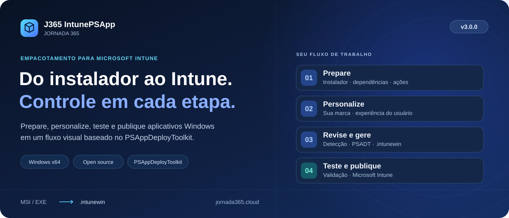
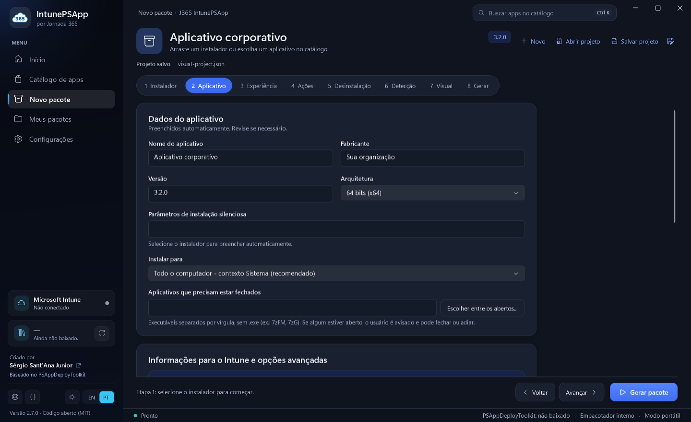
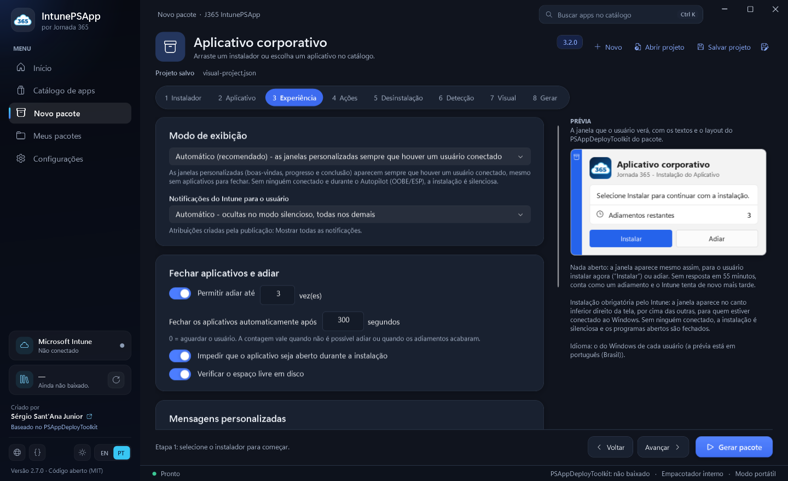
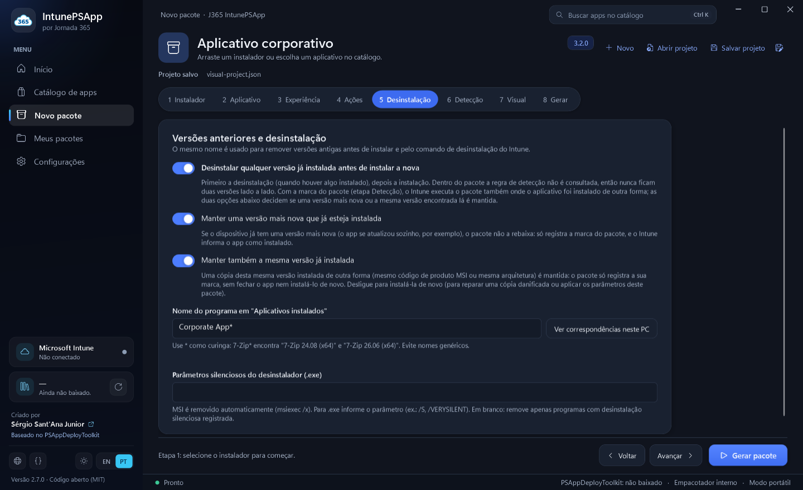
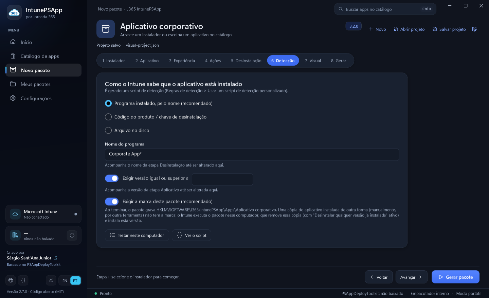
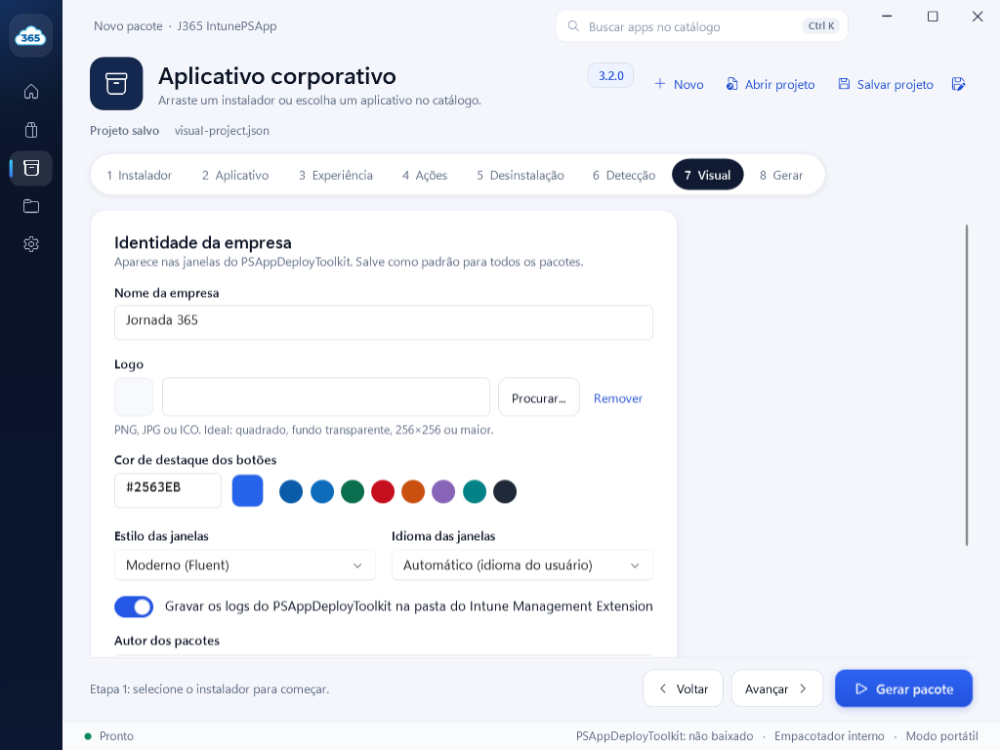
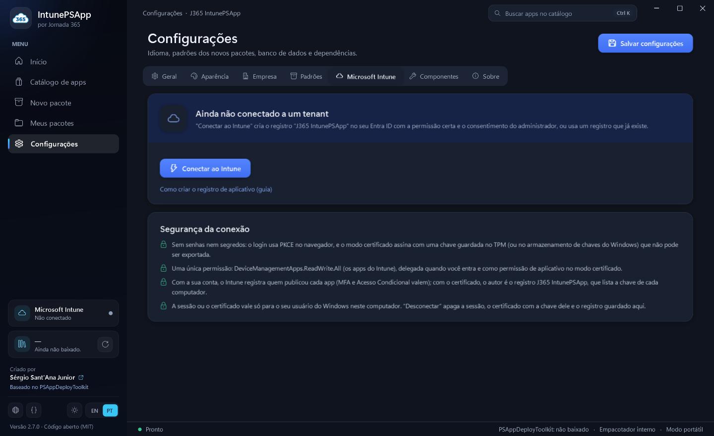
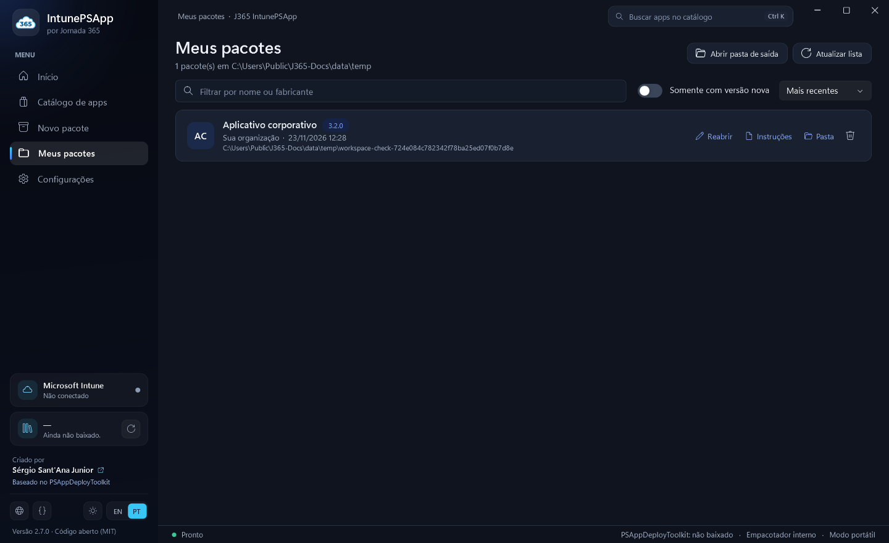
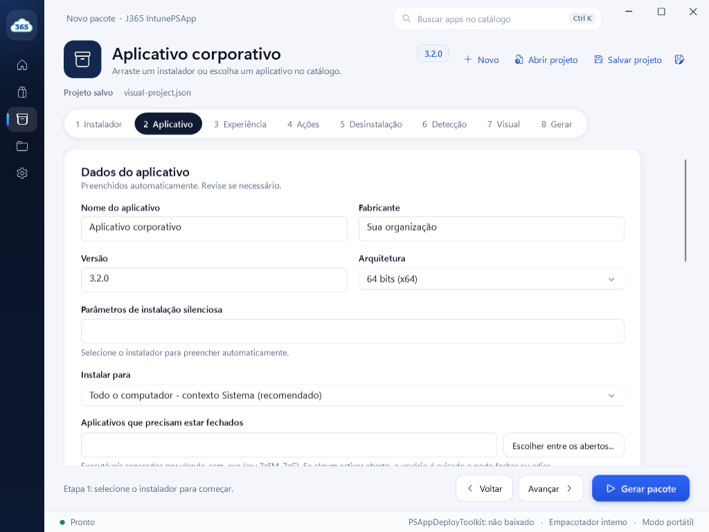

<a href="README.md">English</a> · <strong>Português (Brasil)</strong>

<b>Menos tarefas repetitivas. Mais consistência nos seus pacotes.</b> Uma interface visual para preparar, personalizar, testar e publicar aplicativos Windows.

<a href="#recursos">Conheça os recursos</a> · <a href="#comecar">Como começar</a> · <a href="https://github.com/sesantanajr/J365-IntunePSApp/releases/tag/v2.7.0">Notas da versão</a>

  

## Seu próximo pacote começa aqui

Transforme um instalador MSI ou EXE em um pacote organizado para o Microsoft Intune. O **J365 IntunePSApp** reúne a configuração da instalação, a experiência do usuário, as ações, a detecção e a publicação em um fluxo guiado baseado no **PSAppDeployToolkit**.

| Prepare com mais agilidade | Padronize a experiência | Mantenha o controle |
| --- | --- | --- |
| Catálogo do winget e da Microsoft Store, análise de instaladores, sugestões de parâmetros silenciosos e deploy em lote. | Logo, cores, mensagens, adiamentos e padrões reutilizáveis da sua empresa. | Revisão antes de gerar, testes, logs e proteção contra publicação de pacotes desatualizados. |

**Um fluxo, do começo ao fim:** instalador → aplicativo → experiência → ações → desinstalação → detecção → visual → gerar → testar → publicar.

## Conheça o que você pode fazer

As telas abaixo são capturas reais da **2.7**, com um projeto demonstrativo. Clique nas imagens para ampliar. Os estados de conexão e teste ilustram a interface, sem representar uma implantação em tenant real.

### 01 · Apresente melhor seus aplicativos no Intune

Organize descrição, fabricante, desenvolvedor, proprietário e links de informação e privacidade. Nome e versão ficam em campos separados, com identidade mais clara para o catálogo corporativo.

### 02 · Cuide da experiência de quem recebe a instalação

Defina o modo de exibição, os aplicativos que precisam ser fechados, os adiamentos e as mensagens — ou uma instalação **silenciosa**, sem janelas e sem notificações do Intune. Combine isso com ações antes ou depois da instalação: arquivos, registro, serviços, dependências e comandos personalizados.

<table><tr><td width="50%"><b>Experiência do usuário e adiamentos</b> </td><td width="50%"><b>Ações prontas e arquivos extras</b> </td></tr></table>

### 03 · Planeje a atualização e a detecção

Configure a remoção de versões anteriores e a preservação de uma versão mais nova. Escolha como o Intune reconhecerá a instalação: nome e versão, código do produto ou arquivo. Revise o script gerado antes de distribuir.

<table><tr><td width="50%"><b>Tratamento de versões anteriores</b> </td><td width="50%"><b>Regras de detecção e teste local</b> </td></tr></table>

### 04 · Dê aos pacotes a identidade da sua empresa

Use seu nome, logo e cor de destaque nos diálogos do PSAppDeployToolkit. Salve os padrões para os próximos projetos e escolha a aparência do editor entre claro, escuro ou o tema do Windows.

<table><tr><td width="50%"><b>Marca e cores da empresa</b> </td><td width="50%"><b>Aparência e preferências do editor</b> </td></tr></table>

### 05 · Prepare a conexão e acompanhe a publicação

A solução oferece conexão por certificado do aplicativo, conta de usuário, registro existente ou Azure Cloud Shell. Depois de gerar e testar o pacote, publique ou atualize o aplicativo no Intune com acompanhamento do envio — um de cada vez ou vários de uma vez com a mesma atribuição, inclusive apps da Microsoft Store. [Veja o guia de publicação](docs/INTUNE-PUBLISH.md).

<table><tr><td width="50%"><b>Opções de conexão com o Microsoft Intune</b> </td><td width="50%"><b>Estado e configurações da conexão</b> </td></tr></table>

### 06 · Encontre seus pacotes e retome o trabalho

Reabra projetos, localize pacotes pelo nome ou fabricante e ordene a biblioteca por data, nome ou atualizações disponíveis. O carregamento acontece em segundo plano; buscas sem resultados oferecem um caminho para limpar os filtros.

<table><tr><td width="50%"><b>Biblioteca com busca e ordenação</b> </td><td width="50%"><b>Filtros com recuperação simples</b> </td></tr></table>

### 07 · Saiba quando é hora de gerar novamente

O editor diferencia o projeto salvo do pacote gerado. Mudou as configurações? O resultado anterior recebe um aviso e suas ações de publicação e teste ficam desabilitadas até a nova geração. Salvar não mascara um pacote desatualizado.

### 08 · Trabalhe do seu jeito

Interface em português e inglês, temas claro e escuro, janela adaptável, atalhos de projeto e execução portátil. **Ctrl+S** salva no arquivo atual; **Ctrl+Shift+S** cria outra cópia; **Ctrl+K** abre a busca do catálogo.

## O que você leva ao gerar um pacote

| Entrega | Para que serve |
| --- | --- |
| **Arquivo `.intunewin`** | Conteúdo preparado para o upload ao Microsoft Intune. |
| **Pacote PSAppDeployToolkit** | Estrutura de implantação com instalação, desinstalação, ações e experiência do usuário. |
| **Script de detecção** | Regra para verificar se o aplicativo está instalado conforme a configuração. |
| **Comandos e instruções** | Referência para instalação, desinstalação e preenchimento dos campos do Intune. |
| **Metadados e projeto** | Informações do aplicativo e configurações para reabrir e evoluir o pacote. |

O teste pode ser executado localmente ou no **Windows Sandbox**, quando disponível, com resultados e logs. Também há comandos de linha para automação. [Consulte a documentação](docs/BUILDING.md).

## Comece em três passos

1. Use o botão de download no topo e extraia o ZIP para uma pasta.
2. Abra **`J365.IntunePSApp.exe`** e conclua a preparação das ferramentas. O runtime está incluído; não é necessário instalar o SDK .NET.
3. Escolha um instalador ou um aplicativo do catálogo, configure o projeto e revise antes de gerar — ou marque vários aplicativos (winget ou Microsoft Store) e faça o deploy de todos juntos. Valide em um grupo piloto antes de distribuir.

## Novidades da 2.7

- **Atualização que funciona em redes corporativas:** a versão mais recente é lida nos arquivos da última release no github.com, e não mais na API do GitHub, cujas 60 consultas por hora por endereço são divididas por toda a rede da empresa. Uma verificação que falhou diz o motivo (e quando o limite libera), cada verificação fica no log, e uma janela aberta por dias verifica de novo a cada poucas horas. Cópias até a 2.6.0 dependem da API: se uma continuar dizendo "versão mais recente", baixe esta versão uma vez.
- **A mesma versão já instalada é mantida:** um dispositivo que já tem exatamente esta versão do mesmo produto não é mais desinstalado e reinstalado (9 minutos e um pedido para fechar o Adobe Acrobat Reader numa implantação real): o pacote aplica as ações pós-instalação e grava a sua marca. Uma opção na etapa Desinstalação.
- **Pacotes mais rápidos e robustos:** nomes de pasta curtos e verificação do caminho antes do IntuneWinAppUtil (caminhos longos no OneDrive o faziam falhar), e um empacotador interno que não recompacta mais os instaladores (segundos em vez de minutos). As Configurações avisam quando a pasta de pacotes está no OneDrive.
- **Correções na publicação:** apps da Microsoft Store são publicados pelo Microsoft Graph beta (onde o `winGetApp` existe), uma resposta perdida não cria mais duplicatas, e a lista de versões anteriores nunca pré-seleciona um app de outro nome.
- **Uma janela por vez** e configurações gravadas com segurança: abrir o aplicativo de novo traz a janela aberta para a frente, em vez de uma segunda janela que sobrescrevia as configurações da primeira.
- **Interface e textos:** o lote não inicia duas vezes durante o login, o catálogo se atualiza após uma atualização do banco de dados e ignora cliques duplos na barra de rolagem, as Configurações mantêm o que foi digitado, Esc fecha as caixas de diálogo e os textos em português foram revisados.

A 2.6 trouxe os apps da Microsoft Store, o deploy em lote no Intune, instalações silenciosas de verdade, ícones e parâmetros corretos. Todas as mudanças: [CHANGELOG](CHANGELOG.md).

## Evolução com qualidade

Cada release passa por **409 testes automatizados** no Windows (scripts gerados validados pelo Windows PowerShell 5.1, empacotamento, detecção, textos da publicação, leitura da Microsoft Store, planejamento do lote, idiomas), além de verificações que renderizam o editor, as configurações e as janelas de conexão e de lote nos dois idiomas e temas. A pesquisa na Microsoft Store e a verificação de atualizações também foram exercitadas nos serviços reais. Veja a [revisão de qualidade](docs/QUALITY.md).

Projetos antigos continuam legíveis. Atualizar o editor não altera automaticamente aplicativos já publicados no tenant. A identificação da revisão acompanha novos pacotes; regenere os antigos para recebê-la.

**Compatibilidade:** editor WPF/.NET 10 para Windows x64. A arquitetura ARM64 nos pacotes não equivale a um editor nativo ARM64. Parâmetros silenciosos, detecção e reinício dependem do instalador e precisam de teste. A publicação em tenant real (pacotes e apps da Microsoft Store) deve ser validada com um grupo piloto.

**Assinatura:** o executável desta release ainda não é assinado com Authenticode. Consulte as [orientações de assinatura](docs/SIGNING.md) se uma política do Windows impedir a execução.

## Documentação e comunidade

[Novidades por versão](CHANGELOG.md) · [Análise técnica](docs/QUALITY.md) · [Publicação no Intune](docs/INTUNE-PUBLISH.md) · [Compilar](docs/BUILDING.md) · [Arquitetura / Architecture](docs/ARCHITECTURE.md)

[Contribuir](CONTRIBUTING.md) · [Relatar um problema](https://github.com/sesantanajr/J365-IntunePSApp/issues) · [Security](SECURITY.md) · [SHA256SUMS.txt](https://github.com/sesantanajr/J365-IntunePSApp/releases/download/v2.7.0/SHA256SUMS.txt)

---

<b>Criado por <a href="https://www.linkedin.com/in/sergiosantanacloud/">Sérgio Sant'Ana Junior</a></b> <a href="https://jornada365.cloud">Jornada 365</a> · Sua jornada começa aqui.

<a href="https://jornada365.cloud"><picture><source media="(prefers-color-scheme: dark)" srcset="docs/assets/j365-blog-logo-dark.png"></picture></a>

Baseado no [PSAppDeployToolkit](https://psappdeploytoolkit.com), com catálogo derivado de [microsoft/winget-pkgs](https://github.com/microsoft/winget-pkgs). Projeto independente, sem afiliação com a Microsoft.

[MIT License](LICENSE) · [Third-party notices](THIRD-PARTY-NOTICES.md) · [Code signing policy](CODE_SIGNING_POLICY.md)
