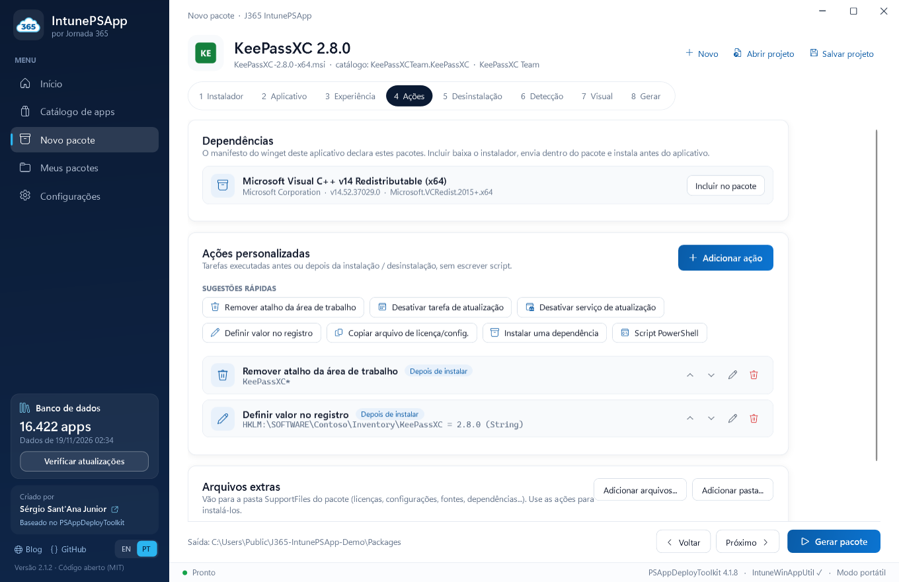
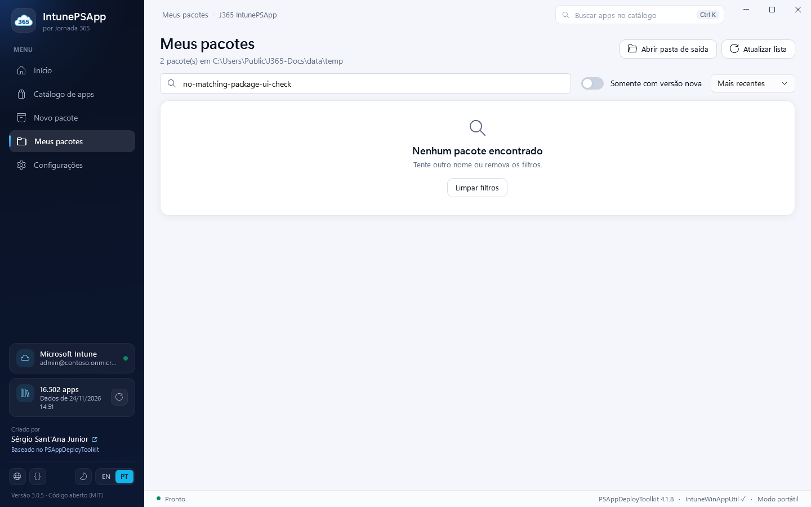
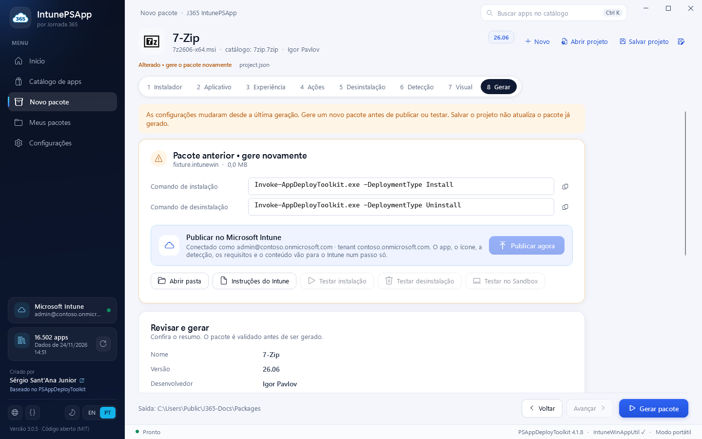

<a href="README.md">English</a> · <strong>Português (Brasil)</strong>

<b>Menos tarefas repetitivas. Mais consistência nos seus pacotes.</b> Uma interface visual para preparar, personalizar, testar e publicar aplicativos Windows.

<a href="#recursos">Conheça os recursos</a> · <a href="#comecar">Como começar</a> · <a href="https://github.com/sesantanajr/J365-IntunePSApp/releases/tag/v2.6.0">Notas da versão</a>

  

## Seu próximo pacote começa aqui

Transforme um instalador MSI ou EXE em um pacote organizado para o Microsoft Intune. O **J365 IntunePSApp** reúne a configuração da instalação, a experiência do usuário, as ações, a detecção e a publicação em um fluxo guiado baseado no **PSAppDeployToolkit**.

| Prepare com mais agilidade | Padronize a experiência | Mantenha o controle |
| --- | --- | --- |
| Catálogo baseado no winget, análise de instaladores e sugestões de parâmetros silenciosos. | Logo, cores, mensagens, adiamentos e padrões reutilizáveis da sua empresa. | Revisão antes de gerar, testes, logs e proteção contra publicação de pacotes desatualizados. |

**Um fluxo, do começo ao fim:** instalador → aplicativo → experiência → ações → desinstalação → detecção → visual → gerar → testar → publicar.

## Conheça o que você pode fazer

As telas abaixo são capturas reais da **2.5.1**, com um projeto demonstrativo. Clique nas imagens para ampliar. Os estados de conexão e teste ilustram a interface, sem representar uma implantação em tenant real.

### 01 · Apresente melhor seus aplicativos no Intune

Organize descrição, fabricante, desenvolvedor, proprietário e links de informação e privacidade. Nome e versão ficam em campos separados, com identidade mais clara para o catálogo corporativo.

### 02 · Cuide da experiência de quem recebe a instalação

Defina o modo de exibição, os aplicativos que precisam ser fechados, os adiamentos e as mensagens. Combine isso com ações antes ou depois da instalação: arquivos, registro, serviços, dependências e comandos personalizados.

<table><tr><td width="50%"><b>Experiência do usuário e adiamentos</b> </td><td width="50%"><b>Ações prontas e arquivos extras</b> </td></tr></table>

### 03 · Planeje a atualização e a detecção

Configure a remoção de versões anteriores e a preservação de uma versão mais nova. Escolha como o Intune reconhecerá a instalação: nome e versão, código do produto ou arquivo. Revise o script gerado antes de distribuir.

<table><tr><td width="50%"><b>Tratamento de versões anteriores</b> </td><td width="50%"><b>Regras de detecção e teste local</b> </td></tr></table>

### 04 · Dê aos pacotes a identidade da sua empresa

Use seu nome, logo e cor de destaque nos diálogos do PSAppDeployToolkit. Salve os padrões para os próximos projetos e escolha a aparência do editor entre claro, escuro ou o tema do Windows.

<table><tr><td width="50%"><b>Marca e cores da empresa</b> </td><td width="50%"><b>Aparência e preferências do editor</b> </td></tr></table>

### 05 · Prepare a conexão e acompanhe a publicação

A solução oferece conexão por certificado do aplicativo, conta de usuário, registro existente ou Azure Cloud Shell. Depois de gerar e testar o pacote, publique ou atualize o aplicativo no Intune com acompanhamento do envio. [Veja o guia de publicação](docs/INTUNE-PUBLISH.md).

<table><tr><td width="50%"><b>Opções de conexão com o Microsoft Intune</b> </td><td width="50%"><b>Estado e configurações da conexão</b> </td></tr></table>

### 06 · Encontre seus pacotes e retome o trabalho

Reabra projetos, localize pacotes pelo nome ou fabricante e ordene a biblioteca por data, nome ou atualizações disponíveis. O carregamento acontece em segundo plano; buscas sem resultados oferecem um caminho para limpar os filtros.

<table><tr><td width="50%"><b>Biblioteca com busca e ordenação</b> </td><td width="50%"><b>Filtros com recuperação simples</b> </td></tr></table>

### 07 · Saiba quando é hora de gerar novamente

Na **2.5.1**, o editor diferencia o projeto salvo do pacote gerado. Mudou as configurações? O resultado anterior recebe um aviso e suas ações de publicação e teste ficam desabilitadas até a nova geração. Salvar não mascara um pacote desatualizado.

### 08 · Trabalhe do seu jeito

Interface em português e inglês, temas claro e escuro, janela adaptável, atalhos de projeto e execução portátil. **Ctrl+S** salva no arquivo atual; **Ctrl+Shift+S** cria outra cópia; **Ctrl+K** abre a busca do catálogo.

## O que você leva ao gerar um pacote

| Entrega | Para que serve |
| --- | --- |
| **Arquivo `.intunewin`** | Conteúdo preparado para o upload ao Microsoft Intune. |
| **Pacote PSAppDeployToolkit** | Estrutura de implantação com instalação, desinstalação, ações e experiência do usuário. |
| **Script de detecção** | Regra para verificar se o aplicativo está instalado conforme a configuração. |
| **Comandos e instruções** | Referência para instalação, desinstalação e preenchimento dos campos do Intune. |
| **Metadados e projeto** | Informações do aplicativo e configurações para reabrir e evoluir o pacote. |

O teste pode ser executado localmente ou no **Windows Sandbox**, quando disponível, com resultados e logs. Também há comandos de linha para automação. [Consulte a documentação](docs/BUILDING.md).

## Comece em três passos

1. Use o botão de download no topo e extraia o ZIP para uma pasta.
2. Abra **`J365.IntunePSApp.exe`** e conclua a preparação das ferramentas. O runtime está incluído; não é necessário instalar o SDK .NET.
3. Escolha um instalador ou aplicativo do catálogo, configure o projeto e revise antes de gerar. Valide em um grupo piloto antes de distribuir.

## Novidades da 2.6

- **Apps da Microsoft Store:** o catálogo também pesquisa a Microsoft Store ao vivo, pelo nome ou pelo ID (`9PM860492SZD` encontra o Microsoft PC Manager), e publica esses apps no Intune como **Microsoft Store app (new)**: o Intune instala pela Store e mantém atualizado, sem pacote, com o logo oficial no Portal da Empresa. Sozinhos ou em lote.
- **Deploy em lote:** marque vários aplicativos no catálogo e gere todos de uma vez com as mesmas configurações (nome da empresa, proprietário, modo de exibição, notificações e adiamento). Cada instalador é baixado do link oficial, conferido pelo SHA256 e empacotado como no editor; opcionalmente, cada pacote é publicado no Intune com a mesma atribuição. Um `.exe` sem parâmetros silenciosos conhecidos, ou um nome que também corresponde a outros aplicativos, é pulado com o motivo, nunca adivinhado, e pode ser aberto no editor. Também por linha de comando: `--batch id1,id2 --mode Silent --publish`.
- **Instalação silenciosa de verdade:** no modo **Silencioso** o pacote não mostra janelas nem bloqueia aplicativos e, por padrão, a atribuição criada na publicação oculta as notificações do Intune (`hideAll`) e não reinicia o computador. A escolha de notificações também pode ser feita por pacote e como padrão da empresa.
- **Menos campos repetidos:** a opção de desinstalar versões anteriores fica só na etapa Desinstalação; o nome e a versão da detecção acompanham as etapas Desinstalação e Aplicativo até serem alterados.
- **Ícones corretos:** ícones genéricos de instaladores (Inno Setup, WiX Burn e os ícones de fábrica do NSIS) não vão mais para o Portal da Empresa; entra o ícone do programa instalado ou o bloco com as iniciais.
- **Atualização confiável:** "Verificar agora" só diz que está atualizado quando conseguiu consultar o GitHub, mostra a versão encontrada e, se a API do GitHub estiver bloqueada, usa a página de versões.
- **Parâmetros corretos:** switches que a análise encontra no próprio instalador (NSIS, InstallShield, Advanced Installer, Squirrel) não são mais descartados quando o banco de dados não traz switches; instaladores Inno Setup por usuário recebem `/CURRENTUSER`, como no winget (432 aplicativos); e a detecção do .NET Desktop Runtime 10 volta a reconhecer o nome que ele registra.

## Evolução com qualidade

A **2.5.1** adiciona controle de revisão dos pacotes, salvamento no arquivo atual, reserva independente das pastas de saída, validação de entradas numéricas e uma biblioteca mais responsiva. A release passou por **292 testes automatizados**, além das verificações do fluxo editar/salvar/reabrir e da renderização da interface.

Projetos antigos continuam legíveis. Atualizar o editor não altera automaticamente aplicativos já publicados no tenant. A identificação da revisão acompanha novos pacotes; regenere os antigos para recebê-la.

**Compatibilidade:** editor WPF/.NET 10 para Windows x64. A arquitetura ARM64 nos pacotes não equivale a um editor nativo ARM64. Parâmetros silenciosos, detecção e reinício dependem do instalador e precisam de teste. A validação desta revisão em tenant real continua pendente.

**Assinatura:** o executável desta release ainda não é assinado com Authenticode. Consulte as [orientações de assinatura](docs/SIGNING.md) se uma política do Windows impedir a execução.

## Documentação e comunidade

[Novidades por versão](CHANGELOG.md) · [Análise técnica](docs/QUALITY-25.md) · [Publicação no Intune](docs/INTUNE-PUBLISH.md) · [Compilar](docs/BUILDING.md) · [Arquitetura / Architecture](docs/ARCHITECTURE.md)

[Contribuir](CONTRIBUTING.md) · [Relatar um problema](https://github.com/sesantanajr/J365-IntunePSApp/issues) · [Security](SECURITY.md) · [SHA256SUMS.txt](https://github.com/sesantanajr/J365-IntunePSApp/releases/download/v2.6.0/SHA256SUMS.txt)

---

<b>Criado por <a href="https://www.linkedin.com/in/sergiosantanacloud/">Sérgio Sant'Ana Junior</a></b> <a href="https://jornada365.cloud">Jornada 365</a> · Sua jornada começa aqui.

<a href="https://jornada365.cloud"><picture><source media="(prefers-color-scheme: dark)" srcset="docs/assets/j365-blog-logo-dark.png"></picture></a>

Baseado no [PSAppDeployToolkit](https://psappdeploytoolkit.com), com catálogo derivado de [microsoft/winget-pkgs](https://github.com/microsoft/winget-pkgs). Projeto independente, sem afiliação com a Microsoft.

[MIT License](LICENSE) · [Third-party notices](THIRD-PARTY-NOTICES.md) · [Code signing policy](CODE_SIGNING_POLICY.md)
