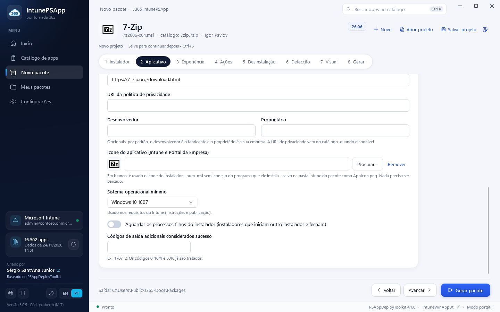
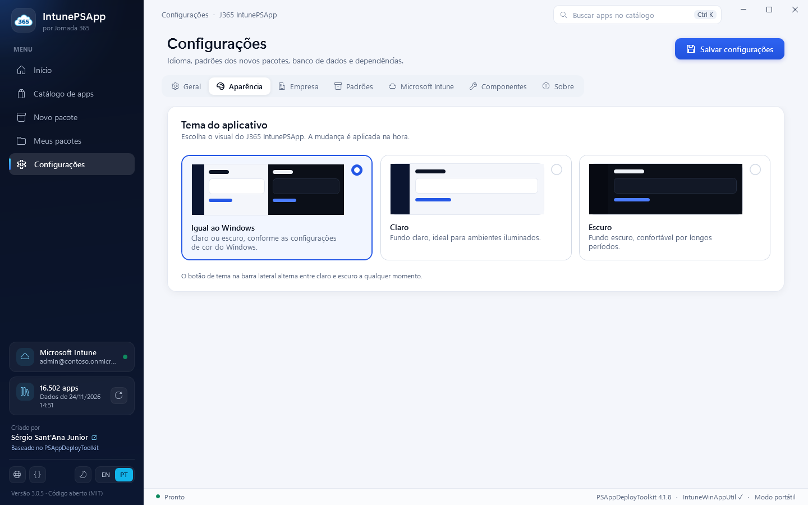
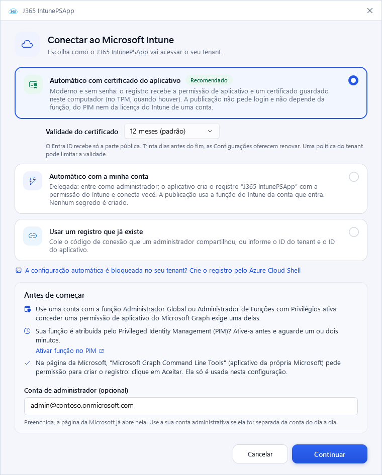
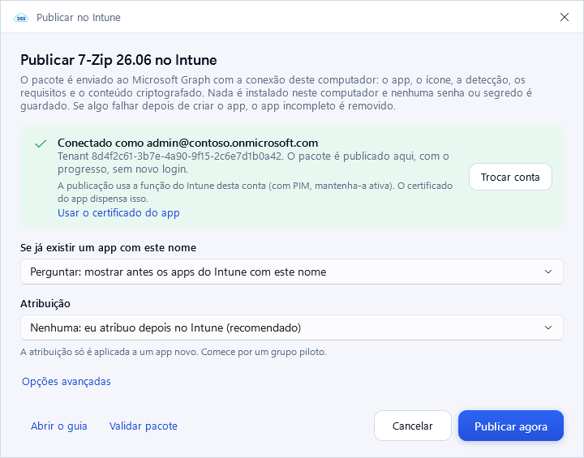
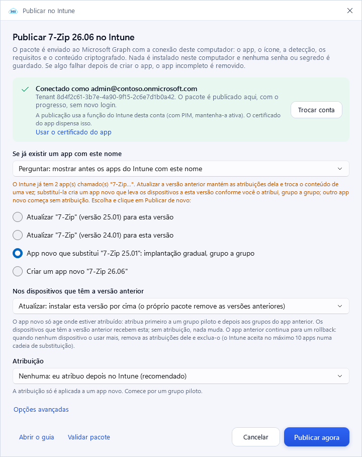
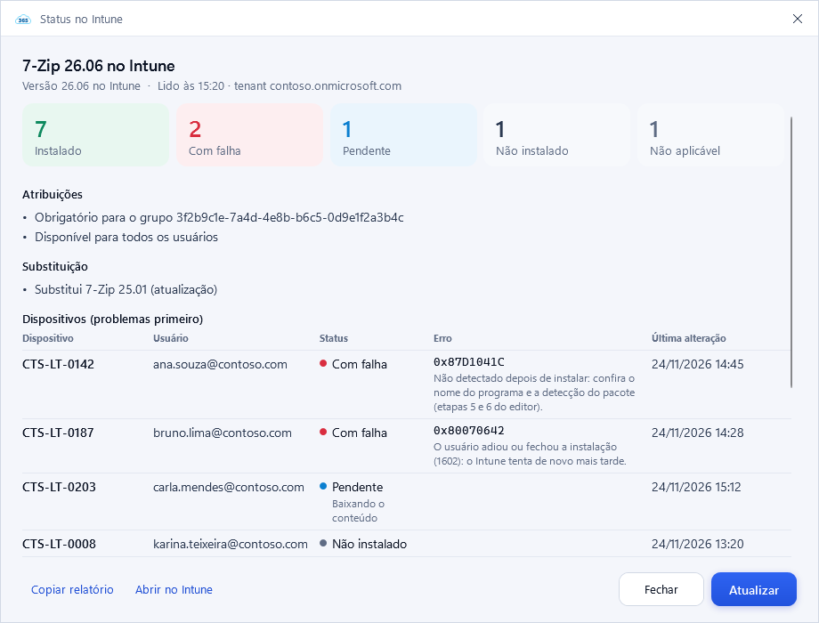
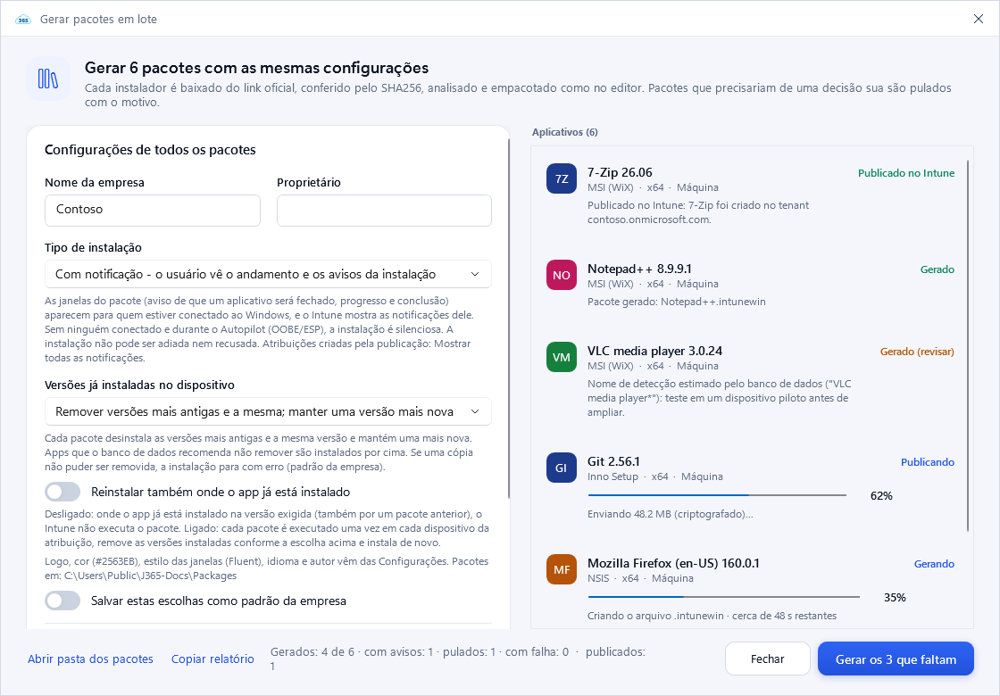

<a href="README.md">English</a> · <strong>Português (Brasil)</strong>

<b>Menos tarefas repetitivas. Mais consistência nos seus pacotes.</b> Uma interface visual para preparar, personalizar, testar e publicar aplicativos Windows.

<a href="#recursos">Conheça os recursos</a> · <a href="#comecar">Como começar</a> · <a href="docs/USER-GUIDE.pt-BR.md"><b>Manual de uso</b></a> · <a href="https://github.com/sesantanajr/J365-IntunePSApp/releases/tag/v3.0.6">Notas da versão</a>

  

## Seu próximo pacote começa aqui

Transforme um instalador MSI ou EXE — ou qualquer aplicativo do catálogo do winget e da Microsoft Store — em um pacote organizado para o Microsoft Intune. O **J365 IntunePSApp** reúne a configuração da instalação, a experiência do usuário, as ações, a detecção e a publicação em um fluxo guiado baseado no **PSAppDeployToolkit**.

| Prepare com mais agilidade | Padronize a experiência | Mantenha o controle |
| --- | --- | --- |
| Catálogo do winget e da Microsoft Store, análise de instaladores, sugestões de parâmetros silenciosos e deploy em lote. | Instalação silenciosa ou com notificação, logo, cores, mensagens e padrões reutilizáveis da sua empresa. | Revisão antes de gerar, testes, logs e proteção contra publicação de pacotes desatualizados. |

**Um fluxo completo:** catálogo ou instalador → aplicativo → experiência → ações → desinstalação → detecção → visual → geração → teste → publicação. Cada tela está explicada no **[manual de uso](docs/USER-GUIDE.pt-BR.md)**.

## Manual de uso

**[Abra o manual de uso](docs/USER-GUIDE.pt-BR.md)**: todas as telas, passo a passo e com capturas — instalação e primeira execução, catálogo (winget e Microsoft Store), as oito etapas do editor, testes, conexão e publicação no Intune, substituição de versões, status da instalação, deploy em lote, configurações, atualização do aplicativo, linha de comando e solução de problemas. *In English: [User manual](docs/USER-GUIDE.md).*

## Conheça o que você pode fazer

Capturas reais da **3.0.5** com uma empresa demonstrativa (Contoso) e o MSI do 7-Zip, empacotado de verdade. Clique nas imagens para ampliar. A conexão com o Intune é um exemplo: nada foi publicado em um tenant.

### 01 · Encontre qualquer aplicativo

Pesquise mais de 16 mil aplicativos do winget pelo nome, fabricante ou ID — com cada instalador, os parâmetros silenciosos que serão usados e a curadoria do Jornada 365 — e a Microsoft Store ao vivo, pelo nome ou ID do produto. **Baixar e empacotar** confere o instalador pelo SHA256 e o abre no editor já preenchido.

### 02 · Apresente melhor seus aplicativos no Intune

O instalador é analisado e reconhecido; nome, versão, arquitetura, contexto e ícone são preenchidos. Descrição, fabricante, desenvolvedor, proprietário e links de informações e privacidade vão para o Intune nos campos próprios.

<table><tr><td width="50%"><b>Aplicativo, arquitetura e contexto</b> </td><td width="50%"><b>Informações exibidas no Intune e no Portal da Empresa</b> </td></tr></table>

### 03 · Cuide da experiência de quem recebe a instalação

Escolha entre a instalação **com notificação** (as janelas do pacote e as notificações do Intune) e a **silenciosa** (nada aparece), defina o fechamento de aplicativos e as mensagens, com a prévia ao vivo da janela real do PSAppDeployToolkit. A instalação não pode ser adiada. Adicione ações antes e depois da instalação para arquivos, registro, serviços, dependências e comandos.

<table><tr><td width="50%"><b>Instalação silenciosa ou com notificação</b> </td><td width="50%"><b>Ações prontas e arquivos extras</b> </td></tr></table>

### 04 · Planeje a atualização e a detecção

Escolha o que cada pacote faz com as versões já instaladas: **remover qualquer versão** (mais antiga, a mesma ou mais nova) e instalar de novo, **manter uma versão mais nova** ou **instalar por cima**. Componentes compartilhados (runtimes do Visual C++ e do .NET, WebView2, Edge) nunca são removidos e, se uma cópia não puder ser removida, a instalação para em vez de deixar duas versões lado a lado. Com **Reinstalar também onde o app já está instalado**, o Intune executa o pacote uma vez em cada dispositivo, inclusive onde um pacote anterior já instalou o app. Detecte por nome/versão, código do produto ou arquivo, com a marca do pacote, e teste a regra no seu computador.

<table><tr><td width="50%"><b>Versões anteriores e versões mantidas</b> </td><td width="50%"><b>Regras de detecção e testes locais</b> </td></tr></table>

### 05 · Dê aos pacotes a identidade da sua empresa

Use o nome, o logo e a cor de destaque da sua empresa nas janelas do PSAppDeployToolkit, salve tudo como padrão da empresa e trabalhe no tema claro, escuro ou igual ao Windows.

<table><tr><td width="50%"><b>Identidade visual e cores</b> </td><td width="50%"><b>Aparência do editor</b> </td></tr></table>

### 06 · Gere, teste e saiba quando gerar de novo

Um clique monta o pacote do PSAppDeployToolkit, o script de detecção e o `.intunewin`, com os comandos e as instruções para o Intune, mostrando a porcentagem real e o tempo restante enquanto gera. Teste aqui ou no Windows Sandbox. Configurações alteradas marcam o resultado como desatualizado e desligam publicação e testes até você gerar de novo.

<table><tr><td width="50%"><b>Pacote pronto para o Intune</b> </td><td width="50%"><b>Pacote desatualizado: gere novamente</b> </td></tr></table>

### 07 · Conecte, publique e acompanhe a instalação

Conecte com a sua conta, com um certificado do aplicativo guardado no TPM, com um registro que já existe ou pelo Azure Cloud Shell. Crie ou atualize o app no Intune com a porcentagem e o tempo restante do envio, o ícone, a detecção, os requisitos e uma atribuição opcional — ou, novidade da 2.8, publique a versão nova como um app novo que **substitui** o anterior e implante grupo a grupo. Depois, o **Status no Intune** mostra os dispositivos instalados, com falha e pendentes, com cada código de erro explicado. [Guia de publicação](docs/INTUNE-PUBLISH.md).

<table><tr><td width="50%"><b>Formas de conectar</b> </td><td width="50%"><b>Publicar no Intune</b> </td></tr><tr><td width="50%"><b>Uma versão nova que substitui a anterior</b> </td><td width="50%"><b>Status no Intune</b> </td></tr></table>

### 08 · Implante vários aplicativos de uma vez

Marque aplicativos do catálogo (winget ou Microsoft Store), defina o que eles têm em comum e gere — e, se quiser, publique — todos. As escolhas em comum incluem o que fazer com as versões já instaladas e a reinstalação onde o app já está; cada aplicativo mostra a etapa, a porcentagem e o tempo restante. O que precisaria de um palpite é pulado com o motivo e pode ser terminado no editor.

### 09 · Encontre seus pacotes e retome o trabalho

Reabra projetos, pesquise pelo nome ou fabricante, ordene por data, nome ou atualizações disponíveis e saia de uma busca vazia com um clique.

<table><tr><td width="50%"><b>Biblioteca de pacotes e ordenação</b> </td><td width="50%"><b>Busca sem resultados com ação de recuperação</b> </td></tr></table>

### 10 · Trabalhe do seu jeito

Português ou inglês, claro ou escuro, portátil ou instalado para o seu usuário, atualizações sem sair do aplicativo e padrões que todo pacote novo segue.

<table><tr><td width="50%"><b>Configurações gerais, atualizações e pastas</b> </td><td width="50%"><b>Configurações e estado da conexão</b> </td></tr></table>

## O que você leva ao gerar um pacote

| Entrega | Para que serve |
| --- | --- |
| **Arquivo `.intunewin`** | Conteúdo preparado para o upload ao Microsoft Intune. |
| **Pacote PSAppDeployToolkit** | Estrutura de implantação com instalação, desinstalação, ações e experiência do usuário. |
| **Script de detecção** | Regra para verificar se o aplicativo está instalado conforme a configuração. |
| **Comandos e instruções** | Referência para instalação, desinstalação e preenchimento dos campos do Intune. |
| **Metadados e projeto** | Informações do aplicativo e configurações para reabrir e evoluir o pacote. |

O teste pode ser executado localmente ou no **Windows Sandbox**, quando disponível, com resultados e logs. Também há comandos de linha para automação. [Consulte a documentação](docs/BUILDING.md).

## Comece em três passos

1. Use o botão de download no topo e extraia o ZIP para uma pasta.
2. Abra **`J365.IntunePSApp.exe`** e conclua a preparação das ferramentas. O runtime está incluído; não é necessário instalar o SDK .NET.
3. Escolha um instalador ou um aplicativo do catálogo, configure o projeto e revise antes de gerar — ou marque vários aplicativos (winget ou Microsoft Store) e faça o deploy de todos juntos. Valide em um grupo piloto antes de distribuir. O [manual de uso](docs/USER-GUIDE.pt-BR.md) percorre cada tela.

## Novidades da 3.0.1 à 3.0.6

- **Remover qualquer versão instalada** (3.0.1): uma escolha só, no editor, nos padrões da empresa e no lote. O pacote remove a versão mais antiga, a mesma e a mais nova antes de instalar, no modo silencioso ou com notificação; componentes compartilhados nunca são removidos.
- **Reinstalar também onde o app já está instalado** (3.0.3): o Intune executa o pacote uma vez em cada dispositivo, mesmo onde um pacote anterior do mesmo app já o instalou (antes, a marca desse pacote fazia o Intune considerar o app instalado).
- **Porcentagem real e tempo restante** (3.0.2 e 3.0.4): na criação do `.intunewin` (as seis passagens da ferramenta da Microsoft, medidas pelo trabalho real), em cada aplicativo do lote, no envio ao Intune (antes informado a cada 10%) e nos downloads.
- **Todo aplicativo do catálogo baixa** (3.0.5): o banco de dados confere os links dos instaladores todos os dias. Quando a versão mais nova do winget está com o link quebrado (cerca de 2% deles, o Autodesk DWG TrueView 2027 entre eles), a versão anterior que funciona entra no lugar; quando nenhuma funciona, o aplicativo fica marcado como *Link indisponível*, o *Somente compatíveis* o esconde, o lote o pula com o motivo e o site do fabricante é oferecido.
- **Instalações que colidem são tentadas de novo** (3.0.6): um instalador `.exe` espera o Windows Installer, e um que falha enquanto outra instalação roda termina com 1618, que o Intune repete, em vez de falhar. Uma cópia que não pôde ser removida termina com um código próprio (69001), explicado no *Status no Intune*, e a publicação encontra um app do mesmo produto com outro nome pela marca do pacote (gravada nas observações do app) antes de criar um segundo.
- **Lote mais claro** (3.0.1): a barra do catálogo numa linha, com a contagem, e os textos no singular quando há um só aplicativo.

## Novidades da 3.0

- **Instalação silenciosa ou com notificação:** os quatro modos de exibição, a escolha das notificações do Intune e os adiamentos viraram uma escolha só. *Com notificação* mostra as janelas do pacote e as notificações do Intune; *Silenciosa* não mostra nada. Projetos antigos continuam abrindo.
- **Sem adiamento:** a opção de o usuário adiar a instalação (3 vezes, por padrão) foi removida.
- **Remoção garantida antes de instalar:** tudo o que estiver instalado sai antes, inclusive a mesma versão. MSI pelo código do produto; .exe pelos parâmetros do pacote, pelo comando silencioso registrado ou pelos parâmetros do Inno Setup e do NSIS, reconhecidos no dispositivo. Se uma cópia continuar instalada, a instalação para com erro (ou instala por cima, se você permitir).
- **Menos motivos para o antivírus desconfiar:** o executável não é mais comprimido e o aplicativo não remove mais a "marca da web" dos arquivos que baixa. O Controle Inteligente de Aplicativos continua exigindo a release assinada ([como assinar](docs/SIGNING.md)).

A 2.8 trouxe a substituição (uma versão nova, grupo a grupo) e o status de instalação no Intune; a 2.7, a verificação de atualizações que funciona em redes corporativas e o [manual de uso](docs/USER-GUIDE.pt-BR.md). Todas as mudanças: [CHANGELOG](CHANGELOG.md).

## Evolução com qualidade

Cada release passa por **517 testes automatizados** no Windows (scripts gerados validados pelo Windows PowerShell 5.1, empacotamento, detecção, a publicação de ponta a ponta contra um Microsoft Graph simulado, o status de instalação, leitura da Microsoft Store, planejamento do lote, idiomas), além de verificações que renderizam o editor, as configurações e as janelas de conexão, publicação, status e lote nos dois idiomas e temas. A pesquisa na Microsoft Store e a verificação de atualizações também foram exercitadas nos serviços reais. Veja a [revisão de qualidade](docs/QUALITY.md).

Projetos antigos continuam legíveis. Atualizar o editor não altera automaticamente aplicativos já publicados no tenant. A identificação da revisão acompanha novos pacotes; regenere os antigos para recebê-la.

**Compatibilidade:** editor WPF/.NET 10 para Windows x64. A arquitetura ARM64 nos pacotes não equivale a um editor nativo ARM64. Parâmetros silenciosos, detecção e reinício dependem do instalador e precisam de teste. A publicação em tenant real (pacotes e apps da Microsoft Store) deve ser validada com um grupo piloto.

**Assinatura:** as releases ainda não são assinadas com Authenticode (a 3.0.6 inclusive). Consulte a [política de assinatura de código](#política-de-assinatura-de-código-code-signing-policy) abaixo e as [orientações de assinatura](docs/SIGNING.md) se uma política do Windows impedir a execução.

## Política de assinatura de código (Code signing policy)

Free code signing provided by [SignPath.io](https://about.signpath.io), certificate by [SignPath Foundation](https://signpath.org) — assinatura de código gratuita fornecida pelo SignPath.io, com certificado da SignPath Foundation.

- **O que é assinado:** somente o executável de release compilado pelo GitHub Actions a partir deste repositório público, depois de os testes passarem. Cada pedido de assinatura é aprovado à mão.
- **Commits e revisão (*committers and reviewers*):** [Sérgio Sant'Ana Junior](https://github.com/sesantanajr). **Aprovação (*approvers*):** [Sérgio Sant'Ana Junior](https://github.com/sesantanajr).
- **Política de privacidade:** este programa não transfere nenhuma informação para outros sistemas em rede, a não ser quando solicitado especificamente pelo usuário ou por quem o instala ou opera.

As releases assinadas começam na primeira versão publicada depois que o projeto for aceito pela fundação; até lá, as releases não são assinadas. A política completa: [CODE_SIGNING_POLICY.md](CODE_SIGNING_POLICY.md).

## Documentação e comunidade

[Manual de uso](docs/USER-GUIDE.pt-BR.md) · [Novidades por versão](CHANGELOG.md) · [Análise técnica](docs/QUALITY.md) · [Publicação no Intune](docs/INTUNE-PUBLISH.md) · [Compilar](docs/BUILDING.md) · [Arquitetura / Architecture](docs/ARCHITECTURE.md)

[Contribuir](CONTRIBUTING.md) · [Relatar um problema](https://github.com/sesantanajr/J365-IntunePSApp/issues) · [Security](SECURITY.md) · [SHA256SUMS.txt](https://github.com/sesantanajr/J365-IntunePSApp/releases/download/v3.0.6/SHA256SUMS.txt)

---

<b>Criado por <a href="https://www.linkedin.com/in/sergiosantanacloud/">Sérgio Sant'Ana Junior</a></b> <a href="https://jornada365.cloud">Jornada 365</a> · Sua jornada começa aqui.

<a href="https://jornada365.cloud"><picture><source media="(prefers-color-scheme: dark)" srcset="docs/assets/j365-blog-logo-dark.png"></picture></a>

Baseado no [PSAppDeployToolkit](https://psappdeploytoolkit.com), com catálogo derivado de [microsoft/winget-pkgs](https://github.com/microsoft/winget-pkgs). Projeto independente, sem afiliação com a Microsoft.

[MIT License](LICENSE) · [Third-party notices](THIRD-PARTY-NOTICES.md) · [Code signing policy](CODE_SIGNING_POLICY.md)
