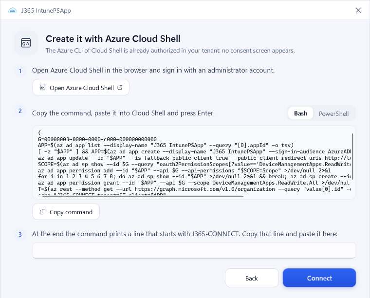
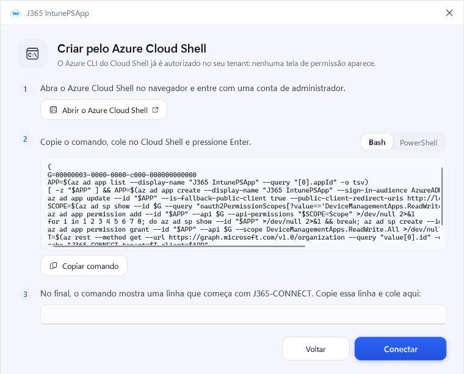

# Publish to Intune

*Português: [abaixo](#publicar-no-intune).*

## Connect with an app certificate (2.4.2, recommended)

*Connect to Intune > Automatic with an app certificate* (or *Settings > Microsoft Intune > Connect with a certificate*) connects this computer **as the application** instead of a user:

1. An administrator signs in once: **Global Administrator** or **Privileged Role Administrator**, because granting an *application permission* of Microsoft Graph takes one of them. *Microsoft Graph Command Line Tools* asks, besides the two permissions of the setup, for `AppRoleAssignment.ReadWrite.All`, used only to grant the permission below.
2. The registration **J365 IntunePSApp** gets `DeviceManagementApps.ReadWrite.All` also as an **application permission**, with the admin consent (an app role assignment of Microsoft Graph). The delegated permission stays, so technicians can still connect with their own accounts.
3. A **certificate** is created on this computer for your Windows user: RSA 2048, valid for 6, 12 or 24 months (chosen under the option; 12 by default), its key **in the TPM** when the computer has one (otherwise in the Windows key store) and **never exportable**. Only its public part goes to the registration (*Certificates & secrets*, named `J365 IntunePSApp - <computer>`); keys of other tools are sent back unchanged.
4. The application asks Microsoft for a token with a short assertion signed by that key (PS256, as Microsoft recommends) and reads one app from Intune to prove it works. A new key and a new permission take a minute or two to reach every server: the window waits and tries again.

From then on publishing needs **no sign-in, no password and no secret**, and it does not depend on the role, the PIM activation or the Intune license of an account. In Intune and Entra ID the actor is the application *J365 IntunePSApp*.

**Good to know.** The application permission lets the registration manage every app of Intune, so keep track of the computers that hold a certificate. *Settings > Microsoft Intune* shows the certificate (thumbprint, expiry, TPM or key store); *Disconnect* deletes it with its key, and an administrator can remove any key in the Entra admin center (*App registrations > J365 IntunePSApp > Certificates & secrets*) or the application permission (*API permissions*). A month before the expiry the application asks to connect again: the new certificate is added next to the one in use, which keeps working until the new one obtained a token and is then removed from this computer (its public part stays listed until it expires). A connection with an account (the automatic setup with your account, a code) replaces the certificate once it works; the application asks first. With Microsoft Entra Workload ID, Conditional Access for workload identities can also limit where the registration signs in from. The script works the same way by hand: `.\Publish-ToIntune.ps1 -TenantId <tenant> -ClientId <id> -CertificateThumbprint <thumbprint>`.

**When the registration is gone.** If the registration was deleted (or disabled) in Entra ID, the application notices it at start-up and before any browser opens, and *Settings > Microsoft Intune* says *The connection needs attention*: *Connect again* runs the automatic setup, which creates a new registration, and *Disconnect* clears everything saved on this computer (the session, the certificate with its key, the registration) so you can start from the beginning.

## Connect to Intune: every way, every step explained

*Settings > Microsoft Intune > Connect to Intune* (also on the sidebar card, in the publishing dialog and on the card of a generated package) opens a window with three ways in, and Azure Cloud Shell as a link under them:

| Way | When | What happens |
|---|---|---|
| **Automatic with an app certificate** (recommended, 2.4.2) | An administrator who can grant application permissions | See the section above: the application connects by itself afterwards, with no sign-in. |
| **Automatic with my account** (delegated) | You, or someone next to you, has an administrator role | You sign in as an administrator; the registration **J365 IntunePSApp** is created and approved (details below); then you sign in with your own account and the application reads one app from Intune to prove it works. Publishing uses the Intune role of that account. |
| **Use an existing registration** | An administrator already connected the tenant | Paste the **connection code** the administrator copied (*Settings > Microsoft Intune > Copy connection code*, a line like `J365-CONNECT tenant=... client=...`), or type the tenant and the application ID. Each technician then signs in with their own account. |
| **Create it with Azure Cloud Shell** | The automatic setup is blocked in your tenant | The window shows a Bash (or PowerShell) command for [shell.azure.com](https://shell.azure.com). It creates the same registration with the **Azure CLI**, which is already authorised in every tenant, so **no consent screen** appears. Its last line is a connection code: paste it back into the window. |

**Before the automatic setup.** Use an account with one of these roles **active**: Global Administrator, Application Administrator or Cloud Application Administrator (granting the consent for Microsoft Graph may also need a Global Administrator or a Privileged Role Administrator). When the role comes from **Privileged Identity Management**, activate it first (the window has a shortcut to *PIM > My roles*) and wait a minute or two. If your administrator account is not the one you use every day, type it in *Administrator account*: the Microsoft page opens with it.

**What the Microsoft page shows.** *Microsoft Graph Command Line Tools* (Microsoft's own application, the one behind `Connect-MgGraph`) asks for permission to read and write applications and permission grants. Select **Accept**: these permissions are only used to create the registration, and the application keeps nothing of that sign-in.

**When it fails**, the window marks the step that failed and lists the likely causes, each with its action:

| Microsoft's answer | Likely cause | Action in the window |
|---|---|---|
| *The sign-in was cancelled* (`access_denied`, `cancel`) | The consent screen was closed or cancelled | *Try again* and select *Accept* |
| | *"Need admin approval"* appeared: the account has no **active** administrator role | *Activate a role in PIM*, *Try another account* |
| | The page came back without asking anything: the tenant blocks *Microsoft Graph Command Line Tools*, or that app reached its limit of permissions (tenants with many scripts) | *Use Azure Cloud Shell* |
| *No role to create registrations* | The account signed in but may not create applications | *Activate a role in PIM*, *Try another account*, *Use Azure Cloud Shell* |
| AADSTS53003 | Conditional Access blocked the sign-in | Sign in from a compliant device, or ask for an exception |
| AADSTS50105 / AADSTS7000112 | *Microsoft Graph Command Line Tools* is disabled or requires assignment | *Use Azure Cloud Shell* |
| The consent is missing | The administrator created the registration but may not approve Microsoft Graph permissions | *Open consent link* / *Copy link* for a Global Administrator |

*Copy details* puts the step, the code and the message on the clipboard for a ticket. Entra ID > *Sign-in logs* (application *Microsoft Graph Command Line Tools*) shows the exact reason on the Microsoft side.

<p align="center"> </p>

## The automatic setup in detail (2.3)

*Connect to Intune > Automatic setup*:

1. You sign in, in the browser, with an **administrator** of your tenant (Global Administrator; or Application Administrator plus Privileged Role Administrator for the consent). This one sign-in uses **Microsoft Graph Command Line Tools**, Microsoft's own public application (the one behind `Connect-MgGraph`), with the delegated permissions `Application.ReadWrite.All` and `DelegatedPermissionGrant.ReadWrite.All`. Those tokens are used for the setup only and are not kept.
2. The application creates the app registration **J365 IntunePSApp** in your Entra ID: single tenant, public client with the redirect `http://localhost`, **no secret**, and only the delegated permission `DeviceManagementApps.ReadWrite.All`. It creates the enterprise application and grants the **admin consent** for the organisation. Run it again and the same registration is found and repaired, not duplicated.
3. You sign in with the new registration. The **session is remembered**: its refresh token is stored encrypted for your Windows user (DPAPI) in the data folder of the application. *Sign out* deletes it.

From then on, *Publish to Intune* on the card of a package publishes **inside the application**: no PowerShell window, no new sign-in, with the steps, the percentage and the time left of the upload on screen. When Intune already has a version of the same application ("7-Zip 25.01" for a "7-Zip 26.06" package), the dialog offers to **update that app** (it keeps its assignments) or to create a new one.

Publishing always acts **as the signed-in user**, with that user's own Intune rights. If the administrator who ran the setup cannot grant consent for Microsoft Graph, the registration is still created and the application shows the admin consent link for a Global Administrator.

Prefer to create the registration yourself? The manual steps below still work: type the tenant and the application (client) ID in *Settings > Microsoft Intune > Or type the registration by hand* (or in *Advanced options* of the dialog) and sign in.

Every generated package includes `Intune\Publish-ToIntune.ps1`. It creates (or updates) the Windows app (Win32) in your tenant from `intune-app.json` and the `.intunewin` file: name, description, command lines, detection script, requirements, icon and content. By default the app is created **without assignments**, so nothing reaches devices until you assign it.

Since version 2.1.2 the script talks to **Microsoft Graph directly**. No PowerShell module is installed and nothing is stored: you sign in with your own account, in the browser, or (2.4.2) the application signs in by itself with the certificate of this computer (`-CertificateThumbprint`).

> **What was tested.** Publishing has been used against real tenants since 2.4.1: that is how the lookup of earlier versions (fixed in 2.4.2) and the refusals of Intune (now explained) were found. Every step of the script also runs against a local stand-in for Entra ID, Microsoft Graph and Azure Storage that checks what is sent, the cryptographic integrity of the content and, since 2.4.2, the signature of the certificate assertion (also from Windows PowerShell 5.1). The certificate connection itself has not been run against a real tenant by the author yet. Start with `-ValidateOnly`, publish a small package to a test tenant first, and please report results in the issues.

## What you need

1. **Windows PowerShell 5.1** (part of Windows) or PowerShell 7.
2. **An account** allowed to create apps in Intune (for example the *Intune Administrator* role).
3. **Your own app registration** in Microsoft Entra ID. Microsoft retired the shared "Microsoft Intune PowerShell" application, so every tenant uses its own.

### Creating the app registration (once per tenant)

1. [Microsoft Entra admin center](https://entra.microsoft.com) > *Entra ID > App registrations > New registration*.
2. Name: for example `Intune app publishing`. Supported account types: *this organizational directory only*.
3. Redirect URI: platform **Public client/native (mobile & desktop)**, value `http://localhost`. Register.
4. *API permissions > Add a permission > Microsoft Graph > Delegated permissions*: `DeviceManagementApps.ReadWrite.All`. It is the only permission the script asks for.
5. *Grant admin consent*. This takes an **Application Administrator, Cloud Application Administrator or Privileged Role Administrator**; an Intune Administrator alone cannot grant it.
6. Only if you will use the device-code sign-in: *Authentication > Advanced settings > Allow public client flows* = **Yes**.
7. Copy the **Application (client) ID** and the **Directory (tenant) ID** from *Overview*.

No client secret is created: you sign in with your own account and the permission is delegated, so the script can never do more than you can.

## Publishing

**From the application:** after generating a package, *Publish to Intune* asks for the tenant and the client ID (remembered in Settings; no secret is stored), what to do when an app with the same name exists, and an optional assignment. *Validate package* checks everything without connecting. *Publish* opens a PowerShell window; when it finishes, the result card shows the outcome and an *Open in Intune* link.

**By hand:**

```powershell
cd "<Output>\<App>_<Version>\Intune"

# Checks the files and shows what would be published, without connecting
powershell -ExecutionPolicy Bypass -File .\Publish-ToIntune.ps1 -ValidateOnly

# Publishes (a browser window opens for the sign-in)
powershell -ExecutionPolicy Bypass -File .\Publish-ToIntune.ps1 -TenantId contoso.onmicrosoft.com -ClientId 00000000-0000-0000-0000-000000000000

# Updates the app when one with the same name already exists (assignments are kept)
powershell -ExecutionPolicy Bypass -File .\Publish-ToIntune.ps1 -TenantId contoso.onmicrosoft.com -ClientId <id> -IfExists Update

# Publishes and makes it available to a pilot group
powershell -ExecutionPolicy Bypass -File .\Publish-ToIntune.ps1 -TenantId contoso.onmicrosoft.com -ClientId <id> -AssignIntent available -AssignTo Group -GroupId <object id of the group>

# A new version as a new app that supersedes the earlier one, required for a pilot group (2.8)
powershell -ExecutionPolicy Bypass -File .\Publish-ToIntune.ps1 -TenantId contoso.onmicrosoft.com -ClientId <id> -IfExists Supersede -AssignIntent required -AssignTo Group -GroupId <object id of the pilot group>
```

| Parameter | Meaning |
|---|---|
| `-ValidateOnly` | Checks the files and values; nothing is sent. |
| `-DeviceCode` | Signs in with a code instead of the browser. Many organisations block this flow with Conditional Access; prefer the browser. |
| `-IfExists Ask\|Fail\|Update\|Supersede\|CreateNew` | What to do when an app with the same name exists or, when none has it, an app of the same product under another name (the package mark in its notes, packages made since 3.0.6). `Ask` (default) asks in the window; with `-Force` it stops instead. `Update` sends new content and settings to the existing app and keeps its assignments. `Supersede` creates a new app that supersedes the newest of them (see [below](#a-new-version-update-or-supersede-and-follow-the-installation-28)). |
| `-SupersedenceType Update\|Replace` | With `Supersede`: `Update` (default) installs over the earlier version; `Replace` makes Intune uninstall it first. |
| `-AppId <id>` | The app to update, or with `Supersede` the app to supersede, instead of looking it up by name. |
| `-AssignIntent none\|available\|required` | Optional assignment, only for an app created by this run. Default `none`. |
| `-AssignTo AllUsers\|AllDevices\|Group` and `-GroupId` | Target of the assignment. Intune has no "available" for all devices. |
| `-Force` | Does not ask for confirmation. |
| `-GraphUrl`, `-LoginUrl` | Endpoints of national clouds. |

**What the script does, in order**

1. Reads `intune-app.json`, checks that the files exist, that the `.intunewin` matches the SHA256 recorded when it was generated and that its `Detection.xml` carries the encryption data.
2. Signs in: authorization code with PKCE in your browser, answered on a local port (or a device code).
3. Looks for an app with exactly the same name; when there is none, for an app of the same product under another name (the line `J365 package mark: ...` of its notes, written since 3.0.6). Two apps of one product assigned to the same devices compete for Windows Installer and satisfy each other's detection, so creating another one anyway is said in the output. (Inside the application, the list of earlier versions shows the apps named like the application as a whole word, "Git 2.45" but never "GitHub Desktop"; only an app with exactly this name is preselected. An app of the same name that J365 IntunePSApp did not create is updated only when chosen, and the script says so.)
4. Creates the app, creates a content version, uploads the encrypted content in blocks, commits it and waits until Intune confirms it. Throttling and temporary errors are retried.
5. If anything fails after the app was created, **the incomplete app is deleted again**: no empty entry is left in the tenant.
6. With `-IfExists Supersede`, links the new app to the earlier version (supersedence) once its content is active. A refused link leaves the new app published and says why.
7. Optionally assigns it.
8. Writes `publish-result.json` in the same folder: status (`published`, `failed`, `cancelled`), app id, link to the admin center, the supersedence, or the error. Exit codes: `0` published or validated, `1` failed, `2` cancelled.

Afterwards: open the link (or the [Intune admin center](https://intune.microsoft.com) > *Apps > Windows*), review the app and assign it to a pilot group before a broad deployment.

## A new version: update or supersede, and follow the installation (2.8)

**Update or supersede.** When Intune already has an earlier version of the application:

| | Update the existing app | New app that supersedes it |
|---|---|---|
| What changes | The content and settings of that app, at once | A second app, linked to the earlier one |
| Devices | Every device the app is assigned to gets the new version at its next check-in | Only where the new app is assigned: a pilot group first, then wider |
| Rollback | Publish the earlier package again | The earlier app is still there: unassign the new one |
| Assignments | Kept | The new app starts with the assignment chosen when publishing (or none) |

Supersedence follows the rules of Intune ([documentation](https://learn.microsoft.com/intune/app-management/deployment/configure-win32-supersedence)):

- The new app acts only where it is assigned. There, it supersedes the earlier version whether or not the earlier app is assigned too.
- **Update** (default) installs the new version over the earlier one: J365 packages remove earlier versions themselves according to *Versions already installed on the device* (step 5 of the editor, the company defaults and the batch window). **Uninstall first** (`-SupersedenceType Replace`) makes Intune run the uninstall command of the earlier app before, even on devices where it is not assigned.
- With an *available* assignment, the Company Portal shows only the new app.
- A chain (A superseded by B, B by C) is superseded by its last app. Intune keeps at most 10 apps in one chain: once no device runs a version any more, unassign and delete it.
- With your account, linking apps takes the Intune permission to relate apps (*Mobile apps > Relate*; Intune Administrator and Application Manager have it). The app certificate uses the application permission `DeviceManagementApps.ReadWrite.All`, which covers it.

The publishing dialog lists the apps of the tenant named like the application and, since 3.0.6, the apps of the same product under another name (same package mark; creating a second app asks first), with *Update* for each one and *New app that supersedes* for the newest earlier version. *Create a new app that supersedes it* (in the dialog, the batch window, or `--if-exists Supersede` on the command line) supersedes the newest app with the same name. When Intune refuses the link, the new app stays published and the result card says why; add the link in the admin center (the new app > *Properties > Supersedence*).

**Status in Intune.** *Status in Intune* on the result card of a published package, and *Status* in *My packages*, read with the connection of this computer and the same permission:

- how many devices have the app installed, failed, pending, not installed or not applicable;
- the assignments (groups by object ID: their names would take a permission to read the directory) and the supersedence;
- every device, the ones with a problem first, with its error code and what the code usually means (for example `0x87D1041C`: not detected after installing; `0x80070642`: the user deferred).

The device install report comes from the report functions of Intune (`retrieveDeviceAppInstallationStatusReport`, or the older `getDeviceInstallStatusReport`), or else from an export of the documented report `DeviceInstallStatusByApp`. A device appears after its next check-in, as in the admin center. *Copy report* gives a tab-separated table, for a ticket or a spreadsheet. Nothing is changed in the tenant.

## Several applications at once, and apps of the Microsoft Store (2.6)

**Batch deploy.** In the catalog, tick several applications (or *Add to batch*) and choose *Batch package*. One window sets what every package shares (company, owner, silent installation or with notification) and, with *Publish each package to Intune*, what to do with an app of the same name (*update it as a new version*, *create another*, *do not publish*) and the assignment of the apps it creates. The tenant and the assignment are confirmed before anything starts. Each package is published as soon as it is generated, inside the application, with the connection of this computer; a publication that fails is tried again alone. An application that needs a decision (an `.exe` without known silent switches, a name that also matches other applications) is skipped with the reason and opens in the editor. Command line: `J365.IntunePSApp.exe --batch 7zip.7zip,VideoLAN.VLC --mode Silent --publish --assign required --assign-to Group --group <group id>`.

**Apps of the Microsoft Store.** The catalog searches the Microsoft Store live (name or product id, for example `9PM860492SZD` for Microsoft PC Manager). These apps are not packaged: they are created in Intune as **Microsoft Store app (new)** (Graph `winGetApp`, which only the beta endpoint of Microsoft Graph has: 2.6 called v1.0 and failed), which Intune installs from the Store and keeps current, with the description of the Store and its official logo. UWP/MSIX apps install in the system context; a Win32 app of the Store that only installs per user, in the user context. An app with the same product id already in Intune is kept, refreshed (texts and logo; its assignments stay) or created again, as chosen. The same connection permission is used (`DeviceManagementApps.ReadWrite.All`). The creation is never sent twice: after a timeout or a 5xx answer the app of the same product id is looked for instead, so a lost answer does not leave a duplicate.

**Notifications and restarts.** Assignments created by the publication follow the type of installation of the package: a silent package hides Intune's toasts (`hideAll`) and one that notifies shows them (`showAll`); a silent package also sets the device restart behavior to *No specific action*. Assignments that already exist in Intune keep their own settings.

## Troubleshooting

| Message | What to check |
|---|---|
| `AADSTS65001` or `AADSTS90094` (consent) | Admin consent was not granted for `DeviceManagementApps.ReadWrite.All`. It takes an Application Administrator, Cloud Application Administrator or Privileged Role Administrator. |
| `AADSTS50011` (redirect URI) | Add the platform *Mobile and desktop applications* with exactly `http://localhost`. |
| `AADSTS7000218` / asks for a client secret | The registration is not a public client: add the platform above; for `-DeviceCode`, also *Allow public client flows* = Yes. |
| `AADSTS700016` / `AADSTS90002` | Wrong application (client) ID or wrong tenant. |
| `AADSTS53003` | Conditional Access blocked the sign-in. With `-DeviceCode`, use the browser sign-in instead. |
| "The sign-in was not completed within 5 minutes" | The browser window was closed. Run the script again. |
| `HTTP 401` (`UnknownError`) from Intune, with any connection | The tenant has **no active Microsoft Intune subscription** (none, only *Basic Mobility and Security*, or a trial that ended): Intune refuses every request then. The setup reads the subscriptions of the tenant and says so; for a connection set up before, use **Check the subscription** (Settings > Microsoft Intune, or the publishing dialog). An administrator activates *Microsoft Intune Plan 1*, or its free trial, in the Microsoft 365 admin center. |
| `HTTP 401` or `HTTP 403` (`Forbidden`) from Intune | Microsoft Graph accepted the sign-in and **Intune** refused it. First, the subscription of the tenant (above). With your account: an Intune role must be **active** now (Intune Administrator or Global Administrator; with PIM, activate it), your account needs an Intune license unless *Allow access to unlicensed admins* is on (*Intune admin center > Tenant administration > Roles > Administrator licensing*), and the tenant needs an active Intune subscription. The app certificate depends on none of the roles or licenses of an account. The application lists these causes with the error. |
| `AADSTS700027` (certificate) | The public part of the certificate of this computer is not in the registration, or it was added a moment ago: wait a minute, or connect with the certificate again. |
| `AADSTS700024` | The clock of this computer is wrong: correct the date and time of Windows. |
| "An app named ... already exists" | Use `-IfExists Update`, `-IfExists Supersede` or `-IfExists CreateNew`. Intune shows only one of two apps with the same name in the Company Portal. |
| "The .intunewin file does not match the SHA256" | The file changed after it was generated: generate the package again. |
| "The app was published, but the supersedence failed" | The new app is complete, without the link. Intune refuses a chain longer than its limit, or an account without the *Relate* permission: delete the versions no longer installed anywhere, or add the supersedence in the admin center. |
| "Intune did not let this connection read the install report" | The status is in the admin center (the app > *Device install status*). The assignments and the supersedence are still shown. |

---

# Publicar no Intune

## Conectar com certificado do aplicativo (2.4.2, recomendado)

*Conectar ao Intune > Automático com certificado do aplicativo* (ou *Configurações > Microsoft Intune > Conectar com certificado*) conecta este computador **como o aplicativo**, e não como um usuário:

1. Um administrador entra uma vez: **Administrador Global** ou **Administrador de Funções Privilegiadas**, porque conceder uma *permissão de aplicativo* do Microsoft Graph exige uma delas. O *Microsoft Graph Command Line Tools* pede, além das duas permissões da configuração, `AppRoleAssignment.ReadWrite.All`, usada só para conceder a permissão abaixo.
2. O registro **J365 IntunePSApp** recebe `DeviceManagementApps.ReadWrite.All` também como **permissão de aplicativo**, com o consentimento do administrador (uma atribuição de função de aplicativo do Microsoft Graph). A permissão delegada continua, então os técnicos ainda podem conectar com a própria conta.
3. Um **certificado** é criado neste computador para o seu usuário do Windows: RSA 2048, válido por 6, 12 ou 24 meses (escolhidos sob a opção; 12 por padrão), com a chave **no TPM** quando o computador tem um (senão no armazenamento de chaves do Windows) e **nunca exportável**. Só a parte pública vai para o registro (*Certificados e segredos*, com o nome `J365 IntunePSApp - <computador>`); as chaves de outras ferramentas voltam sem alteração.
4. O aplicativo pede o token à Microsoft com uma declaração curta assinada por essa chave (PS256, como a Microsoft recomenda) e lê um app do Intune para provar que funciona. Uma chave e uma permissão novas levam um ou dois minutos para chegar a todos os servidores: a janela aguarda e tenta de novo.

A partir daí a publicação **não pede login, senha nem segredo** e não depende da função, da ativação no PIM nem da licença do Intune de uma conta. No Intune e no Entra ID o autor é o aplicativo *J365 IntunePSApp*.

**Bom saber.** A permissão de aplicativo deixa o registro gerenciar todos os apps do Intune, então acompanhe os computadores que têm um certificado. *Configurações > Microsoft Intune* mostra o certificado (impressão digital, validade, TPM ou armazenamento de chaves); *Desconectar* apaga o certificado e a chave, e um administrador pode remover qualquer chave no centro de administração do Entra (*Registros de aplicativo > J365 IntunePSApp > Certificados e segredos*) ou a permissão de aplicativo (*Permissões de API*). Um mês antes de expirar, o aplicativo pede para conectar de novo: o certificado novo é adicionado ao lado do que está em uso, que continua funcionando até o novo obter um token e só então é removido deste computador (a parte pública dele fica listada até expirar). Uma conexão com conta (a configuração automática com a sua conta, um código) substitui o certificado quando funciona; o aplicativo pergunta antes. Com o Microsoft Entra Workload ID, o Acesso Condicional para identidades de carga de trabalho também pode limitar de onde o registro entra. O script funciona do mesmo jeito manualmente: `.\Publish-ToIntune.ps1 -TenantId <tenant> -ClientId <id> -CertificateThumbprint <impressão digital>`.

**Quando o registro some.** Se o registro foi excluído (ou desativado) no Entra ID, o aplicativo percebe ao abrir e antes de abrir qualquer navegador, e *Configurações > Microsoft Intune* mostra *A conexão precisa de atenção*: *Conectar de novo* executa a configuração automática, que cria um registro novo, e *Desconectar* limpa tudo o que está guardado neste computador (a sessão, o certificado com a chave, o registro) para você começar do zero.

## Conectar ao Intune: os caminhos, cada etapa explicada

*Configurações > Microsoft Intune > Conectar ao Intune* (também no cartão da barra lateral, na janela de publicação e no cartão de um pacote gerado) abre uma janela com três caminhos, e o Azure Cloud Shell como link abaixo deles:

| Caminho | Quando | O que acontece |
|---|---|---|
| **Automático com certificado do aplicativo** (recomendado, 2.4.2) | Um administrador que pode conceder permissões de aplicativo | Veja a seção acima: depois o aplicativo conecta sozinho, sem login. |
| **Automático com a minha conta** (delegada) | Você, ou alguém ao seu lado, tem uma função de administrador | Você entra como administrador; o registro **J365 IntunePSApp** é criado e aprovado (detalhes abaixo); depois você entra com a sua própria conta e o aplicativo lê um app do Intune para provar que funciona. A publicação usa a função do Intune dessa conta. |
| **Usar um registro que já existe** | Um administrador já conectou o tenant | Cole o **código de conexão** que o administrador copiou (*Configurações > Microsoft Intune > Copiar código de conexão*, uma linha como `J365-CONNECT tenant=... client=...`), ou informe o tenant e o ID do aplicativo. Cada técnico então entra com a própria conta. |
| **Criar pelo Azure Cloud Shell** | A configuração automática é bloqueada no seu tenant | A janela mostra um comando Bash (ou PowerShell) para o [shell.azure.com](https://shell.azure.com). Ele cria o mesmo registro com o **Azure CLI**, que já é autorizado em todo tenant, então **nenhuma tela de permissão** aparece. A última linha é um código de conexão: cole-a de volta na janela. |

**Antes da configuração automática.** Use uma conta com uma destas funções **ativas**: Administrador Global, Administrador de Aplicativos ou Administrador de Aplicativos de Nuvem (conceder o consentimento do Microsoft Graph também pode exigir um Administrador Global ou de Função Privilegiada). Se a função vem do **Privileged Identity Management**, ative-a antes (a janela tem um atalho para *PIM > Minhas funções*) e aguarde um ou dois minutos. Se a sua conta administrativa não é a do dia a dia, informe-a em *Conta de administrador*: a página da Microsoft já abre nela.

**O que a página da Microsoft mostra.** O *Microsoft Graph Command Line Tools* (aplicativo da própria Microsoft, o mesmo do `Connect-MgGraph`) pede permissão para ler e gravar aplicativos e concessões de permissão. Clique em **Aceitar**: essas permissões só são usadas para criar o registro, e o aplicativo não guarda nada desse login.

**Quando falha**, a janela marca a etapa que falhou e lista as causas prováveis, cada uma com a sua ação:

| Resposta da Microsoft | Causa provável | Ação na janela |
|---|---|---|
| *O login foi cancelado* (`access_denied`, `cancel`) | A tela de permissão foi fechada ou cancelada | *Tentar novamente* e escolher *Aceitar* |
| | Apareceu *"Aprovação do administrador necessária"*: a conta não tem uma função de administrador **ativa** | *Ativar função no PIM*, *Tentar com outra conta* |
| | A página voltou sem pedir nada: o tenant bloqueia o *Microsoft Graph Command Line Tools*, ou esse aplicativo atingiu o limite de permissões (tenants com muitos scripts) | *Usar o Azure Cloud Shell* |
| *Sem função para criar registros* | A conta entrou, mas não pode criar aplicativos | *Ativar função no PIM*, *Tentar com outra conta*, *Usar o Azure Cloud Shell* |
| AADSTS53003 | O Acesso Condicional bloqueou o login | Entre de um dispositivo em conformidade ou peça uma exceção |
| AADSTS50105 / AADSTS7000112 | O *Microsoft Graph Command Line Tools* está desativado ou exige atribuição | *Usar o Azure Cloud Shell* |
| Falta o consentimento | O administrador criou o registro, mas não pode aprovar permissões do Microsoft Graph | *Abrir link de consentimento* / *Copiar link* para um Administrador Global |

*Copiar detalhes* coloca a etapa, o código e a mensagem na área de transferência para um chamado. Em Entra ID > *Logs de entrada* (aplicativo *Microsoft Graph Command Line Tools*) aparece o motivo exato do lado da Microsoft.

<p align="center"> </p>

## A configuração automática em detalhe (2.3)

*Conectar ao Intune > Configuração automática*:

1. Você entra, no navegador, com um **administrador** do seu tenant (Administrador Global; ou Administrador de Aplicativos mais Administrador de Função Privilegiada para o consentimento). Esse login usa o **Microsoft Graph Command Line Tools**, o aplicativo público da própria Microsoft (o mesmo do `Connect-MgGraph`), com as permissões delegadas `Application.ReadWrite.All` e `DelegatedPermissionGrant.ReadWrite.All`. Esses tokens servem só para a configuração e não são guardados.
2. O aplicativo cria o registro **J365 IntunePSApp** no seu Entra ID: um único tenant, cliente público com o redirecionamento `http://localhost`, **sem segredo** e só com a permissão delegada `DeviceManagementApps.ReadWrite.All`. Cria o aplicativo empresarial e concede o **consentimento do administrador** para a organização. Executando de novo, o mesmo registro é encontrado e corrigido, não duplicado.
3. Você entra com o novo registro. A **sessão fica lembrada**: o refresh token é guardado criptografado para o seu usuário do Windows (DPAPI) na pasta de dados do aplicativo. *Sair* o apaga.

Daí em diante, *Publicar no Intune* no cartão de um pacote publica **dentro do aplicativo**: sem janela do PowerShell, sem novo login, com as etapas, a porcentagem e o tempo restante do envio na tela. Quando o Intune já tem uma versão do mesmo aplicativo ("7-Zip 25.01" para um pacote "7-Zip 26.06"), a janela oferece **atualizar esse app** (ele mantém as atribuições) ou criar um novo.

A publicação sempre age **como o usuário conectado**, com os direitos de Intune desse usuário. Se o administrador que executou a configuração não puder conceder consentimento para o Microsoft Graph, o registro é criado mesmo assim e o aplicativo mostra o link de consentimento para um Administrador Global.

Prefere criar o registro você mesmo? Os passos manuais abaixo continuam valendo: informe o tenant e o ID do aplicativo (cliente) em *Configurações > Microsoft Intune > Ou informe o registro manualmente* (ou em *Opções avançadas* da janela) e entre.

Todo pacote gerado inclui o `Intune\Publish-ToIntune.ps1`. Ele cria (ou atualiza) o aplicativo do Windows (Win32) no seu locatário a partir do `intune-app.json` e do arquivo `.intunewin`: nome, descrição, comandos, script de detecção, requisitos, ícone e conteúdo. Por padrão o aplicativo é criado **sem atribuições**, então nada chega aos dispositivos até você atribuir.

Desde a versão 2.1.2 o script fala **direto com o Microsoft Graph**. Nenhum módulo do PowerShell é instalado e nada é guardado: você entra com a sua própria conta, no navegador, ou (2.4.2) o aplicativo entra sozinho com o certificado deste computador (`-CertificateThumbprint`).

> **O que foi testado.** A publicação é usada contra tenants reais desde a 2.4.1: foi assim que apareceram a busca de versões anteriores (corrigida na 2.4.2) e as recusas do Intune (agora explicadas). Todos os passos do script também rodam contra um substituto local do Entra ID, do Microsoft Graph e do Azure Storage que confere o que é enviado, a integridade criptográfica do conteúdo e, desde a 2.4.2, a assinatura da declaração do certificado (também a partir do Windows PowerShell 5.1). A conexão com certificado em si ainda não foi executada pelo autor contra um locatário real. Comece pelo `-ValidateOnly`, publique primeiro um pacote pequeno em um locatário de teste e conte como foi nas issues.

## O que você precisa

1. **Windows PowerShell 5.1** (já vem no Windows) ou PowerShell 7.
2. **Uma conta** com permissão para criar aplicativos no Intune (por exemplo a função *Administrador do Intune*).
3. **Um registro de aplicativo seu** no Microsoft Entra ID. A Microsoft aposentou o aplicativo compartilhado "Microsoft Intune PowerShell", então cada locatário usa o seu.

### Criando o registro de aplicativo (uma vez por locatário)

1. [Centro de administração do Microsoft Entra](https://entra.microsoft.com) > *Entra ID > Registros de aplicativo > Novo registro*.
2. Nome: por exemplo `Publicação de apps no Intune`. Tipos de conta: *somente este diretório organizacional*.
3. URI de redirecionamento: plataforma **Cliente público/nativo (móvel e desktop)**, valor `http://localhost`. Registre.
4. *Permissões de API > Adicionar uma permissão > Microsoft Graph > Permissões delegadas*: `DeviceManagementApps.ReadWrite.All`. É a única permissão que o script pede.
5. *Conceder consentimento do administrador*. Isso exige um **Administrador de Aplicativos, Administrador de Aplicativos de Nuvem ou Administrador de Função com Privilégios**; só a função de Administrador do Intune não consegue conceder.
6. Somente se for usar o login com código de dispositivo: *Autenticação > Configurações avançadas > Permitir fluxos de cliente público* = **Sim**.
7. Copie o **ID do aplicativo (cliente)** e o **ID do diretório (locatário)** em *Visão geral*.

Nenhum segredo de cliente é criado: você entra com a sua própria conta e a permissão é delegada, então o script nunca consegue fazer mais do que você.

## Publicando

**Pelo aplicativo:** depois de gerar um pacote, *Publicar no Intune* pede o tenant e o ID do cliente (ficam lembrados em Configurações; nenhum segredo é guardado), o que fazer quando já existe um app com o mesmo nome e uma atribuição opcional. *Validar pacote* confere tudo sem conectar. *Publicar* abre uma janela do PowerShell; quando ela termina, o cartão de resultado mostra o que aconteceu e um link *Abrir no Intune*.

**Manualmente:**

```powershell
cd "<Saída>\<App>_<Versão>\Intune"

# Confere os arquivos e mostra o que seria publicado, sem conectar
powershell -ExecutionPolicy Bypass -File .\Publish-ToIntune.ps1 -ValidateOnly

# Publica (uma janela do navegador abre para o login)
powershell -ExecutionPolicy Bypass -File .\Publish-ToIntune.ps1 -TenantId contoso.onmicrosoft.com -ClientId 00000000-0000-0000-0000-000000000000

# Atualiza o app quando já existe um com o mesmo nome (as atribuições são mantidas)
powershell -ExecutionPolicy Bypass -File .\Publish-ToIntune.ps1 -TenantId contoso.onmicrosoft.com -ClientId <id> -IfExists Update

# Publica e deixa disponível para um grupo piloto
powershell -ExecutionPolicy Bypass -File .\Publish-ToIntune.ps1 -TenantId contoso.onmicrosoft.com -ClientId <id> -AssignIntent available -AssignTo Group -GroupId <ID do objeto do grupo>

# Uma versão nova como app novo que substitui o anterior, obrigatória para um grupo piloto (2.8)
powershell -ExecutionPolicy Bypass -File .\Publish-ToIntune.ps1 -TenantId contoso.onmicrosoft.com -ClientId <id> -IfExists Supersede -AssignIntent required -AssignTo Group -GroupId <ID do objeto do grupo piloto>
```

| Parâmetro | Significado |
|---|---|
| `-ValidateOnly` | Confere os arquivos e valores; nada é enviado. |
| `-DeviceCode` | Entra com um código em vez do navegador. Muitas organizações bloqueiam esse fluxo com Acesso Condicional; prefira o navegador. |
| `-IfExists Ask\|Fail\|Update\|Supersede\|CreateNew` | O que fazer quando já existe um app com o mesmo nome ou, quando nenhum tem esse nome, um app do mesmo produto com outro nome (a marca do pacote nas observações, em pacotes gerados a partir da 3.0.6). `Ask` (padrão) pergunta na janela; com `-Force` ele para. `Update` envia novo conteúdo e configurações para o app existente e mantém as atribuições. `Supersede` cria um app novo que substitui o mais novo deles (veja [abaixo](#uma-versão-nova-atualizar-ou-substituir-e-acompanhar-a-instalação-28)). |
| `-SupersedenceType Update\|Replace` | Com `Supersede`: `Update` (padrão) instala por cima da versão anterior; `Replace` faz o Intune desinstalá-la antes. |
| `-AppId <id>` | O app a atualizar ou, com `Supersede`, o app a substituir, em vez de procurá-lo pelo nome. |
| `-AssignIntent none\|available\|required` | Atribuição opcional, só para um app criado nesta execução. Padrão `none`. |
| `-AssignTo AllUsers\|AllDevices\|Group` e `-GroupId` | Destino da atribuição. O Intune não tem "disponível" para todos os dispositivos. |
| `-Force` | Não pede confirmação. |
| `-GraphUrl`, `-LoginUrl` | Endereços das nuvens nacionais. |

**O que o script faz, em ordem**

1. Lê o `intune-app.json`, confere se os arquivos existem, se o `.intunewin` bate com o SHA256 registrado quando foi gerado e se o `Detection.xml` dele traz os dados de criptografia.
2. Faz o login: código de autorização com PKCE no seu navegador, respondido em uma porta local (ou código de dispositivo).
3. Procura um app com exatamente o mesmo nome; quando não há, um app do mesmo produto com outro nome (a linha `J365 package mark: ...` das observações, gravada a partir da 3.0.6). Dois apps do mesmo produto atribuídos aos mesmos dispositivos disputam o Windows Installer e um satisfaz a detecção do outro, por isso criar outro mesmo assim é avisado na saída. (Dentro do aplicativo, a lista de versões anteriores mostra os apps com o nome do aplicativo como palavra inteira, "Git 2.45" mas nunca "GitHub Desktop"; só um app com exatamente este nome vem pré-selecionado. Um app do mesmo nome que o J365 IntunePSApp não criou só é atualizado quando escolhido, e o script avisa.)
4. Cria o app, cria uma versão de conteúdo, envia o conteúdo criptografado em blocos, confirma e espera o Intune validar. Limite de requisições e erros temporários são repetidos.
5. Se algo falhar depois de o app ter sido criado, **o app incompleto é apagado**: não fica nenhuma entrada vazia no locatário.
6. Com `-IfExists Supersede`, liga o app novo à versão anterior (substituição) assim que o conteúdo dele estiver ativo. Se o Intune recusar a ligação, o app novo continua publicado e o motivo é informado.
7. Opcionalmente atribui.
8. Grava o `publish-result.json` na mesma pasta: situação (`published`, `failed`, `cancelled`), ID do app, link para o centro de administração, a substituição ou o erro. Códigos de saída: `0` publicado ou validado, `1` falhou, `2` cancelado.

Depois: abra o link (ou o [centro de administração do Intune](https://intune.microsoft.com) > *Aplicativos > Windows*), revise o aplicativo e atribua a um grupo piloto antes de uma implantação ampla.

## Uma versão nova: atualizar ou substituir, e acompanhar a instalação (2.8)

**Atualizar ou substituir.** Quando o Intune já tem uma versão anterior do aplicativo:

| | Atualizar o app existente | App novo que substitui o anterior |
|---|---|---|
| O que muda | O conteúdo e as configurações daquele app, de uma vez | Um segundo app, ligado ao anterior |
| Dispositivos | Todo dispositivo para o qual o app está atribuído recebe a versão nova na próxima sincronização | Só onde o app novo estiver atribuído: primeiro um grupo piloto, depois mais grupos |
| Rollback | Publicar de novo o pacote anterior | O app anterior continua lá: remova a atribuição do novo |
| Atribuições | Mantidas | O app novo começa com a atribuição escolhida ao publicar (ou nenhuma) |

A substituição segue as regras do Intune ([documentação](https://learn.microsoft.com/intune/app-management/deployment/configure-win32-supersedence)):

- O app novo só age onde estiver atribuído. Ali, ele substitui a versão anterior, esteja o app anterior atribuído ou não.
- **Atualizar** (padrão) instala a versão nova por cima da anterior: os pacotes do J365 removem as versões anteriores sozinhos conforme *Versões já instaladas no dispositivo* (etapa 5 do editor, padrões da empresa e janela de lote). **Desinstalar antes** (`-SupersedenceType Replace`) faz o Intune executar antes o comando de desinstalação do app anterior, mesmo nos dispositivos onde ele não está atribuído.
- Com uma atribuição *disponível*, o Portal da Empresa mostra só o app novo.
- Uma cadeia (A substituído por B, B por C) é substituída pelo último app dela. O Intune aceita no máximo 10 apps numa cadeia: quando nenhum dispositivo usar mais uma versão, remova as atribuições dela e exclua-a.
- Com a sua conta, ligar apps exige a permissão do Intune de relacionar apps (*Aplicativos móveis > Relacionar*; Administrador do Intune e Gerenciador de Aplicativos têm). O certificado do aplicativo usa a permissão de aplicativo `DeviceManagementApps.ReadWrite.All`, que cobre isso.

A janela de publicação lista os apps do tenant com o nome do aplicativo e, a partir da 3.0.6, os apps do mesmo produto com outro nome (mesma marca do pacote; criar um segundo app pede confirmação), com *Atualizar* para cada um e *App novo que substitui* para a versão anterior mais nova. *Criar um app novo que substitui o existente* (na janela, no lote ou com `--if-exists Supersede` na linha de comando) substitui o app mais novo com o mesmo nome. Se o Intune recusar a ligação, o app novo continua publicado e o cartão de resultado diz o motivo; adicione a ligação no centro de administração (o app novo > *Propriedades > Substituição*).

**Status no Intune.** *Status no Intune*, no cartão de resultado de um pacote publicado, e *Status*, em *Meus pacotes*, leem com a conexão deste computador e a mesma permissão:

- quantos dispositivos têm o app instalado, com falha, pendente, não instalado ou não aplicável;
- as atribuições (grupos pelo ID do objeto: os nomes exigiriam permissão para ler o diretório) e a substituição;
- cada dispositivo, os com problema primeiro, com o código do erro e o que ele costuma significar (por exemplo `0x87D1041C`: não detectado depois de instalar; `0x80070642`: o usuário adiou).

O relatório de instalação por dispositivo vem das funções de relatório do Intune (`retrieveDeviceAppInstallationStatusReport`, ou a antiga `getDeviceInstallStatusReport`) ou, se nenhuma responder, de uma exportação do relatório documentado `DeviceInstallStatusByApp`. Um dispositivo aparece depois da próxima sincronização, como no centro de administração. *Copiar relatório* gera uma tabela separada por tabulações, para um chamado ou uma planilha. Nada é alterado no tenant.

## Vários aplicativos de uma vez e apps da Microsoft Store (2.6)

**Deploy em lote.** No catálogo, marque vários aplicativos (ou *Adicionar ao lote*) e escolha *Gerar em lote*. Uma janela define o que todos os pacotes compartilham (empresa, proprietário, instalação silenciosa ou com notificação) e, com *Publicar cada pacote no Intune*, o que fazer com um app de mesmo nome (*atualizar como nova versão*, *criar outro*, *não publicar*) e a atribuição dos apps criados. O tenant e a atribuição são confirmados antes de começar. Cada pacote é publicado assim que é gerado, dentro do aplicativo, com a conexão deste computador; uma publicação que falha é tentada de novo sozinha. Um aplicativo que precisa de decisão (um `.exe` sem parâmetros silenciosos conhecidos, um nome que também corresponde a outros aplicativos) é pulado com o motivo e abre no editor. Linha de comando: `J365.IntunePSApp.exe --batch 7zip.7zip,VideoLAN.VLC --mode Silent --publish --assign required --assign-to Group --group <id do grupo>`.

**Apps da Microsoft Store.** O catálogo pesquisa a Microsoft Store ao vivo (nome ou ID do produto, por exemplo `9PM860492SZD` para o Microsoft PC Manager). Esses apps não são empacotados: são criados no Intune como **Aplicativo da Microsoft Store (novo)** (Graph `winGetApp`, que só existe no endpoint beta do Microsoft Graph: a 2.6 chamava o v1.0 e falhava), que o Intune instala pela Store e mantém atualizado, com a descrição da Store e o logo oficial. Apps UWP/MSIX instalam no contexto do sistema; um app Win32 da Store que só instala por usuário, no contexto do usuário. Um app com o mesmo ID já existente no Intune é mantido, atualizado (textos e logo; as atribuições ficam) ou criado de novo, conforme a escolha. A permissão da conexão é a mesma (`DeviceManagementApps.ReadWrite.All`). A criação nunca é enviada duas vezes: depois de um timeout ou de uma resposta 5xx, o app do mesmo ID é procurado, então uma resposta perdida não deixa duplicata.

**Notificações e reinicialização.** As atribuições criadas pela publicação seguem o tipo de instalação do pacote: um pacote silencioso oculta as notificações do Intune (`hideAll`) e um com notificação mostra todas (`showAll`); um pacote silencioso também define o comportamento de reinicialização como *Nenhuma ação específica*. Atribuições que já existem no Intune mantêm a configuração delas.

## Solução de problemas

| Mensagem | O que conferir |
|---|---|
| `AADSTS65001` ou `AADSTS90094` (consentimento) | O consentimento do administrador não foi concedido para `DeviceManagementApps.ReadWrite.All`. Exige Administrador de Aplicativos, Administrador de Aplicativos de Nuvem ou Administrador de Função com Privilégios. |
| `AADSTS50011` (URI de redirecionamento) | Adicione a plataforma *Aplicativos móveis e de desktop* com exatamente `http://localhost`. |
| `AADSTS7000218` / pede um segredo de cliente | O registro não é cliente público: adicione a plataforma acima; para `-DeviceCode`, também *Permitir fluxos de cliente público* = Sim. |
| `AADSTS700016` / `AADSTS90002` | ID do aplicativo (cliente) errado ou locatário errado. |
| `AADSTS53003` | O Acesso Condicional bloqueou o login. Com `-DeviceCode`, use o login pelo navegador. |
| "The sign-in was not completed within 5 minutes" | A janela do navegador foi fechada. Execute o script de novo. |
| `HTTP 401` (`UnknownError`) do Intune, com qualquer conexão | O tenant **não tem uma assinatura ativa do Microsoft Intune** (nenhuma, só a *Mobilidade e Segurança Básicas*, ou uma avaliação que terminou): aí o Intune recusa qualquer pedido. A configuração lê as assinaturas do tenant e avisa; para uma conexão configurada antes, use **Verificar a assinatura** (Configurações > Microsoft Intune, ou a janela de publicação). Um administrador ativa o *Microsoft Intune Plan 1*, ou a avaliação gratuita, no Centro de administração do Microsoft 365. |
| `HTTP 401` ou `HTTP 403` (`Forbidden`) do Intune | O Microsoft Graph aceitou o login e o **Intune** recusou. Primeiro, a assinatura do tenant (acima). Com a sua conta: uma função do Intune precisa estar **ativa** agora (Administrador do Intune ou Administrador Global; com PIM, ative-a), a sua conta precisa de licença do Intune a menos que *Permitir acesso a administradores sem licença* esteja ligado (*centro de administração do Intune > Administração de locatários > Funções > Licenciamento de administrador*), e o tenant precisa de uma assinatura ativa do Intune. O certificado do aplicativo não depende de função nem de licença de uma conta. O aplicativo lista essas causas junto com o erro. |
| `AADSTS700027` (certificado) | A parte pública do certificado deste computador não está no registro, ou foi adicionada agora: aguarde um minuto, ou refaça a conexão com certificado. |
| `AADSTS700024` | O relógio deste computador está errado: corrija a data e a hora do Windows. |
| "An app named ... already exists" | Use `-IfExists Update`, `-IfExists Supersede` ou `-IfExists CreateNew`. O Intune mostra só um de dois apps com o mesmo nome no Portal da Empresa. |
| "The .intunewin file does not match the SHA256" | O arquivo mudou depois de gerado: gere o pacote novamente. |
| "The app was published, but the supersedence failed" | O app novo está completo, sem a ligação. O Intune recusa uma cadeia maior que o limite dele, ou uma conta sem a permissão *Relacionar*: exclua as versões que não estão mais instaladas em lugar nenhum, ou adicione a substituição no centro de administração. |
| "O Intune não deixou esta conexão ler o relatório de instalação" | O status está no centro de administração (o app > *Status de instalação do dispositivo*). As atribuições e a substituição continuam aparecendo. |
