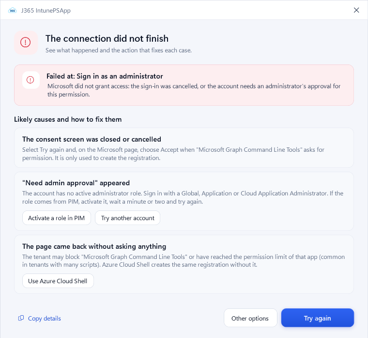
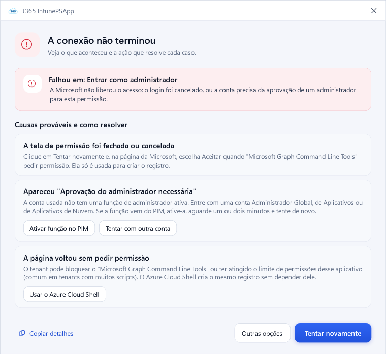

# Publish to Intune

*Português: [abaixo](#publicar-no-intune).*

## Connect with an app certificate (2.4.2, recommended)

*Connect to Intune > Automatic with an app certificate* (or *Settings > Microsoft Intune > Connect with a certificate*) connects this computer **as the application** instead of a user:

1. An administrator signs in once: **Global Administrator** or **Privileged Role Administrator**, because granting an *application permission* of Microsoft Graph takes one of them. *Microsoft Graph Command Line Tools* asks, besides the two permissions of the setup, for `AppRoleAssignment.ReadWrite.All`, used only to grant the permission below.
2. The registration **J365 IntunePSApp** gets `DeviceManagementApps.ReadWrite.All` also as an **application permission**, with the admin consent (an app role assignment of Microsoft Graph). The delegated permission stays, so technicians can still connect with their own accounts.
3. A **certificate** is created on this computer for your Windows user: RSA 2048, valid for one year, its key **in the TPM** when the computer has one (otherwise in the Windows key store) and **never exportable**. Only its public part goes to the registration (*Certificates & secrets*, named `J365 IntunePSApp - <computer>`); keys of other tools are sent back unchanged.
4. The application asks Microsoft for a token with a short assertion signed by that key (PS256, as Microsoft recommends) and reads one app from Intune to prove it works. A new key and a new permission take a minute or two to reach every server: the window waits and tries again.

From then on publishing needs **no sign-in, no password and no secret**, and it does not depend on the role, the PIM activation or the Intune license of an account. In Intune and Entra ID the actor is the application *J365 IntunePSApp*.

**Good to know.** The application permission lets the registration manage every app of Intune, so keep track of the computers that hold a certificate. *Settings > Microsoft Intune* shows the certificate (thumbprint, expiry, TPM or key store); *Remove the certificate from this PC* deletes it with its key, and an administrator can remove any key in the Entra admin center (*App registrations > J365 IntunePSApp > Certificates & secrets*) or the application permission (*API permissions*). A month before the expiry the application asks to connect again: the new certificate is added next to the one in use, which keeps working until the new one obtained a token and is then removed from this computer (its public part stays listed until it expires). Switching to a user connection (a code, your account, another registration) keeps the certificate on this computer: *Use the certificate of this PC* goes back to it without an administrator. With Microsoft Entra Workload ID, Conditional Access for workload identities can also limit where the registration signs in from. The script works the same way by hand: `.\Publish-ToIntune.ps1 -TenantId <tenant> -ClientId <id> -CertificateThumbprint <thumbprint>`.

## Connect to Intune: four ways, every step explained

*Settings > Microsoft Intune > Connect to Intune* (also on the sidebar card, in the publishing dialog and on the card of a generated package) opens a window with four ways in:

| Way | When | What happens |
|---|---|---|
| **Automatic with an app certificate** (recommended, 2.4.2) | An administrator who can grant application permissions | See the section above: the application connects by itself afterwards, with no sign-in. |
| **Automatic with my account** (delegated) | You, or someone next to you, has an administrator role | You sign in as an administrator; the registration **J365 IntunePSApp** is created and approved (details below); then you sign in with your own account and the application reads one app from Intune to prove it works. Publishing uses the Intune role of that account. |
| **Use an existing registration** | An administrator already connected the tenant | Paste the **connection code** the administrator copied (*Settings > Microsoft Intune > Copy connection code*, a line like `J365-CONNECT tenant=... client=...`), or type the tenant and the application ID. Each technician then signs in with their own account. |
| **Create it with Azure Cloud Shell** | The automatic setup is blocked in your tenant | The window shows a Bash (or PowerShell) command for [shell.azure.com](https://shell.azure.com). It creates the same registration with the **Azure CLI**, which is already authorised in every tenant, so **no consent screen** appears. Its last line is a connection code: paste it back into the window. |

**Before the automatic setup.** Use an account with one of these roles **active**: Global Administrator, Application Administrator or Cloud Application Administrator (granting the consent for Microsoft Graph may also need a Global Administrator or a Privileged Role Administrator). When the role comes from **Privileged Identity Management**, activate it first (the window has a shortcut to *PIM > My roles*) and wait a minute or two. If your administrator account is not the one you use every day, type it in *Administrator account*: the Microsoft page opens with it.

**What the Microsoft page shows.** *Microsoft Graph Command Line Tools* (Microsoft's own application, the one behind `Connect-MgGraph`) asks for permission to read and write applications and permission grants. Select **Accept**: these permissions are only used to create the registration, and the application keeps nothing of that sign-in.

**When it fails**, the window marks the step that failed and lists the likely causes, each with its action:

| Microsoft's answer | Likely cause | Action in the window |
|---|---|---|
| *The sign-in was cancelled* (`access_denied`, `cancel`) | The consent screen was closed or cancelled | *Try again* and select *Accept* |
| | *"Need admin approval"* appeared: the account has no **active** administrator role | *Activate a role in PIM*, *Try another account* |
| | The page came back without asking anything: the tenant blocks *Microsoft Graph Command Line Tools*, or that app reached its limit of permissions (tenants with many scripts) | *Use Azure Cloud Shell* |
| *No role to create registrations* | The account signed in but may not create applications | *Activate a role in PIM*, *Try another account*, *Use Azure Cloud Shell* |
| AADSTS53003 | Conditional Access blocked the sign-in | Sign in from a compliant device, or ask for an exception |
| AADSTS50105 / AADSTS7000112 | *Microsoft Graph Command Line Tools* is disabled or requires assignment | *Use Azure Cloud Shell* |
| The consent is missing | The administrator created the registration but may not approve Microsoft Graph permissions | *Open consent link* / *Copy link* for a Global Administrator |

*Copy details* puts the step, the code and the message on the clipboard for a ticket. Entra ID > *Sign-in logs* (application *Microsoft Graph Command Line Tools*) shows the exact reason on the Microsoft side.

<p align="center"> </p>

## The automatic setup in detail (2.3)

*Connect to Intune > Automatic setup*:

1. You sign in, in the browser, with an **administrator** of your tenant (Global Administrator; or Application Administrator plus Privileged Role Administrator for the consent). This one sign-in uses **Microsoft Graph Command Line Tools**, Microsoft's own public application (the one behind `Connect-MgGraph`), with the delegated permissions `Application.ReadWrite.All` and `DelegatedPermissionGrant.ReadWrite.All`. Those tokens are used for the setup only and are not kept.
2. The application creates the app registration **J365 IntunePSApp** in your Entra ID: single tenant, public client with the redirect `http://localhost`, **no secret**, and only the delegated permission `DeviceManagementApps.ReadWrite.All`. It creates the enterprise application and grants the **admin consent** for the organisation. Run it again and the same registration is found and repaired, not duplicated.
3. You sign in with the new registration. The **session is remembered**: its refresh token is stored encrypted for your Windows user (DPAPI) in the data folder of the application. *Sign out* deletes it.

From then on, *Publish to Intune* on the card of a package publishes **inside the application**: no PowerShell window, no new sign-in, with the steps and the upload progress on screen. When Intune already has a version of the same application ("7-Zip 25.01" for a "7-Zip 26.06" package), the dialog offers to **update that app** (it keeps its assignments) or to create a new one.

Publishing always acts **as the signed-in user**, with that user's own Intune rights. If the administrator who ran the setup cannot grant consent for Microsoft Graph, the registration is still created and the application shows the admin consent link for a Global Administrator.

Prefer to create the registration yourself? The manual steps below still work: type the tenant and the application (client) ID in *Settings > Microsoft Intune > Or type the registration by hand* (or in *Advanced options* of the dialog) and sign in.

Every generated package includes `Intune\Publish-ToIntune.ps1`. It creates (or updates) the Windows app (Win32) in your tenant from `intune-app.json` and the `.intunewin` file: name, description, command lines, detection script, requirements, icon and content. By default the app is created **without assignments**, so nothing reaches devices until you assign it.

Since version 2.1.2 the script talks to **Microsoft Graph directly**. No PowerShell module is installed and nothing is stored: you sign in with your own account, in the browser, or (2.4.2) the application signs in by itself with the certificate of this computer (`-CertificateThumbprint`).

> **What was tested.** Publishing has been used against real tenants since 2.4.1: that is how the lookup of earlier versions (fixed in 2.4.2) and the refusals of Intune (now explained) were found. Every step of the script also runs against a local stand-in for Entra ID, Microsoft Graph and Azure Storage that checks what is sent, the cryptographic integrity of the content and, since 2.4.2, the signature of the certificate assertion (also from Windows PowerShell 5.1). The certificate connection itself has not been run against a real tenant by the author yet. Start with `-ValidateOnly`, publish a small package to a test tenant first, and please report results in the issues.

## What you need

1. **Windows PowerShell 5.1** (part of Windows) or PowerShell 7.
2. **An account** allowed to create apps in Intune (for example the *Intune Administrator* role).
3. **Your own app registration** in Microsoft Entra ID. Microsoft retired the shared "Microsoft Intune PowerShell" application, so every tenant uses its own.

### Creating the app registration (once per tenant)

1. [Microsoft Entra admin center](https://entra.microsoft.com) > *Entra ID > App registrations > New registration*.
2. Name: for example `Intune app publishing`. Supported account types: *this organizational directory only*.
3. Redirect URI: platform **Public client/native (mobile & desktop)**, value `http://localhost`. Register.
4. *API permissions > Add a permission > Microsoft Graph > Delegated permissions*: `DeviceManagementApps.ReadWrite.All`. It is the only permission the script asks for.
5. *Grant admin consent*. This takes an **Application Administrator, Cloud Application Administrator or Privileged Role Administrator**; an Intune Administrator alone cannot grant it.
6. Only if you will use the device-code sign-in: *Authentication > Advanced settings > Allow public client flows* = **Yes**.
7. Copy the **Application (client) ID** and the **Directory (tenant) ID** from *Overview*.

No client secret is created: you sign in with your own account and the permission is delegated, so the script can never do more than you can.

## Publishing

**From the application:** after generating a package, *Publish to Intune (preview)* asks for the tenant and the client ID (remembered in Settings; no secret is stored), what to do when an app with the same name exists, and an optional assignment. *Validate package* checks everything without connecting. *Publish* opens a PowerShell window; when it finishes, the result card shows the outcome and an *Open in Intune* link.

**By hand:**

```powershell
cd "<Output>\<App>_<Version>\Intune"

# Checks the files and shows what would be published, without connecting
powershell -ExecutionPolicy Bypass -File .\Publish-ToIntune.ps1 -ValidateOnly

# Publishes (a browser window opens for the sign-in)
powershell -ExecutionPolicy Bypass -File .\Publish-ToIntune.ps1 -TenantId contoso.onmicrosoft.com -ClientId 00000000-0000-0000-0000-000000000000

# Updates the app when one with the same name already exists (assignments are kept)
powershell -ExecutionPolicy Bypass -File .\Publish-ToIntune.ps1 -TenantId contoso.onmicrosoft.com -ClientId <id> -IfExists Update

# Publishes and makes it available to a pilot group
powershell -ExecutionPolicy Bypass -File .\Publish-ToIntune.ps1 -TenantId contoso.onmicrosoft.com -ClientId <id> -AssignIntent available -AssignTo Group -GroupId <object id of the group>
```

| Parameter | Meaning |
|---|---|
| `-ValidateOnly` | Checks the files and values; nothing is sent. |
| `-DeviceCode` | Signs in with a code instead of the browser. Many organisations block this flow with Conditional Access; prefer the browser. |
| `-IfExists Ask\|Fail\|Update\|CreateNew` | What to do when an app with the same name exists. `Ask` (default) asks in the window; with `-Force` it stops instead. `Update` sends new content and settings to the existing app and keeps its assignments. |
| `-AssignIntent none\|available\|required` | Optional assignment, only for an app created by this run. Default `none`. |
| `-AssignTo AllUsers\|AllDevices\|Group` and `-GroupId` | Target of the assignment. Intune has no "available" for all devices. |
| `-Force` | Does not ask for confirmation. |
| `-GraphUrl`, `-LoginUrl` | Endpoints of national clouds. |

**What the script does, in order**

1. Reads `intune-app.json`, checks that the files exist, that the `.intunewin` matches the SHA256 recorded when it was generated and that its `Detection.xml` carries the encryption data.
2. Signs in: authorization code with PKCE in your browser, answered on a local port (or a device code).
3. Looks for an app with exactly the same name.
4. Creates the app, creates a content version, uploads the encrypted content in blocks, commits it and waits until Intune confirms it. Throttling and temporary errors are retried.
5. If anything fails after the app was created, **the incomplete app is deleted again**: no empty entry is left in the tenant.
6. Optionally assigns it.
7. Writes `publish-result.json` in the same folder: status (`published`, `failed`, `cancelled`), app id, link to the admin center, or the error. Exit codes: `0` published or validated, `1` failed, `2` cancelled.

Afterwards: open the link (or the [Intune admin center](https://intune.microsoft.com) > *Apps > Windows*), review the app and assign it to a pilot group before a broad deployment.

## Troubleshooting

| Message | What to check |
|---|---|
| `AADSTS65001` or `AADSTS90094` (consent) | Admin consent was not granted for `DeviceManagementApps.ReadWrite.All`. It takes an Application Administrator, Cloud Application Administrator or Privileged Role Administrator. |
| `AADSTS50011` (redirect URI) | Add the platform *Mobile and desktop applications* with exactly `http://localhost`. |
| `AADSTS7000218` / asks for a client secret | The registration is not a public client: add the platform above; for `-DeviceCode`, also *Allow public client flows* = Yes. |
| `AADSTS700016` / `AADSTS90002` | Wrong application (client) ID or wrong tenant. |
| `AADSTS53003` | Conditional Access blocked the sign-in. With `-DeviceCode`, use the browser sign-in instead. |
| "The sign-in was not completed within 5 minutes" | The browser window was closed. Run the script again. |
| `HTTP 401` or `HTTP 403` (`Forbidden`) from Intune | Microsoft Graph accepted the sign-in and **Intune** refused it. With your account: an Intune role must be **active** now (Intune Administrator or Global Administrator; with PIM, activate it), your account needs an Intune license unless *Allow access to unlicensed admins* is on (*Intune admin center > Tenant administration > Roles > Administrator licensing*), and the tenant needs an active Intune subscription. The app certificate depends on none of the roles or licenses of an account. The application lists these causes with the error. |
| `AADSTS700027` (certificate) | The public part of the certificate of this computer is not in the registration, or it was added a moment ago: wait a minute, or connect with the certificate again. |
| `AADSTS700024` | The clock of this computer is wrong: correct the date and time of Windows. |
| "An app named ... already exists" | Use `-IfExists Update` or `-IfExists CreateNew`. Intune shows only one of two apps with the same name in the Company Portal. |
| "The .intunewin file does not match the SHA256" | The file changed after it was generated: generate the package again. |

---

# Publicar no Intune

## Conectar com certificado do aplicativo (2.4.2, recomendado)

*Conectar ao Intune > Automático com certificado do aplicativo* (ou *Configurações > Microsoft Intune > Conectar com certificado*) conecta este computador **como o aplicativo**, e não como um usuário:

1. Um administrador entra uma vez: **Administrador Global** ou **Administrador de Funções Privilegiadas**, porque conceder uma *permissão de aplicativo* do Microsoft Graph exige uma delas. O *Microsoft Graph Command Line Tools* pede, além das duas permissões da configuração, `AppRoleAssignment.ReadWrite.All`, usada só para conceder a permissão abaixo.
2. O registro **J365 IntunePSApp** recebe `DeviceManagementApps.ReadWrite.All` também como **permissão de aplicativo**, com o consentimento do administrador (uma atribuição de função de aplicativo do Microsoft Graph). A permissão delegada continua, então os técnicos ainda podem conectar com a própria conta.
3. Um **certificado** é criado neste computador para o seu usuário do Windows: RSA 2048, válido por um ano, com a chave **no TPM** quando o computador tem um (senão no armazenamento de chaves do Windows) e **nunca exportável**. Só a parte pública vai para o registro (*Certificados e segredos*, com o nome `J365 IntunePSApp - <computador>`); as chaves de outras ferramentas voltam sem alteração.
4. O aplicativo pede o token à Microsoft com uma declaração curta assinada por essa chave (PS256, como a Microsoft recomenda) e lê um app do Intune para provar que funciona. Uma chave e uma permissão novas levam um ou dois minutos para chegar a todos os servidores: a janela aguarda e tenta de novo.

A partir daí a publicação **não pede login, senha nem segredo** e não depende da função, da ativação no PIM nem da licença do Intune de uma conta. No Intune e no Entra ID o autor é o aplicativo *J365 IntunePSApp*.

**Bom saber.** A permissão de aplicativo deixa o registro gerenciar todos os apps do Intune, então acompanhe os computadores que têm um certificado. *Configurações > Microsoft Intune* mostra o certificado (impressão digital, validade, TPM ou armazenamento de chaves); *Remover o certificado deste PC* apaga o certificado e a chave, e um administrador pode remover qualquer chave no centro de administração do Entra (*Registros de aplicativo > J365 IntunePSApp > Certificados e segredos*) ou a permissão de aplicativo (*Permissões de API*). Um mês antes de expirar, o aplicativo pede para conectar de novo: o certificado novo é adicionado ao lado do que está em uso, que continua funcionando até o novo obter um token e só então é removido deste computador (a parte pública dele fica listada até expirar). Trocar para uma conexão de usuário (um código, a sua conta, outro registro) mantém o certificado neste computador: *Usar o certificado deste PC* volta a ele sem precisar de administrador. Com o Microsoft Entra Workload ID, o Acesso Condicional para identidades de carga de trabalho também pode limitar de onde o registro entra. O script funciona do mesmo jeito manualmente: `.\Publish-ToIntune.ps1 -TenantId <tenant> -ClientId <id> -CertificateThumbprint <impressão digital>`.

## Conectar ao Intune: quatro caminhos, cada etapa explicada

*Configurações > Microsoft Intune > Conectar ao Intune* (também no cartão da barra lateral, na janela de publicação e no cartão de um pacote gerado) abre uma janela com quatro caminhos:

| Caminho | Quando | O que acontece |
|---|---|---|
| **Automático com certificado do aplicativo** (recomendado, 2.4.2) | Um administrador que pode conceder permissões de aplicativo | Veja a seção acima: depois o aplicativo conecta sozinho, sem login. |
| **Automático com a minha conta** (delegada) | Você, ou alguém ao seu lado, tem uma função de administrador | Você entra como administrador; o registro **J365 IntunePSApp** é criado e aprovado (detalhes abaixo); depois você entra com a sua própria conta e o aplicativo lê um app do Intune para provar que funciona. A publicação usa a função do Intune dessa conta. |
| **Usar um registro que já existe** | Um administrador já conectou o tenant | Cole o **código de conexão** que o administrador copiou (*Configurações > Microsoft Intune > Copiar código de conexão*, uma linha como `J365-CONNECT tenant=... client=...`), ou informe o tenant e o ID do aplicativo. Cada técnico então entra com a própria conta. |
| **Criar pelo Azure Cloud Shell** | A configuração automática é bloqueada no seu tenant | A janela mostra um comando Bash (ou PowerShell) para o [shell.azure.com](https://shell.azure.com). Ele cria o mesmo registro com o **Azure CLI**, que já é autorizado em todo tenant, então **nenhuma tela de permissão** aparece. A última linha é um código de conexão: cole-a de volta na janela. |

**Antes da configuração automática.** Use uma conta com uma destas funções **ativas**: Administrador Global, Administrador de Aplicativos ou Administrador de Aplicativos de Nuvem (conceder o consentimento do Microsoft Graph também pode exigir um Administrador Global ou de Função Privilegiada). Se a função vem do **Privileged Identity Management**, ative-a antes (a janela tem um atalho para *PIM > Minhas funções*) e aguarde um ou dois minutos. Se a sua conta administrativa não é a do dia a dia, informe-a em *Conta de administrador*: a página da Microsoft já abre nela.

**O que a página da Microsoft mostra.** O *Microsoft Graph Command Line Tools* (aplicativo da própria Microsoft, o mesmo do `Connect-MgGraph`) pede permissão para ler e gravar aplicativos e concessões de permissão. Clique em **Aceitar**: essas permissões só são usadas para criar o registro, e o aplicativo não guarda nada desse login.

**Quando falha**, a janela marca a etapa que falhou e lista as causas prováveis, cada uma com a sua ação:

| Resposta da Microsoft | Causa provável | Ação na janela |
|---|---|---|
| *O login foi cancelado* (`access_denied`, `cancel`) | A tela de permissão foi fechada ou cancelada | *Tentar novamente* e escolher *Aceitar* |
| | Apareceu *"Aprovação do administrador necessária"*: a conta não tem uma função de administrador **ativa** | *Ativar função no PIM*, *Tentar com outra conta* |
| | A página voltou sem pedir nada: o tenant bloqueia o *Microsoft Graph Command Line Tools*, ou esse aplicativo atingiu o limite de permissões (tenants com muitos scripts) | *Usar o Azure Cloud Shell* |
| *Sem função para criar registros* | A conta entrou, mas não pode criar aplicativos | *Ativar função no PIM*, *Tentar com outra conta*, *Usar o Azure Cloud Shell* |
| AADSTS53003 | O Acesso Condicional bloqueou o login | Entre de um dispositivo em conformidade ou peça uma exceção |
| AADSTS50105 / AADSTS7000112 | O *Microsoft Graph Command Line Tools* está desativado ou exige atribuição | *Usar o Azure Cloud Shell* |
| Falta o consentimento | O administrador criou o registro, mas não pode aprovar permissões do Microsoft Graph | *Abrir link de consentimento* / *Copiar link* para um Administrador Global |

*Copiar detalhes* coloca a etapa, o código e a mensagem na área de transferência para um chamado. Em Entra ID > *Logs de entrada* (aplicativo *Microsoft Graph Command Line Tools*) aparece o motivo exato do lado da Microsoft.

<p align="center"> </p>

## A configuração automática em detalhe (2.3)

*Conectar ao Intune > Configuração automática*:

1. Você entra, no navegador, com um **administrador** do seu tenant (Administrador Global; ou Administrador de Aplicativos mais Administrador de Função Privilegiada para o consentimento). Esse login usa o **Microsoft Graph Command Line Tools**, o aplicativo público da própria Microsoft (o mesmo do `Connect-MgGraph`), com as permissões delegadas `Application.ReadWrite.All` e `DelegatedPermissionGrant.ReadWrite.All`. Esses tokens servem só para a configuração e não são guardados.
2. O aplicativo cria o registro **J365 IntunePSApp** no seu Entra ID: um único tenant, cliente público com o redirecionamento `http://localhost`, **sem segredo** e só com a permissão delegada `DeviceManagementApps.ReadWrite.All`. Cria o aplicativo empresarial e concede o **consentimento do administrador** para a organização. Executando de novo, o mesmo registro é encontrado e corrigido, não duplicado.
3. Você entra com o novo registro. A **sessão fica lembrada**: o refresh token é guardado criptografado para o seu usuário do Windows (DPAPI) na pasta de dados do aplicativo. *Sair* o apaga.

Daí em diante, *Publicar no Intune* no cartão de um pacote publica **dentro do aplicativo**: sem janela do PowerShell, sem novo login, com as etapas e o progresso do envio na tela. Quando o Intune já tem uma versão do mesmo aplicativo ("7-Zip 25.01" para um pacote "7-Zip 26.06"), a janela oferece **atualizar esse app** (ele mantém as atribuições) ou criar um novo.

A publicação sempre age **como o usuário conectado**, com os direitos de Intune desse usuário. Se o administrador que executou a configuração não puder conceder consentimento para o Microsoft Graph, o registro é criado mesmo assim e o aplicativo mostra o link de consentimento para um Administrador Global.

Prefere criar o registro você mesmo? Os passos manuais abaixo continuam valendo: informe o tenant e o ID do aplicativo (cliente) em *Configurações > Microsoft Intune > Ou informe o registro manualmente* (ou em *Opções avançadas* da janela) e entre.

Todo pacote gerado inclui o `Intune\Publish-ToIntune.ps1`. Ele cria (ou atualiza) o aplicativo do Windows (Win32) no seu locatário a partir do `intune-app.json` e do arquivo `.intunewin`: nome, descrição, comandos, script de detecção, requisitos, ícone e conteúdo. Por padrão o aplicativo é criado **sem atribuições**, então nada chega aos dispositivos até você atribuir.

Desde a versão 2.1.2 o script fala **direto com o Microsoft Graph**. Nenhum módulo do PowerShell é instalado e nada é guardado: você entra com a sua própria conta, no navegador, ou (2.4.2) o aplicativo entra sozinho com o certificado deste computador (`-CertificateThumbprint`).

> **O que foi testado.** A publicação é usada contra locatários reais desde a 2.4.1: foi assim que apareceram a busca de versões anteriores (corrigida na 2.4.2) e as recusas do Intune (agora explicadas). Todos os passos do script também rodam contra um substituto local do Entra ID, do Microsoft Graph e do Azure Storage que confere o que é enviado, a integridade criptográfica do conteúdo e, desde a 2.4.2, a assinatura da declaração do certificado (também a partir do Windows PowerShell 5.1). A conexão com certificado em si ainda não foi executada pelo autor contra um locatário real. Comece pelo `-ValidateOnly`, publique primeiro um pacote pequeno em um locatário de teste e conte como foi nas issues.

## O que você precisa

1. **Windows PowerShell 5.1** (já vem no Windows) ou PowerShell 7.
2. **Uma conta** com permissão para criar aplicativos no Intune (por exemplo a função *Administrador do Intune*).
3. **Um registro de aplicativo seu** no Microsoft Entra ID. A Microsoft aposentou o aplicativo compartilhado "Microsoft Intune PowerShell", então cada locatário usa o seu.

### Criando o registro de aplicativo (uma vez por locatário)

1. [Centro de administração do Microsoft Entra](https://entra.microsoft.com) > *Entra ID > Registros de aplicativo > Novo registro*.
2. Nome: por exemplo `Publicação de apps no Intune`. Tipos de conta: *somente este diretório organizacional*.
3. URI de redirecionamento: plataforma **Cliente público/nativo (móvel e desktop)**, valor `http://localhost`. Registre.
4. *Permissões de API > Adicionar uma permissão > Microsoft Graph > Permissões delegadas*: `DeviceManagementApps.ReadWrite.All`. É a única permissão que o script pede.
5. *Conceder consentimento do administrador*. Isso exige um **Administrador de Aplicativos, Administrador de Aplicativos de Nuvem ou Administrador de Função com Privilégios**; só a função de Administrador do Intune não consegue conceder.
6. Somente se for usar o login com código de dispositivo: *Autenticação > Configurações avançadas > Permitir fluxos de cliente público* = **Sim**.
7. Copie o **ID do aplicativo (cliente)** e o **ID do diretório (locatário)** em *Visão geral*.

Nenhum segredo de cliente é criado: você entra com a sua própria conta e a permissão é delegada, então o script nunca consegue fazer mais do que você.

## Publicando

**Pelo aplicativo:** depois de gerar um pacote, *Publicar no Intune (prévia)* pede o locatário e o ID do cliente (ficam lembrados em Configurações; nenhum segredo é guardado), o que fazer quando já existe um app com o mesmo nome e uma atribuição opcional. *Validar pacote* confere tudo sem conectar. *Publicar* abre uma janela do PowerShell; quando ela termina, o cartão de resultado mostra o que aconteceu e um link *Abrir no Intune*.

**Manualmente:**

```powershell
cd "<Saída>\<App>_<Versão>\Intune"

# Confere os arquivos e mostra o que seria publicado, sem conectar
powershell -ExecutionPolicy Bypass -File .\Publish-ToIntune.ps1 -ValidateOnly

# Publica (uma janela do navegador abre para o login)
powershell -ExecutionPolicy Bypass -File .\Publish-ToIntune.ps1 -TenantId contoso.onmicrosoft.com -ClientId 00000000-0000-0000-0000-000000000000

# Atualiza o app quando já existe um com o mesmo nome (as atribuições são mantidas)
powershell -ExecutionPolicy Bypass -File .\Publish-ToIntune.ps1 -TenantId contoso.onmicrosoft.com -ClientId <id> -IfExists Update

# Publica e deixa disponível para um grupo piloto
powershell -ExecutionPolicy Bypass -File .\Publish-ToIntune.ps1 -TenantId contoso.onmicrosoft.com -ClientId <id> -AssignIntent available -AssignTo Group -GroupId <ID do objeto do grupo>
```

| Parâmetro | Significado |
|---|---|
| `-ValidateOnly` | Confere os arquivos e valores; nada é enviado. |
| `-DeviceCode` | Entra com um código em vez do navegador. Muitas organizações bloqueiam esse fluxo com Acesso Condicional; prefira o navegador. |
| `-IfExists Ask\|Fail\|Update\|CreateNew` | O que fazer quando já existe um app com o mesmo nome. `Ask` (padrão) pergunta na janela; com `-Force` ele para. `Update` envia novo conteúdo e configurações para o app existente e mantém as atribuições. |
| `-AssignIntent none\|available\|required` | Atribuição opcional, só para um app criado nesta execução. Padrão `none`. |
| `-AssignTo AllUsers\|AllDevices\|Group` e `-GroupId` | Destino da atribuição. O Intune não tem "disponível" para todos os dispositivos. |
| `-Force` | Não pede confirmação. |
| `-GraphUrl`, `-LoginUrl` | Endereços das nuvens nacionais. |

**O que o script faz, em ordem**

1. Lê o `intune-app.json`, confere se os arquivos existem, se o `.intunewin` bate com o SHA256 registrado quando foi gerado e se o `Detection.xml` dele traz os dados de criptografia.
2. Faz o login: código de autorização com PKCE no seu navegador, respondido em uma porta local (ou código de dispositivo).
3. Procura um app com exatamente o mesmo nome.
4. Cria o app, cria uma versão de conteúdo, envia o conteúdo criptografado em blocos, confirma e espera o Intune validar. Limite de requisições e erros temporários são repetidos.
5. Se algo falhar depois de o app ter sido criado, **o app incompleto é apagado**: não fica nenhuma entrada vazia no locatário.
6. Opcionalmente atribui.
7. Grava o `publish-result.json` na mesma pasta: situação (`published`, `failed`, `cancelled`), ID do app, link para o centro de administração ou o erro. Códigos de saída: `0` publicado ou validado, `1` falhou, `2` cancelado.

Depois: abra o link (ou o [centro de administração do Intune](https://intune.microsoft.com) > *Aplicativos > Windows*), revise o aplicativo e atribua a um grupo piloto antes de uma implantação ampla.

## Solução de problemas

| Mensagem | O que conferir |
|---|---|
| `AADSTS65001` ou `AADSTS90094` (consentimento) | O consentimento do administrador não foi concedido para `DeviceManagementApps.ReadWrite.All`. Exige Administrador de Aplicativos, Administrador de Aplicativos de Nuvem ou Administrador de Função com Privilégios. |
| `AADSTS50011` (URI de redirecionamento) | Adicione a plataforma *Aplicativos móveis e de desktop* com exatamente `http://localhost`. |
| `AADSTS7000218` / pede um segredo de cliente | O registro não é cliente público: adicione a plataforma acima; para `-DeviceCode`, também *Permitir fluxos de cliente público* = Sim. |
| `AADSTS700016` / `AADSTS90002` | ID do aplicativo (cliente) errado ou locatário errado. |
| `AADSTS53003` | O Acesso Condicional bloqueou o login. Com `-DeviceCode`, use o login pelo navegador. |
| "The sign-in was not completed within 5 minutes" | A janela do navegador foi fechada. Execute o script de novo. |
| `HTTP 401` ou `HTTP 403` (`Forbidden`) do Intune | O Microsoft Graph aceitou o login e o **Intune** recusou. Com a sua conta: uma função do Intune precisa estar **ativa** agora (Administrador do Intune ou Administrador Global; com PIM, ative-a), a sua conta precisa de licença do Intune a menos que *Permitir acesso a administradores sem licença* esteja ligado (*centro de administração do Intune > Administração de locatários > Funções > Licenciamento de administrador*), e o tenant precisa de uma assinatura ativa do Intune. O certificado do aplicativo não depende de função nem de licença de uma conta. O aplicativo lista essas causas junto com o erro. |
| `AADSTS700027` (certificado) | A parte pública do certificado deste computador não está no registro, ou foi adicionada agora: aguarde um minuto, ou refaça a conexão com certificado. |
| `AADSTS700024` | O relógio deste computador está errado: corrija a data e a hora do Windows. |
| "An app named ... already exists" | Use `-IfExists Update` ou `-IfExists CreateNew`. O Intune mostra só um de dois apps com o mesmo nome no Portal da Empresa. |
| "The .intunewin file does not match the SHA256" | O arquivo mudou depois de gerado: gere o pacote novamente. |
