<p align="center"><strong>English</strong> · <a href="USER-GUIDE.pt-BR.md">Português (Brasil)</a></p>

# J365 IntunePSApp — User manual

From an installer (`.msi` or `.exe`) or an application of the catalog to a Win32 app in Microsoft Intune: this manual walks through every screen of **J365 IntunePSApp 3.0.4** with real captures. The examples use a fictitious company, *Contoso*, and the 7-Zip MSI.

| You want to… | Go to |
| --- | --- |
| Install the application and prepare it | [1. Install and first start](#1-install-and-first-start) |
| Find an application and its silent switches | [3. Find an application in the catalog](#3-find-an-application-in-the-catalog) |
| Build a package step by step | [4. Create a package](#4-create-a-package-step-by-step) |
| Check a package before it reaches devices | [5. Test before publishing](#5-test-before-publishing) |
| Send it to Intune | [6. Connect to Intune](#6-connect-to-intune) · [7. Publish](#7-publish-to-intune) |
| Roll a new version out gradually and follow the installation | [Supersedence](#a-new-version-group-by-group-supersedence) · [Status in Intune](#follow-the-installation) |
| Package (and publish) many applications at once | [8. Batch deploy](#8-batch-deploy) |
| Reopen, update or find a package | [9. My packages](#9-my-packages) |
| Adjust defaults, branding and the connection | [10. Settings](#10-settings) |
| Automate | [12. Command line](#12-command-line) |
| Solve a problem | [13. Troubleshooting](#13-logs-and-troubleshooting) |

---

## 1. Install and first start

1. Download `J365-IntunePSApp-<version>-win-x64.zip` from the [latest release](https://github.com/sesantanajr/J365-IntunePSApp/releases/latest), extract it and run **`J365.IntunePSApp.exe`**. The .NET runtime is included; nothing else is needed. Optionally check the file against `SHA256SUMS.txt` of the release.
2. The executable is not code-signed yet: Windows SmartScreen may say *Windows protected your PC* — **More info > Run anyway**. Smart App Control or an App Control policy may block it entirely; see [SIGNING.md](SIGNING.md).
3. On the first start the application downloads and verifies what it needs: the **application database** (built every day from winget), the official **PSAppDeployToolkit** template (its Authenticode signature is checked) and Microsoft's **IntuneWinAppUtil** (also signature-checked; optional — the application has a compatible packager of its own).

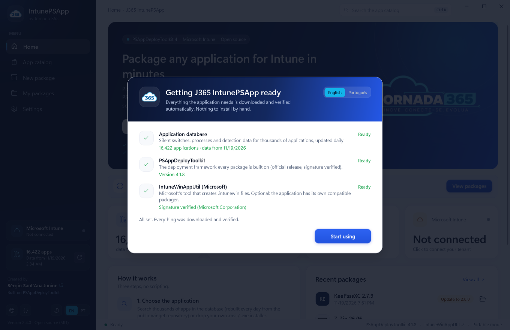

**Portable or installed.** Unzipped in a folder you can write to, the application is *portable*: its data stays in `IntunePSApp-Data` next to the executable. **Settings > General > Install for my user** copies it to `%LOCALAPPDATA%\Programs\J365 IntunePSApp` (Start menu, *Installed apps*, no administrator rights), with its data in `%LOCALAPPDATA%\J365\IntunePSApp`.

**Language and theme** switch live at the bottom of the sidebar (**EN / PT**, sun/moon).

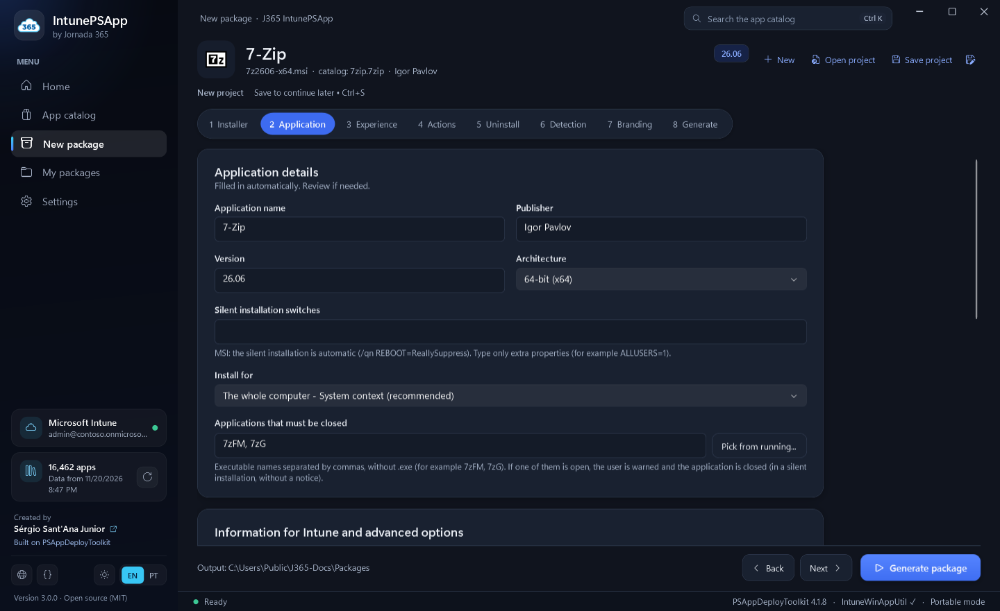

## 2. Home

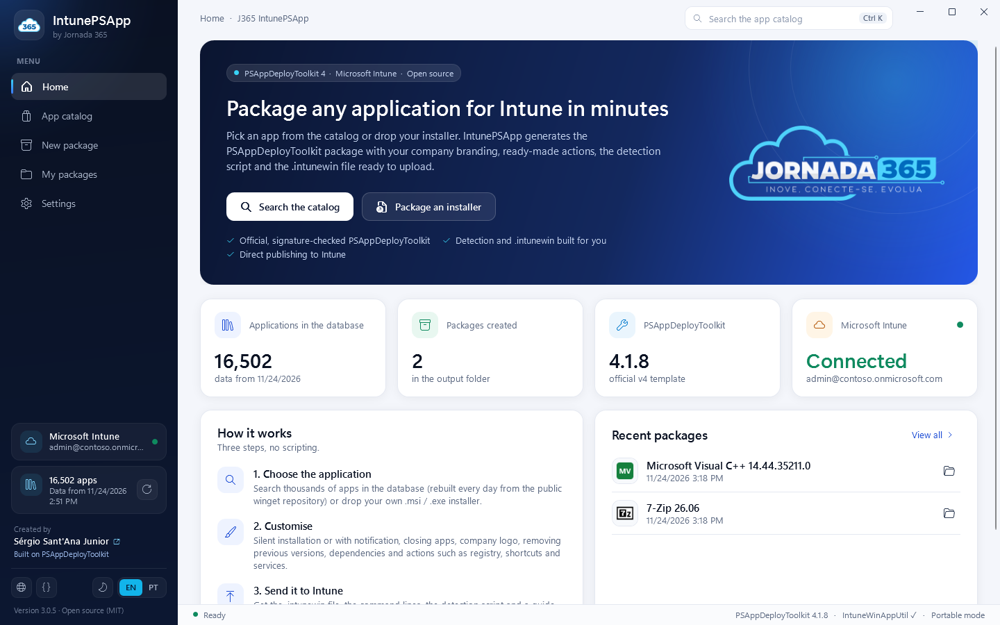

- **Search the catalog** or **Package an installer** (you can also drag an `.msi`/`.exe` onto the window).
- Four indicators: applications in the database, packages created, PSAppDeployToolkit version and the Intune connection.
- Notices appear here when something needs attention: a new version of the application, a newer toolkit, packages whose application has a newer version in the database.
- **Recent packages** reopens your last work.

Shortcuts: **Ctrl+K** search the catalog · **Ctrl+N** new package · **Ctrl+O** open a project · **Ctrl+S** save · **Ctrl+Shift+S** save as · **F5** generate.

## 3. Find an application in the catalog

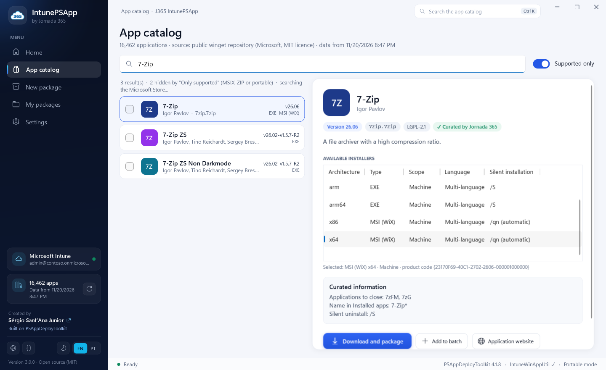

1. Type a name, publisher or winget ID. **Supported only** hides formats that cannot be packaged (MSIX, ZIP, portable) and the applications whose vendor link is dead (the database checks the links every day and, when the newest version in winget has a broken link, uses the earlier one that works); the line above the results says how many it hid.
2. Pick a result: the details list every **installer** (architecture, type, scope, language and the **silent switches** that will be used), the license, the curation of Jornada 365 (applications to close, name in *Installed apps*, uninstall switches) and the dependencies.
3. **Download and package** downloads the installer from the vendor's official address, checks its SHA256 against the winget manifest and opens it in the editor already filled in. **Add to batch** queues it for [batch deploy](#8-batch-deploy).

**Apps of the Microsoft Store.** The search also asks the Microsoft Store live, by name or by product ID (for example `9PM860492SZD`). These apps are not packaged: they are published to Intune as **Microsoft Store app (new)** — Intune installs them from the Store and keeps them updated — alone or in a batch.

## 4. Create a package step by step

The editor has eight steps. The header shows the application, the project file and whether it was saved; **Back / Next** and the step bar move between steps. Everything is checked again on the last step before anything is generated.

### Step 1 — Installer

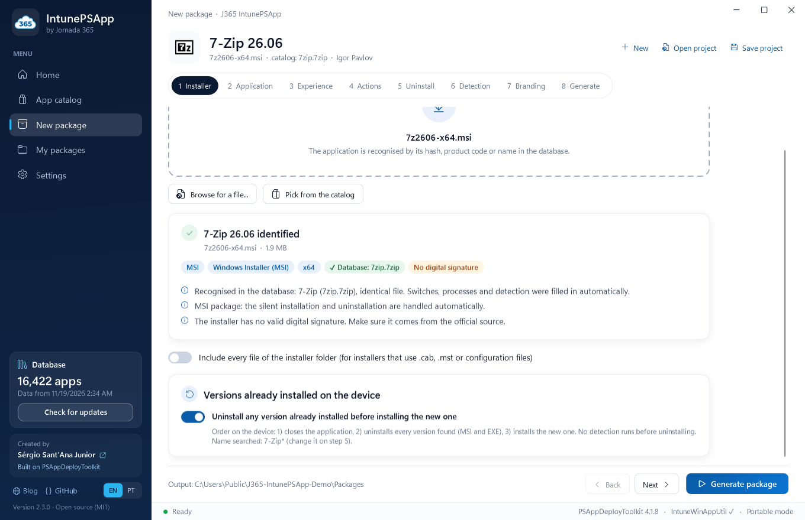

Drop an `.msi`/`.exe`, use **Browse for a file...** or **Pick from the catalog**. The analysis reads the MSI properties or the technology of the setup (Inno Setup, NSIS, WiX Burn, InstallShield…), checks the digital signature and looks for the file in the database by its SHA256 (identical file), product code or name. A recognised installer fills in the switches, processes, detection and uninstall data automatically.

Turn on **Include every file of the installer folder** for setups that need their `.cab`, `.mst` or configuration files.

### Step 2 — Application

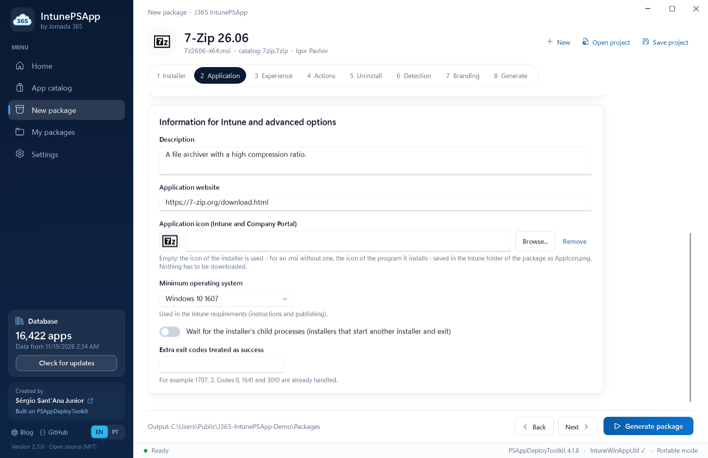

Name, version, publisher, architecture, **installation context** (*System* for every user, or *User*), minimum Windows version, installation switches and the icon shown in the Company Portal (taken from the installer or the installed program; a generic setup icon is never used).

Further down, the information Intune shows: description, developer, owner, information and privacy URLs, notes. The name in Intune carries no version — the version goes to its own field.

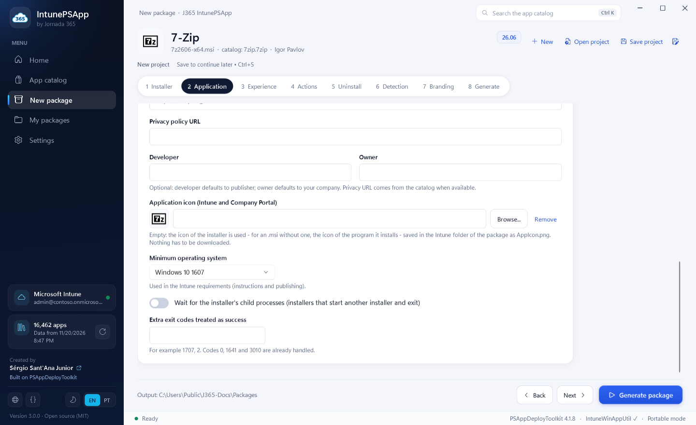

### Step 3 — Experience

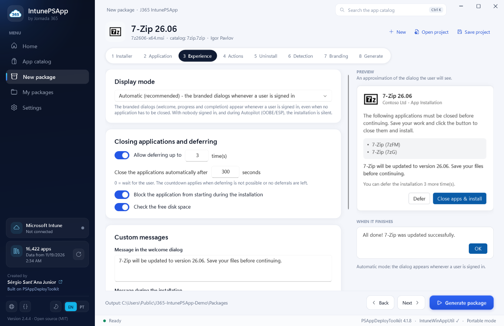

| Type of installation | What the user sees |
| --- | --- |
| **With notification** | The windows of the package (the notice that an application will be closed, progress and completion) whenever a user is signed in, and the notifications of Intune. Silent during Autopilot or with nobody signed in. |
| **Silent** | Nothing: no window and no notice from Intune, which does not restart the device or ask for a restart either. Open applications of the list are closed. |

The installation cannot be deferred (the option to defer left in 3.0), and the notifications of Intune follow the type of installation. Also here: the **applications to close** (with a countdown), blocking the application while it installs, the disk space check, the welcome, progress and completion messages and the restart prompt.The preview on the right draws the real PSAppDeployToolkit 4 dialog, with your logo and colors, in the language of the user.

The preview switches between the moments of the installation — **App open**, **App closed** and **Last notice** — and shows the message **When it finishes**:

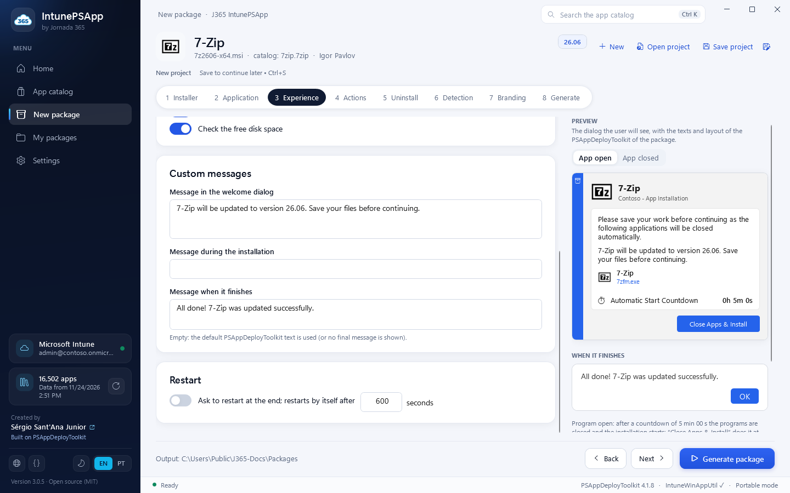

### Step 4 — Actions

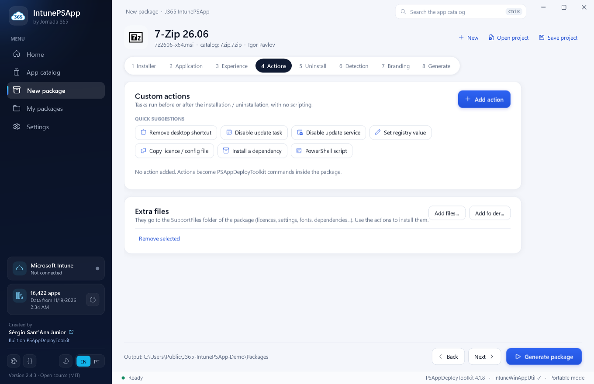

Ready-made actions, each in its phase (*before/after install*, *before/after uninstall*): install a dependency, uninstall another application, remove or create shortcuts, copy files (also to every user profile), delete files and folders, set or remove registry values, import a `.reg` file, stop processes or services, disable a scheduled task, set environment variables, run a program or PowerShell, show a message, wait. Extra files go with the package (`SupportFiles`).

### Step 5 — Uninstall

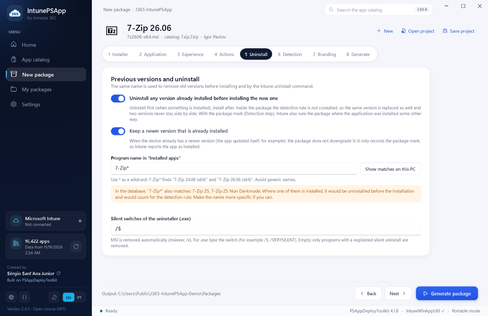

- **Versions already installed on the device** — one choice:
  - **Remove any installed version (older, the same or newer) and install this one**: a clean reinstall, silent or with notification. Shared components (Visual C++ and .NET runtimes, WebView2, Edge) are never removed; an application the database advises not to remove (self-updating browsers, Adobe Acrobat 64-bit, whose name is also the name of Acrobat Pro) is removed too, with a note.
  - **Remove older versions and the same one; keep a newer version** (default): never downgrades an application that updated itself.
  - **Do not remove: install over what is there.**
- **If the removal fails, install over the existing copy anyway** (off by default): off, if a copy is still installed the installation stops with an error, the log names the copy that stayed and Intune reports the failure, so the new version never ends up next to the old one. On, the new version is installed over it. Everything found is removed, the same version included: an MSI by its product code; an .exe by the switches typed here, by the silent command the program registered or, without one, by the switches of Inno Setup and NSIS, recognised on the device.
- **Reinstall also where the app is already installed** (off by default): every package of an app writes the same mark, so where an earlier package already installed the app in the required version Intune considers it installed and never runs the new package — the choice above is not even applied. On, Intune runs the package once on every device of the assignment, which removes the installed versions as chosen above and installs again. The round starts when you turn the option on: generating the package again does not reinstall again; for a new round, turn it off and on. Needs the package mark (step 6).
- **Program name in "Installed apps"** (wildcards allowed) is used to find, remove and detect the application; **Show matches on this PC** lists what it would match. MSI packages uninstall by product code; an `.exe` needs its silent uninstall switches.

### Step 6 — Detection

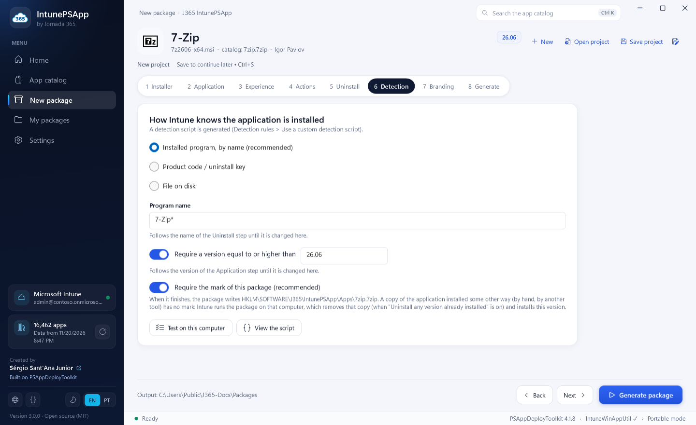

Intune runs the detection rule before and after installing. Detect by **name and minimum version** in *Installed apps* (recommended), by **MSI product code** or by a **file** (with an optional minimum version).

**Require the mark of this package**: the package writes `HKLM\SOFTWARE\J365\IntunePSApp\Apps\<app>` when it finishes, and the detection requires it. A copy installed by hand or by another tool therefore counts as *not installed*, so Intune runs your package there, which handles the installed versions as set in step 5. A copy installed by an earlier package of this app already has the mark and counts as installed — to reinstall on those devices too, turn on **Reinstall also where the app is already installed** (step 5). **Test on this computer** runs the rule here; **View the script** shows exactly what Intune will run.

### Step 7 — Branding

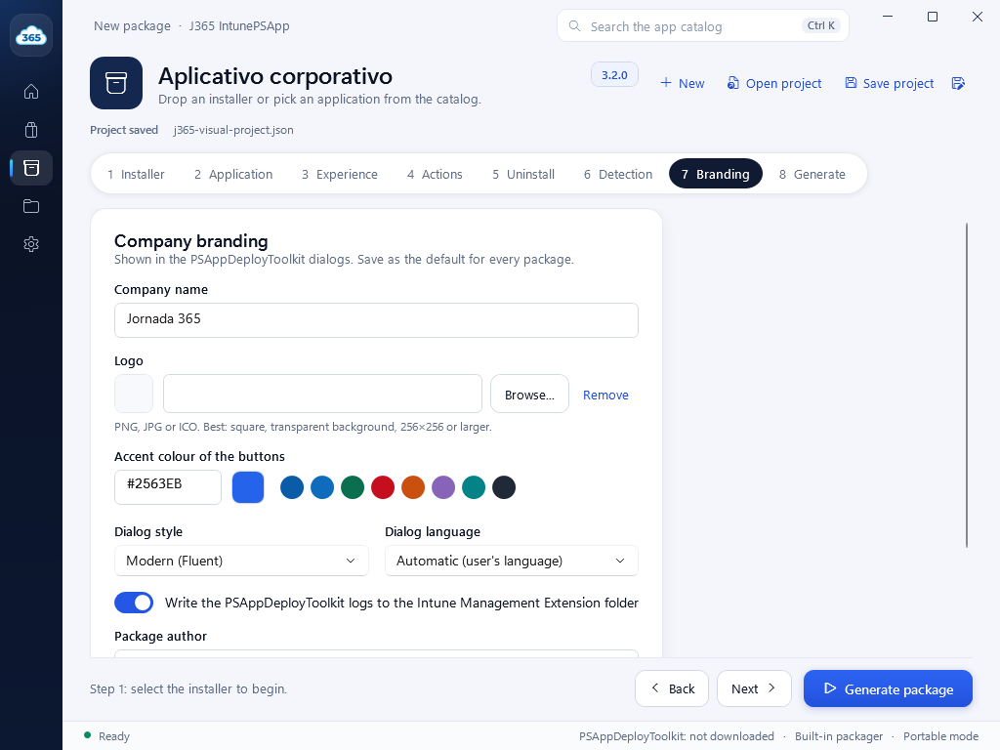

Company name, logo, accent color, dialog style (*Fluent* or *Classic*), language of the dialogs (automatic follows the user) and whether the logs go to the Intune Management Extension folder (collected by *Collect diagnostics*). **Save as the company default** makes them the starting point of every new package.

### Step 8 — Generate

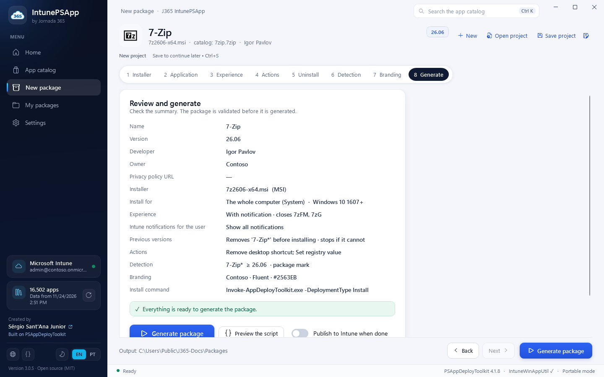

The review lists every choice and any warning (for example an `.exe` without silent switches). **Generate package** (or **F5**) builds the folder:

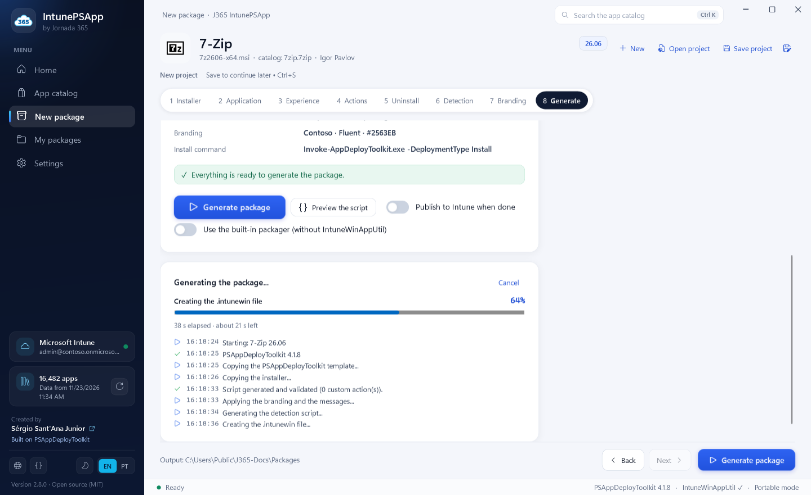

While it works, the editor shows the real percentage and the time left — also while the `.intunewin` is created, the longest step, measured by the actual work of Microsoft's tool or of the built-in packager.

```
<Packages>\7-Zip_26.06\
  Package\        PSAppDeployToolkit + Invoke-AppDeployToolkit.ps1 + Files\ (installer)
  Intune\         7-Zip_26.06.intunewin, Detection_*.ps1, instructions (HTML/TXT), intune-app.json, Publish-ToIntune.ps1
  Sandbox\        Windows Sandbox test
  project.json    every option, to reopen or rebuild
  build.log
```

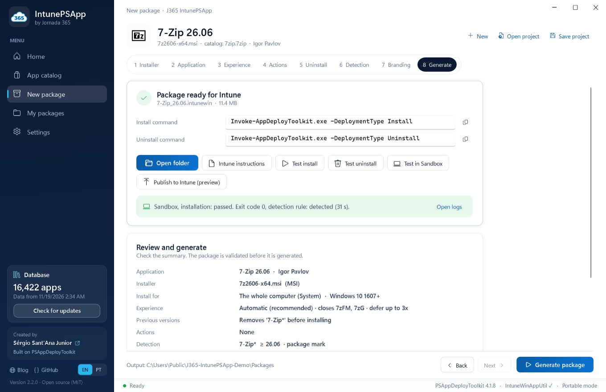

The result card gives the install and uninstall commands, the SHA256 of the `.intunewin`, **Publish now** (when connected), **Open folder**, **Intune instructions** (every field to fill in by hand, if you prefer) and the tests below. If you change anything afterwards, the editor marks the package as outdated and disables publishing and testing until you generate it again.

## 5. Test before publishing

| Test | What it does |
| --- | --- |
| **Test on this computer** (step 6) | Runs the detection rule here. |
| **Test in Sandbox** | Opens Windows Sandbox (a disposable Windows), installs the package as SYSTEM, runs the detection and shows the result here, with the logs. Nothing changes on your computer. Needs Windows Pro/Enterprise/Education; the application offers to enable the feature. |
| **Test install / Test uninstall** | Runs the package on *this* computer as administrator, with the real dialogs. |

Always validate with a pilot group in Intune before a broad assignment.

## 6. Connect to Intune

**Settings > Microsoft Intune > Connect to Intune** opens the connection window:

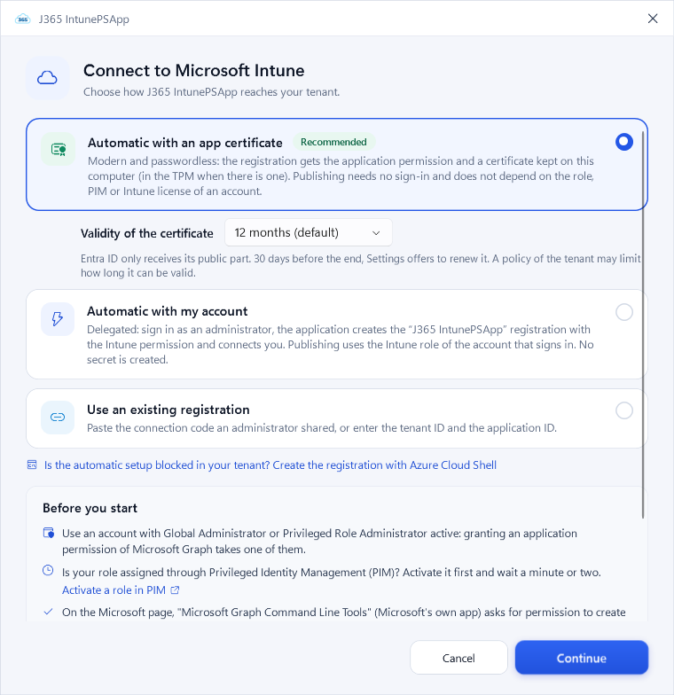

- **Automatic with my account**: you sign in as an administrator in your browser (PKCE, no password in the application); the application creates the single-tenant registration *J365 IntunePSApp* with the only permission it needs, `DeviceManagementApps.ReadWrite.All`, grants the admin consent and connects you. Publications then run as you, with your Intune role.
- **Automatic with an app certificate**: the same registration also gets the application permission and a certificate kept on this computer (its key in the TPM when there is one, never exportable; valid 6, 12 or 24 months). Publishing then needs no user session — no PIM activation, no role of a person — and works for scheduled batches.
- **Use an existing registration**: paste the connection code another administrator shared, or type the tenant ID and the application ID; each technician signs in with their own account.
- **Create it with Azure Cloud Shell**: when the tenant blocks the automatic setup, the same registration is created with the Azure CLI of your own portal session.

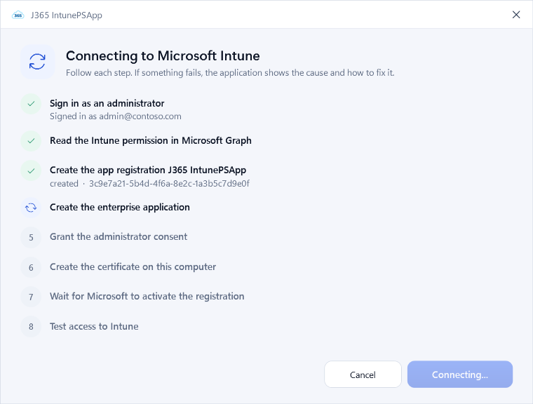

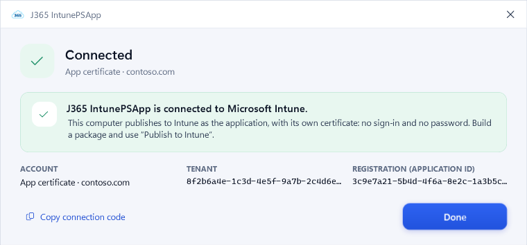

When something fails, the window says why and what to do (role not active in PIM, consent cancelled, no Intune license, registration deleted…):

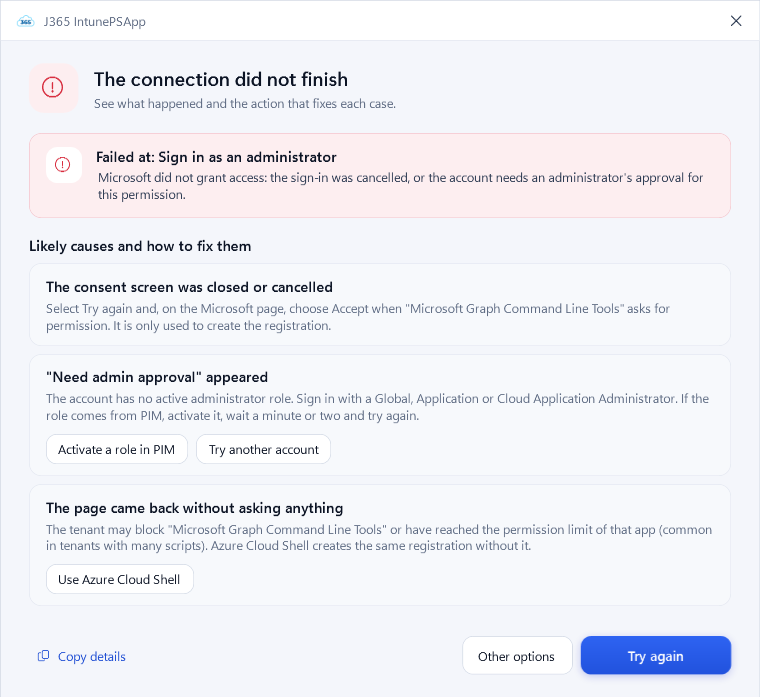

## 7. Publish to Intune

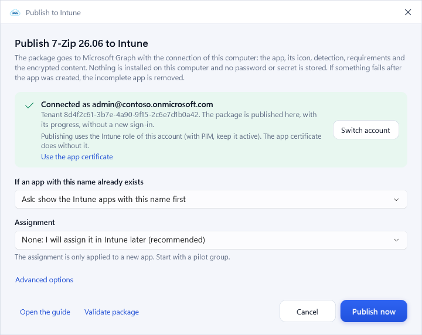

- **If an app with this name already exists**: *Ask* lists the apps of the tenant named like this one. Choose to **update** one of them (it keeps its assignments and gets the new content at once), to publish a **new app that supersedes** the earlier version (new in 2.8), or to create another app. Only an app with exactly this name is preselected.
- **Assignment**: none (assign it later in Intune — recommended), *available* or *required*, for a group, all users or all devices. A broad *required* assignment asks for confirmation.
- **Advanced options**: **Run in a PowerShell window**, or **Copy command** to run `Publish-ToIntune.ps1` yourself (it works without the application too).
- **Validate package** checks everything without connecting.

The upload shows its percentage and the time left. Intune receives the app, its icon, the install/uninstall commands, the detection script, the requirements (architecture, minimum Windows), return codes, notifications and restart behavior. An incomplete app is removed if anything fails or you cancel. The result card then links to **Open in Intune** and **Status in Intune**. See [INTUNE-PUBLISH.md](INTUNE-PUBLISH.md) for the details and the command line.

### A new version, group by group (supersedence)

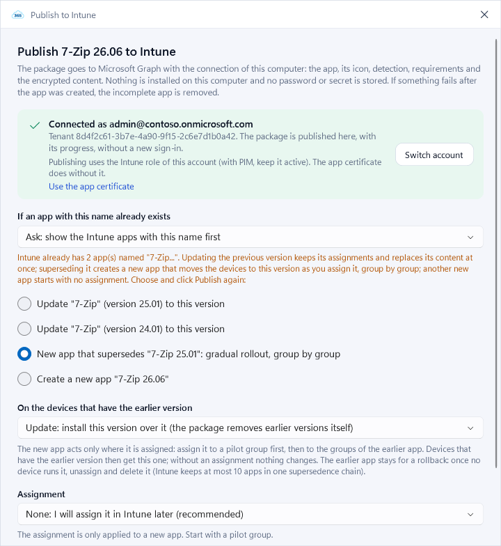

**New app that supersedes** creates the new version as a separate app linked to the earlier one. It acts only where you assign it: assign it to a pilot group first, then to the groups of the earlier app. On those devices the earlier version is replaced; elsewhere nothing changes, and the earlier app stays for a rollback.

- **Update** (default): Intune installs this version over the earlier one, and the package removes earlier versions itself (step 5).
- **Uninstall first**: Intune runs the uninstall command of the earlier app before, even where it is not assigned.

Once no device runs the earlier version, unassign and delete it: Intune keeps at most 10 apps in one supersedence chain.

### Follow the installation

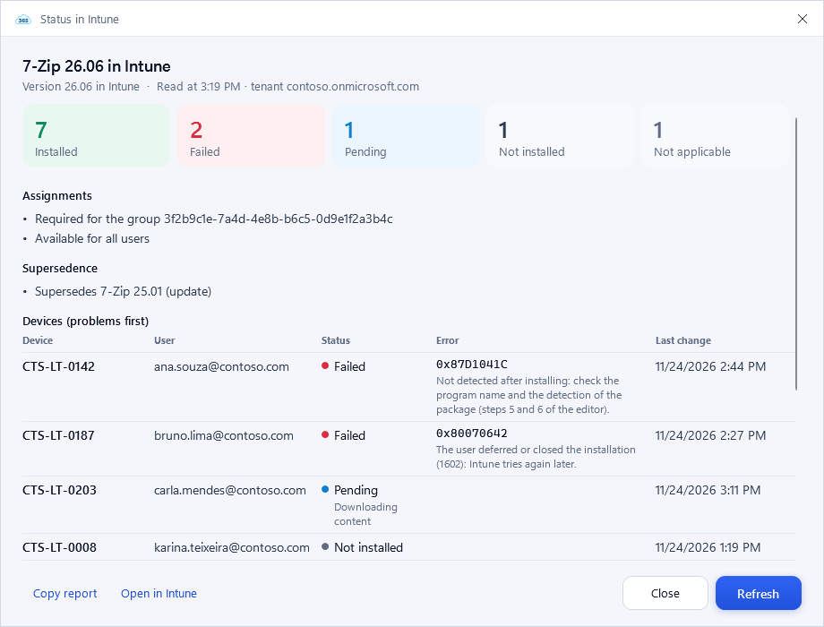

**Status in Intune** (on the result card, or **Status** in [My packages](#9-my-packages)) reads from Intune, without changing anything:

- how many devices have the app installed, failed, pending, not installed or not applicable;
- the assignments and the supersedence;
- every device, the ones with a problem first, with the error code and what it usually means — `0x87D1041C`, for example, is an app not detected after installing: check the detection rule.

**Refresh** reads it again; **Copy report** gives a table for a ticket or a spreadsheet. A device appears after its next check-in with Intune.

## 8. Batch deploy

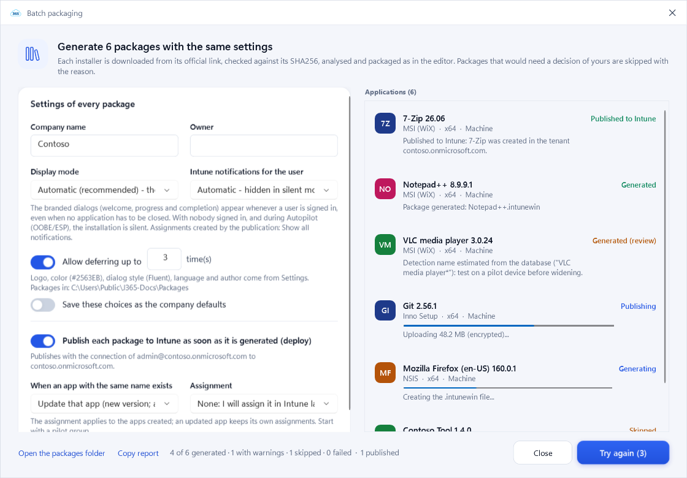

1. In the catalog, tick several applications (or **Add to batch** on the details) and click **Batch package**.
2. Set what they share: company, owner, the type of installation (silent or with notification) and what every package does with the **versions already installed** — *Remove any installed version and install this one* reinstalls every application from scratch; with **Reinstall also where the app is already installed**, also where an earlier package already installed it.
3. Optionally **Publish each package to Intune as soon as it is generated**, with what to do with an app of the same name (update it, **create a new app that supersedes it**, create another, or do not publish) and the assignment. The tenant and the assignment are confirmed before anything starts.
4. **Generate N packages**. Each installer is downloaded from its official link, checked against its SHA256 and packaged as in the editor; each application shows the step it is in, with its real percentage (download, build and upload to Intune) and the time left. An `.exe` without known silent switches, or a name that also matches other applications, is **skipped with the reason** — open it in the editor to finish it by hand. A failed publication can be retried alone; **Copy report** gives a table of the results.

## 9. My packages

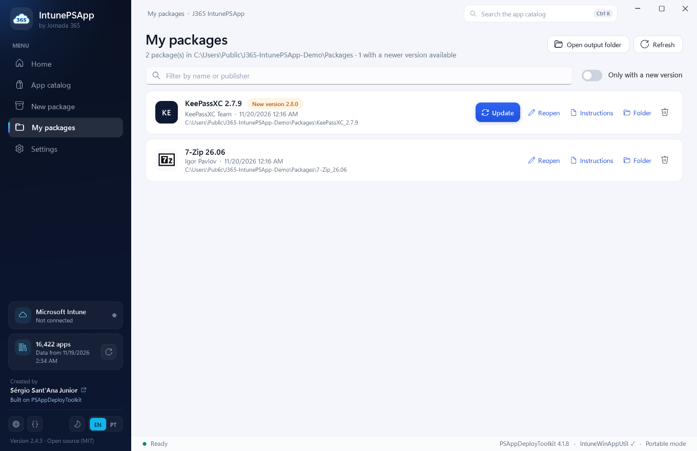

Every package of the output folder, newest first (or *Name A–Z*, *Updates first*, and the switch **Only with a new version**). **Status** (packages published from this computer) shows [how the installation goes](#follow-the-installation), **Reopen** loads the project in the editor (a new version of the application keeps all your customizations: only the installer and the version change), **Instructions** opens the Intune instructions, **Folder** opens it in Explorer.

## 10. Settings

| Tab | What it holds |
| --- | --- |
| **General** | Interface language, **check for new versions** (and **Check now**), installation for the user, desktop shortcut, the packages folder and the data folder (with **Logs**). |
| **Appearance** | Light, dark or the theme of Windows. |
| **Company** | Company name, logo, accent color and dialog style of new packages. |
| **Defaults** | Type of installation (silent or with notification), countdown, blocking, disk check, what to do with the versions already installed (remove any version, keep a newer one or install over) and if the removal fails, messages, preferred architecture and installer language. |
| **Microsoft Intune** | The connection: account or certificate, tenant, subscription check, renew the certificate, disconnect. |
| **Components** | The application database (**Update address**, how often it is checked, **Download again**, **Import file (offline)...**), PSAppDeployToolkit and IntuneWinAppUtil. |
| **About** | Version, signature of the executable, author and licenses. |

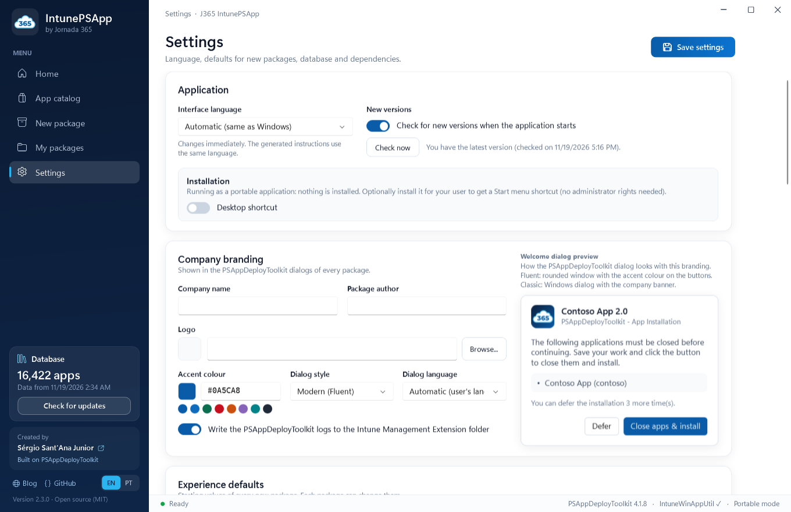

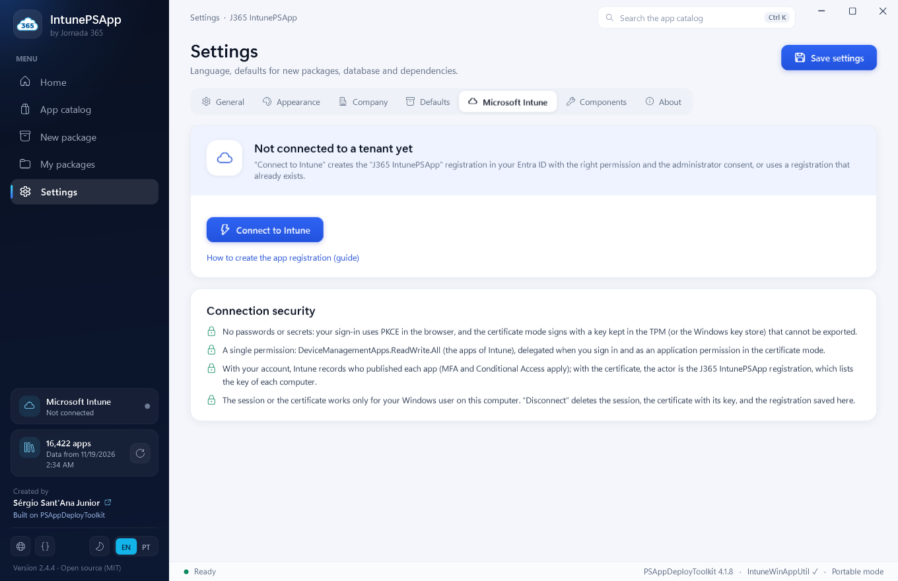

<table><tr><td width="50%"><b>Company</b><br><a href="screenshots/en/company.png">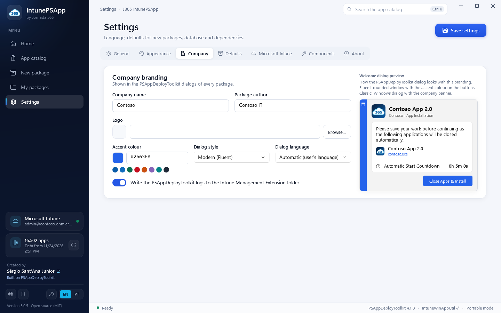 Company" width="100%"></a></td><td width="50%"><b>Defaults</b><br><a href="screenshots/en/defaults.png">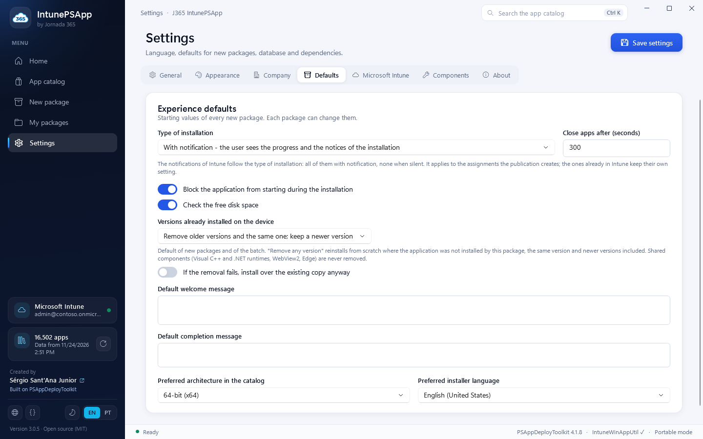 Defaults" width="100%"></a></td></tr><tr><td width="50%"><b>Components</b><br><a href="screenshots/en/components.png">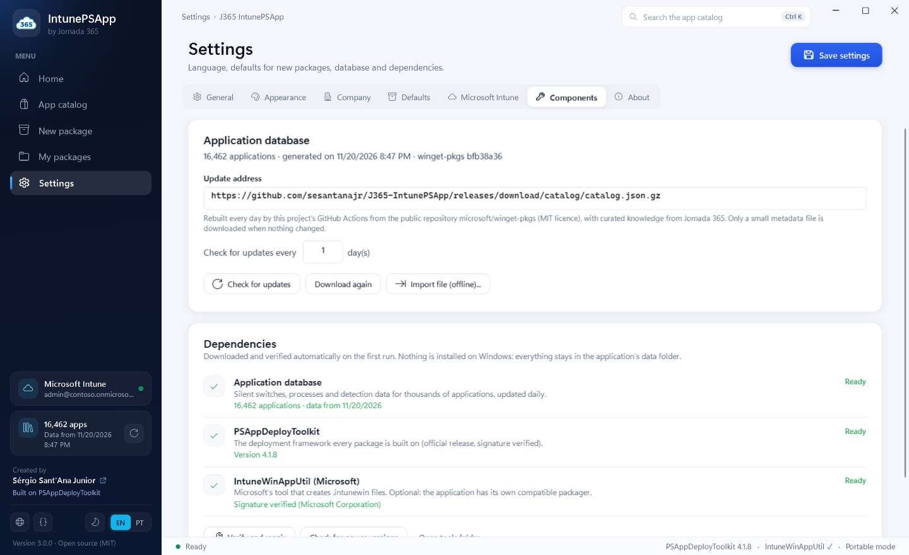 Components" width="100%"></a></td><td width="50%"><b>About</b><br><a href="screenshots/en/about.png">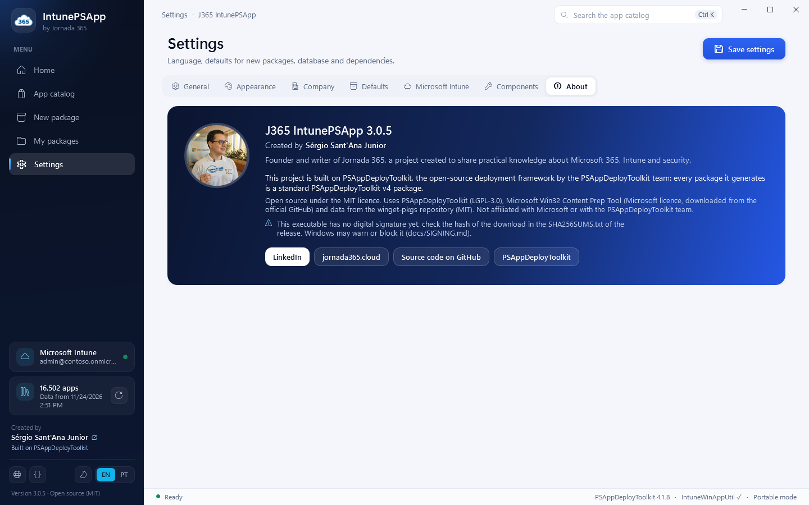 About" width="100%"></a></td></tr></table>

> Keep the packages folder outside OneDrive when you can: every package (the installer and its `.intunewin`) would be uploaded to the cloud. The application points this out under the field.

## 11. Keep the application up to date

The application checks for a new version at start (at most once a day, and every few hours while it stays open) and shows a notice on Home. **Settings > General > Check now** checks immediately and, when there is a new version, downloads it, verifies it against the `SHA256SUMS.txt` of the release and restarts in the new version — packages, settings, database and tools are kept.

The check reads the files of the latest release on github.com, so it works on company networks where the GitHub API limit (60 requests an hour, shared by everyone behind the same address) is reached. Copies up to 2.6.0 only asked that API: if one keeps saying *you have the latest version*, download the latest release once and use **Settings > General > Update the installed copy**.

A release published less than a minute or two ago may not show yet: if a version has just come out and the application says *you have the latest version*, check again in a moment.

## 12. Command line

```powershell
J365.IntunePSApp.exe --build <project.json|installer> [--out <folder>] [--native]
J365.IntunePSApp.exe --batch <id1,id2,...> [--mode Silent|Notify] [--company <name>] [--existing RemoveAll|KeepNewer|InstallOver] [--reinstall] [--out <folder>]
                     [--publish [--if-exists Update|Supersede|CreateNew|Fail [--supersedence Update|Replace]]
                                [--assign none|available|required] [--assign-to AllUsers|AllDevices|Group] [--group <id>]]
J365.IntunePSApp.exe --sandbox <package folder>
J365.IntunePSApp.exe --setup | --update-catalog [--force] | --update [--check]
J365.IntunePSApp.exe --install [--desktop-shortcut] [--quiet] | --uninstall [--purge] [--quiet]
J365.IntunePSApp.exe --version | --help
```

`--batch` accepts winget IDs and Microsoft Store product IDs. `--existing` chooses what each package does with the versions already installed (`RemoveAll` removes any version) and `--reinstall` reinstalls also where the app is already installed. `--publish` uses the connection of this computer (the certificate is the natural choice for scheduled runs); `--if-exists Supersede` publishes each new version as a new app that supersedes the earlier one.

## 13. Logs and troubleshooting

| Where | What |
| --- | --- |
| Settings > General > **Logs** (`…\IntunePSApp\logs\app-YYYYMMDD.log`) | Everything the application did: downloads, builds, publications, update checks, the environment at start. 14 days are kept. |
| `<package>\build.log` | The build of that package. |
| On the device: `C:\ProgramData\Microsoft\IntuneManagementExtension\Logs` (or `C:\Windows\Logs\Software`) | The PSAppDeployToolkit log of the installation (`<App>_PSAppDeployToolkit_Install.log`), the MSI logs, and `AppWorkload.log` of Intune. |

| Symptom | What to do |
| --- | --- |
| Windows blocks the executable | SmartScreen: *More info > Run anyway*. Smart App Control / App Control: see [SIGNING.md](SIGNING.md). |
| "Could not download the installer" (HTTP 404) or *Link unavailable* | The vendor took the file off the link registered in winget. The application offers the vendor's site: download the installer and drop it on **New package** (the analysis checks its signature and the database fills in the switches). The next update of the database uses a version whose link works, when there is one. |
| The SHA256 of the file does not match | The vendor published another file at the same link: for safety it is not used. Download it from the vendor's site and drop it on **New package**. |
| "Could not check for new versions" | Network or proxy; the message says why (and when a GitHub API limit frees up). |
| IntuneWinAppUtil failed | The built-in packager makes the same `.intunewin` automatically; very long paths go straight to it. A shorter packages folder lets Microsoft's tool be used. |
| Intune says *not detected* after installing | Check the program name of step 5/6 with **Show matches on this PC** and **Test on this computer**; the detection output explains a missing package mark. |
| Intune refuses (401/403) | The window explains it: role not active (PIM), no Intune license or subscription, consent missing. The certificate connection avoids user roles. |
| Intune says *installed*, but the app was not reinstalled | An earlier package of the same app left its mark, and Intune does not run the package where the app already is in the required version. Turn on **Reinstall also where the app is already installed** (step 5), generate and publish again. |
| *You have the latest version* right after a new release | Wait a minute or two and click **Check now** again. |
| Tests or publishing fail with "Constrained Language" | An App Control policy restricts PowerShell; signed releases of the application keep full PowerShell. |

Questions and problems: [open an issue](https://github.com/sesantanajr/J365-IntunePSApp/issues) with the application log (remove sensitive data first).

---

<p align="center">J365 IntunePSApp · created by <a href="https://www.linkedin.com/in/sergiosantanacloud/">Sérgio Sant'Ana Junior</a> · <a href="https://jornada365.cloud">Jornada 365</a> · built on <a href="https://psappdeploytoolkit.com">PSAppDeployToolkit</a></p>
