<p align="center"><a href="USER-GUIDE.md">English</a> · <strong>Português (Brasil)</strong></p>

# J365 IntunePSApp — Guia de uso

De um instalador (`.msi` ou `.exe`) ou de um aplicativo do catálogo até um app Win32 no Microsoft Intune: este guia percorre todas as telas do **J365 IntunePSApp 3.0** com capturas reais. Os exemplos usam uma empresa fictícia, a *Contoso*, e o MSI do 7-Zip.

| Você quer… | Vá para |
| --- | --- |
| Instalar e preparar o aplicativo | [1. Instalação e primeira execução](#1-instalação-e-primeira-execução) |
| Encontrar um aplicativo e seus parâmetros silenciosos | [3. Encontre um aplicativo no catálogo](#3-encontre-um-aplicativo-no-catálogo) |
| Montar um pacote passo a passo | [4. Crie um pacote](#4-crie-um-pacote-passo-a-passo) |
| Conferir um pacote antes de ele chegar aos dispositivos | [5. Teste antes de publicar](#5-teste-antes-de-publicar) |
| Enviar para o Intune | [6. Conecte ao Intune](#6-conecte-ao-intune) · [7. Publique](#7-publique-no-intune) |
| Publicar uma versão nova aos poucos e acompanhar a instalação | [Substituição](#uma-versão-nova-grupo-a-grupo-substituição) · [Status no Intune](#acompanhe-a-instalação) |
| Empacotar (e publicar) vários aplicativos de uma vez | [8. Deploy em lote](#8-deploy-em-lote) |
| Reabrir, atualizar ou encontrar um pacote | [9. Meus pacotes](#9-meus-pacotes) |
| Ajustar padrões, identidade visual e conexão | [10. Configurações](#10-configurações) |
| Automatizar | [12. Linha de comando](#12-linha-de-comando) |
| Resolver um problema | [13. Solução de problemas](#13-logs-e-solução-de-problemas) |

---

## 1. Instalação e primeira execução

1. Baixe o `J365-IntunePSApp-<versão>-win-x64.zip` da [versão mais recente](https://github.com/sesantanajr/J365-IntunePSApp/releases/latest), extraia e execute o **`J365.IntunePSApp.exe`**. O runtime do .NET já vem junto; não é preciso instalar mais nada. Se quiser, confira o arquivo pelo `SHA256SUMS.txt` da versão.
2. O executável ainda não tem assinatura de código: o SmartScreen pode dizer *O Windows protegeu o computador* — **Mais informações > Executar assim mesmo**. O Controle Inteligente de Aplicativos ou uma política de App Control podem bloqueá-lo; veja o [SIGNING.md](SIGNING.md).
3. Na primeira execução o aplicativo baixa e confere o que precisa: o **banco de dados de aplicativos** (gerado todos os dias a partir do winget), o template oficial do **PSAppDeployToolkit** (a assinatura Authenticode é verificada) e o **IntuneWinAppUtil** da Microsoft (também com a assinatura verificada; opcional — o aplicativo tem um empacotador compatível próprio).

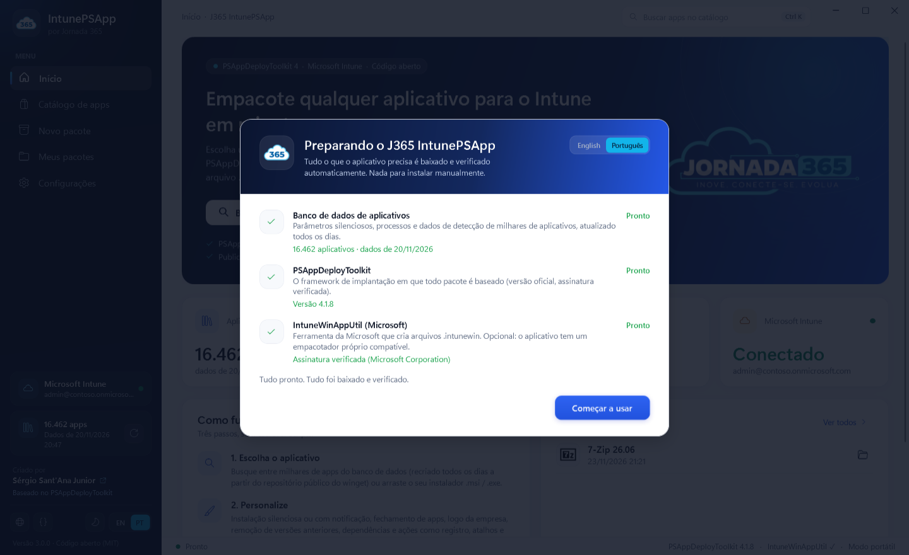

**Portátil ou instalado.** Extraído numa pasta com permissão de escrita, o aplicativo é *portátil*: os dados ficam em `IntunePSApp-Data`, ao lado do executável. **Configurações > Geral > Instalar para o meu usuário** copia o aplicativo para `%LOCALAPPDATA%\Programs\J365 IntunePSApp` (Menu Iniciar e *Aplicativos instalados*, sem precisar de administrador), com os dados em `%LOCALAPPDATA%\J365\IntunePSApp`.

**Idioma e tema** mudam na hora, no rodapé da barra lateral (**EN / PT**, sol/lua).

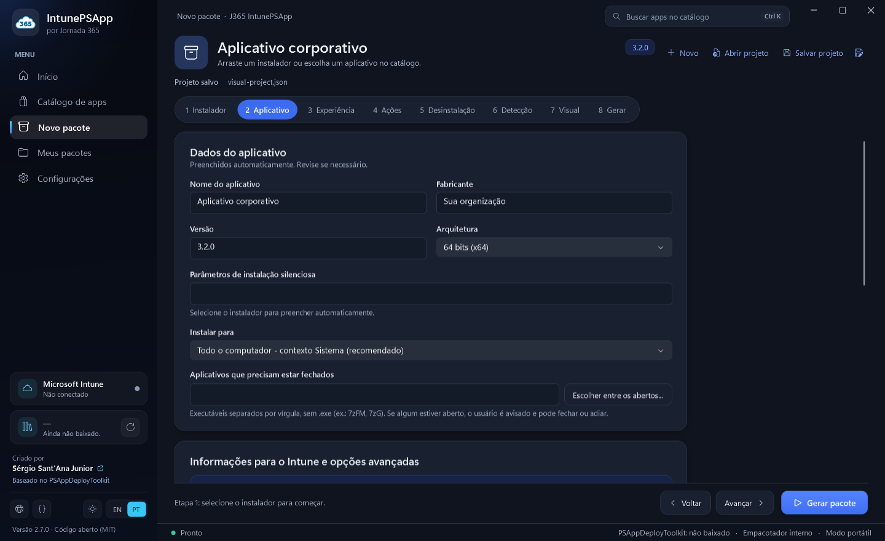

## 2. Início

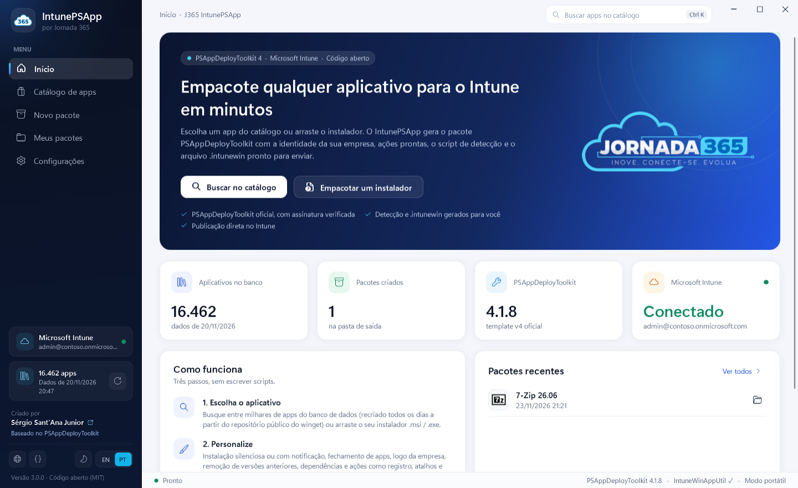

- **Buscar no catálogo** ou **Empacotar um instalador** (você também pode arrastar um `.msi`/`.exe` para a janela).
- Quatro indicadores: aplicativos no banco de dados, pacotes criados, versão do PSAppDeployToolkit e a conexão com o Intune.
- Avisos aparecem aqui quando algo pede atenção: uma versão nova do aplicativo, um toolkit mais novo, pacotes cujo aplicativo tem versão mais nova no banco de dados.
- **Pacotes recentes** reabre o seu último trabalho.

Atalhos: **Ctrl+K** busca no catálogo · **Ctrl+N** novo pacote · **Ctrl+O** abre um projeto · **Ctrl+S** salva · **Ctrl+Shift+S** salva como · **F5** gera o pacote.

## 3. Encontre um aplicativo no catálogo

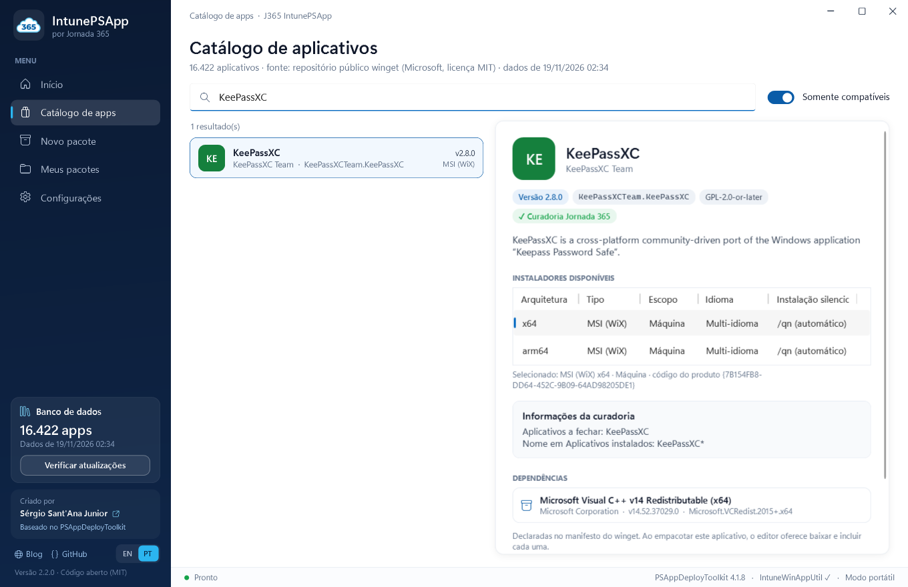

1. Digite um nome, fabricante ou ID do winget. **Somente compatíveis** esconde formatos que não podem ser empacotados (MSIX, ZIP, portátil); a linha acima dos resultados diz quantos foram escondidos.
2. Escolha um resultado: os detalhes listam cada **instalador** (arquitetura, tipo, escopo, idioma e os **parâmetros silenciosos** que serão usados), a licença, a curadoria do Jornada 365 (aplicativos a fechar, nome em *Aplicativos instalados*, parâmetros de desinstalação) e as dependências.
3. **Baixar e empacotar** baixa o instalador do endereço oficial do fabricante, confere o SHA256 com o manifesto do winget e abre tudo no editor já preenchido. **Adicionar ao lote** coloca o aplicativo na fila do [deploy em lote](#8-deploy-em-lote).

**Apps da Microsoft Store.** A busca também consulta a Microsoft Store ao vivo, pelo nome ou pelo ID do produto (por exemplo `9PM860492SZD`). Esses apps não são empacotados: são publicados no Intune como **Aplicativo da Microsoft Store (novo)** — o Intune os instala pela Store e os mantém atualizados —, sozinhos ou em lote.

## 4. Crie um pacote passo a passo

O editor tem oito etapas. O cabeçalho mostra o aplicativo, o arquivo do projeto e se ele foi salvo; **Voltar / Avançar** e a barra de etapas navegam entre elas. Tudo é conferido de novo na última etapa, antes de qualquer coisa ser gerada.

### Etapa 1 — Instalador

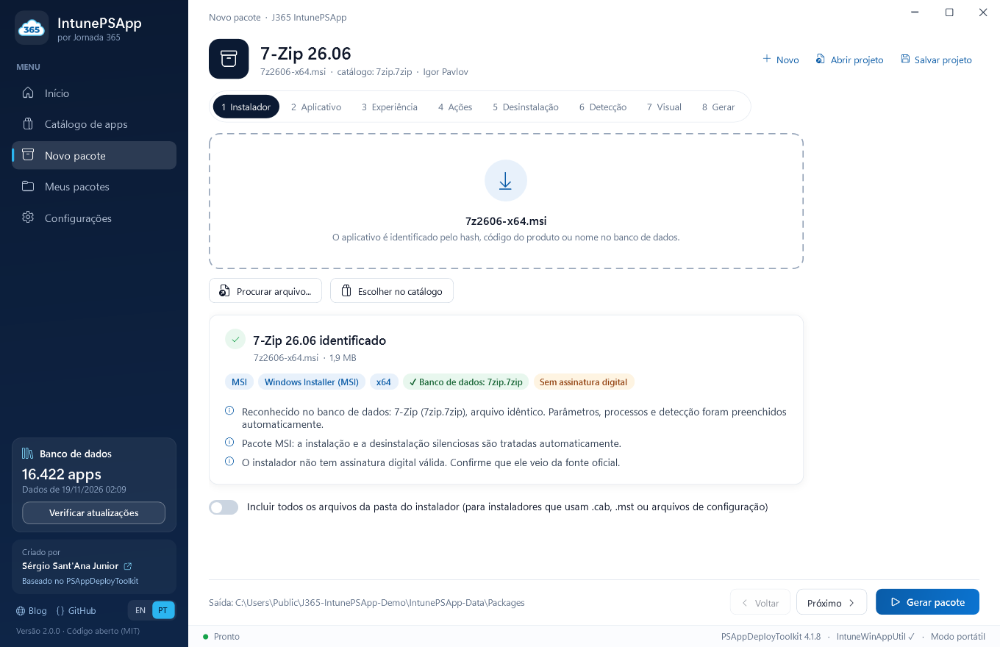

Arraste um `.msi`/`.exe`, use **Procurar arquivo...** ou **Escolher no catálogo**. A análise lê as propriedades do MSI ou a tecnologia do instalador (Inno Setup, NSIS, WiX Burn, InstallShield…), confere a assinatura digital e procura o arquivo no banco de dados pelo SHA256 (arquivo idêntico), pelo código do produto ou pelo nome. Um instalador reconhecido preenche automaticamente parâmetros, processos, detecção e desinstalação.

Ligue **Incluir todos os arquivos da pasta do instalador** para instaladores que precisam dos seus `.cab`, `.mst` ou arquivos de configuração.

### Etapa 2 — Aplicativo

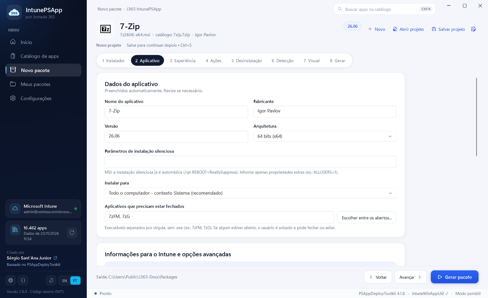

Nome, versão, fabricante, arquitetura, **contexto de instalação** (*Sistema*, para todos os usuários, ou *Usuário*), versão mínima do Windows, parâmetros de instalação e o ícone exibido no Portal da Empresa (tirado do instalador ou do programa instalado; um ícone genérico de instalador nunca é usado).

Mais abaixo, as informações que o Intune mostra: descrição, desenvolvedor, proprietário, URLs de informações e de privacidade, observações. O nome no Intune não leva a versão — a versão vai no campo próprio.

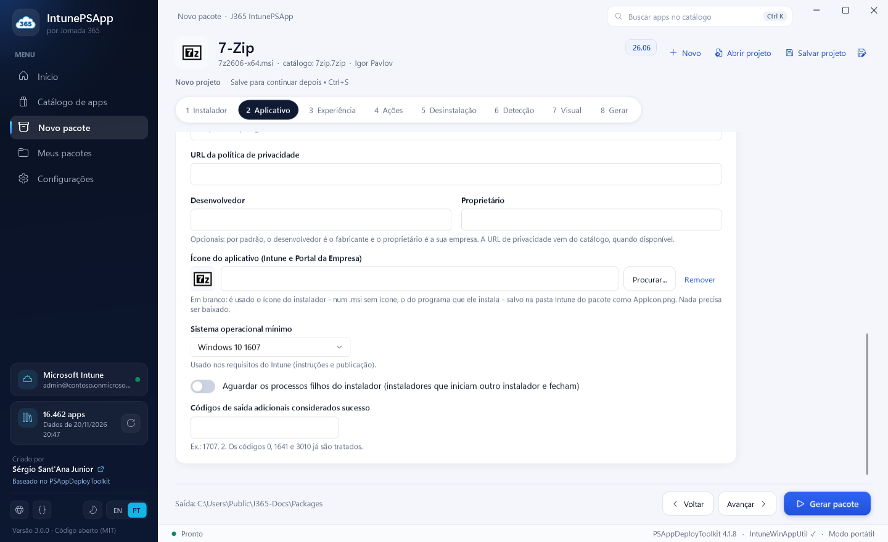

### Etapa 3 — Experiência

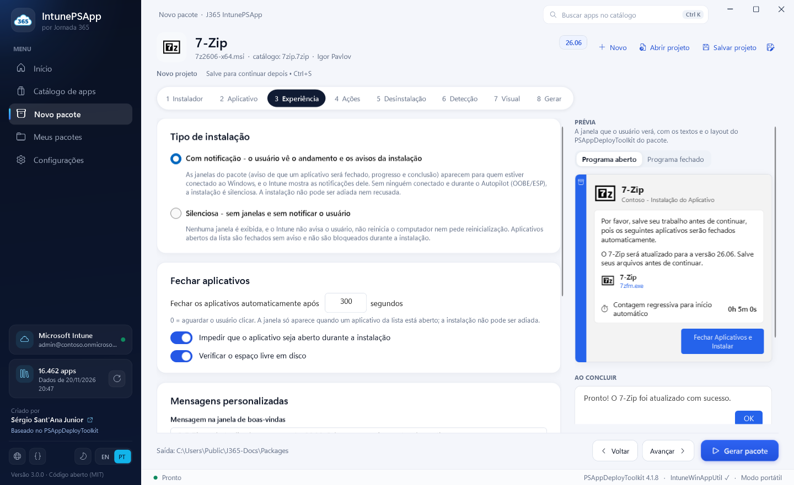

| Tipo de instalação | O que o usuário vê |
| --- | --- |
| **Com notificação** | As janelas do pacote (aviso de que um aplicativo será fechado, progresso e conclusão) sempre que houver um usuário conectado, e as notificações do Intune. Silenciosa no Autopilot ou sem ninguém conectado. |
| **Silenciosa** | Nada: nenhuma janela e nenhum aviso do Intune, que também não reinicia o computador nem pede reinicialização. Aplicativos abertos da lista são fechados. |

A instalação não pode ser adiada (a opção de adiar saiu na 3.0), e as notificações do Intune seguem o tipo de instalação. Também aqui: os **aplicativos a fechar** (com contagem regressiva), o bloqueio do aplicativo durante a instalação, a verificação de espaço em disco, as mensagens de boas-vindas, de progresso e de conclusão e o pedido de reinício.A prévia à direita desenha a janela real do PSAppDeployToolkit 4, com o seu logo e as suas cores, no idioma do usuário.

A prévia alterna entre os momentos da instalação — **Programa aberto**, **Programa fechado** e **Último aviso** — e mostra a mensagem **Ao concluir**:

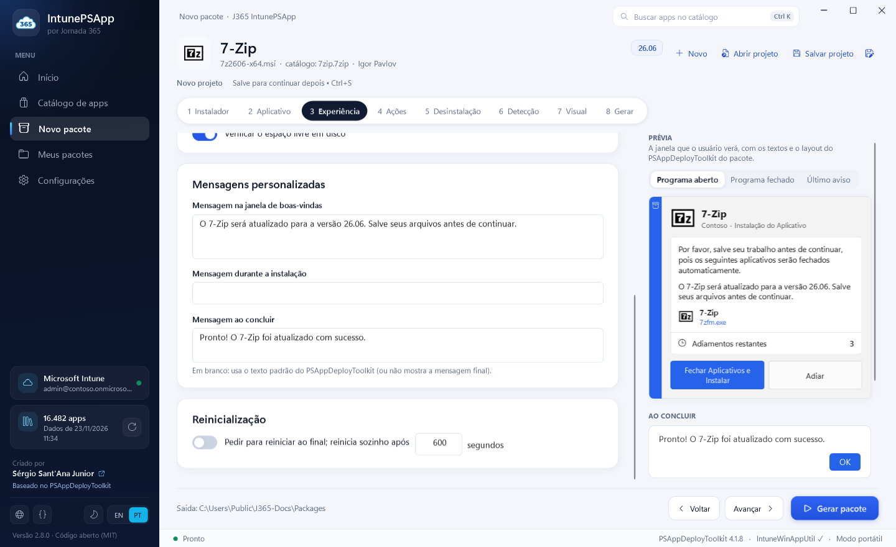

### Etapa 4 — Ações

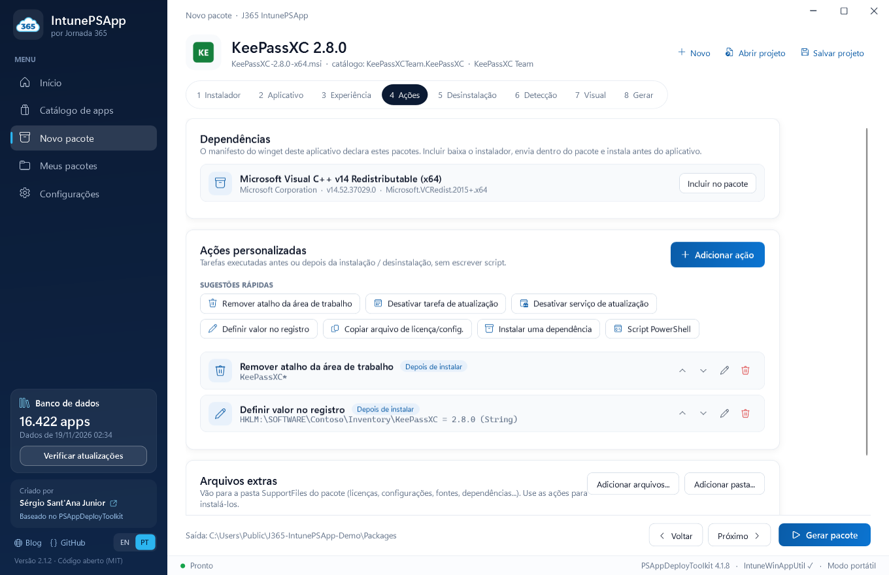

Ações prontas, cada uma na sua fase (*antes/depois da instalação*, *antes/depois da desinstalação*): instalar uma dependência, desinstalar outro aplicativo, remover ou criar atalhos, copiar arquivos (inclusive para todos os perfis de usuário), apagar arquivos e pastas, criar ou remover valores no registro, importar um `.reg`, parar processos ou serviços, desativar uma tarefa agendada, definir variáveis de ambiente, executar um programa ou PowerShell, mostrar uma mensagem, aguardar. Arquivos extras vão junto com o pacote (`SupportFiles`).

### Etapa 5 — Desinstalação

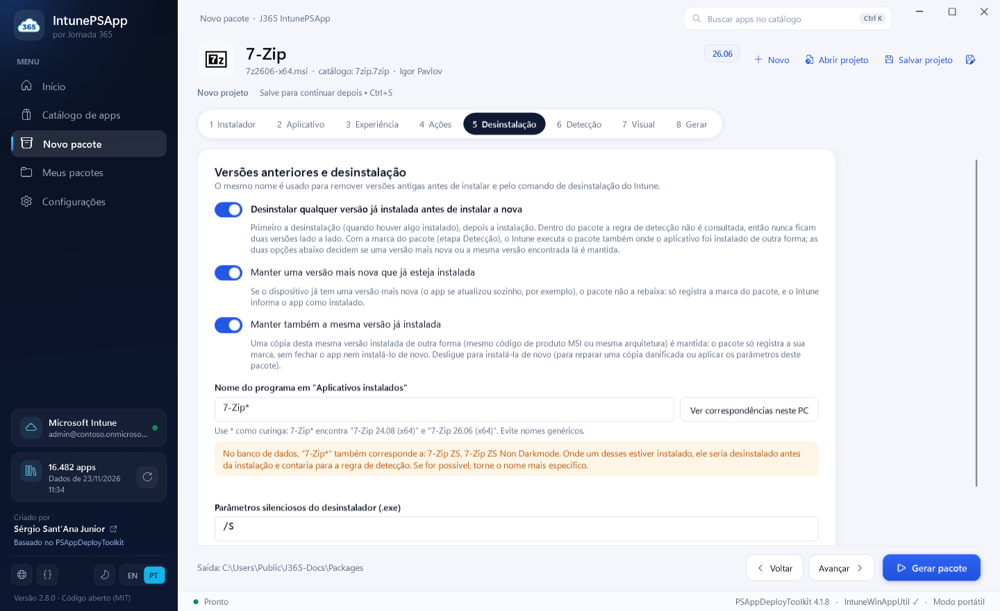

- **Versões já instaladas no dispositivo** — uma escolha:
  - **Remover qualquer versão instalada (mais antiga, a mesma ou mais nova) e instalar esta**: reinstalação limpa, no modo silencioso ou com notificação. MSI sai pelo código do produto; .exe pelos parâmetros informados, pelo comando silencioso que o programa registrou ou, na falta dele, pelos parâmetros do Inno Setup e do NSIS. Componentes compartilhados (runtimes do Visual C++ e do .NET, WebView2, Edge) nunca são removidos; um aplicativo que o banco de dados recomenda não remover (navegadores que se atualizam sozinhos, Adobe Acrobat 64 bits, cujo nome é também o do Acrobat Pro) é removido também, com aviso.
  - **Remover versões mais antigas e a mesma; manter uma versão mais nova** (padrão): nunca rebaixa um aplicativo que se atualizou sozinho.
  - **Não remover: instalar por cima do que existir.**
- **Se a remoção falhar, instalar por cima mesmo assim** (desligado por padrão): desligado, se uma cópia continuar instalada a instalação para com erro, o log diz qual cópia ficou e o Intune informa a falha, de modo que a versão nova nunca fica ao lado da antiga. Ligado, a versão nova é instalada por cima.
- **Reinstalar também onde o app já está instalado** (desligado por padrão): todo pacote de um app grava a mesma marca, então onde um pacote anterior já instalou o app na versão exigida o Intune o considera instalado e não executa o pacote novo — a escolha acima nem chega a ser aplicada. Ligado, o Intune executa o pacote uma vez em cada dispositivo da atribuição, que remove as versões instaladas conforme a escolha acima e instala de novo. A rodada começa quando você liga a opção: gerar o pacote de novo não reinstala outra vez; para uma nova rodada, desligue e ligue. Precisa da marca do pacote (etapa 6).
- **Nome do programa em "Aplicativos instalados"** (aceita curingas) é usado para encontrar, remover e detectar o aplicativo; **Ver correspondências neste PC** mostra o que ele encontraria. Pacotes MSI desinstalam pelo código do produto; um `.exe` precisa dos seus parâmetros silenciosos de desinstalação.

### Etapa 6 — Detecção

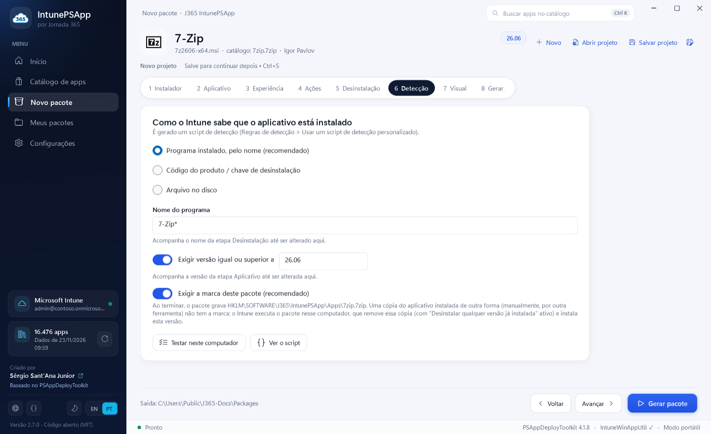

O Intune executa a regra de detecção antes e depois de instalar. Detecte pelo **nome e versão mínima** em *Aplicativos instalados* (recomendado), pelo **código do produto MSI** ou por um **arquivo** (com versão mínima opcional).

**Exigir a marca deste pacote (recomendado)**: o pacote grava `HKLM\SOFTWARE\J365\IntunePSApp\Apps\<app>` ao terminar, e a detecção exige essa marca. Assim, uma cópia instalada manualmente ou por outra ferramenta conta como *não instalada* e o Intune executa o seu pacote ali (que então a substitui, ou a mantém quando é a mesma versão ou uma mais nova). **Testar neste computador** executa a regra aqui; **Ver o script** mostra exatamente o que o Intune vai executar.

### Etapa 7 — Visual

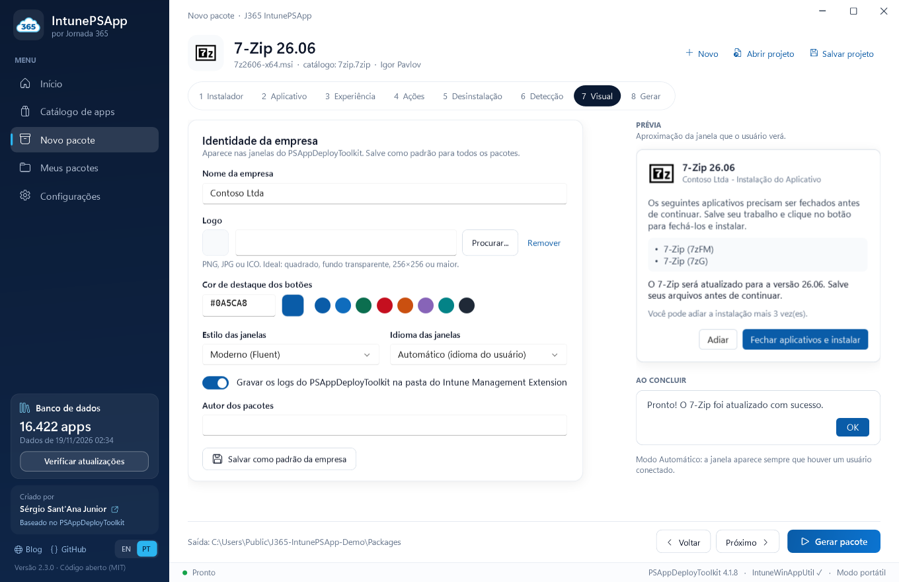

Nome da empresa, logo, cor de destaque, estilo das janelas (*Fluent* ou *Clássico*), idioma das janelas (o automático acompanha o usuário) e se os logs vão para a pasta do Intune Management Extension (coletada pelo *Coletar diagnóstico*). **Salvar como padrão da empresa** torna essas escolhas o ponto de partida de cada pacote novo.

### Etapa 8 — Gerar

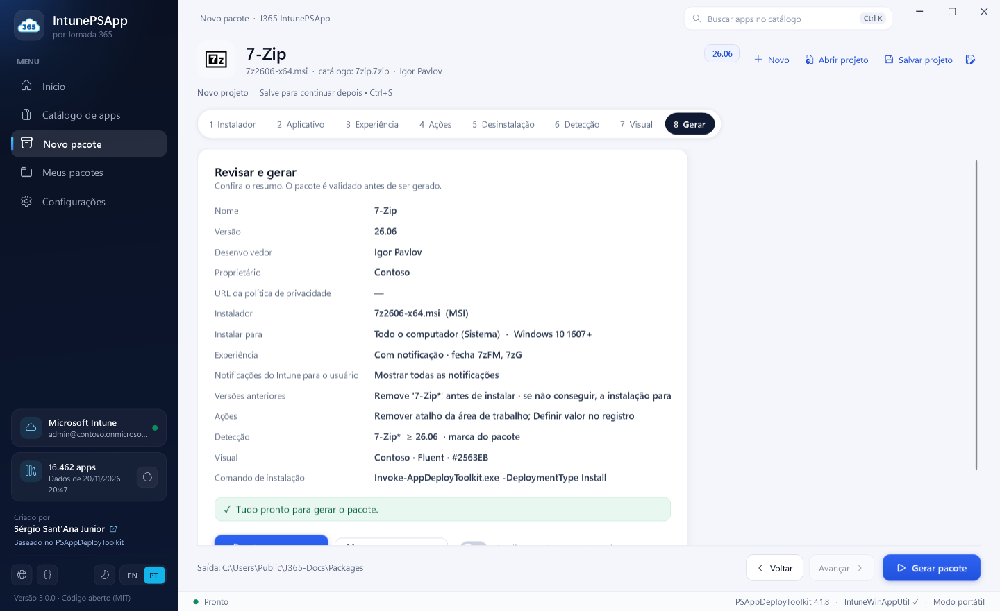

A revisão lista cada escolha e qualquer aviso (por exemplo, um `.exe` sem parâmetros silenciosos). **Gerar pacote** (ou **F5**) monta a pasta:

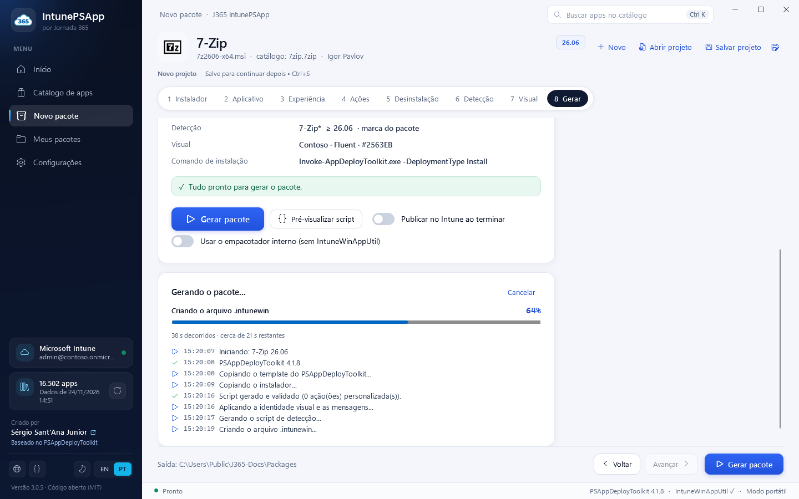

```
<Pacotes>\7-Zip_26.06\
  Package\        PSAppDeployToolkit + Invoke-AppDeployToolkit.ps1 + Files\ (instalador)
  Intune\         7-Zip_26.06.intunewin, Detection_*.ps1, instruções (HTML/TXT), intune-app.json, Publish-ToIntune.ps1
  Sandbox\        teste no Windows Sandbox
  project.json    todas as opções, para reabrir ou gerar de novo
  build.log
```

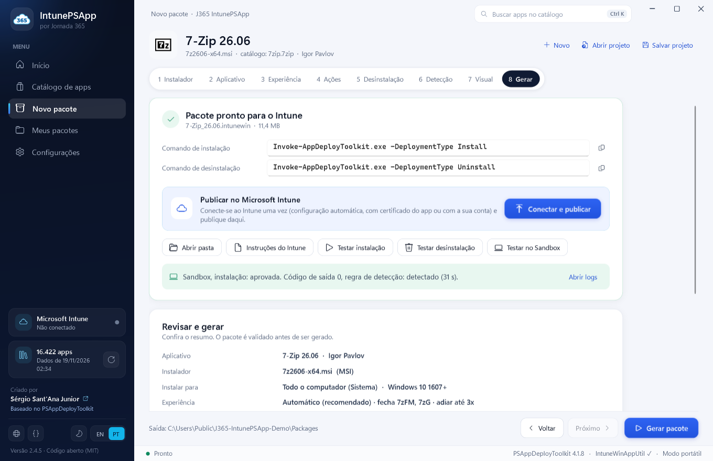

O cartão de resultado traz os comandos de instalação e desinstalação, o SHA256 do `.intunewin`, **Publicar agora** (quando conectado), **Abrir pasta**, **Instruções do Intune** (cada campo para preencher manualmente, se preferir) e os testes abaixo. Se você mudar algo depois, o editor marca o pacote como desatualizado e desliga a publicação e os testes até você gerar de novo.

## 5. Teste antes de publicar

| Teste | O que faz |
| --- | --- |
| **Testar neste computador** (etapa 6) | Executa a regra de detecção aqui. |
| **Testar no Sandbox** | Abre o Windows Sandbox (um Windows descartável), instala o pacote como SYSTEM, executa a detecção e mostra o resultado aqui, com os logs. Nada muda no seu computador. Exige Windows Pro/Enterprise/Education; o aplicativo oferece ativar o recurso. |
| **Testar instalação / Testar desinstalação** | Executa o pacote *neste* computador como administrador, com as janelas reais. |

Valide sempre com um grupo piloto no Intune antes de uma atribuição ampla.

## 6. Conecte ao Intune

**Configurações > Microsoft Intune > Conectar ao Intune** abre a janela de conexão:

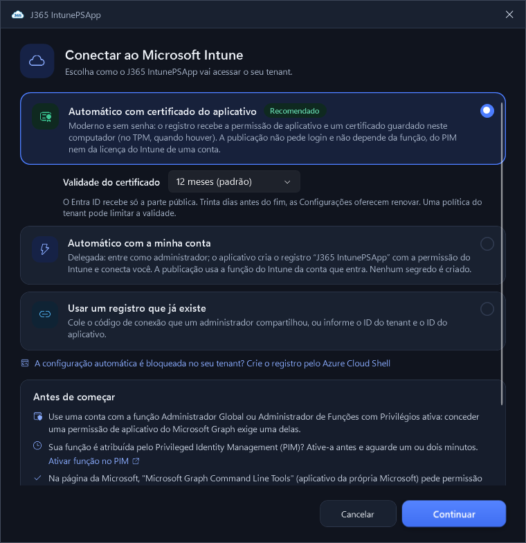

- **Automático com a minha conta**: você entra como administrador no navegador (PKCE, nenhuma senha passa pelo aplicativo); o aplicativo cria o registro de tenant único *J365 IntunePSApp* com a única permissão necessária, `DeviceManagementApps.ReadWrite.All`, concede o consentimento do administrador e conecta você. As publicações rodam como você, com a sua função no Intune.
- **Automático com certificado do aplicativo**: o mesmo registro recebe também a permissão de aplicativo e um certificado guardado neste computador (a chave no TPM, quando houver, nunca exportável; validade de 6, 12 ou 24 meses). A publicação passa a dispensar uma sessão de usuário — sem ativação de PIM, sem função de uma pessoa — e funciona para lotes agendados.
- **Usar um registro que já existe**: cole o código de conexão que outro administrador compartilhou, ou informe o ID do tenant e o ID do aplicativo; cada técnico entra com a própria conta.
- **Criar pelo Azure Cloud Shell**: quando o tenant bloqueia a configuração automática, o mesmo registro é criado pelo Azure CLI da sua própria sessão no portal.

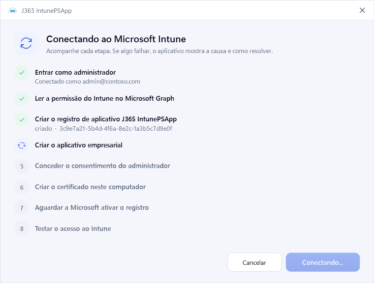

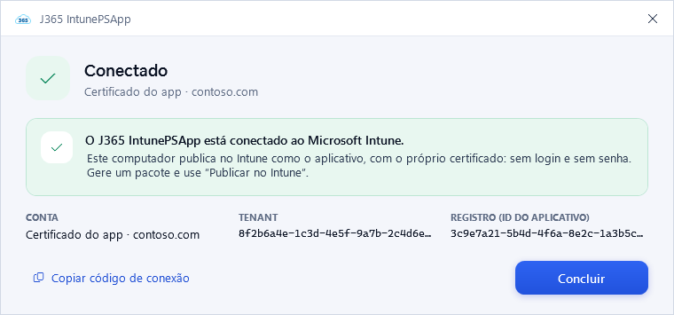

Quando algo falha, a janela diz o motivo e o que fazer (função não ativa no PIM, consentimento cancelado, sem licença do Intune, registro apagado…):

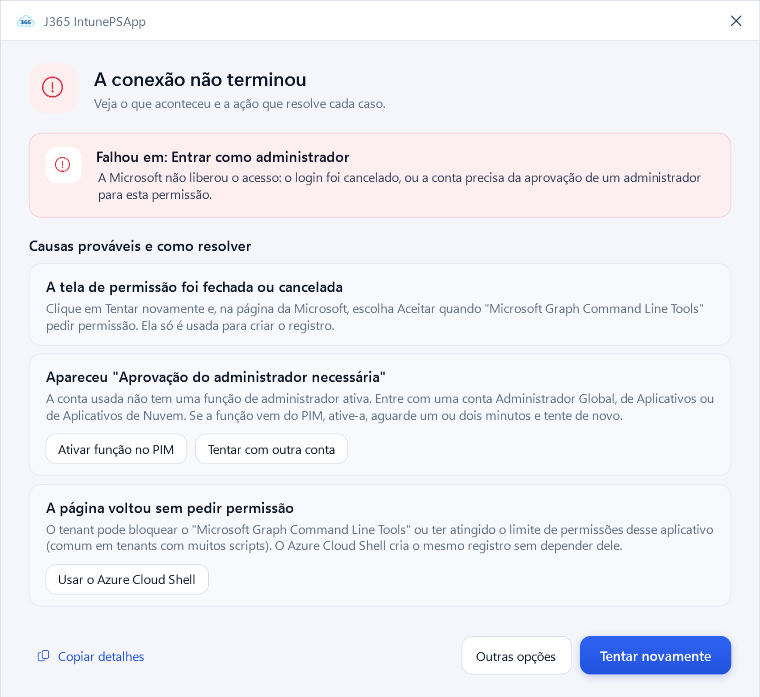

## 7. Publique no Intune

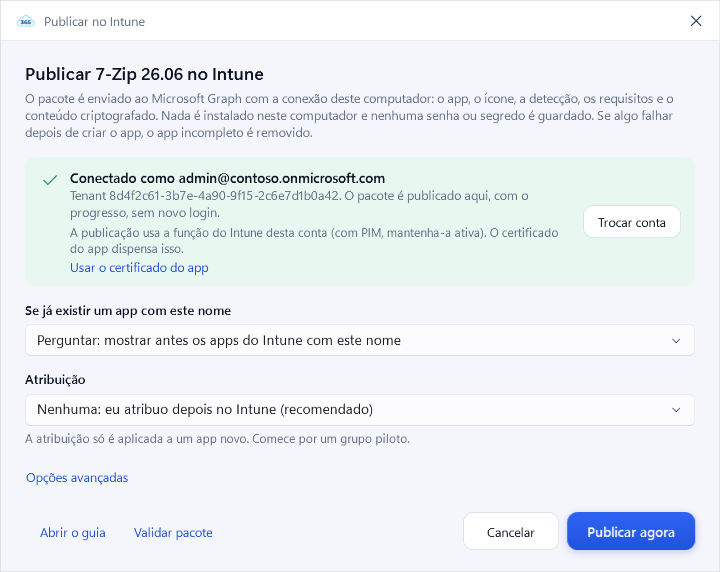

- **Se já existir um app com este nome**: *Perguntar* lista os apps do tenant com esse nome. Escolha **atualizar** um deles (ele mantém as atribuições e recebe o conteúdo novo de uma vez), publicar um **app novo que substitui** a versão anterior (novidade da 2.8) ou criar outro app. Só um app com exatamente este nome vem pré-selecionado.
- **Atribuição**: nenhuma (atribua depois no Intune — recomendado), *disponível* ou *obrigatória*, para um grupo, todos os usuários ou todos os dispositivos. Uma atribuição obrigatória ampla pede confirmação.
- **Opções avançadas**: **Executar numa janela do PowerShell**, ou **Copiar comando** para executar o `Publish-ToIntune.ps1` você mesmo (ele funciona também sem o aplicativo).
- **Validar pacote** confere tudo sem conectar.

O envio mostra a porcentagem e o tempo restante. O Intune recebe o app, o ícone, os comandos de instalação e desinstalação, o script de detecção, os requisitos (arquitetura, Windows mínimo), os códigos de retorno, as notificações e o comportamento de reinício. Um app incompleto é removido se algo falhar ou se você cancelar. O cartão de resultado então mostra **Abrir no Intune** e **Status no Intune**. Detalhes e linha de comando no [INTUNE-PUBLISH.md](INTUNE-PUBLISH.md).

### Uma versão nova, grupo a grupo (substituição)

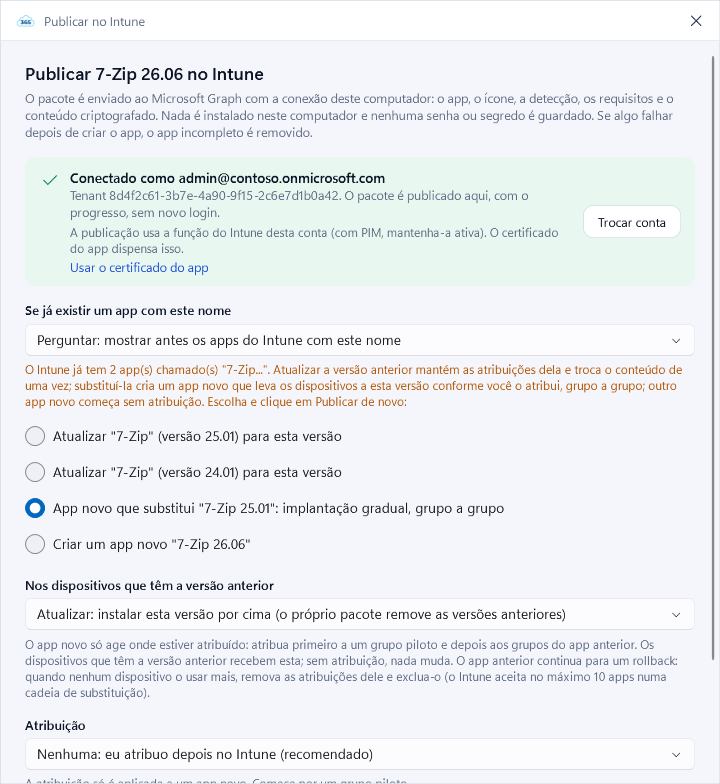

**App novo que substitui** cria a versão nova como um app separado, ligado ao anterior. Ele só age onde você o atribuir: atribua primeiro a um grupo piloto e depois aos grupos do app anterior. Nesses dispositivos a versão anterior é substituída; nos demais nada muda, e o app anterior continua lá para um rollback.

- **Atualizar** (padrão): o Intune instala esta versão por cima da anterior, e o próprio pacote remove as versões anteriores (etapa 5).
- **Desinstalar antes**: o Intune executa antes o comando de desinstalação do app anterior, mesmo onde ele não está atribuído.

Quando nenhum dispositivo usar mais a versão anterior, remova as atribuições dela e exclua-a: o Intune aceita no máximo 10 apps numa cadeia de substituição.

### Acompanhe a instalação

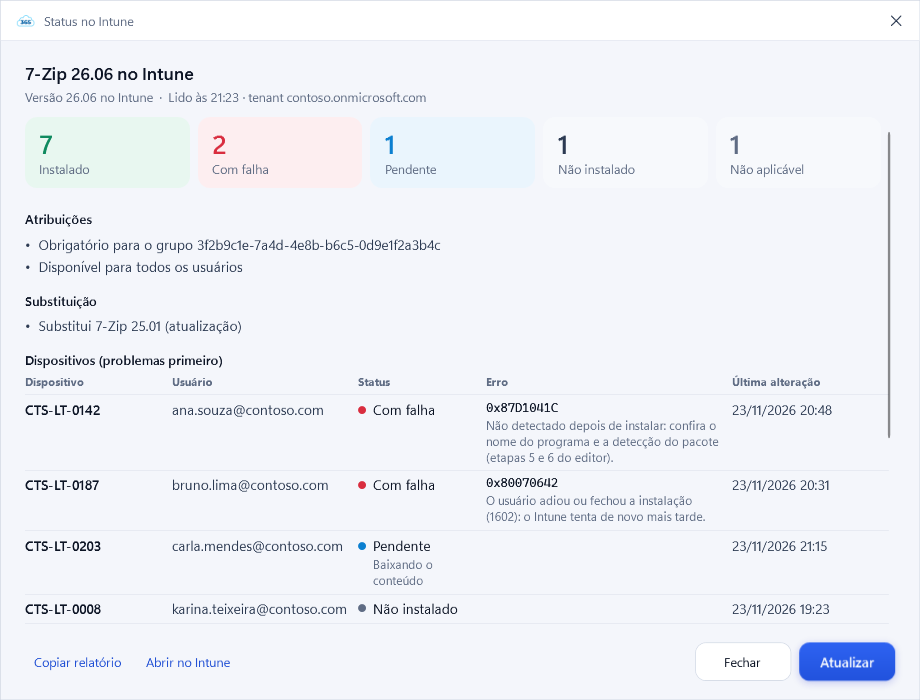

**Status no Intune** (no cartão de resultado, ou **Status** em [Meus pacotes](#9-meus-pacotes)) lê do Intune, sem alterar nada:

- quantos dispositivos têm o app instalado, com falha, pendente, não instalado ou não aplicável;
- as atribuições e a substituição;
- cada dispositivo, os com problema primeiro, com o código do erro e o que ele costuma significar — `0x87D1041C`, por exemplo, é um app não detectado depois de instalar: confira a regra de detecção.

**Atualizar** lê de novo; **Copiar relatório** gera uma tabela para um chamado ou uma planilha. Um dispositivo aparece depois da próxima sincronização com o Intune.

## 8. Deploy em lote

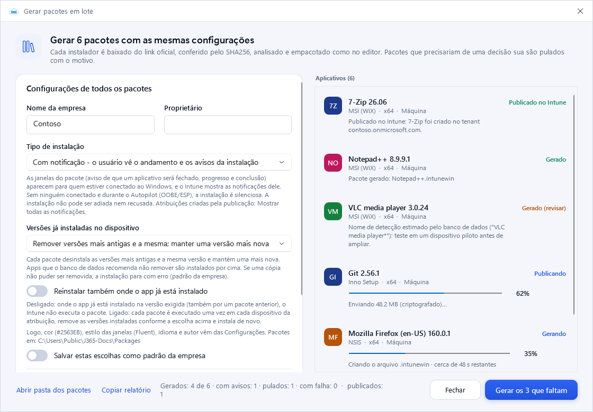

1. No catálogo, marque vários aplicativos (ou **Adicionar ao lote** nos detalhes) e clique em **Gerar em lote**.
2. Defina o que eles têm em comum: empresa, proprietário, o tipo de instalação (silenciosa ou com notificação) e o que cada pacote faz com as **versões já instaladas** — *Remover qualquer versão instalada e instalar esta* reinstala todos os aplicativos do zero; com **Reinstalar também onde o app já está instalado**, isso vale também onde um pacote anterior já o instalou.
3. Se quiser, ligue **Publicar cada pacote no Intune assim que for gerado (deploy)**, com o que fazer com um app do mesmo nome (atualizá-lo, **criar um app novo que substitui o existente**, criar outro ou não publicar) e a atribuição. O tenant e a atribuição são confirmados antes de qualquer coisa começar.
4. **Gerar N pacotes**. Cada instalador é baixado do link oficial, conferido pelo SHA256 e empacotado como no editor; cada aplicativo mostra a etapa em que está, com a porcentagem real (download, geração e envio ao Intune) e o tempo restante. Um `.exe` sem parâmetros silenciosos conhecidos, ou um nome que também corresponde a outros aplicativos, é **pulado com o motivo** — abra-o no editor para terminar manualmente. Uma publicação que falhou pode ser repetida sozinha; **Copiar relatório** gera uma tabela com os resultados.

## 9. Meus pacotes

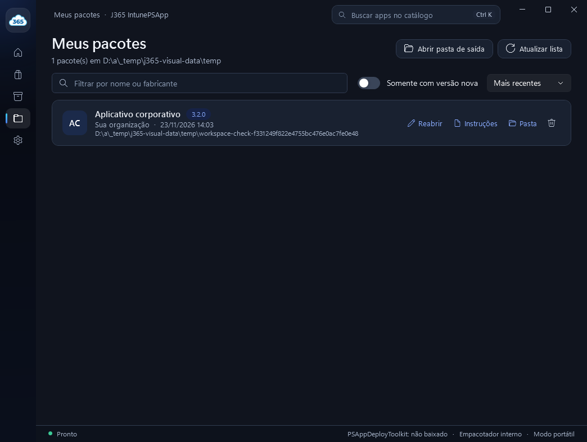

Todos os pacotes da pasta de saída, do mais recente ao mais antigo (ou *Nome A–Z*, *Atualizações primeiro*, e a chave **Somente com versão nova**). **Status** (pacotes publicados a partir deste computador) mostra [como está a instalação](#acompanhe-a-instalação), **Reabrir** carrega o projeto no editor (uma versão nova do aplicativo mantém todas as suas personalizações: só o instalador e a versão mudam), **Instruções** abre as instruções do Intune, **Pasta** abre no Explorer.

## 10. Configurações

| Guia | O que contém |
| --- | --- |
| **Geral** | Idioma da interface, **verificar novas versões** (e **Verificar agora**), instalação para o usuário, atalho na área de trabalho, a pasta dos pacotes e a pasta de dados (com **Logs**). |
| **Aparência** | Claro, escuro ou igual ao Windows. |
| **Empresa** | Nome da empresa, logo, cor de destaque e estilo das janelas dos pacotes novos. |
| **Padrões** | Tipo de instalação (silenciosa ou com notificação), contagem regressiva, bloqueio, verificação de disco, versões anteriores e o que fazer se a remoção falhar, mensagens, arquitetura e idioma preferidos dos instaladores. |
| **Microsoft Intune** | A conexão: conta ou certificado, tenant, **Verificar a assinatura**, **Renovar o certificado**, **Desconectar**. |
| **Componentes** | O banco de dados de aplicativos (**Endereço de atualização**, frequência da verificação, **Baixar novamente**, **Importar arquivo (offline)...**), o PSAppDeployToolkit e o IntuneWinAppUtil. |
| **Sobre** | Versão, assinatura do executável, autor e licenças. |

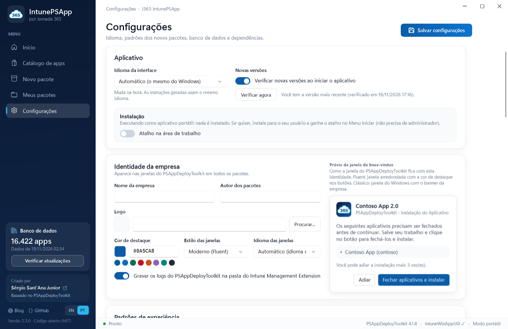

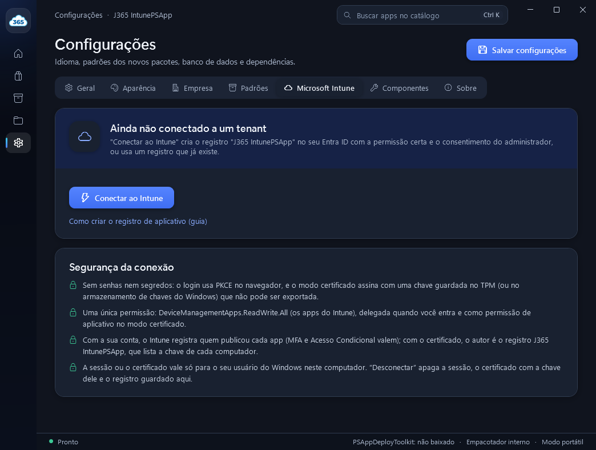

<table><tr><td width="50%"><b>Empresa</b><br><a href="screenshots/pt-BR/company.png">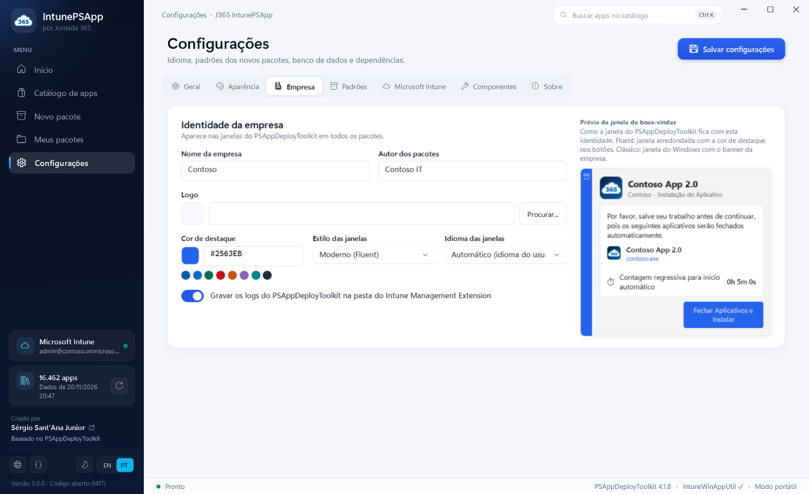 Empresa" width="100%"></a></td><td width="50%"><b>Padrões</b><br><a href="screenshots/pt-BR/defaults.png">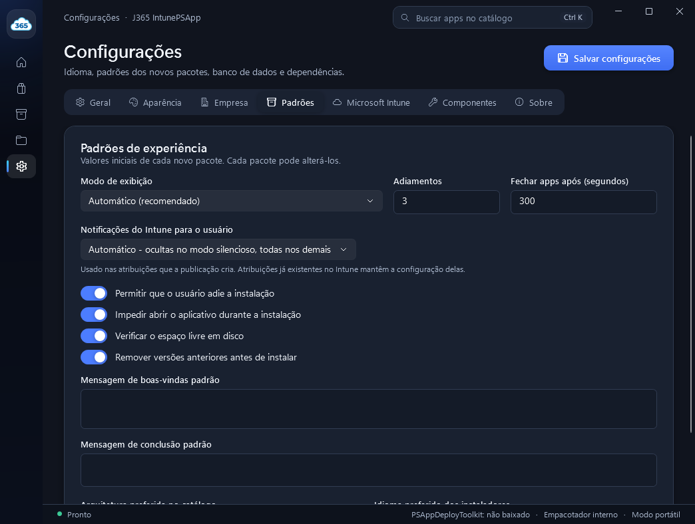 Padrões" width="100%"></a></td></tr><tr><td width="50%"><b>Componentes</b><br><a href="screenshots/pt-BR/components.png">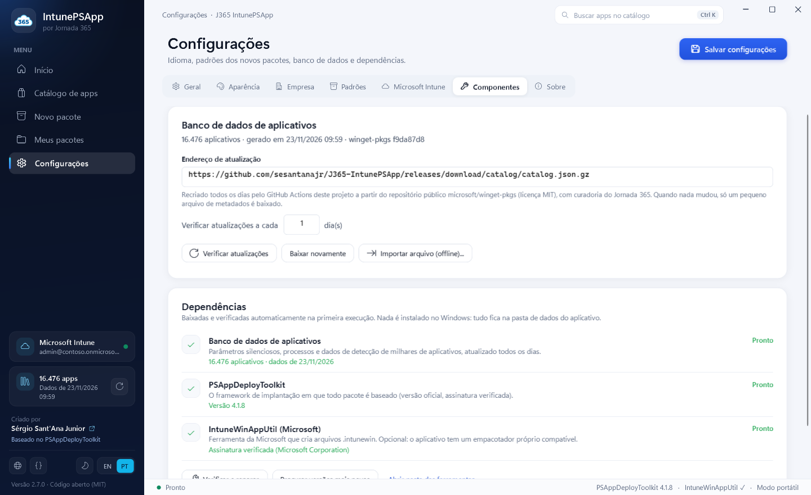 Componentes" width="100%"></a></td><td width="50%"><b>Sobre</b><br><a href="screenshots/pt-BR/about.png">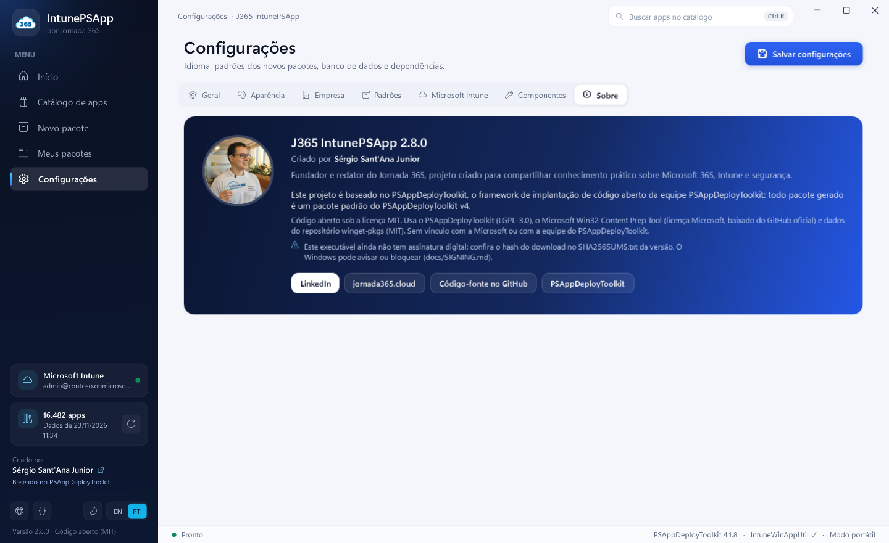 Sobre" width="100%"></a></td></tr></table>

> Sempre que puder, mantenha a pasta de pacotes fora do OneDrive: cada pacote (o instalador e o seu `.intunewin`) seria enviado para a nuvem. O aplicativo avisa isso abaixo do campo.

## 11. Mantenha o aplicativo atualizado

O aplicativo procura uma versão nova ao iniciar (no máximo uma vez por dia, e a cada poucas horas enquanto fica aberto) e mostra um aviso no Início. **Configurações > Geral > Verificar agora** verifica na hora e, se houver versão nova, baixa, confere pelo `SHA256SUMS.txt` da versão e reinicia na versão nova — pacotes, configurações, banco de dados e ferramentas são mantidos.

A verificação lê os arquivos da última versão no github.com, então funciona em redes corporativas onde o limite da API do GitHub (60 consultas por hora, divididas por todos que saem pelo mesmo endereço) se esgota. Cópias até a 2.6.0 só consultavam essa API: se uma continuar dizendo *você tem a versão mais recente*, baixe a versão mais recente uma vez e use **Configurações > Geral > Atualizar a cópia instalada**.

## 12. Linha de comando

```powershell
J365.IntunePSApp.exe --build <project.json|instalador> [--out <pasta>] [--native]
J365.IntunePSApp.exe --batch <id1,id2,...> [--mode Silent|Notify] [--company <nome>] [--out <pasta>]
                     [--publish [--if-exists Update|Supersede|CreateNew|Fail [--supersedence Update|Replace]]
                                [--assign none|available|required] [--assign-to AllUsers|AllDevices|Group] [--group <id>]]
J365.IntunePSApp.exe --sandbox <pasta do pacote>
J365.IntunePSApp.exe --setup | --update-catalog [--force] | --update [--check]
J365.IntunePSApp.exe --install [--desktop-shortcut] [--quiet] | --uninstall [--purge] [--quiet]
J365.IntunePSApp.exe --version | --help
```

O `--batch` aceita IDs do winget e IDs de produto da Microsoft Store. O `--publish` usa a conexão deste computador (o certificado é a escolha natural para execuções agendadas); `--if-exists Supersede` publica cada versão nova como um app novo que substitui o anterior.

## 13. Logs e solução de problemas

| Onde | O quê |
| --- | --- |
| Configurações > Geral > **Logs** (`…\IntunePSApp\logs\app-AAAAMMDD.log`) | Tudo o que o aplicativo fez: downloads, gerações, publicações, verificações de versão, o ambiente na inicialização. São mantidos 14 dias. |
| `<pacote>\build.log` | A geração daquele pacote. |
| No dispositivo: `C:\ProgramData\Microsoft\IntuneManagementExtension\Logs` (ou `C:\Windows\Logs\Software`) | O log do PSAppDeployToolkit da instalação (`<App>_PSAppDeployToolkit_Install.log`), os logs do MSI e o `AppWorkload.log` do Intune. |

| Sintoma | O que fazer |
| --- | --- |
| O Windows bloqueia o executável | SmartScreen: *Mais informações > Executar assim mesmo*. Controle Inteligente de Aplicativos / App Control: veja o [SIGNING.md](SIGNING.md). |
| "Não foi possível verificar novas versões" | Rede ou proxy; a mensagem diz o motivo (e quando um limite da API do GitHub libera). |
| O IntuneWinAppUtil falhou | O empacotador interno gera o mesmo `.intunewin` automaticamente; caminhos muito longos vão direto para ele. Uma pasta de pacotes mais curta permite usar a ferramenta da Microsoft. |
| O Intune diz *não detectado* depois de instalar | Confira o nome do programa das etapas 5 e 6 com **Ver correspondências neste PC** e **Testar neste computador**; a saída da detecção explica uma marca do pacote ausente. |
| O Intune recusa (401/403) | A janela explica: função não ativa (PIM), sem licença ou assinatura do Intune, consentimento ausente. A conexão por certificado dispensa funções de usuário. |
| Testes ou publicação falham com "Constrained Language" | Uma política de App Control restringe o PowerShell; versões assinadas do aplicativo mantêm o PowerShell completo. |

Dúvidas e problemas: [abra uma issue](https://github.com/sesantanajr/J365-IntunePSApp/issues) com o log do aplicativo (remova dados sensíveis antes).

---

<p align="center">J365 IntunePSApp · criado por <a href="https://www.linkedin.com/in/sergiosantanacloud/">Sérgio Sant'Ana Junior</a> · <a href="https://jornada365.cloud">Jornada 365</a> · baseado no <a href="https://psappdeploytoolkit.com">PSAppDeployToolkit</a></p>
